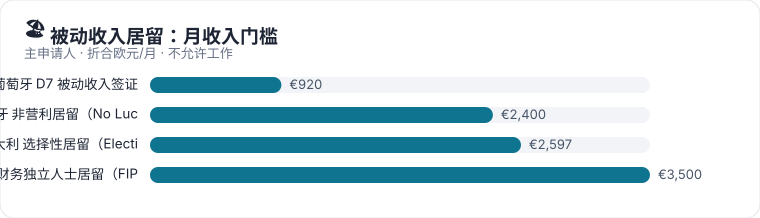
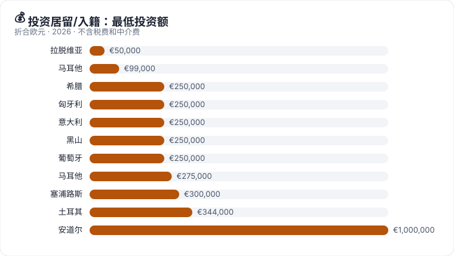
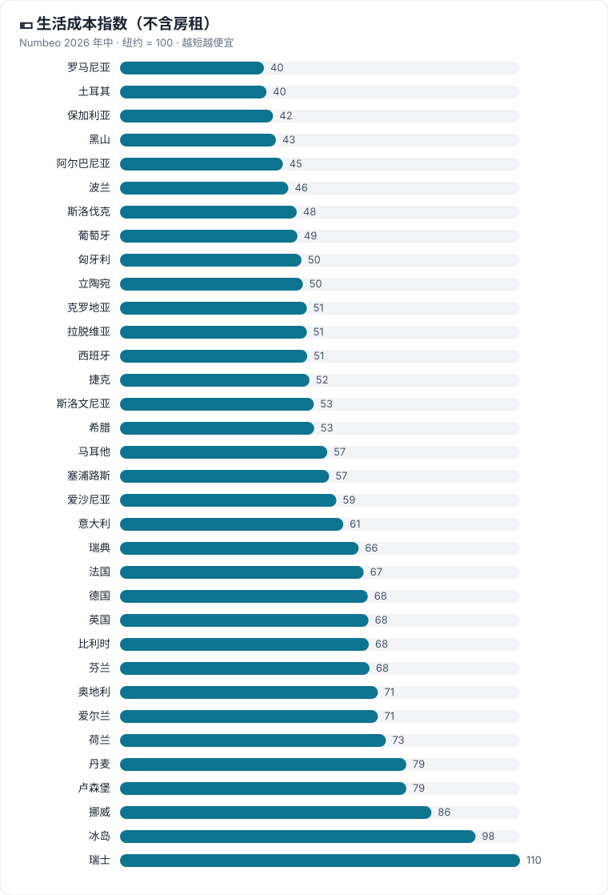
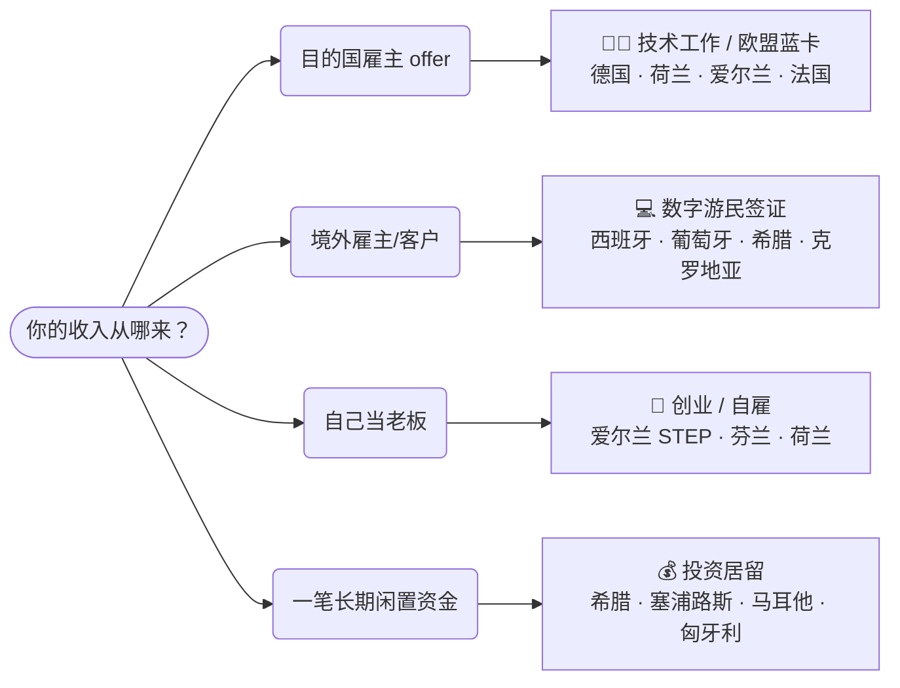

<div align="center">

# RUN · 润

### 一本给中国人看的海外移居手册

数字游民 · 技术移民 · 欧盟蓝卡 · 创业自雇 · 投资居留


[](README.en.md)

**[🧭 我该走哪条路](docs/routes/choose-route.md)** ｜ **[🌏 主要移民地区](docs/global/README.md)** ｜ **[🇪🇺 欧洲 36 国](docs/europe/README.md)** ｜ **[📊 路线对比](docs/europe/README.md#compare)** ｜ **[📑 文件准备](docs/practical/china-documents.md)**

</div>

> [!CAUTION]
> 本手册仅供信息参考，**不构成**移民、法律、税务或投资建议。2025–2026 年大量路线关闭或改规则，网上很多旧攻略已经失效——任何决定前请以各国官方页面为准。详见 [免责声明](DISCLAIMER.md)。

---

## 🚪 你是哪种情况？

<table>
<tr>
<td width="33%" valign="top" align="center">

### 💻
**[数字游民](docs/routes/digital-nomad.md)**

为境外雇主或客户远程工作，想换个国家生活

<sub>15 条欧洲路线 · 月入 €330 起</sub>

</td>
<td width="33%" valign="top" align="center">

### 🧑‍💻
**[技术工作 · 蓝卡](docs/routes/skilled-work.md)**

拿到当地雇主 offer：工作 → 居留 → 永居 → 入籍

<sub>50+ 条路线 · 最快 21 个月永居</sub>

</td>
<td width="33%" valign="top" align="center">

### 🎓
**[留学 → 工作 → 移民](docs/routes/study-to-work.md)**

毕业后 6–36 个月找工作签证，再转工作签

<sub>德国 18 个月 · 芬兰 2 年 · 爱尔兰硕士 2 年</sub>

</td>
</tr>
<tr>
<td width="33%" valign="top" align="center">

### 🚀
**[创业 · 自雇](docs/routes/startup-self-employed.md)**

在当地开公司、做自由职业

<sub>爱沙尼亚、爱尔兰 STEP、荷兰、丹麦…</sub>

</td>
<td width="33%" valign="top" align="center">

### 🏖️
**[被动收入 · 退休](docs/routes/passive-income.md)**

靠养老金、租金、存款生活，不在当地工作

<sub>葡萄牙 D7 €920/月起 · 西班牙 NLV</sub>

</td>
<td width="33%" valign="top" align="center">

### 💰
**[投资居留 · 入籍](docs/routes/investment.md)**

用投资换身份，住得少也能保持

<sub>希腊 · 塞浦路斯 · 马耳他 · 匈牙利</sub>

</td>
</tr>
</table>

---

## 🌏 主要移民地区

<table>
<tr>
<td align="center"><a href="docs/global/usa.md">🇺🇸<br><b>美国</b></a><br><sub>H-1B · NIW · EB-5</sub></td>
<td align="center"><a href="docs/global/canada.md">🇨🇦<br><b>加拿大</b></a><br><sub>Express Entry · 省提名</sub></td>
<td align="center"><a href="docs/global/australia.md">🇦🇺<br><b>澳大利亚</b></a><br><sub>189 · 482 · 858</sub></td>
<td align="center"><a href="docs/global/new-zealand.md">🇳🇿<br><b>新西兰</b></a><br><sub>SMC · 投资移民</sub></td>
<td align="center"><a href="docs/global/japan.md">🇯🇵<br><b>日本</b></a><br><sub>高度人才 · 经管签</sub></td>
<td align="center"><a href="docs/global/south-korea.md">🇰🇷<br><b>韩国</b></a><br><sub>F-1-D · Top-Tier</sub></td>
<td align="center"><a href="docs/global/singapore.md">🇸🇬<br><b>新加坡</b></a><br><sub>EP · ONE Pass</sub></td>
</tr>
<tr>
<td align="center"><a href="docs/global/hong-kong.md">🇭🇰<br><b>香港</b></a><br><sub>高才通 · 优才</sub></td>
<td align="center"><a href="docs/global/philippines.md">🇵🇭<br><b>菲律宾</b></a><br><sub>SRRV 退休 · SIRV</sub></td>
<td align="center"><a href="docs/global/thailand.md">🇹🇭<br><b>泰国</b></a><br><sub>DTV · LTR</sub></td>
<td align="center"><a href="docs/global/malaysia.md">🇲🇾<br><b>马来西亚</b></a><br><sub>DE Rantau · MM2H</sub></td>
<td align="center"><a href="docs/global/uae.md">🇦🇪<br><b>阿联酋</b></a><br><sub>黄金签证</sub></td>
<td align="center"><a href="docs/global/latin-america.md">🌎<br><b>拉美</b></a><br><sub>墨西哥 · 巴拿马…</sub></td>
<td align="center"><a href="docs/europe/united-kingdom.md">🇬🇧<br><b>英国</b></a><br><sub>见欧洲篇</sub></td>
</tr>
</table>

---

## 🇪🇺 欧洲 36 国

> [!NOTE]
> 每个国家页都有 **🏙️ 生活与身份档案**（生活成本、房租、安全、平均工资、个税、护照、永居和入籍年限、双重国籍、中国护照入境方式），以及每条路线的关键数字、流程图和材料清单。横向对比见 [生活与身份对比表](docs/europe/README.md#profiles)。

<sub>💻 数字游民 · 🧑‍💻 技术工作 · 🚀 创业 · 🧾 自雇 · 🏖️ 被动收入 · 💰 投资 · 🛂 入籍 · 🧩 其他</sub>

<!-- AUTO:countries -->
<table>
<tr><td width="25%" valign="top"><a href="docs/europe/albania.md"><b>🇦🇱 阿尔巴尼亚</b></a><br><sub>Albania · 1 条路线 💻</sub><br><sub>数字游民许可门槛极低（月入约 EUR 330），适合低预算试住</sub></td><td width="25%" valign="top"><a href="docs/europe/andorra.md"><b>🇦🇩 安道尔</b></a><br><sub>Andorra · 1 条路线 💰</sub><br><sub>被动居留 2026 起涨到 EUR 100 万投资 + 配额，门槛很高</sub></td><td width="25%" valign="top"><a href="docs/europe/austria.md"><b>🇦🇹 奥地利</b></a><br><sub>Austria · 3 条路线 🧑‍💻 🧾</sub><br><sub>红白红卡积分制 / 蓝卡 EUR 55,678，21 个月转 Plus 卡</sub></td><td width="25%" valign="top"><a href="docs/europe/belgium.md"><b>🇧🇪 比利时</b></a><br><sub>Belgium · 3 条路线 🧑‍💻 🧾</sub><br><sub>工作许可按大区审批，四个大区门槛各不同</sub></td></tr>
<tr><td width="25%" valign="top"><a href="docs/europe/bulgaria.md"><b>🇧🇬 保加利亚</b></a><br><sub>Bulgaria · 3 条路线 🚀 🧑‍💻</sub><br><sub>无数字游民签证；蓝卡 + StartUp Visa 证书，税率 10%</sub></td><td width="25%" valign="top"><a href="docs/europe/croatia.md"><b>🇭🇷 克罗地亚</b></a><br><sub>Croatia · 3 条路线 💻 🧑‍💻</sub><br><sub>数字游民最长 18 个月、境外收入免税，但不能续成长期身份</sub></td><td width="25%" valign="top"><a href="docs/europe/cyprus.md"><b>🇨🇾 塞浦路斯</b></a><br><sub>Cyprus · 4 条路线 💰 💻 🧑‍💻</sub><br><sub>30 万欧投资永居约 2 个月获批；数字游民名额 500</sub></td><td width="25%" valign="top"><a href="docs/europe/czechia.md"><b>🇨🇿 捷克</b></a><br><sub>Czechia · 3 条路线 💻 🧑‍💻</sub><br><sub>员工卡门槛低；数字游民计划不含中国大陆护照</sub></td></tr>
<tr><td width="25%" valign="top"><a href="docs/europe/denmark.md"><b>🇩🇰 丹麦</b></a><br><sub>Denmark · 2 条路线 🚀 🧑‍💻</sub><br><sub>不签蓝卡，走 Pay Limit（DKK 55.2 万/年）等本国路线</sub></td><td width="25%" valign="top"><a href="docs/europe/estonia.md"><b>🇪🇪 爱沙尼亚</b></a><br><sub>Estonia · 4 条路线 💻 🚀 🧑‍💻</sub><br><sub>数字游民是 D 签证非居留；就业许可最长 5 年</sub></td><td width="25%" valign="top"><a href="docs/europe/finland.md"><b>🇫🇮 芬兰</b></a><br><sub>Finland · 3 条路线 🧑‍💻 🧾</sub><br><sub>专家许可与蓝卡同为 EUR 3,937/月，快速通道 2 周</sub></td><td width="25%" valign="top"><a href="docs/europe/france.md"><b>🇫🇷 法国</b></a><br><sub>France · 3 条路线 🧑‍💻 🧾</sub><br><sub>人才护照员工类年薪 EUR 39,582 即可，首卡最长 4 年</sub></td></tr>
<tr><td width="25%" valign="top"><a href="docs/europe/germany.md"><b>🇩🇪 德国</b></a><br><sub>Germany · 4 条路线 🧑‍💻 🧾</sub><br><sub>蓝卡 EUR 50,700（IT 无学历可办），最快 21 个月永居</sub></td><td width="25%" valign="top"><a href="docs/europe/greece.md"><b>🇬🇷 希腊</b></a><br><sub>Greece · 5 条路线 🏖️ 💰 💻 🧑‍💻</sub><br><sub>黄金签证 40/80 万欧买房；数字游民 EUR 3,500/月</sub></td><td width="25%" valign="top"><a href="docs/europe/hungary.md"><b>🇭🇺 匈牙利</b></a><br><sub>Hungary · 4 条路线 💰 💻 🧑‍💻</sub><br><sub>25 万欧基金换 10+10 年居留可工作；白卡不能带家属</sub></td><td width="25%" valign="top"><a href="docs/europe/iceland.md"><b>🇮🇸 冰岛</b></a><br><sub>Iceland · 1 条路线 🧩</sub><br><sub>旧远程工作签证已废止，目前无可用数字游民路线</sub></td></tr>
<tr><td width="25%" valign="top"><a href="docs/europe/ireland.md"><b>🇮🇪 爱尔兰</b></a><br><sub>Ireland · 2 条路线 🚀 🧑‍💻</sub><br><sub>不签蓝卡；Critical Skills EUR 40,904 起，英语国家</sub></td><td width="25%" valign="top"><a href="docs/europe/italy.md"><b>🇮🇹 意大利</b></a><br><sub>Italy · 4 条路线 🏖️ 💰 💻 🧑‍💻</sub><br><sub>数字游民须高技能；投资者签证 25 万欧起（非房产）</sub></td><td width="25%" valign="top"><a href="docs/europe/latvia.md"><b>🇱🇻 拉脱维亚</b></a><br><sub>Latvia · 4 条路线 💰 💻 🧑‍💻</sub><br><sub>2026 新法关闭买房居留；蓝卡门槛 EUR 2,723/月</sub></td><td width="25%" valign="top"><a href="docs/europe/liechtenstein.md"><b>🇱🇮 列支敦士登</b></a><br><sub>Liechtenstein · 1 条路线 🧩</sub><br><sub>配额 + 抽签，第三国国民几乎不可行</sub></td></tr>
<tr><td width="25%" valign="top"><a href="docs/europe/lithuania.md"><b>🇱🇹 立陶宛</b></a><br><sub>Lithuania · 3 条路线 🚀 🧑‍💻</sub><br><sub>2024 起工作必须本国居留；Startup Visa 免资本要求</sub></td><td width="25%" valign="top"><a href="docs/europe/luxembourg.md"><b>🇱🇺 卢森堡</b></a><br><sub>Luxembourg · 2 条路线 🧑‍💻 🧾</sub><br><sub>蓝卡 EUR 65,652 但首卡 4 年；自雇许可 3 年</sub></td><td width="25%" valign="top"><a href="docs/europe/malta.md"><b>🇲🇹 马耳他</b></a><br><sub>Malta · 8 条路线 💰 💻 🛂 🧑‍💻</sub><br><sub>MPRP 永居约 11–47 万欧；数字游民最长 4 年</sub></td><td width="25%" valign="top"><a href="docs/europe/montenegro.md"><b>🇲🇪 黑山</b></a><br><sub>Montenegro · 2 条路线 💰 💻</sub><br><sub>非申根；数字游民 2+2 年最友好；投资入籍已关闭</sub></td></tr>
<tr><td width="25%" valign="top"><a href="docs/europe/netherlands.md"><b>🇳🇱 荷兰</b></a><br><sub>Netherlands · 3 条路线 🧑‍💻 🧾</sub><br><sub>高技术移民 30 岁以下 EUR 4,357/月，需认可雇主</sub></td><td width="25%" valign="top"><a href="docs/europe/norway.md"><b>🇳🇴 挪威</b></a><br><sub>Norway · 1 条路线 🧾</sub><br><sub>技术自雇许可禁止远程工作；3 年可申请永居</sub></td><td width="25%" valign="top"><a href="docs/europe/poland.md"><b>🇵🇱 波兰</b></a><br><sub>Poland · 3 条路线 🧑‍💻 🧾</sub><br><sub>工作许可门槛低；2026-04 起全部 MOS 线上递交</sub></td><td width="25%" valign="top"><a href="docs/europe/portugal.md"><b>🇵🇹 葡萄牙</b></a><br><sub>Portugal · 6 条路线 🏖️ 💰 💻 🧑‍💻</sub><br><sub>数字游民 EUR 3,680/月；黄金签证不能买房；入籍改为 10 年</sub></td></tr>
<tr><td width="25%" valign="top"><a href="docs/europe/romania.md"><b>🇷🇴 罗马尼亚</b></a><br><sub>Romania · 3 条路线 💻 🧑‍💻</sub><br><sub>数字游民门槛最高之一（约 EUR 5,500/月）；蓝卡门槛低</sub></td><td width="25%" valign="top"><a href="docs/europe/slovakia.md"><b>🇸🇰 斯洛伐克</b></a><br><sub>Slovakia · 3 条路线 🧑‍💻 🧾</sub><br><sub>蓝卡门槛全欧最低之一 EUR 1,944/月，首卡 5 年</sub></td><td width="25%" valign="top"><a href="docs/europe/slovenia.md"><b>🇸🇮 斯洛文尼亚</b></a><br><sub>Slovenia · 3 条路线 💻 🧑‍💻</sub><br><sub>数字游民 2025 新开、家属可立即团聚；蓝卡 1 倍平均工资</sub></td><td width="25%" valign="top"><a href="docs/europe/spain.md"><b>🇪🇸 西班牙</b></a><br><sub>Spain · 2 条路线 🏖️ 💻</sub><br><sub>数字游民 EUR 2,442/月起；黄金签证 2025 年已关闭</sub></td></tr>
<tr><td width="25%" valign="top"><a href="docs/europe/sweden.md"><b>🇸🇪 瑞典</b></a><br><sub>Sweden · 3 条路线 🧑‍💻 🧾</sub><br><sub>2026 起工作许可须达中位工资 90%（SEK 34,470/月）</sub></td><td width="25%" valign="top"><a href="docs/europe/switzerland.md"><b>🇨🇭 瑞士</b></a><br><sub>Switzerland · 1 条路线 🧾</sub><br><sub>第三国国民配额 + 优先本地，基本只适合高端人才</sub></td><td width="25%" valign="top"><a href="docs/europe/turkiye.md"><b>🇹🇷 土耳其</b></a><br><sub>Türkiye · 1 条路线 🛂</sub><br><sub>USD 40 万买房可申请入籍（非欧盟护照）</sub></td><td width="25%" valign="top"><a href="docs/europe/united-kingdom.md"><b>🇬🇧 英国</b></a><br><sub>United Kingdom · 3 条路线 🧑‍💻</sub><br><sub>投资移民已关闭；永居拟从 5 年改为 10 年</sub></td></tr>
</table>
<!-- /AUTO -->

---

## 📰 2025–2026 必须知道的变化

<!-- AUTO:changes -->
| 时间 | 国家 | 类型 | 变化 |
|---|---|:-:|---|
| 2025-04-03 | 🇪🇸 [西班牙](docs/europe/spain.md) | ⛔ 关闭 | 黄金签证全部投资类别停止受理新申请 |
| 2025-07 | 🇲🇹 [马耳他](docs/europe/malta.md) | ⛔ 关闭 | 投资入籍（护照项目）在欧盟法院判决后被废止，只剩功绩入籍 |
| 2025-10-16 | 🇯🇵 [日本](docs/global/japan.md) | 🔺 收紧 | 经营管理签证资本金 500 万 → 3,000 万日元，并须雇员和日语 |
| 2025-11-21 | 🇸🇮 [斯洛文尼亚](docs/europe/slovenia.md) | 🆕 新开 | 新开数字游民许可；蓝卡门槛降至平均工资 1 倍 |
| 2026-01-01 | 🇧🇬 [保加利亚](docs/europe/bulgaria.md) | 🔄 变化 | 改用欧元（2025 年已完整加入申根） |
| 2026-01-08 | 🇫🇮 [芬兰](docs/europe/finland.md) | 🔄 变化 | 永居新规：年收入 ≥ EUR 40,000 可 4 年申请 |
| 2026 | 🇵🇹 [葡萄牙](docs/europe/portugal.md) | 🔺 收紧 | 国籍法改革：入籍从 5 年改为一般 10 年 |
| 2026 | 🇦🇩 [安道尔](docs/europe/andorra.md) | 🔺 收紧 | 被动居留投资门槛涨到 EUR 100 万 + 年度配额 |
| 2026 | 🇸🇪 [瑞典](docs/europe/sweden.md) | 🔺 收紧 | 工作许可须达中位工资 90%（SEK 34,470/月） |
| 2026 | 🇷🇴 [罗马尼亚](docs/europe/romania.md) | 🔄 变化 | 工作移民改为 WorkinRomania 平台 + D/AM 签证 |
| 2026-04-27 | 🇵🇱 [波兰](docs/europe/poland.md) | 🔄 变化 | 居留申请全部改为 MOS 线上递交 |
| 2026-05 | 🇮🇸 [冰岛](docs/europe/iceland.md) | ⛔ 关闭 | 远程工作长期签证废止 |
| 2026-06-30 | 🇨🇦 [加拿大](docs/global/canada.md) | ⛔ 关闭 | 联邦创业签证（SUV）完全暂停 |
| 2026-06-30 | 🇰🇷 [韩国](docs/global/south-korea.md) | 🆕 新开 | F-1-D 数字游民签证转为正式签证，最长 3 年 |
| 2026-09-15 | 🇱🇻 [拉脱维亚](docs/europe/latvia.md) | ⛔ 关闭 | 新《移民法》关闭买房居留和银行次级债居留 |
| 2026-09-30 | 🇺🇸 [美国](docs/global/usa.md) | 🔄 变化 | 法院阻止执行 H-1B 10 万美元附加费；抽签改为按工资加权 |
| 咨询中 | 🇬🇧 [英国](docs/europe/united-kingdom.md) | 🔺 收紧 | 永居拟从 5 年改为 10 年（earned settlement） |
<!-- /AUTO -->

---

## 📈 一图看门槛

<p align="center"></p>
<p align="center"></p>
<p align="center"></p>
<p align="center"></p>
<p align="center"></p>

<table>
<tr>
<td width="33%" valign="top">

**⚡ 最快拿永居**
- 🇨🇾 塞浦路斯投资永居 — 直接，约 2 个月
- 🇲🇹 马耳他 MPRP — 直接
- 🇩🇪 德国蓝卡 + B1 德语 — 21 个月
- 🇦🇹 奥地利红白红卡 Plus — 21 个月
- 🇯🇵 日本高度人才 80 分 — 1 年

</td>
<td width="33%" valign="top">

**💸 门槛最低**
- 🇦🇱 阿尔巴尼亚数字游民 — 月入约 €330
- 🇪🇸 西班牙数字游民 — €2,442/月
- 🇸🇰 斯洛伐克蓝卡 — €1,944/月
- 🇵🇱 波兰普通工作许可 — 最低工资即可
- 🇨🇿 捷克员工卡 — 最低工资即可

</td>
<td width="33%" valign="top">

**🚫 中国大陆护照不适用**
- 🇨🇿 捷克数字游民计划
- 🇯🇵 日本数字游民签证
- 🇱🇻 拉脱维亚远程工作签证（雇主须 OECD）
- 🇵🇦 巴拿马友好国家签证
- 🇺🇸 E-2 条约投资者

</td>
</tr>
</table>

---

## 📚 实用指南

| | 指南 | 内容 |
|:-:|---|---|
| 🧭 | [我该走哪条路？](docs/routes/choose-route.md) | 四步判断：收入来源 → 目标 → 护照限制 → 自检清单 |
| 🎓 | [留学 → 工作 → 移民](docs/routes/study-to-work.md) | 欧洲及全球毕业后找工作签证期限对比 |
| 🏙️ | [生活与身份对比表](docs/europe/README.md#profiles) | 36 国生活成本、工资、个税、护照、入籍年限、双重国籍 |
| 📑 | [中国申请人文件准备](docs/practical/china-documents.md) | 海牙认证、无犯罪、学历认证、姓名拼音、资金合规 |
| 🧾 | [税务居民入门](docs/practical/tax-residency.md) | 居留 ≠ 税务居民；183 天规则；各国特殊税制 |
| ✅ | [落地前 90 天清单](docs/practical/landing-checklist.md) | 住址登记、居留卡、税号、银行、续签时间点 |
| 🔗 | [资源导航](docs/resources.md) | 官方门户、类似网站、其他润学项目 |
| 📊 | [programmes.csv](data/programmes.csv) | 99 条路线的结构化数据，可直接用 Excel 打开 |

---

## 🧭 一张图选路线



<sub>更细的判断见 [我该走哪条路？](docs/routes/choose-route.md)</sub>

---

<details>
<summary><b>📁 项目结构 & 如何参与</b></summary>

```text
RUN/
├── README.md                 ← 你在这里
├── docs/
│   ├── europe/               欧洲 36 国，每国一页（自动生成）
│   ├── routes/               按路线：决策指南、数字游民、技术工作、创业、投资
│   ├── global/               美加澳新、日韩新港台、泰马、阿联酋、拉美
│   ├── practical/            文件准备、税务居民、落地清单
│   └── resources.md
├── data/                     programmes.csv/json、changes.json、指南索引
├── src/
│   ├── details/<国家>.json    每条路线的关键数字、流程、材料、注意事项
│   └── notes/<国家>.md        每个国家的深度解读
├── assets/charts/            自动生成的 SVG 图表
└── scripts/build_docs.py     由 data + src 生成 docs/europe、图表和本页的自动区块
```

修改国家内容请编辑 `src/`，然后运行：

```bash
python3 scripts/build_docs.py
```

发现过时信息欢迎提 Issue / PR，请附官方来源链接。详见 [CONTRIBUTING.md](CONTRIBUTING.md)。

</details>

<details>
<summary><b>📚 数据来源与致谢</b></summary>

- **欧洲路线**：99 条来自 [LetsMigrate.org](https://letsmigrate.org/zh-hans/countries/) 的公开项目记录和指南（各附官方来源），由本项目改写并补充细节；另有 11 条 **RUN 补充路线**（西班牙非营利居留、葡萄牙 D7、德国机会卡和技术工人签证、希腊 FIP、意大利选择性居留、马耳他 GRP、爱沙尼亚创业签证、英国技术工作 / 全球人才 / HPI），来源逐条列在对应国家页。
- **生活与身份档案**：[Numbeo](https://www.numbeo.com/cost-of-living/rankings_by_country.jsp)（生活成本、房租、安全，2026 年中）、[Eurostat 平均工资](https://www.connexion-emploi.com/en/a/average-salary-in-europe-country-ranking)、[Tax Foundation](https://taxfoundation.org/data/all/eu/top-personal-income-tax-rates-europe/)（个税 2026）、[Henley Passport Index](https://statbase.org/datasets/indexes-and-ratings/henley-passport-index/)（2026）、各国移民局（永居、入籍、双重国籍）。
- **留学转移民**：瑞典移民局、Study in Denmark、Migri 等官方页面及院校、机构的公开整理。
- **主要移民地区（欧洲以外）**依据 2026-10 对各国政府网站及律所、机构公开资料的检索整理，核查深度低于欧洲篇。
- 参考了中文社区项目 [run](https://github.com/The-Run-Philosophy-Organization/run)、[awesome-run](https://github.com/Knowckx/awesome-run)、[How-to-run](https://lidangzzz.github.io/How-to-run/) 的组织思路。
- 文档内容采用 [CC BY-SA 4.0](LICENSE)，脚本采用 [MIT](LICENSE-CODE)。

</details>
