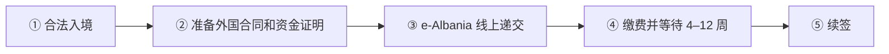

# 🇦🇱 阿尔巴尼亚 · Albania

    

**数字游民许可门槛极低（月入约 EUR 330），适合低预算试住**

[💻 数字移动工作者统一许可](#albania-digital-mobile-worker-unique-permit) · [📖 深度解读](#deep) · [🔗 延伸阅读](#more)

> [!TIP]
> **一句话判断**：**非欧盟、非申根**，入盟候选国，生活成本欧洲最低一档。官方的**数字移动工作者统一许可**（俗称数字游民签证）资金门槛**极低**：每人月收入 ALL 32,000（约 EUR 330）或存款 ALL 300,000（约 EUR 3,100）。适合预算有限、想在欧洲边上住一年试试的远程工作者。

## 🏙️ 生活与身份档案

<table>
<tr><td width="33%" valign="top">💶 生活成本指数（纽约=100） <b>44.7 ●●●●○</b></td><td width="33%" valign="top">🏠 房租指数（纽约=100） <b>11.9 ●●●●●</b></td><td width="33%" valign="top">🛡️ 安全指数 <b>55.7 ●●○○○</b></td></tr>
<tr><td width="33%" valign="top">💼 平均年薪（总额） <b>—</b></td><td width="33%" valign="top">🧾 最高个税税率 <b>23%</b></td><td width="33%" valign="top">🛂 护照免签目的地 <b>121 个（中国 81）</b></td></tr>
<tr><td width="33%" valign="top">🏠 永居年限 <b>5 年</b></td><td width="33%" valign="top">🎖️ 入籍年限 <b>5 年</b></td><td width="33%" valign="top">🔁 双重国籍 <b>✅ 可保留原国籍</b></td></tr>
<tr><td width="33%" valign="top">🗣️ 语言要求 <b>阿尔巴尼亚语</b></td><td width="33%" valign="top">✈️ 中国护照入境 <b>旺季常有免签（以年度通知为准）；持有效申根多次签可入境</b></td><td width="33%" valign="top"></td></tr>
</table>

● 越多越好（成本/房租越低、安全越高）。数据：Numbeo 2026 年中、Eurostat、Tax Foundation 2026、Henley 2026；永居/入籍为常见规则，以官方为准。中国不承认双重国籍。[数据说明](README.md#profiles)

## 📊 路线速查

| 路线 | 类型 | 门槛信号 | 家属 | 永居 | 状态 |
|---|---|---|:-:|:-:|:-:|
| [阿尔巴尼亚数字移动工作者统一许可](#albania-digital-mobile-worker-unique-permit) | 💻 数字游民 | ALL 32,000/月 | ✅ 可带 | ✅ 可能 | 🟢 开放 |

门槛为主申请人的最低信号值，多与当地工资挂钩、每年调整，递交前以官方为准。

---

## 💻 阿尔巴尼亚数字移动工作者统一许可

   

> **欧洲门槛最低的数字游民许可：月入约 €330 或存款约 €3,100 即可。**

<table>
<tr><td width="33%" valign="top">收入 <b>每人 ALL 32,000/月（≈ €330）</b></td><td width="33%" valign="top">或存款 <b>每人 ALL 300,000（≈ €3,100）</b></td><td width="33%" valign="top">递交 <b>e-Albania 服务 15146</b></td></tr>
<tr><td width="33%" valign="top">审理 <b>4–12 周</b></td><td width="33%" valign="top">费用 <b>首次 ALL 4,500，续签 ALL 2,250</b></td><td width="33%" valign="top">期限 <b>首次最长 1 年，可续</b></td></tr>
<tr><td width="33%" valign="top">申根 <b>非申根</b></td><td width="33%" valign="top"></td><td width="33%" valign="top"></td></tr>
</table>

<table><tr>
<td width="50%" valign="top">✅ <b>适合</b><ul><li>预算有限、想在欧洲边上试住的远程工作者</li></ul></td>
<td width="50%" valign="top">❌ <b>不适合</b><ul><li>需要申根居留</li></ul></td>
</tr></table>

### 🗺️ 申请流程

1. **合法入境** — 免签或 D 类签证
2. **准备外国合同和资金证明**
3. **e-Albania 线上递交**
4. **缴费并等待 4–12 周**
5. **续签**

### 📋 材料清单

- [ ] 外国雇佣/服务合同
- [ ] 收入或存款证明
- [ ] ≥1 年健康保险
- [ ] 无犯罪证明（翻译 + 认证）
- [ ] 照片 47×36 mm

> [!WARNING]
> **注意**
> - 第三方网站门槛说法不一，以内政部为准
> - 住满 183 天成为税务居民

🔗 官方来源（5）

- [Ministry of Interior residence and unique permit procedure](https://mb.gov.al/en/procedura-dhe-dokumentacioni-per-pajisjen-me-leje-qendrimi-dhe-leje-unike-residence-unique-permit-al-en/)
- [Ministry for Europe and Foreign Affairs visa regime](https://punetejashtme.gov.al/en/regjimi-i-vizave-per-te-huajt/)
- [e-Visa Albania application portal](https://e-visa.al/apply)
- [General Directorate of Taxes individual taxpayers](https://tatime.gov.al/individ/?artikull=rezident)
- [Ministry of Interior citizenship by naturalisation](https://mb.gov.al/azili-shtetesia/)

数据核查：2026-10-25 · [LetsMigrate 原始记录](https://letsmigrate.org/zh-hans/programmes/albania-digital-mobile-worker-unique-permit-zh/) · [↑ 回到顶部](#top)

---

## 📖 深度解读

### 路线要点

### 数字移动工作者统一许可（Law 79/2021 第 68 条）
- **适用**：持有外国雇主的雇佣合同或外国客户的服务合同，远程工作。
- **资金**：每人月收入 ≥ **ALL 32,000**，或每人存款 ≥ **ALL 300,000**（覆盖 1 个日历年）。
  > 第三方网站对门槛的说法不一（有的写约 EUR 817/月），以内政部和 e-Albania 当前页面为准。
- **其他材料**：≥1 年有效的健康保险、原籍国无犯罪证明（翻译 + 认证）、6 个月内照片（47×36 mm）、合法停留证明。
- **入境**：部分国籍免签；需签证者，>90 天停留且要办居留的一般用 D 类签证。首次申请时须在阿尔巴尼亚**合法停留**。
- **递交**：线上 e-Albania **服务 15146**。
- **审理**：4–12 周。
- **费用**：首次 ALL 4,500，续签 ALL 2,250。
- **期限**：首次最长 1 年，可续签。美国、欧盟、科索沃公民首次可获 5 年。
- **家属**：担保人持有 ≥1 年可续居留许可、有稳定资源，可为家属申请家庭团聚。
- 官方标注"可能通向永居"，需持续续签累积合法居留。

### 税务提醒
- 一个税务年度内在阿 ≥183 天（出入境当天都算），或有永久住所、生活重心 → 税务居民，全球收入纳税。
- 停留 <183 天、雇主非阿尔巴尼亚居民、报酬不由雇主在阿常设机构支付——**三条同时满足**，工资收入才可能只在居住国纳税。
- 年收入 > ALL 1,200,000 等情形需年度申报，截止次年 3 月 31 日。

---

## 🔗 延伸阅读

LetsMigrate 中文指南原文（3 篇）

- [阿尔巴尼亚数字移动工作者统一许可指南](https://letsmigrate.org/zh-hans/articles/albania-digital-mobile-worker-unique-permit-guide-zh/)
- [阿尔巴尼亚数字移动工作者税务、家庭与实务设置](https://letsmigrate.org/zh-hans/articles/albania-digital-mobile-worker-unique-permit-tax-family-setup-zh/)
- [阿尔巴尼亚数字移动工作者许可时间线与文件](https://letsmigrate.org/zh-hans/articles/albania-digital-mobile-worker-unique-permit-timeline-documents-zh/)

[← 🇬🇧 英国](united-kingdom.md) ｜ [🇪🇺 全部国家](README.md) ｜ [🏠 首页](../../README.md) ｜ [🇦🇩 安道尔 →](andorra.md)

本页根据 [LetsMigrate.org](https://letsmigrate.org/zh-hans/countries/albania-zh/) 公开资料及官方来源整理改写，仅供信息参考，不构成移民、法律、税务或投资建议。
