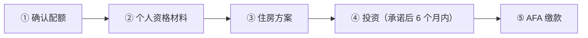

# 🇦🇩 安道尔 · Andorra

    

**被动居留 2026 起涨到 EUR 100 万投资 + 配额，门槛很高**

[💰 被动居留](#andorra-passive-residence) · [📖 深度解读](#deep) · [🔗 延伸阅读](#more)

> [!TIP]
> **一句话判断**：**非欧盟、非申根**的欧洲微型国家，夹在法国和西班牙之间，以低税著称。**2026 年新法（Law 2/2026）后，被动居留门槛涨到 EUR 100 万投资**，并实行年度配额，**低资本路线已基本不可行**。

## 🏙️ 生活与身份档案

<table>
<tr><td width="33%" valign="top">💶 生活成本指数（纽约=100） <b>—</b></td><td width="33%" valign="top">🏠 房租指数（纽约=100） <b>—</b></td><td width="33%" valign="top">🛡️ 安全指数 <b>86.5 ●●●●●</b></td></tr>
<tr><td width="33%" valign="top">💼 平均年薪（总额） <b>—</b></td><td width="33%" valign="top">🧾 最高个税税率 <b>10%</b></td><td width="33%" valign="top">🛂 护照免签目的地 <b>171 个（中国 81）</b></td></tr>
<tr><td width="33%" valign="top">🏠 永居年限 <b>约 10–20 年</b></td><td width="33%" valign="top">🎖️ 入籍年限 <b>20 年</b></td><td width="33%" valign="top">🔁 双重国籍 <b>❌ 一般须放弃</b></td></tr>
<tr><td width="33%" valign="top">🗣️ 语言要求 <b>加泰罗尼亚语</b></td><td width="33%" valign="top">✈️ 中国护照入境 <b>经申根国入境，需申根签证</b></td><td width="33%" valign="top"></td></tr>
</table>

● 越多越好（成本/房租越低、安全越高）。数据：Numbeo 2026 年中、Eurostat、Tax Foundation 2026、Henley 2026；永居/入籍为常见规则，以官方为准。中国不承认双重国籍。[数据说明](README.md#profiles)

## 📊 路线速查

| 路线 | 类型 | 门槛信号 | 家属 | 永居 | 状态 |
|---|---|---|:-:|:-:|:-:|
| [安道尔被动居留](#andorra-passive-residence) | 💰 投资居留 | 投资 ≥ 1,000,000 | ✅ 可带 | ✅ 可能 | 🟢 开放 |

门槛为主申请人的最低信号值，多与当地工资挂钩、每年调整，递交前以官方为准。

---

## 💰 安道尔被动居留

   

> **不工作的被动居留，2026 起需投资 100 万欧 + 缴款 5 万欧，且有配额。**

<table>
<tr><td width="33%" valign="top">投资 <b>EUR 1,000,000 安道尔资产（住房基金 40 万）</b></td><td width="33%" valign="top">AFA 缴款 <b>EUR 50,000 + 每位家属 12,000，不退</b></td><td width="33%" valign="top">配额 <b>2026 年被动居留 163 个</b></td></tr>
<tr><td width="33%" valign="top">居住 <b>每年 ≥90 天</b></td><td width="33%" valign="top">期限 <b>2 + 2 + 3 + 10 年</b></td><td width="33%" valign="top">房产 <b>单套须 > EUR 800,000</b></td></tr>
</table>

<table><tr>
<td width="50%" valign="top">✅ <b>适合</b><ul><li>高净值、想低税生活的家庭</li></ul></td>
<td width="50%" valign="top">❌ <b>不适合</b><ul><li>预算低于 100 万欧</li></ul></td>
</tr></table>

### 🗺️ 申请流程

1. **确认配额**
2. **个人资格材料**
3. **住房方案**
4. **投资（承诺后 6 个月内）**
5. **AFA 缴款**

### 📋 材料清单

- [ ] 护照、户籍、无犯罪
- [ ] 资金来源
- [ ] 投资证明
- [ ] 住房证明
- [ ] 医保

> [!WARNING]
> **注意**
> - 不能在安道尔工作
> - 入籍需长期居住并可能放弃原国籍

🔗 官方来源（3）

- [Andorra Government residence without work initial authorization](https://www.govern.ad/ca/tematiques/immigracio/residencia/residencia-sense-treball-autoritzacio-inicial)
- [Andorra Law 2/2026 sustainable growth measures](https://portaljuridicandorra.ad/L2026002)
- [Andorra Government 2026 immigration quota and passive residence update](https://www.govern.ad/ca/w/el-govern-acorda-reduir-les-quotes-d-immigracio-per-afavorir-el-creixement-sostenible-i-controlat-de-la-poblacio)

数据核查：2026-10-25 · [LetsMigrate 原始记录](https://letsmigrate.org/zh-hans/programmes/andorra-passive-residence-zh/) · [↑ 回到顶部](#top)

---

## 📖 深度解读

### 路线要点

### 被动居留（无营利活动居留）
| 项目 | 2026 规则 |
|---|---|
| 投资 | 在安道尔资产中永久有效投资 **EUR 1,000,000**；投住房基金（Housing Fund）可降至 EUR 400,000 |
| 可投资产 | 安道尔房产（每套须 > EUR 800,000）、安道尔公司股权、安道尔实体发行的债务/金融工具、本地基金、公债、本地寿险、存入金融管理局（AFA）的无息存款 |
| AFA 缴款 | 主申请人 **EUR 50,000** + 每位家属 EUR 12,000，获批后不退 |
| 配额（2026） | 无工作居留共 200 个，其中被动居留 163 个 |
| 居住要求 | 每个日历年在安道尔 **≥90 天** |
| 有效期 | 首次 2 年 → 续 2 年 → 续 3 年 → 之后每次 10 年 |
| 投资时限 | 承诺后 6 个月内完成（不可抗力可再延 6 个月） |

- 不能在安道尔从事营利工作。
- **申请顺序**：先确认配额 → 个人资格（护照、户籍、居住史、无犯罪）→ 住房方案 → 资金来源和银行合规 → 投资计划 → AFA 缴款 → 保险和家属材料。
- **入籍**是独立的长期问题，需长期居住、融入、语言（加泰罗尼亚语），并可能需放弃原国籍；不要把被动居留当成护照捷径。
- 低税吸引力需单独做税务居民规划。

---

## 🔗 延伸阅读

LetsMigrate 中文指南原文（3 篇）

- [安道尔被动居留指南](https://letsmigrate.org/zh-hans/articles/andorra-passive-residence-guide-zh/)
- [安道尔被动居留投资与文件](https://letsmigrate.org/zh-hans/articles/andorra-passive-residence-investment-documents-zh/)
- [安道尔被动居留税务、家庭与国籍规划](https://letsmigrate.org/zh-hans/articles/andorra-passive-residence-tax-family-citizenship-zh/)

[← 🇦🇱 阿尔巴尼亚](albania.md) ｜ [🇪🇺 全部国家](README.md) ｜ [🏠 首页](../../README.md) ｜ [🇦🇹 奥地利 →](austria.md)

本页根据 [LetsMigrate.org](https://letsmigrate.org/zh-hans/countries/andorra-zh/) 公开资料及官方来源整理改写，仅供信息参考，不构成移民、法律、税务或投资建议。
