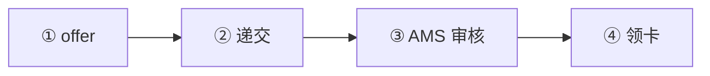
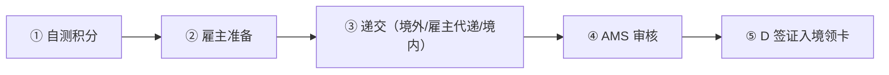
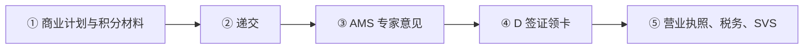

# 🇦🇹 奥地利 · Austria

    

**红白红卡积分制 / 蓝卡 EUR 55,678，21 个月转 Plus 卡**

[🧑‍💻 欧盟蓝卡](#austria-eu-blue-card) · [🧑‍💻 红白红卡](#austria-red-white-red-card) · [🧾 自雇关键工作者 / 初创创始人签证替代路线](#austria-self-employed-startup-founder-visa) · [📖 深度解读](#deep) · [🔗 延伸阅读](#more)

> [!TIP]
> **一句话判断**：欧盟 + 申根 + 欧元区。**没有数字游民签证**。技术移民看 **红白红卡（Rot-Weiß-Rot Karte，积分制）vs 欧盟蓝卡**（2026 门槛 EUR 55,678/年）。两者满 21 个月都能转 **红白红卡 Plus**（可自由就业）。创业看**自雇关键工作者**（如转入 ≥10 万欧资本）和**初创创始人**（≥3 万欧 + 50 分）。奥地利入籍一般要 10 年且原则上要放弃原国籍。

## 🏙️ 生活与身份档案

<table>
<tr><td width="33%" valign="top">💶 生活成本指数（纽约=100） <b>70.8 ●●●○○</b></td><td width="33%" valign="top">🏠 房租指数（纽约=100） <b>23.8 ●●●●○</b></td><td width="33%" valign="top">🛡️ 安全指数 <b>70.8 ●●●●○</b></td></tr>
<tr><td width="33%" valign="top">💼 平均年薪（总额） <b>EUR 58,600</b></td><td width="33%" valign="top">🧾 最高个税税率 <b>55%</b></td><td width="33%" valign="top">🛂 护照免签目的地 <b>185 个（中国 81）</b></td></tr>
<tr><td width="33%" valign="top">🏠 永居年限 <b>5 年</b></td><td width="33%" valign="top">🎖️ 入籍年限 <b>10 年（部分 6 年）</b></td><td width="33%" valign="top">🔁 双重国籍 <b>❌ 一般须放弃</b></td></tr>
<tr><td width="33%" valign="top">🗣️ 语言要求 <b>德语 B1</b></td><td width="33%" valign="top">✈️ 中国护照入境 <b>申根签证</b></td><td width="33%" valign="top"></td></tr>
</table>

● 越多越好（成本/房租越低、安全越高）。数据：Numbeo 2026 年中、Eurostat、Tax Foundation 2026、Henley 2026；永居/入籍为常见规则，以官方为准。中国不承认双重国籍。[数据说明](README.md#profiles)

## 📊 路线速查

| 路线 | 类型 | 门槛信号 | 家属 | 永居 | 状态 |
|---|---|---|:-:|:-:|:-:|
| [奥地利欧盟蓝卡](#austria-eu-blue-card) | 🧑‍💻 技术工作 | EUR 55,678/年 | ✅ 可带 | ✅ 可能 | 🟢 开放 |
| [奥地利红白红卡](#austria-red-white-red-card) | 🧑‍💻 技术工作 | — | ✅ 可带 | ✅ 可能 | 🟢 开放 |
| [奥地利自雇关键工作者 / 初创创始人签证替代路线](#austria-self-employed-startup-founder-visa) | 🧾 自雇 | — | ✅ 可带 | ✅ 可能 | 🟢 开放 |

门槛为主申请人的最低信号值，多与当地工资挂钩、每年调整，递交前以官方为准。

---

## 🧑‍💻 奥地利欧盟蓝卡

   

> **奥地利蓝卡：年薪 55,678 欧、无积分，21 个月后也可转 Plus 卡。**

<table>
<tr><td width="33%" valign="top">年薪 <b>≥ EUR 55,678（含特别支付）</b></td><td width="33%" valign="top">学历 <b>三年制高等教育或 ICT 经验，岗位对口</b></td><td width="33%" valign="top">首期 <b>24 个月</b></td></tr>
<tr><td width="33%" valign="top">费用 <b>EUR 218</b></td><td width="33%" valign="top">换雇主 <b>需新蓝卡</b></td><td width="33%" valign="top"></td></tr>
</table>

<table><tr>
<td width="50%" valign="top">✅ <b>适合</b><ul><li>高薪对口岗位</li></ul></td>
<td width="50%" valign="top">❌ <b>不适合</b><ul><li>学历与岗位不对口</li></ul></td>
</tr></table>

### 🗺️ 申请流程

1. **offer**
2. **递交**
3. **AMS 审核**
4. **领卡**

### 📋 材料清单

- [ ] 劳动合同
- [ ] 学历证明
- [ ] 护照

🔗 官方来源（3）

- [Migration.gv.at EU Blue Card](https://www.migration.gv.at/en/types-of-immigration/permanent-immigration/eubluecard/)
- [Migration.gv.at Red-White-Red Card plus](https://www.migration.gv.at/en/types-of-immigration/permanent-immigration/red-white-red-card-plus/)
- [European Commission EU Blue Card](https://home-affairs.ec.europa.eu/policies/migration-and-asylum/eu-immigration-portal/eu-blue-card_en)

数据核查：2026-10-25 · [LetsMigrate 原始记录](https://letsmigrate.org/zh-hans/programmes/austria-eu-blue-card-zh/) · [↑ 回到顶部](#top)

---

## 🧑‍💻 奥地利红白红卡

   

> **奥地利积分制工作居留：按学历、经验、语言、年龄打分，21 个月后转可自由就业的 Plus 卡。**

<table>
<tr><td width="33%" valign="top">高资质人才 <b>≥70/100 分</b></td><td width="33%" valign="top">其他关键工作者 <b>≥55/90 分 + 月薪 ≥ EUR 3,465</b></td><td width="33%" valign="top">紧缺职业技术工 <b>≥55/90 分</b></td></tr>
<tr><td width="33%" valign="top">首期 <b>24 个月</b></td><td width="33%" valign="top">费用 <b>EUR 218</b></td><td width="33%" valign="top">后续 <b>24 个月内工作满 21 个月 → Plus 卡</b></td></tr>
</table>

<table><tr>
<td width="50%" valign="top">✅ <b>适合</b><ul><li>积分够但薪资达不到蓝卡</li><li>紧缺职业从业者</li></ul></td>
<td width="50%" valign="top">❌ <b>不适合</b><ul><li>不想学德语（语言分重要）</li></ul></td>
</tr></table>

### 🗺️ 申请流程

1. **自测积分**
2. **雇主准备**
3. **递交（境外/雇主代递/境内）**
4. **AMS 审核**
5. **D 签证入境领卡**

### 📋 材料清单

- [ ] 劳动合同
- [ ] 学历和工作证明
- [ ] 语言证书
- [ ] 护照
- [ ] 医保

> [!WARNING]
> **注意**
> - 换雇主要申请新卡，完整申请递交 45 天后可临时上岗

🔗 官方来源（4）

- [Migration.gv.at permanent immigration](https://www.migration.gv.at/en/types-of-immigration/permanent-immigration/)
- [Migration.gv.at other key workers](https://www.migration.gv.at/en/types-of-immigration/permanent-immigration/other-key-workers/)
- [Migration.gv.at shortage occupations](https://www.migration.gv.at/en/types-of-immigration/permanent-immigration/skilled-workers-in-shortage-occupations/)
- [Migration.gv.at Red-White-Red Card plus](https://www.migration.gv.at/en/types-of-immigration/permanent-immigration/red-white-red-card-plus/)

数据核查：2026-10-25 · [LetsMigrate 原始记录](https://letsmigrate.org/zh-hans/programmes/austria-red-white-red-card-zh/) · [↑ 回到顶部](#top)

---

## 🧾 奥地利自雇关键工作者 / 初创创始人签证替代路线

   

> **自雇关键工作者（如转入 10 万欧资本）或初创创始人（3 万欧 + 50 分）。**

<table>
<tr><td width="33%" valign="top">自雇关键工作者 <b>宏观经济效益：如持续转入 ≥ EUR 100,000、创造就业</b></td><td width="33%" valign="top">初创创始人 <b>资本 ≥ EUR 30,000 + 持股 ≥50% + ≥50/85 分</b></td><td width="33%" valign="top">AMS 意见 <b>约 3 周</b></td></tr>
<tr><td width="33%" valign="top">首期 <b>24 个月</b></td><td width="33%" valign="top">费用 <b>EUR 218</b></td><td width="33%" valign="top"></td></tr>
</table>

<table><tr>
<td width="50%" valign="top">✅ <b>适合</b><ul><li>真实在奥地利创业</li></ul></td>
<td width="50%" valign="top">❌ <b>不适合</b><ul><li>远程员工</li></ul></td>
</tr></table>

### 🗺️ 申请流程

1. **商业计划与积分材料**
2. **递交**
3. **AMS 专家意见**
4. **D 签证领卡**
5. **营业执照、税务、SVS**

### 📋 材料清单

- [ ] 商业计划
- [ ] 资本证明
- [ ] 持股证明
- [ ] 资质/语言证明

> [!WARNING]
> **注意**
> - 新自雇者年收入 > EUR 6,613.20 须 1 个月内到 SVS 登记

🔗 官方来源（4）

- [Migration.gv.at self-employed key workers](https://www.migration.gv.at/en/types-of-immigration/permanent-immigration/self-employedkeyworkers/)
- [Migration.gv.at start-up founders](https://www.migration.gv.at/en/types-of-immigration/permanent-immigration/start-up-founders/)
- [Migration.gv.at Red-White-Red Card plus](https://www.migration.gv.at/en/types-of-immigration/permanent-immigration/red-white-red-card-plus/)
- [USP trade registration](https://www.usp.gv.at/en/gruendung/EAP/gewerbeanmeldung.html)

数据核查：2026-10-25 · [LetsMigrate 原始记录](https://letsmigrate.org/zh-hans/programmes/austria-self-employed-startup-founder-visa-zh/) · [↑ 回到顶部](#top)

---

## 📖 深度解读

### 路线要点

### 红白红卡 vs 欧盟蓝卡
| | 红白红卡 | 欧盟蓝卡 |
|---|---|---|
| 类别 | 紧缺职业技术工、其他关键工作者、高资质人才、奥地利毕业生、自雇关键工作者、初创创始人等 | 三年制高等教育或 ICT 经验 + 对口岗位 |
| 积分 | 高资质人才 ≥70/100；其他关键工作者和紧缺职业 ≥55/90 | 无积分 |
| 薪资 | 其他关键工作者 ≥ **EUR 3,465/月**（税前，按 14 薪计） | ≥ **EUR 55,678/年**（含特别支付） |
| 劳动力市场审查 | AMS 审核 | AMS 审核 |
| 首次有效期 | 一般 24 个月 | 24 个月 |
| 换雇主 | 需申请新卡；完整申请递交 45 天后可临时开始新工作 | 需为新雇主重新签发蓝卡 |
| 后续 | 24 个月内合规工作满 21 个月 → **红白红卡 Plus** | 同左 |

- **申请费**：EUR 218（2026-10 官方页面）。
- **流程**：在境外递交，或雇主在奥地利代为递交，或合法入境后在境内递交 → 转 AMS 审核 → 居留机关决定 → 需签证者办 D 签证入境领卡。

### 自雇关键工作者 / 初创创始人
| | 自雇关键工作者 | 初创创始人 |
|---|---|---|
| 核心条件 | 对奥地利有宏观经济效益：如持续转入 ≥ **EUR 100,000** 资本、创造/保住就业、技术或知识转移、对地区有重要意义 | 创新企业 + 公司资本 ≥ **EUR 30,000** + 持股 ≥50% + 实际控制 + ≥**50/85 分** |
| AMS 专家意见 | 一般 3 周内 | 同左 |
| 首次期限 | 最长 24 个月 | 最长 24 个月 |
| 费用 | EUR 218 | EUR 218 |

- 两者都**不是**为境外雇主/客户远程工作的居住许可。
- 新自雇者 2026 年税前年收入超过 EUR 6,613.20 须在 1 个月内向 SVS 社保登记。

---

## 🔗 延伸阅读

LetsMigrate 中文指南原文（7 篇）

- [奥地利红白红卡和欧盟蓝卡家庭、换雇主和定居](https://letsmigrate.org/zh-hans/articles/austria-red-white-red-card-eu-blue-card-family-employer-change-settlement-zh/)
- [奥地利红白红卡和欧盟蓝卡工资、积分及 AMS 规则](https://letsmigrate.org/zh-hans/articles/austria-red-white-red-card-eu-blue-card-salary-points-ams-rules-zh/)
- [奥地利红白红卡和欧盟蓝卡时间线及文件](https://letsmigrate.org/zh-hans/articles/austria-red-white-red-card-eu-blue-card-timeline-documents-zh/)
- [奥地利红白红卡 vs 欧盟蓝卡](https://letsmigrate.org/zh-hans/articles/austria-red-white-red-card-vs-eu-blue-card-zh/)
- [奥地利自雇关键工作者 / 初创创始人签证替代路线指南](https://letsmigrate.org/zh-hans/articles/austria-self-employed-startup-founder-visa-guide-zh/)
- [奥地利自雇和初创创始人税务、商业登记和设置](https://letsmigrate.org/zh-hans/articles/austria-self-employed-startup-founder-visa-tax-trade-setup-zh/)
- [奥地利自雇和初创创始人签证时间线及文件](https://letsmigrate.org/zh-hans/articles/austria-self-employed-startup-founder-visa-timeline-documents-zh/)

[← 🇦🇩 安道尔](andorra.md) ｜ [🇪🇺 全部国家](README.md) ｜ [🏠 首页](../../README.md) ｜ [🇧🇪 比利时 →](belgium.md)

本页根据 [LetsMigrate.org](https://letsmigrate.org/zh-hans/countries/austria-zh/) 公开资料及官方来源整理改写，仅供信息参考，不构成移民、法律、税务或投资建议。
