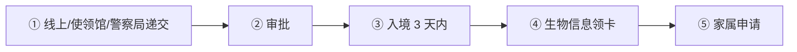
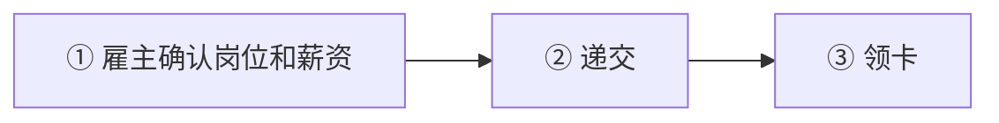
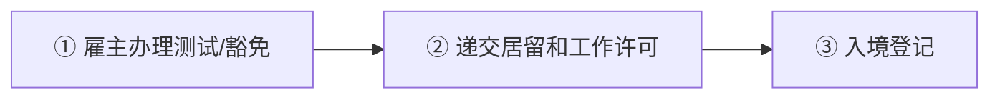

# 🇭🇷 克罗地亚 · Croatia

    

**数字游民最长 18 个月、境外收入免税，但不能续成长期身份**

[💻 数字游民临时居留](#croatia-digital-nomad-temporary-stay) · [🧑‍💻 欧盟蓝卡](#croatia-eu-blue-card) · [🧑‍💻 居留和工作许可](#croatia-stay-and-work-permit) · [📖 深度解读](#deep) · [🔗 延伸阅读](#more)

> [!TIP]
> **一句话判断**：欧盟 + 申根 + 欧元区。远程工作者看**数字游民临时居留**（最长 18 个月、境外收入可免税，但**不能续成长期身份**）；受雇于克罗地亚雇主看**居留和工作许可 vs 欧盟蓝卡**（2025 年《外国人法》修订后蓝卡最长 48 个月）。

## 🏙️ 生活与身份档案

<table>
<tr><td width="33%" valign="top">💶 生活成本指数（纽约=100） <b>51.3 ●●●●○</b></td><td width="33%" valign="top">🏠 房租指数（纽约=100） <b>16.1 ●●●●○</b></td><td width="33%" valign="top">🛡️ 安全指数 <b>74.8 ●●●●○</b></td></tr>
<tr><td width="33%" valign="top">💼 平均年薪（总额） <b>EUR 23,446</b></td><td width="33%" valign="top">🧾 最高个税税率 <b>33%</b></td><td width="33%" valign="top">🛂 护照免签目的地 <b>183 个（中国 81）</b></td></tr>
<tr><td width="33%" valign="top">🏠 永居年限 <b>5 年</b></td><td width="33%" valign="top">🎖️ 入籍年限 <b>8 年</b></td><td width="33%" valign="top">🔁 双重国籍 <b>⚠️ 有条件</b></td></tr>
<tr><td width="33%" valign="top">🗣️ 语言要求 <b>克罗地亚语</b></td><td width="33%" valign="top">✈️ 中国护照入境 <b>申根签证</b></td><td width="33%" valign="top"></td></tr>
</table>

● 越多越好（成本/房租越低、安全越高）。数据：Numbeo 2026 年中、Eurostat、Tax Foundation 2026、Henley 2026；永居/入籍为常见规则，以官方为准。中国不承认双重国籍。[数据说明](README.md#profiles)

## 📊 路线速查

| 路线 | 类型 | 门槛信号 | 家属 | 永居 | 状态 |
|---|---|---|:-:|:-:|:-:|
| [克罗地亚数字游民临时居留](#croatia-digital-nomad-temporary-stay) | 💻 数字游民 | EUR 3,622.5/月 | ✅ 可带 | ⏳ 偏临时 | 🟢 开放 |
| [克罗地亚欧盟蓝卡](#croatia-eu-blue-card) | 🧑‍💻 技术工作 | EUR 3,024/月 | ✅ 可带 | ✅ 可能 | 🟢 开放 |
| [克罗地亚居留和工作许可](#croatia-stay-and-work-permit) | 🧑‍💻 技术工作 | — | ✅ 可带 | ✅ 可能 | 🟢 开放 |

门槛为主申请人的最低信号值，多与当地工资挂钩、每年调整，递交前以官方为准。

---

## 💻 克罗地亚数字游民临时居留

   

> **月入 3,622 欧的远程工作者可在克罗地亚住最长 18 个月，境外工作收入免所得税。**

<table>
<tr><td width="33%" valign="top">收入 <b>≥ EUR 3,622.50/月，或存款 EUR 43,470（12 个月）/ 65,205（18 个月）</b></td><td width="33%" valign="top">家属加算 <b>每人 + 平均月净工资 10%</b></td><td width="33%" valign="top">期限 <b>最长 18 个月，不足 18 个月可延 ≤6 个月</b></td></tr>
<tr><td width="33%" valign="top">冷却期 <b>到期后 6 个月才能再申请</b></td><td width="33%" valign="top">费用 <b>警察局 EUR 46.45 + 9.29 + 31.85；使领馆 EUR 55.74 + 41.14（D 签证 93）</b></td><td width="33%" valign="top">税 <b>境外雇主工作收入免所得税</b></td></tr>
<tr><td width="33%" valign="top">永居 <b>❌ 不能续成长期身份</b></td><td width="33%" valign="top"></td><td width="33%" valign="top"></td></tr>
</table>

<table><tr>
<td width="50%" valign="top">✅ <b>适合</b><ul><li>想在地中海边住一年半的远程工作者</li><li>收入或存款充足</li></ul></td>
<td width="50%" valign="top">❌ <b>不适合</b><ul><li>想长期定居</li><li>有克罗地亚客户</li></ul></td>
</tr></table>

### 🗺️ 申请流程

1. **线上/使领馆/警察局递交** — Form 1a
2. **审批** — 无统一时限
3. **入境 3 天内** — 到警察局登记住址（Form 16a）
4. **生物信息领卡**
5. **家属申请** — 主申请人获批后才能递交

### 📋 材料清单

- [ ] Form 1a 或线上表
- [ ] 护照（比停留期多 3 个月）
- [ ] 覆盖克罗地亚的保险
- [ ] 远程工作证明（境外雇主或本人境外公司）
- [ ] 资金证明：6 个月工资单或流水或存款
- [ ] 无犯罪证明（认证）
- [ ] 克罗地亚地址（首次可用酒店预订）
- [ ] 克语或英语翻译

> [!WARNING]
> **注意**
> - 家属提前递交会被直接拒绝
> - 免税只覆盖境外雇佣收入，不含分红、资本利得等

🔗 官方来源（3）

- [MUP temporary stay of digital nomads](https://mup.gov.hr/aliens-281621/stay-and-work/temporary-stay-of-digital-nomads/286833)
- [Ministry of Foreign and European Affairs stay of aliens page](https://mvep.gov.hr/print.aspx?id=180412&url=print)
- [gov.hr digital nomad e-Citizens and OIB page](https://gov.hr/en/if-i-am-a-digital-nomad-with-an-approved-temporary-residence-in-croatia-can-i-use-the-e-citizens-digital-platform/1838)

数据核查：2026-10-26 · [LetsMigrate 原始记录](https://letsmigrate.org/zh-hans/programmes/croatia-digital-nomad-temporary-stay-zh/) · [↑ 回到顶部](#top)

---

## 🧑‍💻 克罗地亚欧盟蓝卡

   

> **月薪约 3,024 欧以上的高资质岗位，2025 年修法后蓝卡最长 48 个月。**

<table>
<tr><td width="33%" valign="top">月薪 <b>≥ 上年平均工资 1.5 倍 = EUR 3,024</b></td><td width="33%" valign="top">资质 <b>高等教育；部分职业认可技能</b></td><td width="33%" valign="top">有效期 <b>最长 48 个月</b></td></tr>
<tr><td width="33%" valign="top">失业保护 <b>2025 修法后有</b></td><td width="33%" valign="top"></td><td width="33%" valign="top"></td></tr>
</table>

<table><tr>
<td width="50%" valign="top">✅ <b>适合</b><ul><li>高资质技术岗位</li></ul></td>
<td width="50%" valign="top">❌ <b>不适合</b><ul><li>薪资低于门槛</li></ul></td>
</tr></table>

### 🗺️ 申请流程

1. **雇主确认岗位和薪资**
2. **递交** — 警察局/使领馆
3. **领卡**

### 📋 材料清单

- [ ] 劳动合同
- [ ] 学历证明
- [ ] 护照

> [!WARNING]
> **注意**
> - 英文官方页面可能滞后于 2025 年修法

🔗 官方来源（4）

- [Ministry of the Interior highly qualified third-country nationals](https://mup.gov.hr/aliens-281621/stay-and-work/highly-qualified-third-country-nationals/281803)
- [Aliens Act amendment 2025](https://narodne-novine.nn.hr/clanci/sluzbeni/2025_03_40_516.html)
- [Average monthly gross wage in legal entities in 2025](https://narodne-novine.nn.hr/clanci/sluzbeni/2026_03_32_417.html)
- [European Commission EU Blue Card in Croatia](https://home-affairs.ec.europa.eu/policies/migration-and-asylum/eu-immigration-portal/eu-blue-card/eu-blue-card-croatia_en)

数据核查：2026-10-26 · [LetsMigrate 原始记录](https://letsmigrate.org/zh-hans/programmes/croatia-eu-blue-card-zh/) · [↑ 回到顶部](#top)

---

## 🧑‍💻 克罗地亚居留和工作许可

   

> **受雇于克罗地亚雇主的普通居留和工作许可，可能需劳动力市场测试。**

<table>
<tr><td width="33%" valign="top">薪资 <b>视岗位</b></td><td width="33%" valign="top">前置 <b>劳动力市场测试或豁免</b></td><td width="33%" valign="top">有效期 <b>视类别和合同</b></td></tr>
</table>

<table><tr>
<td width="50%" valign="top">✅ <b>适合</b><ul><li>普通岗位</li></ul></td>
<td width="50%" valign="top">❌ <b>不适合</b><ul><li>需要欧盟流动</li></ul></td>
</tr></table>

### 🗺️ 申请流程

1. **雇主办理测试/豁免**
2. **递交居留和工作许可**
3. **入境登记**

### 📋 材料清单

- [ ] 劳动合同
- [ ] 护照
- [ ] 资质证明

> [!WARNING]
> **注意**
> - 换工作前先确认许可

🔗 官方来源（4）

- [Ministry of the Interior stay and work of third-country nationals](https://mup.gov.hr/aliens-281621/stay-and-work/stay-and-work-of-third-country-nationals/281802)
- [GOV.HR work of foreign nationals](https://gov.hr/en/work-of-foreign-nationals/1214)
- [Croatian Employment Service labour market test and work permits](https://www.hzz.hr/usluge/radna-dozvola/)
- [Aliens Act amendment 2025](https://narodne-novine.nn.hr/clanci/sluzbeni/2025_03_40_516.html)

数据核查：2026-10-26 · [LetsMigrate 原始记录](https://letsmigrate.org/zh-hans/programmes/croatia-stay-and-work-permit-zh/) · [↑ 回到顶部](#top)

---

## 📖 深度解读

### 路线要点

### 数字游民临时居留
- **资金**：月收入 ≥ **EUR 3,622.50**，或一次性存款：住 12 个月 EUR 43,470、18 个月 EUR 65,205。每多 1 名家属/伴侣，增加平均月净工资的 10%。
- **证明方式**：银行流水显示固定收入，或至少 6 个月工资单，或账户余额覆盖全部停留期。
- **只能为境外雇主或自己的境外公司工作**，不能有克罗地亚雇主/客户。
- **期限**：最长 18 个月；首次批不足 18 个月的，可在到期前 ≥60 天申请延期（最多再加 6 个月）。**到期后须等 6 个月**才能再申请。
- **递交渠道**：线上、使领馆或当地警察局。
- **费用**：
  | 渠道 | 临时居留费 | 其他 |
  |---|---|---|
  | 警察局 | EUR 46.45 | 生物识别行政费 9.29 + 居留卡 31.85（加急 59.73） |
  | 使领馆 | EUR 55.74 | D 签证 93（如需）+ 居留卡 41.14 |
- **其他材料**：Form 1a 或线上表格；护照有效期比计划停留多 3 个月；覆盖克罗地亚的保险；无犯罪证明（原籍国或入境前连续居住 >1 年的国家，需认证）；克罗地亚地址（首次可用酒店/青旅预订）。材料用克罗地亚语或英语。
- **入境后 3 天内**到警察局登记住址（Form 16a + 租约/房产证/房东声明）。
- **家属**：配偶、非正式伴侣（同居 >3 年，或有共同子女/后来结婚）可家庭团聚，但**须在主申请人获批之后**再递交，提前递交会被拒。
- **税务**：所得税法对"为未在克罗地亚注册的雇主工作"所得的数字游民收入有豁免，但不覆盖被动收入、本地收入、公司分红、资本利得、房产收入等。

### 居留和工作许可 vs 欧盟蓝卡
| | 居留和工作许可 | 欧盟蓝卡 |
|---|---|---|
| 薪资 | 视岗位和劳动力市场测试 | ≥ 上年法人单位平均月薪 1.5 倍，2026 参考 **EUR 3,024/月** |
| 资质 | 视岗位 | 高等教育；2025 修订后部分情况认可职业技能 |
| 有效期 | 视类别和合同 | 最长 **48 个月** |
| 换工作/失业 | 雇佣基础终止即有风险 | 2025 修订加入失业保护和结构化换工作规则 |

- 雇主、合同、岗位、劳动力市场测试或豁免是雇佣类案件的前置顺序。英文官方页面可能滞后于 2025 年修法，换工作前先向警方确认。

### 常见坑
- 想靠数字游民身份"滚动"续成永居——18 个月封顶 + 6 个月冷却期，不可能。
- 家属和主申请人一起递交——会被拒。

---

## 🔗 延伸阅读

LetsMigrate 中文指南原文（9 篇）

- [克罗地亚数字游民临时居留文件清单](https://letsmigrate.org/zh-hans/articles/croatia-digital-nomad-temporary-stay-documents-checklist-zh/)
- [克罗地亚数字游民临时居留家庭和续期规则](https://letsmigrate.org/zh-hans/articles/croatia-digital-nomad-temporary-stay-family-extension-zh/)
- [克罗地亚数字游民临时居留指南](https://letsmigrate.org/zh-hans/articles/croatia-digital-nomad-temporary-stay-guide-zh/)
- [克罗地亚数字游民收入、税务、银行和保险](https://letsmigrate.org/zh-hans/articles/croatia-digital-nomad-temporary-stay-income-tax-banking-insurance-zh/)
- [克罗地亚数字游民临时居留时间线和费用](https://letsmigrate.org/zh-hans/articles/croatia-digital-nomad-temporary-stay-timeline-costs-zh/)
- [克罗地亚居留和工作许可与欧盟蓝卡家庭、流动和长期居留](https://letsmigrate.org/zh-hans/articles/croatia-stay-work-permit-eu-blue-card-family-mobility-settlement-zh/)
- [克罗地亚居留和工作许可与欧盟蓝卡薪资规则](https://letsmigrate.org/zh-hans/articles/croatia-stay-work-permit-eu-blue-card-salary-qualification-rules-zh/)
- [克罗地亚居留和工作许可与欧盟蓝卡时间线和文件](https://letsmigrate.org/zh-hans/articles/croatia-stay-work-permit-eu-blue-card-timeline-documents-zh/)
- [克罗地亚居留和工作许可 vs 欧盟蓝卡](https://letsmigrate.org/zh-hans/articles/croatia-stay-work-permit-vs-eu-blue-card-zh/)

[← 🇧🇬 保加利亚](bulgaria.md) ｜ [🇪🇺 全部国家](README.md) ｜ [🏠 首页](../../README.md) ｜ [🇨🇾 塞浦路斯 →](cyprus.md)

本页根据 [LetsMigrate.org](https://letsmigrate.org/zh-hans/countries/croatia-zh/) 公开资料及官方来源整理改写，仅供信息参考，不构成移民、法律、税务或投资建议。
