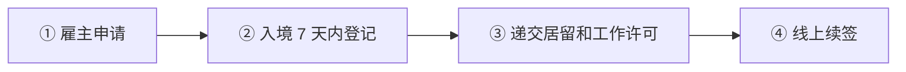

# 🇨🇾 塞浦路斯 · Cyprus

    

**30 万欧投资永居约 2 个月获批；数字游民名额 500**

[💻 数字游民签证](#cyprus-digital-nomad-visa) · [🧑‍💻 欧盟蓝卡](#cyprus-eu-blue-card) · [🧑‍💻 受雇工作 Single Permit](#cyprus-remunerated-employment-single-permit) · [💰 投资永久居留](#cyprus-permanent-residence-by-investment) · [🛂 Investment Programme](#cyprus-investment-programme) · [📖 深度解读](#deep) · [🔗 延伸阅读](#more)

> [!TIP]
> **一句话判断**：欧盟 + 欧元区，**尚未完全加入申根**（参与申根合作但内部边检未取消，塞浦路斯居留卡不等于申根卡）。主要入口：**Regulation 6(2) 投资永居**（30 万欧，审批快约 2 个月）、**数字游民签证**（总名额 500）、**外资公司雇佣政策 / Single Permit / 欧盟蓝卡**。原"投资入籍护照项目"**已于 2020-11-01 终止**。

## 🏙️ 生活与身份档案

<table>
<tr><td width="33%" valign="top">💶 生活成本指数（纽约=100） <b>57.4 ●●●●○</b></td><td width="33%" valign="top">🏠 房租指数（纽约=100） <b>24.6 ●●●●○</b></td><td width="33%" valign="top">🛡️ 安全指数 <b>66.4 ●●●○○</b></td></tr>
<tr><td width="33%" valign="top">💼 平均年薪（总额） <b>EUR 27,611</b></td><td width="33%" valign="top">🧾 最高个税税率 <b>35%</b></td><td width="33%" valign="top">🛂 护照免签目的地 <b>174 个（中国 81）</b></td></tr>
<tr><td width="33%" valign="top">🏠 永居年限 <b>5 年（投资可直接）</b></td><td width="33%" valign="top">🎖️ 入籍年限 <b>8 年（10 年内 7 年 + 最后 1 年）</b></td><td width="33%" valign="top">🔁 双重国籍 <b>✅ 可保留原国籍</b></td></tr>
<tr><td width="33%" valign="top">🗣️ 语言要求 <b>希腊语 B1</b></td><td width="33%" valign="top">✈️ 中国护照入境 <b>塞浦路斯签证；持有效申根签证通常可入境</b></td><td width="33%" valign="top"></td></tr>
</table>

● 越多越好（成本/房租越低、安全越高）。数据：Numbeo 2026 年中、Eurostat、Tax Foundation 2026、Henley 2026；永居/入籍为常见规则，以官方为准。中国不承认双重国籍。[数据说明](README.md#profiles)

## 📊 路线速查

| 路线 | 类型 | 门槛信号 | 家属 | 永居 | 状态 |
|---|---|---|:-:|:-:|:-:|
| [塞浦路斯数字游民签证](#cyprus-digital-nomad-visa) | 💻 数字游民 | EUR 3,500/月 | ✅ 可带 | ⏳ 偏临时 | 🟢 开放 |
| [塞浦路斯欧盟蓝卡](#cyprus-eu-blue-card) | 🧑‍💻 技术工作 | EUR 43,632/年 | ✅ 可带 | ✅ 可能 | 🟢 开放 |
| [塞浦路斯受雇工作 Single Permit](#cyprus-remunerated-employment-single-permit) | 🧑‍💻 技术工作 | — | ✅ 可带 | ✅ 可能 | 🟢 开放 |
| [塞浦路斯投资永久居留](#cyprus-permanent-residence-by-investment) | 💰 投资居留 | EUR 50,000/年；投资 ≥ 300,000 | ✅ 可带 | ✅ 可能 | 🟢 开放 |
| [塞浦路斯 Investment Programme](#cyprus-investment-programme) | 🛂 入籍 | — | — | — | ⛔ 已关闭 |

门槛为主申请人的最低信号值，多与当地工资挂钩、每年调整，递交前以官方为准。

---

## 💻 塞浦路斯数字游民签证

   

> **税后月入 3,500 欧可申请，最长 3 年；全国只有 500 个名额。**

<table>
<tr><td width="33%" valign="top">收入 <b>税后 ≥ EUR 3,500/月；配偶 +20%，每个孩子 +15%</b></td><td width="33%" valign="top">名额 <b>500 个</b></td><td width="33%" valign="top">递交时间 <b>合法入境后 3 个月内</b></td></tr>
<tr><td width="33%" valign="top">审理 <b>5–7 周</b></td><td width="33%" valign="top">费用 <b>发证 / 续签 / 外国人登记各 EUR 70</b></td><td width="33%" valign="top">卡期 <b>首次 1 年，可续最多 2 年</b></td></tr>
<tr><td width="33%" valign="top">工作限制 <b>本人和家属都不能在塞浦路斯本地工作</b></td><td width="33%" valign="top"></td><td width="33%" valign="top"></td></tr>
</table>

<table><tr>
<td width="50%" valign="top">✅ <b>适合</b><ul><li>喜欢海岛、英语可通的远程工作者</li></ul></td>
<td width="50%" valign="top">❌ <b>不适合</b><ul><li>需要长期身份</li><li>名额已满时</li></ul></td>
</tr></table>

### 🗺️ 申请流程

1. **确认名额未满** — 移民局公告
2. **合法入境塞浦路斯**
3. **3 个月内递交** — 尼科西亚移民局总部
4. **生物信息** — 6 岁以下只拍照
5. **5–7 周审查**
6. **续签** — 到期前至少 1 个月

### 📋 材料清单

- [ ] 申请表
- [ ] 护照
- [ ] 境外雇佣或自雇证明
- [ ] 税后收入证明
- [ ] 塞浦路斯住宿证明
- [ ] 医疗保险
- [ ] 无犯罪及体检证明（按当前清单）
- [ ] 认证翻译

> [!WARNING]
> **注意**
> - 60 天税务居民规则需要本地业务或职位，单靠数字游民许可不满足

🔗 官方来源（4）

- [Migration Department digital nomads and family members](https://www.gov.cy/mip-md/en/documents/digital-nomads-and-family-members/)
- [Migration Department digital nomad forms and supporting documents](https://www.gov.cy/mip-md/en/documents/digital-nomads-and-family-members-2/)
- [Cyprus Tax Department individuals and tax residence](https://www.mof.gov.cy/mof/tax/taxdep.nsf/All/60CDDB556F7C9D4DC2258549002DEA93)
- [European Union Cyprus country profile](https://european-union.europa.eu/principles-countries-history/eu-countries/cyprus_en)

数据核查：2026-10-26 · [LetsMigrate 原始记录](https://letsmigrate.org/zh-hans/programmes/cyprus-digital-nomad-visa-zh/) · [↑ 回到顶部](#top)

---

## 🧑‍💻 塞浦路斯欧盟蓝卡

   

> **年薪 43,632 欧以上，且仅限 ICT、药企研发、海事三个行业。**

<table>
<tr><td width="33%" valign="top">年薪 <b>≥ EUR 43,632</b></td><td width="33%" valign="top">行业 <b>仅 ICT、药企科研、海事（不含船长船员）</b></td><td width="33%" valign="top">审理 <b>90 天；长期流动 30 天</b></td></tr>
<tr><td width="33%" valign="top">费用 <b>入境许可 + 蓝卡 EUR 110；续签 EUR 95；登记 EUR 70</b></td><td width="33%" valign="top">卡期 <b>6 个月–3 年</b></td><td width="33%" valign="top">失业宽限 <b>持卡 <2 年 3 个月，≥2 年 6 个月</b></td></tr>
</table>

<table><tr>
<td width="50%" valign="top">✅ <b>适合</b><ul><li>ICT 行业高薪员工</li></ul></td>
<td width="50%" valign="top">❌ <b>不适合</b><ul><li>其他行业（配额为零）</li></ul></td>
</tr></table>

### 🗺️ 申请流程

1. **雇主确认行业符合**
2. **入境后 7 天内** — 外国人登记并递交蓝卡
3. **家属同时递交** — 家属可工作
4. **90 天内决定**

### 📋 材料清单

- [ ] 劳动合同
- [ ] 学历或 ICT 经验证明
- [ ] 护照
- [ ] 保险

> [!WARNING]
> **注意**
> - 2025-07-07 才重新受理，欧盟门户页面信息过时

🔗 官方来源（3）

- [Migration Department EU Blue Card](https://www.gov.cy/mip-md/en/documents/companies-investors-permanent-residence-3/eu-blue-card-investors/)
- [Deputy Ministry EU Blue Card press release](https://www.gov.cy/en/migration/press-release-by-the-deputy-ministry-of-migration-and-international-protection-on-the-eu-blue-card/)
- [Application for EU Blue Card](https://www.gov.cy/mip-md/en/documents/application-for-eu-blue-card-eubc/)

数据核查：2026-10-26 · [LetsMigrate 原始记录](https://letsmigrate.org/zh-hans/programmes/cyprus-eu-blue-card-zh/) · [↑ 回到顶部](#top)

---

## 🧑‍💻 塞浦路斯受雇工作 Single Permit

   

> **普通雇佣单一许可（GEN）；外资公司另有月薪 2,500 欧的便利政策。**

<table>
<tr><td width="33%" valign="top">薪资 <b>无统一门槛；外资公司政策月薪 ≥ EUR 2,500</b></td><td width="33%" valign="top">审理 <b>完整材料最长 4 个月</b></td><td width="33%" valign="top">费用 <b>入境许可 EUR 120 + 居留/工作许可 EUR 130 + 登记 70</b></td></tr>
<tr><td width="33%" valign="top">卡期 <b>最长连续 3 年</b></td><td width="33%" valign="top">印花税 <b>2026-01-01 起新合同免</b></td><td width="33%" valign="top"></td></tr>
</table>

<table><tr>
<td width="50%" valign="top">✅ <b>适合</b><ul><li>在塞浦路斯外资公司工作</li></ul></td>
<td width="50%" valign="top">❌ <b>不适合</b><ul><li>想要欧盟流动性</li></ul></td>
</tr></table>

### 🗺️ 申请流程

1. **雇主申请**
2. **入境 7 天内登记**
3. **递交居留和工作许可**
4. **线上续签** — 到期前 60–30 天

### 📋 材料清单

- [ ] 劳动合同
- [ ] 雇主文件
- [ ] 护照

> [!WARNING]
> **注意**
> - 换工作需雇主出具解约文件，30 天内找新雇主

🔗 官方来源（3）

- [Remunerated employment single permit GEN](https://www.gov.cy/mip-md/en/documents/remunerated-employment-single-permit-gen/)
- [Application for employment of third-country nationals](https://www.gov.cy/en/service/application-for-employment-of-third-country-nationals/)
- [Companies of foreign interests policy](https://www.gov.cy/mip-md/en/documents/legislation-and-policy/)

数据核查：2026-10-26 · [LetsMigrate 原始记录](https://letsmigrate.org/zh-hans/programmes/cyprus-remunerated-employment-single-permit-zh/) · [↑ 回到顶部](#top)

---

## 💰 塞浦路斯投资永久居留

   

> **投资 30 万欧 + 年收入 5 万欧，约 2 个月直接拿塞浦路斯永居，全家可一起办。**

<table>
<tr><td width="33%" valign="top">最低投资 <b>EUR 300,000（一手住宅另加增值税）</b></td><td width="33%" valign="top">投资方式 <b>新住宅 / 其他房地产 / 公司股本（≥5 名员工）/ 投资基金</b></td><td width="33%" valign="top">年收入 <b>主申请人 EUR 50,000，配偶 +15,000，每个未成年子女 +10,000</b></td></tr>
<tr><td width="33%" valign="top">审理 <b>约 2 个月</b></td><td width="33%" valign="top">费用 <b>申请费 EUR 500 + 每人 ARC EUR 70</b></td><td width="33%" valign="top">有效期 <b>永久（条件持续）；居留卡每 10 年换</b></td></tr>
<tr><td width="33%" valign="top">失效 <b>全家连续 2 年不入境，或卖掉投资未替换</b></td><td width="33%" valign="top">工作 <b>❌ 不给工作权</b></td><td width="33%" valign="top"></td></tr>
</table>

<table><tr>
<td width="50%" valign="top">✅ <b>适合</b><ul><li>想快速拿欧盟国家永居的家庭</li><li>有稳定境外被动收入或工资</li></ul></td>
<td width="50%" valign="top">❌ <b>不适合</b><ul><li>想要申根自由通行（塞浦路斯尚未完全加入申根）</li><li>想入籍（需 7 年真实居住 + 希腊语 B1）</li></ul></td>
</tr></table>

### 🗺️ 申请流程

1. **选投资** — 一手房最常见；申请前须已付 ≥ EUR 200,000（不含税）
2. **准备收入证明** — 年收入 5 万欧起，按家属加算
3. **递交申请** — 移民局
4. **约 2 个月审批**
5. **领卡** — 主申请人和成年家属 10 年卡
6. **持续监测** — 每年提供投资和保险证明，每 3 年提供无犯罪证明

### 📋 材料清单

- [ ] 护照
- [ ] 购房合同、付款凭证、产权或登记文件
- [ ] 年收入证明（工资、租金、分红等）
- [ ] 无犯罪证明（原籍国 + 居住国）
- [ ] 医疗保险
- [ ] 结婚证、出生证明
- [ ] 18–25 岁在读子女的学籍证明

> [!WARNING]
> **注意**
> - 老资料写的'年收入 3 万欧'已过时
> - 可能要缴增值税，一手房 + VAT 才算达标
> - 塞浦路斯 non-dom 税制要单独规划

🔗 官方来源（5）

- [Migration Department immigration permits for investors](https://www.gov.cy/mip-md/en/documents/companies-investors-permanent-residence-3/immigration-permits-for-investors/)
- [Migration Department investor immigration permit forms](https://www.gov.cy/mip-md/en/documents/immigration-permits-for-investors-ip/)
- [Migration Department immigration permits](https://www.gov.cy/mip-md/en/documents/companies-investors-permanent-residence-3/immigration-permits/)
- [Cyprus Tax Department individuals and tax residence](https://www.mof.gov.cy/mof/tax/taxdep.nsf/All/60CDDB556F7C9D4DC2258549002DEA93)
- [Ministry of Interior Cypriot citizenship and nationality](https://www.gov.cy/moi/en/ministry/departments/civil-registry-section/registry-office-2/cypriot-citizenship-nationality/)

数据核查：2026-10-26 · [LetsMigrate 原始记录](https://letsmigrate.org/zh-hans/programmes/cyprus-permanent-residence-by-investment-zh/) · [↑ 回到顶部](#top)

---

## 🛂 塞浦路斯 Investment Programme

   

> **塞浦路斯'投资入籍'护照项目已于 2020-11-01 终止。**

<table>
<tr><td width="33%" valign="top">终止 <b>2020-11-01</b></td><td width="33%" valign="top">现状 <b>不接受任何新申请</b></td><td width="33%" valign="top">后续 <b>部分已授予国籍被撤销；2026-03 欧盟委员会结案</b></td></tr>
<tr><td width="33%" valign="top">替代 <b>Reg. 6(2) 投资永居（不是国籍）</b></td><td width="33%" valign="top"></td><td width="33%" valign="top"></td></tr>
</table>

> [!WARNING]
> **注意**
> - 现在推销'塞浦路斯护照'的都要警惕

🔗 官方来源（4）

- [Cyprus Investment Programme service-provider registry](https://cipregistry.mof.gov.cy/en/)
- [Law Office press release on European Commission infringement closure](https://www.gov.cy/en/independent-officials/the-european-commission-closed-the-infringement-procedure-against-cyprus-in-relation-to-the-cyprus-investment-program/)
- [Ministry of Interior Cypriot citizenship and nationality](https://www.gov.cy/moi/en/ministry/departments/civil-registry-section/registry-office-2/cypriot-citizenship-nationality/)
- [Ministry of Interior naturalisation by residence M127](https://www.gov.cy/moi/en/documents/acquisition-of-cypriot-citizenship-by-naturalization-due-to-years-of-residence-form-m127/)

数据核查：2026-10-26 · [LetsMigrate 原始记录](https://letsmigrate.org/zh-hans/programmes/cyprus-investment-programme-zh/) · [↑ 回到顶部](#top)

---

## 📖 深度解读

### 路线要点

### 投资永久居留（Regulation 6(2) Immigration Permit）
- **最低投资 EUR 300,000**，四选一：
  | 类别 | 要求 |
  |---|---|
  | 新建住宅 | 开发商一手房，≥ EUR 300,000 + 增值税；申请前须已付 ≥ EUR 200,000（不含税） |
  | 其他房地产 | 写字楼、商铺、酒店等，≥ EUR 300,000，可二手 |
  | 塞浦路斯公司股本 | 公司实际在塞运营、有实体办公、雇员 ≥5 人 |
  | 塞浦路斯投资基金 | AIF / AIFLNP / RAIF 份额 |
- **稳定年收入**（2023-05 第四次修订后）：主申请人 **EUR 50,000**，配偶 +15,000，每名未成年子女 +10,000。老攻略写的 EUR 30,000 已过时。
- **费用**：申请费 EUR 500；无 ARC 的每人 EUR 70。**审理约 2 个月**。
- **有效期**：居留权无限期（条件持续满足），居留卡每 10 年换。
- **家属**：配偶、未成年子女；18–25 岁在境外读大学的未婚受抚养子女可单独申请，获批后即使超龄也继续有效。
- **失效情形**：卖掉投资又没立即用等值投资替代；全家在外**连续 2 年**不入境；在别国取得永居。
- **监测**：每年提供投资和保险证明，每 3 年提供无犯罪证明。
- **不给工作权**，不自动通向入籍。

### 数字游民签证
- **名额上限 500 个**，先确认未满。
- **收入**：税后 ≥ **EUR 3,500/月**；配偶 +20%，每个孩子 +15%。
- 为境外注册公司工作的雇员，或客户在境外的自雇者。**本人和家属都不能在塞浦路斯本地工作**。
- **流程**：合法入境后 **3 个月内**到尼科西亚移民局总部递交 → 审查 5–7 周。
- **费用**：发证 EUR 70，续签 EUR 70，外国人登记 EUR 70。
- **卡期**：首次 1 年，可续最多 2 年（共 3 年），提前 ≥1 个月续签。官方标注"通常偏临时"。

### 雇佣路线
| | 普通 Single Permit（GEN） | 欧盟蓝卡 | 外资公司政策 |
|---|---|---|---|
| 薪资 | 无统一门槛 | 年薪 ≥ **EUR 43,632** | 月薪 ≥ EUR 2,500 |
| 行业 | 视类别，可能有劳动力市场测试 | **仅限** ICT、药企研发、海事（不含船长船员），其他行业配额为零 | 合格的外资公司 |
| 审理 | 完整材料最长 4 个月 | 90 天 | — |
| 卡期 | 最长连续 3 年 | 6 个月–3 年 | 合同 ≥2 年 |

- 蓝卡 2025-07-07 起才重新受理；家属可同时递交且可工作（含自雇）。
- 蓝卡失业宽限：持卡 <2 年为 3 个月，≥2 年为 6 个月。
- 2026-01-01 起新签劳动合同不再需要缴印花税。

### 入籍（与投资无关）
- 2023-12-19 起：申请前连续合法居住 12 个月 + 此前 10 年中累计 ≥7 年 + 希腊语 B1 + 公民知识考试等。
- 原投资入籍项目已关闭，部分已授予的国籍被撤销；2026-03 欧盟委员会已结案。

### 税务提醒
- 一年 >183 天即税务居民；或满足"60 天规则"（在塞 ≥60 天、不在其他国家 >183 天、在塞有工作/业务/董事职位、有自有或租赁的永久住所）。单靠数字游民许可不满足 60 天规则的"本地经营"条件。
- 塞浦路斯有 non-dom（非定居者）制度，股息利息可免特别国防税，需专业规划。

---

## 🔗 延伸阅读

LetsMigrate 中文指南原文（14 篇）

- [塞浦路斯数字游民签证文件清单](https://letsmigrate.org/zh-hans/articles/cyprus-digital-nomad-visa-documents-checklist-zh/)
- [塞浦路斯数字游民签证家庭和续签规则](https://letsmigrate.org/zh-hans/articles/cyprus-digital-nomad-visa-family-renewal-zh/)
- [塞浦路斯数字游民签证指南](https://letsmigrate.org/zh-hans/articles/cyprus-digital-nomad-visa-guide-zh/)
- [塞浦路斯数字游民签证税务、银行、保险和设置](https://letsmigrate.org/zh-hans/articles/cyprus-digital-nomad-visa-tax-banking-insurance-zh/)
- [塞浦路斯数字游民签证时间线和费用](https://letsmigrate.org/zh-hans/articles/cyprus-digital-nomad-visa-timeline-costs-zh/)
- [塞浦路斯 Investment Programme 已结束说明](https://letsmigrate.org/zh-hans/articles/cyprus-investment-programme-ended-explainer-zh/)
- [塞浦路斯投资永久居留指南](https://letsmigrate.org/zh-hans/articles/cyprus-permanent-residence-by-investment-guide-zh/)
- [塞浦路斯永久居留投资路线和尽职调查](https://letsmigrate.org/zh-hans/articles/cyprus-permanent-residence-by-investment-routes-due-diligence-zh/)
- [塞浦路斯永久居留税务、家庭、工作和公民身份](https://letsmigrate.org/zh-hans/articles/cyprus-permanent-residence-by-investment-tax-family-work-citizenship-zh/)
- [塞浦路斯永久居留时间线和文件](https://letsmigrate.org/zh-hans/articles/cyprus-permanent-residence-by-investment-timeline-documents-zh/)
- [塞浦路斯 Single Permit 和欧盟蓝卡家庭、流动和定居](https://letsmigrate.org/zh-hans/articles/cyprus-single-permit-eu-blue-card-family-mobility-settlement-zh/)
- [塞浦路斯 Single Permit 和欧盟蓝卡薪资规则](https://letsmigrate.org/zh-hans/articles/cyprus-single-permit-eu-blue-card-salary-qualification-rules-zh/)
- [塞浦路斯 Single Permit 和欧盟蓝卡时间线与文件](https://letsmigrate.org/zh-hans/articles/cyprus-single-permit-eu-blue-card-timeline-documents-zh/)
- [塞浦路斯 Single Permit 与欧盟蓝卡](https://letsmigrate.org/zh-hans/articles/cyprus-single-permit-vs-eu-blue-card-zh/)

[← 🇭🇷 克罗地亚](croatia.md) ｜ [🇪🇺 全部国家](README.md) ｜ [🏠 首页](../../README.md) ｜ [🇨🇿 捷克 →](czechia.md)

本页根据 [LetsMigrate.org](https://letsmigrate.org/zh-hans/countries/cyprus-zh/) 公开资料及官方来源整理改写，仅供信息参考，不构成移民、法律、税务或投资建议。
