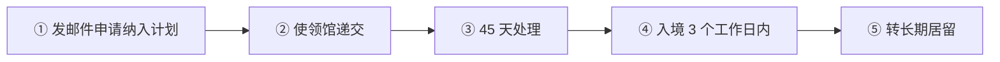
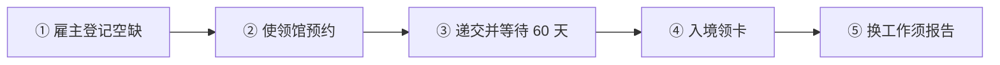
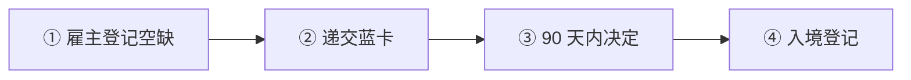

# 🇨🇿 捷克 · Czechia

    

**员工卡门槛低；数字游民计划不含中国大陆护照**

[💻 Digital Nomad Program](#czechia-digital-nomad-program) · [🧑‍💻 Employee Card](#czechia-employee-card) · [🧑‍💻 欧盟蓝卡](#czechia-eu-blue-card) · [📖 深度解读](#deep) · [🔗 延伸阅读](#more)

> [!TIP]
> **一句话判断**：欧盟 + 申根，货币克朗（CZK）。技术就业看 **Employee Card（门槛低）vs 欧盟蓝卡**。所谓"数字游民计划"其实是**限定国籍 + 限定 IT/营销岗位**的窄路线，**中国大陆护照不在名单内**（日本、韩国、新加坡、美英加澳新、以色列、印度、巴西、墨西哥等在列）。

## 🏙️ 生活与身份档案

<table>
<tr><td width="33%" valign="top">💶 生活成本指数（纽约=100） <b>52.0 ●●●●○</b></td><td width="33%" valign="top">🏠 房租指数（纽约=100） <b>19.1 ●●●●○</b></td><td width="33%" valign="top">🛡️ 安全指数 <b>73.3 ●●●●○</b></td></tr>
<tr><td width="33%" valign="top">💼 平均年薪（总额） <b>EUR 23,998</b></td><td width="33%" valign="top">🧾 最高个税税率 <b>23%</b></td><td width="33%" valign="top">🛂 护照免签目的地 <b>183 个（中国 81）</b></td></tr>
<tr><td width="33%" valign="top">🏠 永居年限 <b>5 年</b></td><td width="33%" valign="top">🎖️ 入籍年限 <b>永居满 5 年（合计约 10 年）</b></td><td width="33%" valign="top">🔁 双重国籍 <b>✅ 可保留原国籍</b></td></tr>
<tr><td width="33%" valign="top">🗣️ 语言要求 <b>捷克语 B1</b></td><td width="33%" valign="top">✈️ 中国护照入境 <b>申根签证</b></td><td width="33%" valign="top"></td></tr>
</table>

● 越多越好（成本/房租越低、安全越高）。数据：Numbeo 2026 年中、Eurostat、Tax Foundation 2026、Henley 2026；永居/入籍为常见规则，以官方为准。中国不承认双重国籍。[数据说明](README.md#profiles)

## 📊 路线速查

| 路线 | 类型 | 门槛信号 | 家属 | 永居 | 状态 |
|---|---|---|:-:|:-:|:-:|
| [捷克 Digital Nomad Program](#czechia-digital-nomad-program) | 💻 数字游民 | — | ✅ 可带 | ⏳ 偏临时 | 🟢 开放 |
| [捷克 Employee Card](#czechia-employee-card) | 🧑‍💻 技术工作 | CZK 22,400/月 | ✅ 可带 | ✅ 可能 | 🟢 开放 |
| [捷克欧盟蓝卡](#czechia-eu-blue-card) | 🧑‍💻 技术工作 | CZK 73,823/月 | ✅ 可带 | ✅ 可能 | 🟢 开放 |

门槛为主申请人的最低信号值，多与当地工资挂钩、每年调整，递交前以官方为准。

---

## 💻 捷克 Digital Nomad Program

   

> **只对指定国家的 IT 和营销专家开放，中国大陆护照不在名单内。**

<table>
<tr><td width="33%" valign="top">名单包括 <b>澳、巴西、印度、以色列、日、加、韩、墨、新西兰、新加坡、英、美等</b></td><td width="33%" valign="top">岗位 <b>仅 IT 或营销专家</b></td><td width="33%" valign="top">审理 <b>45 天</b></td></tr>
<tr><td width="33%" valign="top">签证费 <b>长期商业签证 CZK 5,000；延期 CZK 1,000</b></td><td width="33%" valign="top">期限 <b>长期签证最长 1 年，之后转长期居留</b></td><td width="33%" valign="top">家属 <b>同时递交可纳入</b></td></tr>
</table>

<table><tr>
<td width="50%" valign="top">✅ <b>适合</b><ul><li>持名单内护照的 IT/营销远程工作者</li></ul></td>
<td width="50%" valign="top">❌ <b>不适合</b><ul><li>中国大陆护照</li><li>非 IT/营销岗位</li></ul></td>
</tr></table>

### 🗺️ 申请流程

1. **发邮件申请纳入计划** — 向工业和贸易部（MPO），属酌情决定
2. **使领馆递交** — 雇员走'其他'目的签证；自由职业办营业执照走'商业'签证
3. **45 天处理**
4. **入境 3 个工作日内** — 到外警登记
5. **转长期居留** — 签证到期前 90 天起可延期

### 📋 材料清单

- [ ] 护照
- [ ] 纳入计划确认邮件
- [ ] 雇佣合同或营业执照
- [ ] 住宿证明
- [ ] 资金证明
- [ ] 旅行/综合医保
- [ ] 无犯罪证明（不超过 180 天）

> [!WARNING]
> **注意**
> - 材料一般不能超过 180 天

🔗 官方来源（4）

- [Ministry of Industry and Trade Digital Nomad Program](https://mpo.gov.cz/en/foreign-trade/economic-migration/programs-and-projects/digital-nomad-program--275799/)
- [CzechInvest Digital Nomad Program](https://czechinvest.gov.cz/en/For-Investors/Visa-Support/Digital-Nomad-Program)
- [Information Portal for Foreigners long-term visa for business](https://ipc.gov.cz/en/visa-and-residence-permit-types/third-country-nationals/long-term-visa/long-term-visa-for-the-purpose-of-doing-business/)
- [Gov.cz personal income taxes and tax residence](https://portal.gov.cz/en/informace/dane-z-prijmu-fyzickych-osob-INF-293)

数据核查：2026-10-26 · [LetsMigrate 原始记录](https://letsmigrate.org/zh-hans/programmes/czechia-digital-nomad-program-zh/) · [↑ 回到顶部](#top)

---

## 🧑‍💻 捷克 Employee Card

   

> **门槛最低的欧盟工作居留之一：只要最低工资、每周 15 小时，不卡学历。**

<table>
<tr><td width="33%" valign="top">薪资 <b>≥ 最低工资 CZK 22,400/月（2026）</b></td><td width="33%" valign="top">工时 <b>每周 ≥15 小时</b></td><td width="33%" valign="top">学历 <b>一般不要求</b></td></tr>
<tr><td width="33%" valign="top">有效期 <b>最长 2 年，可续</b></td><td width="33%" valign="top">审理 <b>60 天（复杂案件 90 天）</b></td><td width="33%" valign="top">费用 <b>行政费 CZK 2,500 / 领事费 CZK 5,000</b></td></tr>
<tr><td width="33%" valign="top">永居 <b>连续居住 5 年</b></td><td width="33%" valign="top"></td><td width="33%" valign="top"></td></tr>
</table>

<table><tr>
<td width="50%" valign="top">✅ <b>适合</b><ul><li>普通岗位、没有高学历</li><li>想先进入欧盟再升级身份</li></ul></td>
<td width="50%" valign="top">❌ <b>不适合</b><ul><li>想要欧盟内流动（看蓝卡）</li></ul></td>
</tr></table>

### 🗺️ 申请流程

1. **雇主登记空缺** — 中央空缺数据库
2. **使领馆预约** — 部分使领馆有名额配额
3. **递交并等待 60 天**
4. **入境领卡**
5. **换工作须报告** — 失业 90 天内须找到新工作

### 📋 材料清单

- [ ] 劳动合同（写明工资和工时）
- [ ] 护照
- [ ] 住宿证明
- [ ] 学历（岗位要求时）
- [ ] 无犯罪证明

> [!WARNING]
> **注意**
> - 使领馆名额紧张，政府批准的雇主计划可加快预约

🔗 官方来源（3）

- [Czech Information Portal for Foreigners Employee Card](https://ipc.gov.cz/en/visa-and-residence-permit-types/third-country-nationals/long-term-residence-permits/employee-card/)
- [Ministry of Labour employee cards](https://mpsv.gov.cz/pro-cizince)
- [Czech labour-market access for selected countries](https://ipc.gov.cz/en/free-access-to-the-czech-labour-market-for-citizens-of-selected-countries/)

数据核查：2026-10-26 · [LetsMigrate 原始记录](https://letsmigrate.org/zh-hans/programmes/czechia-employee-card-zh/) · [↑ 回到顶部](#top)

---

## 🧑‍💻 捷克欧盟蓝卡

   

> **月薪约 7.4 万克朗（≈ €2,950）以上的高资质岗位，最长 3 年。**

<table>
<tr><td width="33%" valign="top">月薪 <b>≥ CZK 73,823（2026-05 至 2027-04）</b></td><td width="33%" valign="top">学历 <b>≥3 年高等教育</b></td><td width="33%" valign="top">有效期 <b>合同期 + 3 个月，最长 3 年</b></td></tr>
<tr><td width="33%" valign="top">审理 <b>90 天；蓝卡迁入 30 天</b></td><td width="33%" valign="top">费用 <b>CZK 2,500 + 领事费 5,000</b></td><td width="33%" valign="top">永居 <b>5 年；可累计其他欧盟国蓝卡年限</b></td></tr>
</table>

<table><tr>
<td width="50%" valign="top">✅ <b>适合</b><ul><li>高薪技术岗位</li></ul></td>
<td width="50%" valign="top">❌ <b>不适合</b><ul><li>工资在最低工资附近（用员工卡）</li></ul></td>
</tr></table>

### 🗺️ 申请流程

1. **雇主登记空缺**
2. **递交蓝卡**
3. **90 天内决定**
4. **入境登记**

### 📋 材料清单

- [ ] 劳动合同
- [ ] 学历认证
- [ ] 护照
- [ ] 住宿证明

> [!WARNING]
> **注意**
> - 欧盟委员会页面的 CZK 65,012 是旧门槛

🔗 官方来源（4）

- [Czech Information Portal for Foreigners Blue Card](https://ipc.gov.cz/en/visa-and-residence-permit-types/third-country-nationals/long-term-residence-permits/blue-card/)
- [Ministry of Industry and Trade 2026 Blue Card salary increase](https://mpo.gov.cz/cz/zahranicni-obchod/ekonomicka-migrace/navyseni-mzdy-pro-modre-karty-a-nove-formulare-cestneho-prohlaseni-_-program-klicovy-a-vedecky-personal-a-program-vysoce-kvalifikovany-zamestnanec--292547/)
- [European Commission EU Blue Card in Czechia](https://home-affairs.ec.europa.eu/policies/migration-and-asylum/eu-immigration-portal/eu-blue-card/eu-blue-card-czechia_en)
- [Czech continuous residence for third-country nationals](https://ipc.gov.cz/en/administrative-proceedings/continuous-residence/)

数据核查：2026-10-26 · [LetsMigrate 原始记录](https://letsmigrate.org/zh-hans/programmes/czechia-eu-blue-card-zh/) · [↑ 回到顶部](#top)

---

## 📖 深度解读

### 路线要点

### Digital Nomad Program（数字游民计划）
- **国籍名单**（以工业和贸易部 MPO 当前页面为准）：澳大利亚、巴西、印度、以色列、日本、加拿大、韩国、墨西哥、新西兰、新加坡、英国、美国等。
- **岗位**：只限 IT 或营销专家。一般咨询、运营、销售、内容创作者不算。
- **两条轨道**：雇员 → 继续受雇于境外雇主，申请"其他"目的长期签证；自由职业 → 办捷克营业执照（trade licence），申请"商业"目的长期签证。
- **流程**：先发邮件给 MPO 申请纳入计划（属酌情决定，不是法定权利）→ 获纳入后到使领馆正式递交 → **45 天**处理目标 → 入境 3 个工作日内到外警登记。
- **费用**：长期商业签证 CZK 5,000；签证延期 CZK 1,000；长期居留申请 CZK 2,500（15 岁以下 CZK 1,000）。
- **期限**：长期签证**最长 1 年**（含延期），之后要转长期居留。延期最早到期前 90 天、最晚到期当天递交。
- **家属**：直系亲属同时递交可一并纳入。
- 材料须原件或公证件，一般不超过 180 天（护照和户籍类文件除外）。

### Employee Card vs 欧盟蓝卡
| | Employee Card（员工卡） | 欧盟蓝卡 |
|---|---|---|
| 学历 | 一般不卡学历 | ≥3 年制高职或大学学历 |
| 薪资 | ≥ 最低工资 **CZK 22,400/月**（2026），每周 ≥15 小时 | **≥ CZK 73,823/月**（2026-05-01 至 2027-04-30） |
| 有效期 | 最长 2 年 | 合同期 + 3 个月，最长 3 年 |
| 审理 | 60 天（复杂案件 90 天） | 90 天（部分蓝卡迁入 30 天） |
| 费用 | 行政费 CZK 2,500 / 领事费 CZK 5,000 | 同左 |

- 岗位一般需在中央空缺数据库登记；部分使领馆对员工卡申请有**名额配额**，政府批准的雇主计划可改善预约。
- 员工卡持有人失业后 90 天内须报告新工作或改换其他居留，否则卡失效。
- 2024-07-01 起，澳、新、美、加、英、以、日、韩、新加坡公民享有自由劳动力市场准入（仍需居留许可）。

### 永居与入籍
- 连续居住 **5 年**可申请永久居留；蓝卡持有人在捷克满 2 年、之前在其他欧盟国家持蓝卡 ≥1 年的，可累计年限。

### 税务提醒
- 在捷克有住所，或一个日历年内停留 ≥183 天（每个起始日都算）→ 税务居民。
- 走自由职业轨道需处理营业执照、税务、社保和医保登记。

---

## 🔗 延伸阅读

LetsMigrate 中文指南原文（9 篇）

- [捷克 Digital Nomad Program 文件清单](https://letsmigrate.org/zh-hans/articles/czechia-digital-nomad-program-documents-checklist-zh/)
- [捷克 Digital Nomad Program 家庭和延期规则](https://letsmigrate.org/zh-hans/articles/czechia-digital-nomad-program-family-extension-zh/)
- [捷克 Digital Nomad Program 指南](https://letsmigrate.org/zh-hans/articles/czechia-digital-nomad-program-guide-zh/)
- [捷克 Digital Nomad Program 税务、银行、保险和设置](https://letsmigrate.org/zh-hans/articles/czechia-digital-nomad-program-tax-banking-insurance-zh/)
- [捷克 Digital Nomad Program 时间线和费用](https://letsmigrate.org/zh-hans/articles/czechia-digital-nomad-program-timeline-costs-zh/)
- [捷克 Employee Card 和欧盟蓝卡家庭、流动性与定居](https://letsmigrate.org/zh-hans/articles/czechia-employee-card-eu-blue-card-family-mobility-settlement-zh/)
- [捷克 Employee Card 和欧盟蓝卡薪资与资质规则](https://letsmigrate.org/zh-hans/articles/czechia-employee-card-eu-blue-card-salary-qualification-rules-zh/)
- [捷克 Employee Card 和欧盟蓝卡时间线与文件](https://letsmigrate.org/zh-hans/articles/czechia-employee-card-eu-blue-card-timeline-documents-zh/)
- [捷克 Employee Card vs 欧盟蓝卡](https://letsmigrate.org/zh-hans/articles/czechia-employee-card-vs-eu-blue-card-zh/)

[← 🇨🇾 塞浦路斯](cyprus.md) ｜ [🇪🇺 全部国家](README.md) ｜ [🏠 首页](../../README.md) ｜ [🇩🇰 丹麦 →](denmark.md)

本页根据 [LetsMigrate.org](https://letsmigrate.org/zh-hans/countries/czechia-zh/) 公开资料及官方来源整理改写，仅供信息参考，不构成移民、法律、税务或投资建议。
