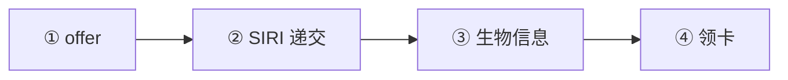
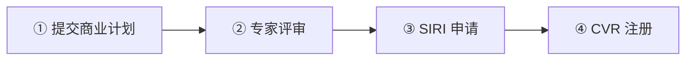

# 🇩🇰 丹麦 · Denmark

    

**不签蓝卡，走 Pay Limit（DKK 55.2 万/年）等本国路线**

[🧑‍💻 Pay Limit Scheme](#denmark-pay-limit-scheme) · [🚀 Startup Denmark 替代路线](#denmark-startup-denmark) · [📖 深度解读](#deep) · [🔗 延伸阅读](#more)

> [!TIP]
> **一句话判断**：欧盟 + 申根，货币克朗（DKK）。**没有数字游民签证，也不签发欧盟蓝卡**（丹麦不参与蓝卡指令）。技术工作走丹麦本国体系：**薪资门槛计划（Pay Limit）**、**补充薪资门槛**、**正面清单（紧缺职业）**、**快速通道（认证雇主）**。创业看 **Startup Denmark**（每年仅 75 个名额）。

## 🏙️ 生活与身份档案

<table>
<tr><td width="33%" valign="top">💶 生活成本指数（纽约=100） <b>78.6 ●●●○○</b></td><td width="33%" valign="top">🏠 房租指数（纽约=100） <b>26.6 ●●●○○</b></td><td width="33%" valign="top">🛡️ 安全指数 <b>73.2 ●●●●○</b></td></tr>
<tr><td width="33%" valign="top">💼 平均年薪（总额） <b>EUR 71,565</b></td><td width="33%" valign="top">🧾 最高个税税率 <b>60.5%</b></td><td width="33%" valign="top">🛂 护照免签目的地 <b>186 个（中国 81）</b></td></tr>
<tr><td width="33%" valign="top">🏠 永居年限 <b>8 年（满足条件 4 年）</b></td><td width="33%" valign="top">🎖️ 入籍年限 <b>9 年</b></td><td width="33%" valign="top">🔁 双重国籍 <b>✅ 可保留原国籍</b></td></tr>
<tr><td width="33%" valign="top">🗣️ 语言要求 <b>丹麦语 3 级</b></td><td width="33%" valign="top">✈️ 中国护照入境 <b>申根签证</b></td><td width="33%" valign="top"></td></tr>
</table>

● 越多越好（成本/房租越低、安全越高）。数据：Numbeo 2026 年中、Eurostat、Tax Foundation 2026、Henley 2026；永居/入籍为常见规则，以官方为准。中国不承认双重国籍。[数据说明](README.md#profiles)

## 📊 路线速查

| 路线 | 类型 | 门槛信号 | 家属 | 永居 | 状态 |
|---|---|---|:-:|:-:|:-:|
| [丹麦 Pay Limit Scheme](#denmark-pay-limit-scheme) | 🧑‍💻 技术工作 | DKK 552,000/年 | ✅ 可带 | ✅ 可能 | 🟢 开放 |
| [丹麦 Startup Denmark 替代路线](#denmark-startup-denmark) | 🚀 创业 | — | ✅ 可带 | ✅ 可能 | 🟢 开放 |

门槛为主申请人的最低信号值，多与当地工资挂钩、每年调整，递交前以官方为准。

---

## 🧑‍💻 丹麦 Pay Limit Scheme

   

> **丹麦不签蓝卡，高薪走 Pay Limit：年薪 DKK 55.2 万，不限学历和行业。**

<table>
<tr><td width="33%" valign="top">年薪 <b>≥ DKK 552,000</b></td><td width="33%" valign="top">补充方案 <b>DKK 446,000 + 附加条件</b></td><td width="33%" valign="top">要求 <b>丹麦银行账户、每周 ≥30 小时</b></td></tr>
<tr><td width="33%" valign="top">费用 <b>DKK 6,810</b></td><td width="33%" valign="top">审理 <b>1 个月（最长 3 个月）</b></td><td width="33%" valign="top"></td></tr>
</table>

<table><tr>
<td width="50%" valign="top">✅ <b>适合</b><ul><li>高薪岗位</li></ul></td>
<td width="50%" valign="top">❌ <b>不适合</b><ul><li>靠福利凑薪资</li></ul></td>
</tr></table>

### 🗺️ 申请流程

1. **offer**
2. **SIRI 递交**
3. **生物信息**
4. **领卡**

### 📋 材料清单

- [ ] 劳动合同
- [ ] 护照

> [!WARNING]
> **注意**
> - 正面清单职业可走另一条路

🔗 官方来源（4）

- [SIRI Pay Limit Scheme](https://www.nyidanmark.dk/en-GB/You-want-to-apply/Work/Pay-limit-scheme/)
- [SIRI Pay Limit Scheme minimum amount](https://www.nyidanmark.dk/en-GB/Words-and-concepts/SIRI/Minimum-amounts/Pay-Limit-Scheme%27s-minimum-amount)
- [SIRI Positive List for People with a Higher Education](https://www.nyidanmark.dk/en-GB/Applying/Work/Positive%20list%20higher%20education)
- [European Commission EU Blue Card](https://home-affairs.ec.europa.eu/policies/migration-and-asylum/eu-immigration-portal/eu-blue-card_en)

数据核查：2026-10-25 · [LetsMigrate 原始记录](https://letsmigrate.org/zh-hans/programmes/denmark-pay-limit-scheme-zh/) · [↑ 回到顶部](#top)

---

## 🚀 丹麦 Startup Denmark 替代路线

   

> **专家委员会批准的创业项目才能申请，每年只有 75 个名额。**

<table>
<tr><td width="33%" valign="top">名额 <b>每年 75 个</b></td><td width="33%" valign="top">团队 <b>最多 3 名创始人</b></td><td width="33%" valign="top">费用 <b>DKK 3,060</b></td></tr>
<tr><td width="33%" valign="top">期限 <b>2 年，续 3 年</b></td><td width="33%" valign="top"></td><td width="33%" valign="top"></td></tr>
</table>

<table><tr>
<td width="50%" valign="top">✅ <b>适合</b><ul><li>可扩展的科技创业团队</li></ul></td>
<td width="50%" valign="top">❌ <b>不适合</b><ul><li>普通生意</li></ul></td>
</tr></table>

### 🗺️ 申请流程

1. **提交商业计划**
2. **专家评审**
3. **SIRI 申请**
4. **CVR 注册**

### 📋 材料清单

- [ ] 商业计划
- [ ] 自给能力证明

🔗 官方来源（5）

- [Startup Denmark programme](https://startupdenmarkprogramme.dk/)
- [Startup Denmark application process](https://startupdenmarkprogramme.dk/application-guide-startups)
- [SIRI Startup Denmark residence and work permit](https://www.nyidanmark.dk/en-GB/You-want-to-apply/Work/Start-up-Denmark/)
- [Business in Denmark starting a business](https://businessindenmark.virk.dk/guidance/services-contact-point/Establish-a-business-in-Denmark/)
- [Danish Tax Agency VAT guide](https://skat.dk/en-us/businesses/vat/vat-what-to-do/how-to-register-your-business)

数据核查：2026-10-25 · [LetsMigrate 原始记录](https://letsmigrate.org/zh-hans/programmes/denmark-startup-denmark-zh/) · [↑ 回到顶部](#top)

---

## 📖 深度解读

### 路线要点

### 技术工作路线（SIRI 审批）
| 路线 | 适用 | 2026 门槛 |
|---|---|---|
| **Pay Limit 薪资门槛计划** | 高薪丹麦工作，不限学历和行业 | **DKK 552,000/年**（DKK 46,000/月） |
| 补充薪资门槛计划 | 门槛略低，附加条件 | DKK 446,000/年 |
| 正面清单（高等教育/技工） | 职位在当前紧缺清单 + 相应学历 | 清单 2026-10-01 更新 |
| 快速通道（Fast-track） | 雇主获 SIRI 认证 | 按具体轨道 |

- Pay Limit：需丹麦工作 offer、丹麦标准薪资和劳动条件、**丹麦银行账户**、每周 ≥30 小时；食堂、车、手机、住房等福利一般不计入薪资。
- **费用**：DKK 6,810（主要工作路线）；**审理**：通常 1 个月，需补件最长 3 个月。

### Startup Denmark
- 先由专家委员会评审商业计划（创新性、可扩展性、团队、市场、丹麦契合度），最多 3 名创始人可联合提交。
- 通过后向 SIRI 申请居留和工作许可，**首次费用 DKK 3,060**，需证明能负担本人和家属生活。
- **每年 75 个名额**；首次最长 2 年，每次续签最长 3 年。
- 不是远程工作签证。

### 永居与入籍
- 丹麦永居要求严格（通常需 8 年居住，满足条件可缩短到 4 年，另有就业、丹麦语、自给等条件），入籍同样严格，以 SIRI 和移民部现行规定为准。

---

## 🔗 延伸阅读

LetsMigrate 中文指南原文（4 篇）

- [丹麦欧盟蓝卡替代技术工作路线](https://letsmigrate.org/zh-hans/articles/denmark-skilled-work-alternatives-not-eu-blue-card-zh/)
- [丹麦 Startup Denmark 替代指南](https://letsmigrate.org/zh-hans/articles/denmark-startup-denmark-guide-zh/)
- [丹麦 Startup Denmark 税务和业务设置](https://letsmigrate.org/zh-hans/articles/denmark-startup-denmark-tax-business-setup-zh/)
- [丹麦 Startup Denmark 时间线和文件](https://letsmigrate.org/zh-hans/articles/denmark-startup-denmark-timeline-documents-zh/)

[← 🇨🇿 捷克](czechia.md) ｜ [🇪🇺 全部国家](README.md) ｜ [🏠 首页](../../README.md) ｜ [🇪🇪 爱沙尼亚 →](estonia.md)

本页根据 [LetsMigrate.org](https://letsmigrate.org/zh-hans/countries/denmark-zh/) 公开资料及官方来源整理改写，仅供信息参考，不构成移民、法律、税务或投资建议。
