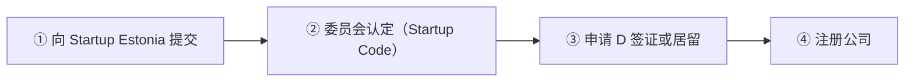

# 🇪🇪 爱沙尼亚 · Estonia

    

**数字游民是 D 签证非居留；就业许可最长 5 年**

[💻 数字游民签证](#estonia-digital-nomad-visa) · [🧑‍💻 欧盟蓝卡](#estonia-eu-blue-card) · [🧑‍💻 就业居留许可](#estonia-residence-permit-for-employment) · [🚀 创业签证（Startup Visa）](#estonia-startup-visa) · [📖 深度解读](#deep) · [🔗 延伸阅读](#more)

> [!TIP]
> **一句话判断**：欧盟 + 申根 + 欧元区，数字化政务发达。**数字游民签证本质是 D 类签证，不是居留许可**，最多连续住 548 天/730 天；**e-Residency（电子居民）不给任何居留或入境权利**，别搞混。技术就业看**就业居留许可（最长 5 年）vs 欧盟蓝卡**，工资门槛与统计局平均工资挂钩。

## 🏙️ 生活与身份档案

<table>
<tr><td width="33%" valign="top">💶 生活成本指数（纽约=100） <b>59.4 ●●●●○</b></td><td width="33%" valign="top">🏠 房租指数（纽约=100） <b>15.2 ●●●●○</b></td><td width="33%" valign="top">🛡️ 安全指数 <b>76.5 ●●●●○</b></td></tr>
<tr><td width="33%" valign="top">💼 平均年薪（总额） <b>EUR 26,546</b></td><td width="33%" valign="top">🧾 最高个税税率 <b>22%</b></td><td width="33%" valign="top">🛂 护照免签目的地 <b>183 个（中国 81）</b></td></tr>
<tr><td width="33%" valign="top">🏠 永居年限 <b>5 年</b></td><td width="33%" valign="top">🎖️ 入籍年限 <b>8 年</b></td><td width="33%" valign="top">🔁 双重国籍 <b>❌ 一般须放弃</b></td></tr>
<tr><td width="33%" valign="top">🗣️ 语言要求 <b>爱沙尼亚语 B1</b></td><td width="33%" valign="top">✈️ 中国护照入境 <b>申根签证</b></td><td width="33%" valign="top"></td></tr>
</table>

● 越多越好（成本/房租越低、安全越高）。数据：Numbeo 2026 年中、Eurostat、Tax Foundation 2026、Henley 2026；永居/入籍为常见规则，以官方为准。中国不承认双重国籍。[数据说明](README.md#profiles)

## 📊 路线速查

| 路线 | 类型 | 门槛信号 | 家属 | 永居 | 状态 |
|---|---|---|:-:|:-:|:-:|
| [爱沙尼亚数字游民签证](#estonia-digital-nomad-visa) | 💻 数字游民 | EUR 3,960/月 | ✅ 可带 | ⏳ 偏临时 | 🟢 开放 |
| [爱沙尼亚欧盟蓝卡](#estonia-eu-blue-card) | 🧑‍💻 技术工作 | EUR 3,138/月 | ✅ 可带 | ✅ 可能 | 🟢 开放 |
| [爱沙尼亚就业居留许可](#estonia-residence-permit-for-employment) | 🧑‍💻 技术工作 | EUR 2,092/月 | ✅ 可带 | ✅ 可能 | 🟢 开放 |
| [爱沙尼亚创业签证（Startup Visa）](#estonia-startup-visa) | 🚀 创业 | — | ✅ 可带 | ✅ 可能 | 🟢 开放 |

门槛为主申请人的最低信号值，多与当地工资挂钩、每年调整，递交前以官方为准。

---

## 💻 爱沙尼亚数字游民签证

   

> **月入约 3,960 欧的远程工作者可拿 D 签证住最长 1 年；这是签证，不是居留许可。**

<table>
<tr><td width="33%" valign="top">收入 <b>申请前 6 个月 EUR 132/天（≈ 3,960/月）</b></td><td width="33%" valign="top">C 签证 <b>≤90 天，费用 EUR 90</b></td><td width="33%" valign="top">D 签证 <b>最长 365 天，费用 EUR 120</b></td></tr>
<tr><td width="33%" valign="top">连续两次 D <b>730 天内总停留 ≤548 天</b></td><td width="33%" valign="top">审理 <b>约 30 天</b></td><td width="33%" valign="top">永居 <b>❌ 不通向</b></td></tr>
</table>

<table><tr>
<td width="50%" valign="top">✅ <b>适合</b><ul><li>想在北欧数字化国家住一年的远程工作者</li></ul></td>
<td width="50%" valign="top">❌ <b>不适合</b><ul><li>想长期居留</li><li>把 e-Residency 当居留的人</li></ul></td>
</tr></table>

### 🗺️ 申请流程

1. **准备 6 个月收入证明**
2. **选 C 或 D 签证**
3. **递交** — 使领馆、VFS 或在爱沙尼亚的警察与边防局
4. **约 30 天出结果**

### 📋 材料清单

- [ ] 签证申请表、照片、护照
- [ ] 远程工作证明（雇主/公司/客户合同）
- [ ] 6 个月收入证明
- [ ] 教育与职业经历说明
- [ ] 医疗保险
- [ ] 住宿计划

> [!WARNING]
> **注意**
> - e-Residency 不给任何居留或入境权利
> - 住满 183 天成为税务居民

🔗 官方来源（3）

- [Estonia e-Residency Digital Nomad Visa FAQ](https://www.e-resident.gov.ee/blog/posts/faqs-about-estonias-digital-nomad-visa/)
- [Estonian Ministry of Foreign Affairs D visa guidance](https://vm.ee/en/consular-visa-and-travel-information/visa-information/application-long-stay-d-visa)
- [Estonian Tax and Customs Board tax residency guidance](https://www.emta.ee/en/private-client/foreigner-non-resident/tax-residency/determining-residency)

数据核查：2026-10-25 · [LetsMigrate 原始记录](https://letsmigrate.org/zh-hans/programmes/estonia-digital-nomad-visa-zh/) · [↑ 回到顶部](#top)

---

## 🧑‍💻 爱沙尼亚欧盟蓝卡

   

> **月薪约 3,138 欧（特定职业 2,594）以上的高资质岗位。**

<table>
<tr><td width="33%" valign="top">薪资 <b>平均工资 1.5 倍 EUR 3,138；特定职业 1.24 倍 EUR 2,594</b></td><td width="33%" valign="top">有效期 <b>合同期 + 3 个月，最长 2 年 3 个月</b></td><td width="33%" valign="top">失业 <b>持卡 <2 年累计 3 个月，≥2 年 6 个月</b></td></tr>
<tr><td width="33%" valign="top">长期居留 <b>欧盟内 5 年，最后 2 年在爱沙尼亚</b></td><td width="33%" valign="top"></td><td width="33%" valign="top"></td></tr>
</table>

<table><tr>
<td width="50%" valign="top">✅ <b>适合</b><ul><li>需要欧盟流动的高资质员工</li></ul></td>
<td width="50%" valign="top">❌ <b>不适合</b><ul><li>想要 5 年首期（看就业居留）</li></ul></td>
</tr></table>

### 🗺️ 申请流程

1. **拿到 offer**
2. **递交蓝卡**
3. **领卡并登记住址**

### 📋 材料清单

- [ ] 劳动合同
- [ ] 3 年制学历或经验证明
- [ ] 护照

> [!WARNING]
> **注意**
> - 蓝卡首期比普通就业居留短

🔗 官方来源（3）

- [European Commission highly-qualified worker in Estonia](https://home-affairs.ec.europa.eu/policies/migration-and-asylum/eu-immigration-portal/highly-qualified-worker-estonia_en)
- [Estonian Aliens Act](https://www.riigiteataja.ee/en/tolge/pdf/506012026003)
- [Statistics Estonia average monthly gross wages and salaries](https://www.stat.ee/en/find-statistics/statistics-theme/work-life/wages-and-salaries-and-labour-costs/average-monthly-gross-wages-and-salaries)

数据核查：2026-10-26 · [LetsMigrate 原始记录](https://letsmigrate.org/zh-hans/programmes/estonia-eu-blue-card-zh/) · [↑ 回到顶部](#top)

---

## 🧑‍💻 爱沙尼亚就业居留许可

   

> **爱沙尼亚普通就业居留，工资达平均水平即可，首次最长 5 年。**

<table>
<tr><td width="33%" valign="top">薪资 <b>≥ 平均月薪 EUR 2,092（2025 年值）</b></td><td width="33%" valign="top">顶尖专家 <b>≥ 1.5 倍（EUR 3,138）+ 雇主条件</b></td><td width="33%" valign="top">有效期 <b>最长 5 年</b></td></tr>
<tr><td width="33%" valign="top">审理 <b>2 个月</b></td><td width="33%" valign="top">配额 <b>普通就业可能受年度配额限制</b></td><td width="33%" valign="top">长期居留 <b>5 年 + 爱沙尼亚语 B1</b></td></tr>
</table>

<table><tr>
<td width="50%" valign="top">✅ <b>适合</b><ul><li>初创/ICT 公司员工（可豁免配额）</li><li>想要较长首期居留</li></ul></td>
<td width="50%" valign="top">❌ <b>不适合</b><ul><li>配额已满的普通岗位</li></ul></td>
</tr></table>

### 🗺️ 申请流程

1. **雇主确认类别和配额**
2. **递交居留申请**
3. **2 个月内决定**
4. **30 天内发卡**
5. **1 个月内登记住址**

### 📋 材料清单

- [ ] 劳动合同
- [ ] 学历/资质
- [ ] 护照
- [ ] 雇主文件

> [!WARNING]
> **注意**
> - 按申请时最新统计数据重算薪资门槛

🔗 官方来源（3）

- [European Commission employed worker in Estonia](https://home-affairs.ec.europa.eu/policies/migration-and-asylum/eu-immigration-portal/employed-worker-estonia_en)
- [Estonian Aliens Act](https://www.riigiteataja.ee/en/tolge/pdf/506012026003)
- [Statistics Estonia average monthly gross wages and salaries](https://www.stat.ee/en/find-statistics/statistics-theme/work-life/wages-and-salaries-and-labour-costs/average-monthly-gross-wages-and-salaries)

数据核查：2026-10-26 · [LetsMigrate 原始记录](https://letsmigrate.org/zh-hans/programmes/estonia-residence-permit-for-employment-zh/) · [↑ 回到顶部](#top)

---

## 🚀 爱沙尼亚创业签证（Startup Visa）

    

> **创业委员会 10 个工作日内评审，不收费、无最低注资，通过后可拿 D 签证或 2+3 年居留。**

<table>
<tr><td width="33%" valign="top">评审 <b>创业委员会，10 个工作日，免费</b></td><td width="33%" valign="top">注资 <b>无最低要求（普通商业投资居留需 6.5 万欧）</b></td><td width="33%" valign="top">个人资金 <b>约 EUR 800/月</b></td></tr>
<tr><td width="33%" valign="top">签证 <b>D 签证 EUR 120</b></td><td width="33%" valign="top">居留 <b>2+3 年，境内 EUR 350 / 境外 380</b></td><td width="33%" valign="top">招人 <b>免移民配额和最低工资要求</b></td></tr>
</table>

<table><tr>
<td width="50%" valign="top">✅ <b>适合</b><ul><li>有可扩展科技项目的创始人</li></ul></td>
<td width="50%" valign="top">❌ <b>不适合</b><ul><li>普通生意、无创新性</li></ul></td>
</tr></table>

### 🗺️ 申请流程

1. **向 Startup Estonia 提交**
2. **委员会认定（Startup Code）**
3. **申请 D 签证或居留**
4. **注册公司** — 可用 e-Residency 远程办理

### 📋 材料清单

- [ ] 商业计划
- [ ] 团队与产品材料
- [ ] 资金证明
- [ ] 医保 ≥ EUR 30,000

> [!WARNING]
> **注意**
> - e-Residency 本身不给居留，这才是能住下来的那条

🔗 来源（2）

- [e-Residency: Startup Visa vs e-Residency](https://www.e-resident.gov.ee/blog/posts/estonian-startup-visa-vs-e-residency/)
- [Remote Work Europe: Estonia Startup Visa](https://remoteworkeurope.eu/insights/estonia-startup-visa-explained/)

数据核查：2026-10 · 本条为 RUN 补充路线（LetsMigrate 未收录），来源见上 · [↑ 回到顶部](#top)

---

## 📖 深度解读

### 路线要点

### 数字游民签证（远程工作 C/D 签证）
- **适用**：为境外雇主工作；或拥有并经营境外公司；或主要为境外客户服务的自由职业者/顾问。
- **收入**：申请前 6 个月合法收入达到 **EUR 132/天（约 EUR 3,960/月）**（外交部最新标准；e-Residency FAQ 仍显示旧的 EUR 150/天）。
- **两种签证**：
  | | C 签证 | D 签证 |
  |---|---|---|
  | 停留 | ≤90 天 | 最长连续 12 个月，停留 ≤365 天 |
  | 国家费用 | EUR 90 | EUR 120 |
- **连续两次 D 签证**：730 天内总停留不能超过 548 天，不能无限滚动。
- 持 D 签证期间可在其他申根国 180 天内停留 90 天。
- **递交**：爱沙尼亚使领馆、授权的 VFS，或已在爱沙尼亚合法停留时到警察与边防局；处理约 30 天。
- 需提交教育与职业经历说明；家属可随行（签证类）。**不通永居或入籍**。

### 就业居留许可 vs 欧盟蓝卡
以 2025 年平均月薪 **EUR 2,092** 计算（统计局年度数据，申请时需按最新官方数据重算）：

| 路线 | 薪资公式 | 2026 参考值 | 首次有效期 |
|---|---|---|---|
| 普通就业居留 | ≥ 平均工资 1.0 倍 | EUR 2,092/月 | 最长 5 年 |
| 顶尖专家（Top specialist） | ≥ 1.5 倍 + 雇主条件 | EUR 3,138/月 | 同就业居留 |
| 欧盟蓝卡（一般） | ≥ 1.5 倍 | EUR 3,138/月 | 合同期 + 3 个月，最长 2 年 3 个月 |
| 欧盟蓝卡（特定职业） | ≥ 1.24 倍 | EUR 2,594.08/月 | 同上 |

- **年度移民配额**：普通就业可能受配额限制；顶尖专家、初创/ICT 等类别可豁免。
- **时限**：短期就业登记 15 个工作日；就业居留 2 个月内决定；获批后 30 天内发卡；到达 1 个月内到人口登记处登记住址。
- **失业**：就业许可因雇主经济原因解约的，90 天内不撤销；蓝卡持有 <2 年可失业累计 3 个月，≥2 年可 6 个月。
- **长期居留**：一般需连续 5 年临时居留 + 稳定收入 + 爱沙尼亚语 **B1**；蓝卡可累计欧盟内年限（最后 2 年在爱沙尼亚）。

### 创业签证（本站未单列）
- 爱沙尼亚有 Startup Visa：初创公司需先获创业委员会认定，适合有真实科技创业项目的人，详见官方 Startup Estonia。

### 税务提醒
- 住所在爱沙尼亚，或连续 12 个月内停留 ≥183 天 → 税务居民。
- 用 e-Residency 开的爱沙尼亚公司 + 本人长住爱沙尼亚，可能引发公司常设机构和个人税务问题。

---

## 🔗 延伸阅读

LetsMigrate 中文指南原文（9 篇）

- [爱沙尼亚数字游民签证文件清单](https://letsmigrate.org/zh-hans/articles/estonia-digital-nomad-visa-documents-checklist-zh/)
- [爱沙尼亚数字游民签证家庭和第二次签证规则](https://letsmigrate.org/zh-hans/articles/estonia-digital-nomad-visa-family-second-visa-zh/)
- [爱沙尼亚数字游民签证指南](https://letsmigrate.org/zh-hans/articles/estonia-digital-nomad-visa-guide-zh/)
- [爱沙尼亚数字游民签证税务、e-Residency、银行和保险](https://letsmigrate.org/zh-hans/articles/estonia-digital-nomad-visa-tax-eresidency-banking-insurance-zh/)
- [爱沙尼亚数字游民签证时间线和费用](https://letsmigrate.org/zh-hans/articles/estonia-digital-nomad-visa-timeline-costs-zh/)
- [爱沙尼亚工作许可和欧盟蓝卡家庭、流动性与定居](https://letsmigrate.org/zh-hans/articles/estonia-employment-eu-blue-card-family-mobility-settlement-zh/)
- [爱沙尼亚就业和欧盟蓝卡薪资规则](https://letsmigrate.org/zh-hans/articles/estonia-employment-eu-blue-card-salary-qualification-rules-zh/)
- [爱沙尼亚工作许可和欧盟蓝卡时间线与文件](https://letsmigrate.org/zh-hans/articles/estonia-employment-eu-blue-card-timeline-documents-zh/)
- [爱沙尼亚就业许可 vs 欧盟蓝卡](https://letsmigrate.org/zh-hans/articles/estonia-employment-permit-vs-eu-blue-card-zh/)

[← 🇩🇰 丹麦](denmark.md) ｜ [🇪🇺 全部国家](README.md) ｜ [🏠 首页](../../README.md) ｜ [🇫🇮 芬兰 →](finland.md)

本页根据 [LetsMigrate.org](https://letsmigrate.org/zh-hans/countries/estonia-zh/) 公开资料及官方来源整理改写，仅供信息参考，不构成移民、法律、税务或投资建议。
