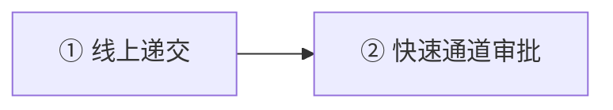
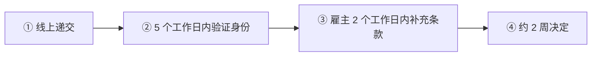
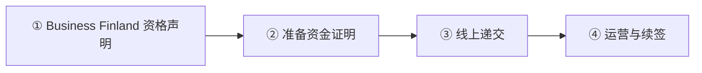

# 🇫🇮 芬兰 · Finland

    

**专家许可与蓝卡同为 EUR 3,937/月，快速通道 2 周**

[🧑‍💻 欧盟蓝卡](#finland-eu-blue-card) · [🧑‍💻 专家居留许可](#finland-specialist-residence-permit) · [🧾 企业家和初创许可替代路线](#finland-entrepreneur-startup-permit) · [📖 深度解读](#deep) · [🔗 延伸阅读](#more)

> [!TIP]
> **一句话判断**：欧盟 + 申根 + 欧元区。**没有数字游民签证**。2026 年**专家居留许可和欧盟蓝卡用同一个薪资门槛 EUR 3,937/月**，都支持**快速通道（目标 2 周出结果）**；专家许可对学历更灵活。创业看**初创企业家许可**（需 Business Finland 资格声明）。**2026-01-08 永居规则调整**：年收入 ≥ EUR 40,000 可 4 年拿永居。

## 🏙️ 生活与身份档案

<table>
<tr><td width="33%" valign="top">💶 生活成本指数（纽约=100） <b>68.5 ●●●○○</b></td><td width="33%" valign="top">🏠 房租指数（纽约=100） <b>20.1 ●●●●○</b></td><td width="33%" valign="top">🛡️ 安全指数 <b>73.7 ●●●●○</b></td></tr>
<tr><td width="33%" valign="top">💼 平均年薪（总额） <b>EUR 49,428</b></td><td width="33%" valign="top">🧾 最高个税税率 <b>45%</b></td><td width="33%" valign="top">🛂 护照免签目的地 <b>185 个（中国 81）</b></td></tr>
<tr><td width="33%" valign="top">🏠 永居年限 <b>4 年（年入 4 万欧）/ 6 年</b></td><td width="33%" valign="top">🎖️ 入籍年限 <b>8 年（语言达标 5 年）</b></td><td width="33%" valign="top">🔁 双重国籍 <b>✅ 可保留原国籍</b></td></tr>
<tr><td width="33%" valign="top">🗣️ 语言要求 <b>芬兰/瑞典语</b></td><td width="33%" valign="top">✈️ 中国护照入境 <b>申根签证</b></td><td width="33%" valign="top"></td></tr>
</table>

● 越多越好（成本/房租越低、安全越高）。数据：Numbeo 2026 年中、Eurostat、Tax Foundation 2026、Henley 2026；永居/入籍为常见规则，以官方为准。中国不承认双重国籍。[数据说明](README.md#profiles)

## 📊 路线速查

| 路线 | 类型 | 门槛信号 | 家属 | 永居 | 状态 |
|---|---|---|:-:|:-:|:-:|
| [芬兰欧盟蓝卡](#finland-eu-blue-card) | 🧑‍💻 技术工作 | EUR 3,937/月 | ✅ 可带 | ✅ 可能 | 🟢 开放 |
| [芬兰专家居留许可](#finland-specialist-residence-permit) | 🧑‍💻 技术工作 | EUR 3,937/月 | ✅ 可带 | ✅ 可能 | 🟢 开放 |
| [芬兰企业家和初创许可替代路线](#finland-entrepreneur-startup-permit) | 🧾 自雇 | — | ✅ 可带 | ✅ 可能 | 🟢 开放 |

门槛为主申请人的最低信号值，多与当地工资挂钩、每年调整，递交前以官方为准。

---

## 🧑‍💻 芬兰欧盟蓝卡

   

> **与专家许可同门槛（3,937 欧），多一个欧盟流动和 P-EU 累计优势。**

<table>
<tr><td width="33%" valign="top">月薪 <b>≥ EUR 3,937</b></td><td width="33%" valign="top">学历 <b>≥3 年高等教育或 5 年经验</b></td><td width="33%" valign="top">合同 <b>≥6 个月</b></td></tr>
<tr><td width="33%" valign="top">首期 <b>最长 2 年</b></td><td width="33%" valign="top">快速通道 <b>可</b></td><td width="33%" valign="top"></td></tr>
</table>

<table><tr>
<td width="50%" valign="top">✅ <b>适合</b><ul><li>学历规范、需要欧盟流动</li></ul></td>
<td width="50%" valign="top">❌ <b>不适合</b><ul><li>学历不规范（选专家许可）</li></ul></td>
</tr></table>

### 🗺️ 申请流程

1. **线上递交**
2. **快速通道审批**

### 📋 材料清单

- [ ] 劳动合同
- [ ] 学历证明

🔗 官方来源（3）

- [Finnish Immigration Service EU Blue Card](https://migri.fi/en/eu-blue-card)
- [Finnish Immigration Service income requirement for work](https://migri.fi/en/working-in-finland/income-requirement)
- [Finnish Immigration Service period of residence requirement](https://migri.fi/en/period-of-residence-requirement)

数据核查：2026-10-25 · [LetsMigrate 原始记录](https://letsmigrate.org/zh-hans/programmes/finland-eu-blue-card-zh/) · [↑ 回到顶部](#top)

---

## 🧑‍💻 芬兰专家居留许可

   

> **芬兰专家许可：月薪 3,937 欧，学历要求灵活，快速通道 2 周。**

<table>
<tr><td width="33%" valign="top">月薪 <b>≥ EUR 3,937（不含福利）</b></td><td width="33%" valign="top">资质 <b>学历或工作经验</b></td><td width="33%" valign="top">快速通道 <b>约 2 周（仅境外首次申请）</b></td></tr>
<tr><td width="33%" valign="top">费用 <b>线上 EUR 530</b></td><td width="33%" valign="top">首期 <b>最长 2 年</b></td><td width="33%" valign="top">永居 <b>4 年 + 年收入 4 万欧，或 6 年 + B1</b></td></tr>
</table>

<table><tr>
<td width="50%" valign="top">✅ <b>适合</b><ul><li>有经验但学历不完全对口的专家</li></ul></td>
<td width="50%" valign="top">❌ <b>不适合</b><ul><li>已在芬兰境内（不能走快速通道）</li></ul></td>
</tr></table>

### 🗺️ 申请流程

1. **线上递交**
2. **5 个工作日内验证身份**
3. **雇主 2 个工作日内补充条款**
4. **约 2 周决定**

### 📋 材料清单

- [ ] 劳动合同
- [ ] 学历或经验证明
- [ ] 护照

> [!WARNING]
> **注意**
> - 配偶 2 天内递交可享快速通道

🔗 官方来源（4）

- [Finnish Immigration Service specialist residence permit](https://migri.fi/en/specialist)
- [Finnish Immigration Service income requirement for work](https://migri.fi/en/working-in-finland/income-requirement)
- [Finnish Immigration Service fast track for specialists](https://migri.fi/en/fast-track-for-specialist)
- [Finnish Immigration Service permanent residence permit](https://migri.fi/en/permanent-residence-permit)

数据核查：2026-10-25 · [LetsMigrate 原始记录](https://letsmigrate.org/zh-hans/programmes/finland-specialist-residence-permit-zh/) · [↑ 回到顶部](#top)

---

## 🧾 芬兰企业家和初创许可替代路线

   

> **企业家（持股 ≥30% 管理者）或初创企业家（需 Business Finland 声明）。**

<table>
<tr><td width="33%" valign="top">企业家 <b>个体户、合伙人或管理股东（≥30%）</b></td><td width="33%" valign="top">初创 <b>Business Finland 声明（≤4 个月）</b></td><td width="33%" valign="top">生活资金 <b>每月 EUR 1,030–1,210，至少 1 年</b></td></tr>
<tr><td width="33%" valign="top">费用 <b>企业家 EUR 750 / 初创 650（线上）</b></td><td width="33%" valign="top">首期 <b>初创最长 2 年</b></td><td width="33%" valign="top">快速通道 <b>初创可，约 2 周</b></td></tr>
</table>

<table><tr>
<td width="50%" valign="top">✅ <b>适合</b><ul><li>有创新项目的创始人</li></ul></td>
<td width="50%" valign="top">❌ <b>不适合</b><ul><li>没有资金储备</li></ul></td>
</tr></table>

### 🗺️ 申请流程

1. **Business Finland 资格声明**
2. **准备资金证明**
3. **线上递交**
4. **运营与续签**

### 📋 材料清单

- [ ] 资格声明
- [ ] 资金证明
- [ ] 商业材料

> [!WARNING]
> **注意**
> - 营业额 > EUR 20,000 须登记增值税

🔗 官方来源（4）

- [Finnish Immigration Service entrepreneur permit](https://migri.fi/en/entrepreneur)
- [Finnish Immigration Service startup entrepreneur permit](https://migri.fi/en/start-up-entrepreneur)
- [Finnish Immigration Service work-based income requirement](https://migri.fi/en/working-in-finland/income-requirement)
- [Finnish Tax Administration prepayment register](https://www.vero.fi/en/businesses-and-corporations/business-operations/tax-administrations-registers--business/prepayment-register/)

数据核查：2026-10-25 · [LetsMigrate 原始记录](https://letsmigrate.org/zh-hans/programmes/finland-entrepreneur-startup-permit-zh/) · [↑ 回到顶部](#top)

---

## 📖 深度解读

### 路线要点

### 专家居留许可 vs 欧盟蓝卡
| | 专家居留许可 | 欧盟蓝卡 |
|---|---|---|
| 2026 薪资 | **≥ EUR 3,937/月**（不含福利、津贴） | 同左 |
| 资质 | 学历，或通过工作经验/其他教育获得的专业能力 | ≥3 年制高等教育，或通常 ≥5 年可比经验 |
| 合同 | 确认雇佣 | ≥6 个月 |
| 首次期限 | 最长 2 年 | 最长 2 年（短期工作 + 3 个月） |
| 费用 | 线上首次 EUR 530 / 纸质 630 / 续签 230 | 同左 |
| 快速通道 | 可（境外申请） | 可（境外申请） |

- **快速通道**：仅首次申请、仅在芬兰境外；递交后 5 个工作日内完成身份验证，雇主 2 个工作日内补充雇佣条款。配偶在主申请人递交后获得快速通道编号，2 天内递交自己的申请。
- **普通雇员许可**：需达到集体协议工资，2026 年总收入至少 EUR 1,600/月。
- 薪资不够 EUR 3,937 时，福利不能用来补足。

### 企业家 / 初创企业家许可
- **企业家形式**：个体户、普通合伙人、合格合作社成员，或在有限公司中担任管理职务 + 持股/投票权 ≥30%。
- **初创企业家**：需 Business Finland 的肯定资格声明（递交时不超过 4 个月），资金至少够 1 年：
  | 计划居住地 | 2026 每月净资源 |
  |---|---|
  | 赫尔辛基都市圈 | EUR 1,210 |
  | 其他大城市 | EUR 1,090 |
  | 其他市镇 | EUR 1,030 |
- 资金够 2 年可获 2 年首次许可；续签最长 4 年（按已证明收入期间）。初创有快速通道（目标 2 周）。
- **费用**：企业家线上 EUR 750 / 纸质 900；初创企业家线上 EUR 650 / 纸质 800；续签 EUR 230 / 430。
- 年营业额超过 EUR 20,000 须登记增值税。

### 永居（2026-01-08 新规）
- 连续居住 **6 年** + 工作经历 + 芬兰语/瑞典语 B1；
- 或 **4 年** + 年应税收入 ≥ **EUR 40,000**；
- 另有芬兰高等教育、认可的外国学历、语言特别好等路径。
- 蓝卡持有人可走欧盟长期居民（P-EU）累计路径。

---

## 🔗 延伸阅读

LetsMigrate 中文指南原文（7 篇）

- [芬兰企业家和初创许可替代指南](https://letsmigrate.org/zh-hans/articles/finland-entrepreneur-startup-permit-guide-zh/)
- [芬兰企业家许可税务和业务设置](https://letsmigrate.org/zh-hans/articles/finland-entrepreneur-startup-permit-tax-business-setup-zh/)
- [芬兰企业家和初创许可时间线与文件](https://letsmigrate.org/zh-hans/articles/finland-entrepreneur-startup-permit-timeline-documents-zh/)
- [芬兰专家和欧盟蓝卡家庭、流动性与定居](https://letsmigrate.org/zh-hans/articles/finland-specialist-eu-blue-card-family-mobility-settlement-zh/)
- [芬兰专家和欧盟蓝卡薪资与资质规则](https://letsmigrate.org/zh-hans/articles/finland-specialist-eu-blue-card-salary-qualification-rules-zh/)
- [芬兰专家和欧盟蓝卡时间线与文件](https://letsmigrate.org/zh-hans/articles/finland-specialist-eu-blue-card-timeline-documents-zh/)
- [芬兰专家居留许可 vs 欧盟蓝卡](https://letsmigrate.org/zh-hans/articles/finland-specialist-residence-permit-vs-eu-blue-card-zh/)

[← 🇪🇪 爱沙尼亚](estonia.md) ｜ [🇪🇺 全部国家](README.md) ｜ [🏠 首页](../../README.md) ｜ [🇫🇷 法国 →](france.md)

本页根据 [LetsMigrate.org](https://letsmigrate.org/zh-hans/countries/finland-zh/) 公开资料及官方来源整理改写，仅供信息参考，不构成移民、法律、税务或投资建议。
