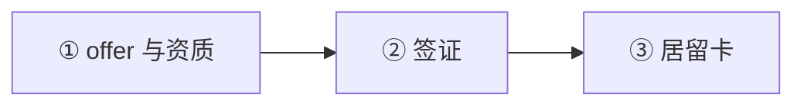
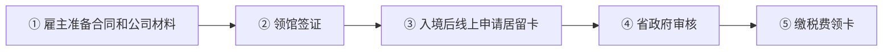
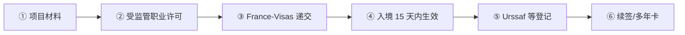

# 🇫🇷 法国 · France

    

**人才护照员工类年薪 EUR 39,582 即可，首卡最长 4 年**

[🧑‍💻 EU Blue Card](#france-eu-blue-card) · [🧑‍💻 Talent Qualified Employee](#france-talent-qualified-employee) · [🧾 创业者 / 自由职业签证替代路线](#france-entrepreneur-profession-liberale-visa) · [📖 深度解读](#deep) · [🔗 延伸阅读](#more)

> [!TIP]
> **一句话判断**：欧盟 + 申根 + 欧元区。**没有数字游民签证**。技术就业的核心是**人才护照（Passeport Talent）**体系：多数技术员工类别年薪只要 **EUR 39,582**，比欧盟蓝卡（EUR 59,373）低很多，**首张卡就最长 4 年**。创业有"人才护照-企业创始人"（投资 EUR 30,000 + 硕士或 5 年经验），自由职业走"创业者/自由职业"签证。

## 🏙️ 生活与身份档案

<table>
<tr><td width="33%" valign="top">💶 生活成本指数（纽约=100） <b>66.9 ●●●○○</b></td><td width="33%" valign="top">🏠 房租指数（纽约=100） <b>20.6 ●●●●○</b></td><td width="33%" valign="top">🛡️ 安全指数 <b>44.2 ●○○○○</b></td></tr>
<tr><td width="33%" valign="top">💼 平均年薪（总额） <b>EUR 43,356</b></td><td width="33%" valign="top">🧾 最高个税税率 <b>55.4%</b></td><td width="33%" valign="top">🛂 护照免签目的地 <b>185 个（中国 81）</b></td></tr>
<tr><td width="33%" valign="top">🏠 永居年限 <b>5 年（10 年居民卡）</b></td><td width="33%" valign="top">🎖️ 入籍年限 <b>5 年</b></td><td width="33%" valign="top">🔁 双重国籍 <b>✅ 可保留原国籍</b></td></tr>
<tr><td width="33%" valign="top">🗣️ 语言要求 <b>法语 B1+</b></td><td width="33%" valign="top">✈️ 中国护照入境 <b>申根签证</b></td><td width="33%" valign="top"></td></tr>
</table>

● 越多越好（成本/房租越低、安全越高）。数据：Numbeo 2026 年中、Eurostat、Tax Foundation 2026、Henley 2026；永居/入籍为常见规则，以官方为准。中国不承认双重国籍。[数据说明](README.md#profiles)

## 📊 路线速查

| 路线 | 类型 | 门槛信号 | 家属 | 永居 | 状态 |
|---|---|---|:-:|:-:|:-:|
| [法国 EU Blue Card](#france-eu-blue-card) | 🧑‍💻 技术工作 | EUR 59,373/年 | ✅ 可带 | ✅ 可能 | 🟢 开放 |
| [法国 Talent Qualified Employee](#france-talent-qualified-employee) | 🧑‍💻 技术工作 | EUR 39,582/年 | ✅ 可带 | ✅ 可能 | 🟢 开放 |
| [法国创业者 / 自由职业签证替代路线](#france-entrepreneur-profession-liberale-visa) | 🧾 自雇 | EUR 1,867.02/月 | ⚠️ 需核查 | ✅ 可能 | 🟢 开放 |

门槛为主申请人的最低信号值，多与当地工资挂钩、每年调整，递交前以官方为准。

---

## 🧑‍💻 法国 EU Blue Card

   

> **人才护照-欧盟蓝卡：年薪 59,373 欧，高资质岗位，可欧盟流动。**

<table>
<tr><td width="33%" valign="top">年薪 <b>≥ EUR 59,373</b></td><td width="33%" valign="top">资质 <b>学历或 5 年经验</b></td><td width="33%" valign="top">卡期 <b>最长 4 年</b></td></tr>
<tr><td width="33%" valign="top">审理 <b>90 天（已持他国蓝卡 30 天）</b></td><td width="33%" valign="top">费用 <b>EUR 350</b></td><td width="33%" valign="top"></td></tr>
</table>

<table><tr>
<td width="50%" valign="top">✅ <b>适合</b><ul><li>高薪且需要欧盟流动</li></ul></td>
<td width="50%" valign="top">❌ <b>不适合</b><ul><li>薪资 4–6 万欧之间（人才员工类更合适）</li></ul></td>
</tr></table>

### 🗺️ 申请流程

1. **offer 与资质**
2. **签证**
3. **居留卡**

### 📋 材料清单

- [ ] 劳动合同
- [ ] 学历证明
- [ ] 护照

🔗 官方来源（4）

- [Service-Public talent residence card](https://www.service-public.gouv.fr/particuliers/vosdroits/F16922?lang=en)
- [France-Visas international talents](https://france-visas.gouv.fr/en/web/france-visas/talents-internationaux-et-attractivite-economique)
- [Business France Talent EU Blue Card](https://welcome.businessfrance.fr/en/setting-up-a-business/recruiting-international-talent/visas-and-residence-permits/hiring-foreign-employee/talent-blue-card/)
- [Legifrance talent legal provisions](https://www.legifrance.gouv.fr/codes/id/LEGISCTA000042776771/)

数据核查：2026-10-25 · [LetsMigrate 原始记录](https://letsmigrate.org/zh-hans/programmes/france-eu-blue-card-zh/) · [↑ 回到顶部](#top)

---

## 🧑‍💻 法国 Talent Qualified Employee

   

> **法国人才护照员工类：年薪 39,582 欧即可，首卡最长 4 年，家属专门有人才家庭卡。**

<table>
<tr><td width="33%" valign="top">年薪 <b>≥ EUR 39,582</b></td><td width="33%" valign="top">类别 <b>合格员工（法国硕士）/ 创新企业员工 / 外派员工</b></td><td width="33%" valign="top">卡期 <b>合同期，最长 4 年</b></td></tr>
<tr><td width="33%" valign="top">费用 <b>EUR 350</b></td><td width="33%" valign="top">审理 <b>省政府 4 个月不答复视为拒绝</b></td><td width="33%" valign="top">家属 <b>人才-家庭卡，配偶可工作</b></td></tr>
</table>

<table><tr>
<td width="50%" valign="top">✅ <b>适合</b><ul><li>法国硕士毕业生</li><li>在创新企业工作</li></ul></td>
<td width="50%" valign="top">❌ <b>不适合</b><ul><li>薪资低于 39,582</li></ul></td>
</tr></table>

### 🗺️ 申请流程

1. **雇主准备合同和公司材料**
2. **领馆签证**
3. **入境后线上申请居留卡**
4. **省政府审核**
5. **缴税费领卡**

### 📋 材料清单

- [ ] 劳动合同
- [ ] 学历（法国硕士等）
- [ ] 雇主证明
- [ ] 护照

> [!WARNING]
> **注意**
> - 39,582 和 59,373 属于不同类别，不能互换

🔗 官方来源（3）

- [Service-Public talent residence card](https://www.service-public.gouv.fr/particuliers/vosdroits/F16922?lang=en)
- [France-Visas international talents](https://france-visas.gouv.fr/en/web/france-visas/talents-internationaux-et-attractivite-economique)
- [Legifrance reference salary order](https://www.legifrance.gouv.fr/jorf/id/JORFTEXT000052158119)

数据核查：2026-10-25 · [LetsMigrate 原始记录](https://letsmigrate.org/zh-hans/programmes/france-talent-qualified-employee-zh/) · [↑ 回到顶部](#top)

---

## 🧾 法国创业者 / 自由职业签证替代路线

   

> **在法国经营业务或做自由职业，收入须达到最低工资水平。**

<table>
<tr><td width="33%" valign="top">收入 <b>≥ EUR 1,867.02/月（最低工资）</b></td><td width="33%" valign="top">签证 <b>1 年期 VLS-TS，入境 15 天内生效</b></td><td width="33%" valign="top">居留卡 <b>EUR 350，最长 1 年，可续</b></td></tr>
<tr><td width="33%" valign="top">多年卡 <b>之后可申请 4 年卡（法语 A2 + 公民考试）</b></td><td width="33%" valign="top">创始人替代 <b>人才护照：投资 ≥ 3 万欧 + 硕士或 5 年经验</b></td><td width="33%" valign="top"></td></tr>
</table>

<table><tr>
<td width="50%" valign="top">✅ <b>适合</b><ul><li>在法国有业务的自由职业者</li></ul></td>
<td width="50%" valign="top">❌ <b>不适合</b><ul><li>境外雇主的远程员工</li></ul></td>
</tr></table>

### 🗺️ 申请流程

1. **项目材料**
2. **受监管职业许可**
3. **France-Visas 递交**
4. **入境 15 天内生效**
5. **Urssaf 等登记**
6. **续签/多年卡**

### 📋 材料清单

- [ ] 商业计划或项目介绍
- [ ] 资金证明
- [ ] Urssaf 注册
- [ ] 住址证明（6 个月内）

> [!WARNING]
> **注意**
> - 资质强的创始人优先看人才护照-企业创始人

🔗 官方来源（4）

- [France-Visas self employed person or liberal activity](https://www.france-visas.gouv.fr/en/activite-non-salariee-ou-liberale)
- [Service-Public entrepreneur / liberal profession residence card](https://www.service-public.gouv.fr/particuliers/vosdroits/F35795?lang=en)
- [Business France entrepreneur / liberal profession status](https://welcome.businessfrance.fr/en/setting-up-a-business/recruiting-international-talent/visas-and-residence-permits/status-of-foreign-company-directors/entrepreneur-liberal-profession/)
- [France-Visas international talents](https://france-visas.gouv.fr/en/web/france-visas/talents-internationaux-et-attractivite-economique)

数据核查：2026-10-25 · [LetsMigrate 原始记录](https://letsmigrate.org/zh-hans/programmes/france-entrepreneur-profession-liberale-visa-zh/) · [↑ 回到顶部](#top)

---

## 📖 深度解读

### 路线要点

### 人才护照员工类 vs 人才护照-欧盟蓝卡
| 类别 | 2026 税前年薪 | 关键证据 |
|---|---|---|
| 合格员工（如持法国硕士学历） | **EUR 39,582** | 法国硕士学历 + 法国工作 |
| 创新企业员工 | EUR 39,582 | 雇主被认定为创新企业 |
| 外派员工 | EUR 39,582 | 集团内关系 |
| **人才护照-欧盟蓝卡** | **EUR 59,373**（= 39,582 × 1.5） | 高资质岗位 + 学历或 5 年经验 |

- **有效期**：员工类为合同期、最长 4 年；蓝卡最长 4 年（合同较短的为合同期 + 3 个月，2 年上限内）。
- **审理**：多数人才卡省政府 4 个月不答复视为拒绝；蓝卡 90 天（已持其他欧盟国蓝卡 30 天）。
- **费用**：居留卡税费 EUR 350（印花税 50 + 税 300）。
- **家属**：人才护照有专门的"人才-家庭"卡，配偶可工作——两条路线对家庭都友好；蓝卡多一个欧盟流动优势。
- **流程**：雇主准备合同和公司材料 → 法国领馆签证（停留 <1 年发 VLS-TS 需入境后线上生效；≥1 年入境后线上申请居留卡）→ 省政府审核 → 缴税费领卡。

### 创业者 / 自由职业签证（Entrepreneur / Profession libérale）
- 适合在法国从事自由职业或经营企业，**不适合境外雇主的远程员工**。
- **资源要求**：活动收入至少相当于法国全职最低工资，Service-Public 2026-06 示例为 **EUR 1,867.02/月**。
- **流程**：France-Visas 递交 → 1 年期 VLS-TS → **入境后 15 天内生效** → 完成职业登记（如 Urssaf）→ 续签。
- **居留卡**：EUR 350，最长 1 年，满足条件可续；之后可申请 **4 年多年卡**（需法语 A2 + 公民考试，65 岁以上豁免）。
- 受监管职业需事先取得执业许可或行业协会注册。

### 人才护照-企业创始人
- 真实严肃的在法创业项目 + 投资 ≥ **EUR 30,000** + 硕士学历或 5 年可比经验，最长 4 年多年居留。

### 入籍
- 一般需在法连续居住 5 年（在法国完成两年高等教育可缩短至 2 年），法语 B1（新规趋严，以 Service-Public 为准）。

---

## 🔗 延伸阅读

LetsMigrate 中文指南原文（7 篇）

- [法国创业者 / 自由职业签证替代路线指南](https://letsmigrate.org/zh-hans/articles/france-entrepreneur-profession-liberale-visa-guide-zh/)
- [法国创业者 / 自由职业签证税务、社保设置和工作边界](https://letsmigrate.org/zh-hans/articles/france-entrepreneur-profession-liberale-visa-tax-social-setup-zh/)
- [法国创业者 / 自由职业签证时间线和文件](https://letsmigrate.org/zh-hans/articles/france-entrepreneur-profession-liberale-visa-timeline-documents-zh/)
- [法国人才和欧盟蓝卡家庭、流动和定居](https://letsmigrate.org/zh-hans/articles/france-talent-eu-blue-card-family-mobility-settlement-zh/)
- [法国人才和欧盟蓝卡工资、类别和合同规则](https://letsmigrate.org/zh-hans/articles/france-talent-eu-blue-card-salary-categories-contract-rules-zh/)
- [法国人才和欧盟蓝卡时间线及文件](https://letsmigrate.org/zh-hans/articles/france-talent-eu-blue-card-timeline-documents-zh/)
- [法国人才护照 vs 欧盟蓝卡](https://letsmigrate.org/zh-hans/articles/france-talent-passport-vs-eu-blue-card-zh/)

[← 🇫🇮 芬兰](finland.md) ｜ [🇪🇺 全部国家](README.md) ｜ [🏠 首页](../../README.md) ｜ [🇩🇪 德国 →](germany.md)

本页根据 [LetsMigrate.org](https://letsmigrate.org/zh-hans/countries/france-zh/) 公开资料及官方来源整理改写，仅供信息参考，不构成移民、法律、税务或投资建议。
