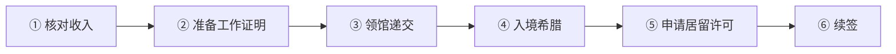
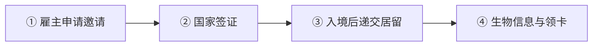
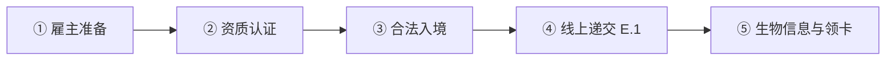
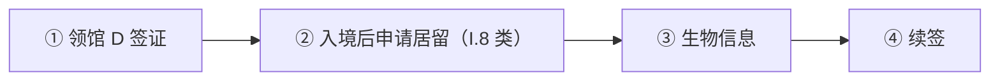
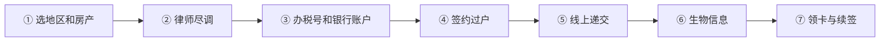

# 🇬🇷 希腊 · Greece

    

**黄金签证 40/80 万欧买房；数字游民 EUR 3,500/月**

[💻 数字游民签证](#greece-digital-nomad-visa) · [🧑‍💻 受雇工作居留许可](#greece-dependent-employment-residence-permit) · [🧑‍💻 欧盟蓝卡](#greece-eu-blue-card) · [🏖️ 财务独立人士居留（FIP）](#greece-fip) · [💰 黄金签证](#greece-golden-visa) · [📖 深度解读](#deep) · [🔗 延伸阅读](#more)

> [!TIP]
> **一句话判断**：欧盟 + 申根 + 欧元区。中国人最常看的三条：**黄金签证（买房，已涨价）**、**数字游民签证**、**雇主担保的 E.4 普通工作 / E.1 欧盟蓝卡**。黄金签证仍开放，但"25 万欧买房拿身份"已经过时：热门地区 80 万、其他地区 40 万。

## 🏙️ 生活与身份档案

<table>
<tr><td width="33%" valign="top">💶 生活成本指数（纽约=100） <b>53.3 ●●●●○</b></td><td width="33%" valign="top">🏠 房租指数（纽约=100） <b>12.9 ●●●●●</b></td><td width="33%" valign="top">🛡️ 安全指数 <b>54.0 ●●○○○</b></td></tr>
<tr><td width="33%" valign="top">💼 平均年薪（总额） <b>EUR 17,954</b></td><td width="33%" valign="top">🧾 最高个税税率 <b>44%</b></td><td width="33%" valign="top">🛂 护照免签目的地 <b>185 个（中国 81）</b></td></tr>
<tr><td width="33%" valign="top">🏠 永居年限 <b>5 年</b></td><td width="33%" valign="top">🎖️ 入籍年限 <b>7 年</b></td><td width="33%" valign="top">🔁 双重国籍 <b>✅ 可保留原国籍</b></td></tr>
<tr><td width="33%" valign="top">🗣️ 语言要求 <b>希腊语 B1 + 考试</b></td><td width="33%" valign="top">✈️ 中国护照入境 <b>申根签证</b></td><td width="33%" valign="top"></td></tr>
</table>

● 越多越好（成本/房租越低、安全越高）。数据：Numbeo 2026 年中、Eurostat、Tax Foundation 2026、Henley 2026；永居/入籍为常见规则，以官方为准。中国不承认双重国籍。[数据说明](README.md#profiles)

## 📊 路线速查

| 路线 | 类型 | 门槛信号 | 家属 | 永居 | 状态 |
|---|---|---|:-:|:-:|:-:|
| [希腊数字游民签证](#greece-digital-nomad-visa) | 💻 数字游民 | EUR 3,500/月 | ✅ 可带 | ✅ 可能 | 🟢 开放 |
| [希腊受雇工作居留许可](#greece-dependent-employment-residence-permit) | 🧑‍💻 技术工作 | EUR 920/月 | ✅ 可带 | ✅ 可能 | 🟢 开放 |
| [希腊欧盟蓝卡](#greece-eu-blue-card) | 🧑‍💻 技术工作 | EUR 31,918.83/年 | ✅ 可带 | ✅ 可能 | 🟢 开放 |
| [希腊财务独立人士居留（FIP）](#greece-fip) | 🏖️ 被动收入居留 | EUR 3,500/月 | ✅ 可带 | ✅ 可能 | 🟢 开放 |
| [希腊黄金签证](#greece-golden-visa) | 💰 投资居留 | 投资 ≥ 250,000 | ✅ 可带 | ✅ 可能 | 🟢 开放 |

门槛为主申请人的最低信号值，多与当地工资挂钩、每年调整，递交前以官方为准。

---

## 💻 希腊数字游民签证

   

> **税后月入 3,500 欧的远程工作者可申请，签证 1 年后转 2 年居留，可长期续。**

<table>
<tr><td width="33%" valign="top">收入门槛 <b>税后 ≥ EUR 3,500/月</b></td><td width="33%" valign="top">家属加算 <b>配偶 +20%（EUR 700），每个孩子 +15%（EUR 525）</b></td><td width="33%" valign="top">签证 <b>国家签证最长 12 个月</b></td></tr>
<tr><td width="33%" valign="top">居留许可 <b>2 年，可每 2 年续签</b></td><td width="33%" valign="top">签证费 <b>EUR 75；居留许可费以 e-paravolo 为准</b></td><td width="33%" valign="top">审理 <b>领馆法定 10 天内答复</b></td></tr>
<tr><td width="33%" valign="top">工作限制 <b>本人和家属都不能为希腊雇主/客户工作</b></td><td width="33%" valign="top"></td><td width="33%" valign="top"></td></tr>
</table>

<table><tr>
<td width="50%" valign="top">✅ <b>适合</b><ul><li>为境外雇主/客户工作且收入较高</li><li>想在申根区长期住</li><li>家庭随行但家属不需要工作</li></ul></td>
<td width="50%" valign="top">❌ <b>不适合</b><ul><li>有希腊客户或想接希腊项目</li><li>配偶需要在希腊工作</li></ul></td>
</tr></table>

### 🗺️ 申请流程

1. **核对收入** — 按家庭人数计算门槛：配偶+1 孩 EUR 4,725
2. **准备工作证明** — 雇员：合同 + 雇主确认；自雇：境外公司或客户合同
3. **领馆递交** — 可本人、邮件或挂号信递交
4. **入境希腊** — 持国家签证
5. **申请居留许可** — 签证到期前递交，转 2 年许可
6. **续签** — 每 2 年续，持续满足条件

### 📋 材料清单

- [ ] 护照、照片、国家签证申请表
- [ ] 声明：在希腊远程工作且不为希腊雇主提供服务
- [ ] 境外雇佣合同或服务合同
- [ ] 税后收入证明（工资单、银行流水）
- [ ] 医疗保险
- [ ] 无犯罪证明
- [ ] 家属关系证明

> [!WARNING]
> **注意**
> - 不要计划以游客身份入境后转换，官方路径是领馆签证
> - 超过 183 天即希腊税务居民；Article 5C 税收优惠需另行申请

🔗 官方来源（5）

- [Greek MFA digital nomad visa page](https://www.mfa.gr/en/services/working-in-greece-as-a-digital-nomad/)
- [Greek Decentralized Administration digital nomad FAQ](https://e-dm.gov.gr/allodapoi-metanastefsi/)
- [Greek MFA digital nomad consular guidance](https://www.mfa.gr/uk/en/greece-welcomes-digital-nomads/)
- [Greek Migration Code, official Government Gazette PDF](https://migration.gov.gr/wp-content/uploads/2023/04/%CE%9A%CF%8E%CE%B4%CE%B9%CE%BA%CE%B1%CF%82-%CE%9C%CE%B5%CF%84%CE%B1%CE%BD%CE%AC%CF%83%CF%84%CE%B5%CF%85%CF%83%CE%B7%CF%82.pdf)
- [Ministry of Migration legal migration applications](https://migration.gov.gr/en/applications-legal/)

数据核查：2026-10-26 · [LetsMigrate 原始记录](https://letsmigrate.org/zh-hans/programmes/greece-digital-nomad-visa-zh/) · [↑ 回到顶部](#top)

---

## 🧑‍💻 希腊受雇工作居留许可

   

> **E.4 普通受雇工作居留：雇主先获批'邀请'，员工再办国家签证。**

<table>
<tr><td width="33%" valign="top">薪资 <b>≥ 非熟练工月收入（最低工资 EUR 920/月）</b></td><td width="33%" valign="top">合同 <b>劳动部 2026 规定 ≥6 个月（部分清单仍写 1 年）</b></td><td width="33%" valign="top">雇主邀请费 <b>每人 EUR 200</b></td></tr>
<tr><td width="33%" valign="top">居留费 <b>EUR 150 + 制卡 EUR 16</b></td><td width="33%" valign="top">审理 <b>约 50–80 天</b></td><td width="33%" valign="top"></td></tr>
</table>

<table><tr>
<td width="50%" valign="top">✅ <b>适合</b><ul><li>普通岗位、薪资不高</li><li>雇主愿意走邀请流程</li></ul></td>
<td width="50%" valign="top">❌ <b>不适合</b><ul><li>想快速入境（流程较长）</li></ul></td>
</tr></table>

### 🗺️ 申请流程

1. **雇主申请邀请** — 邀请获批后员工才能申请签证
2. **国家签证** — 以受雇工作为目的
3. **入境后递交居留** — 线上递交
4. **生物信息与领卡**

### 📋 材料清单

- [ ] 获批的雇主邀请
- [ ] 国家签证
- [ ] 劳动合同
- [ ] 保险申请证明
- [ ] 护照

> [!WARNING]
> **注意**
> - 合同期限要求官方表述不一致，递交前确认

🔗 官方来源（3）

- [Mitos E.4 residence permit following approved invitation for dependent employment](https://en.mitos.gov.gr/index.php/%CE%94%CE%94%3AResidence_permit_following_approval_of_an_invitation_for_dependent_employment_%E2%80%93_Initial_granting_%28%E2%80%98E.4%E2%80%99%29)
- [Ministry of Labour work for third-country nationals in Greece](https://ypergasias.gov.gr/en/labour-relations/individual-employment-relations/work-for-third-country-nationals-in-greece/)
- [Greek Government minimum wage announcement 2026](https://www.government.gov.gr/nea-afxisi-katotatou-misthou-ena-akomi-simantiko-vima-gia-ti-dievrinsi-tou-diathesimou-eisodimatos-ergazomenon/)

数据核查：2026-10-26 · [LetsMigrate 原始记录](https://letsmigrate.org/zh-hans/programmes/greece-dependent-employment-residence-permit-zh/) · [↑ 回到顶部](#top)

---

## 🧑‍💻 希腊欧盟蓝卡

   

> **E.1 高资质员工居留：年薪约 3.2 万欧以上、合同 6 个月，审理最快 30 天。**

<table>
<tr><td width="33%" valign="top">薪资 <b>≥ 希腊平均年薪 1.6 倍，参考 EUR 31,918.83/年</b></td><td width="33%" valign="top">合同 <b>≥6 个月高资质工作</b></td><td width="33%" valign="top">雇主 <b>每名员工对应雇主年收入 ≥ EUR 60,000</b></td></tr>
<tr><td width="33%" valign="top">费用 <b>居留费 EUR 150 + 制卡 EUR 16</b></td><td width="33%" valign="top">审理 <b>法定 90 天；认证雇主 30 天</b></td><td width="33%" valign="top">卡期 <b>3 年，可续 3 年</b></td></tr>
</table>

<table><tr>
<td width="50%" valign="top">✅ <b>适合</b><ul><li>拿到希腊高薪技术岗位</li><li>需要欧盟内流动和长期居留累计</li></ul></td>
<td width="50%" valign="top">❌ <b>不适合</b><ul><li>薪资低于门槛</li><li>无学历/资质证明</li></ul></td>
</tr></table>

### 🗺️ 申请流程

1. **雇主准备** — 合同、招聘公告、公司资质
2. **资质认证** — 非监管职业提交学历；监管职业需 ATEEN 认证
3. **合法入境** — 申根签证或免签（按当前规定）
4. **线上递交 E.1** — 移民部电子系统
5. **生物信息与领卡** — 3 年卡

### 📋 材料清单

- [ ] 劳动合同（≥6 个月）
- [ ] 学历/资质证明
- [ ] 招聘公告
- [ ] 雇主税务和公司证明
- [ ] 护照、保险

> [!WARNING]
> **注意**
> - 门槛按年度数据调整，接近门槛时递交前复核

🔗 官方来源（4）

- [Mitos E.1 highly qualified employee residence permit](https://en.mitos.gov.gr/index.php/%CE%94%CE%94%3AResidence_permit_of_a_highly_qualified_employee_%28%E2%80%98E.1%E2%80%99%29_following_admission_with_a_uniform_visa_or_visa-free_regime_%E2%80%93_Initial_granting)
- [European Commission EU Blue Card in Greece](https://home-affairs.ec.europa.eu/policies/migration-and-asylum/eu-immigration-portal/eu-blue-card/eu-blue-card-greece_en)
- [Migration Code Law 5038/2023](https://migration.gov.gr/en/nomothesia-1-2/nomothesia-ypiresia-nomimis-metanasteysis/)
- [Greek Law 5275/2026 Article 19 Blue Card validity](https://migration.gov.gr/wp-content/uploads/2026/02/%CE%A6%CE%95%CE%9A%CE%9117_6.2.2025.pdf)

数据核查：2026-10-26 · [LetsMigrate 原始记录](https://letsmigrate.org/zh-hans/programmes/greece-eu-blue-card-zh/) · [↑ 回到顶部](#top)

---

## 🏖️ 希腊财务独立人士居留（FIP）

    

> **境外被动收入每月 3,500 欧，即可在希腊住 3 年可续；不能在希腊工作。**

<table>
<tr><td width="33%" valign="top">收入 <b>境外被动收入 ≥ EUR 3,500/月（2024-09 起）</b></td><td width="33%" valign="top">家属 <b>配偶 +20%，每个孩子 +15%</b></td><td width="33%" valign="top">或存款 <b>单人约 EUR 126,000；夫妻 151,200</b></td></tr>
<tr><td width="33%" valign="top">期限 <b>3 年，可同期续签</b></td><td width="33%" valign="top">续签 <b>每年在希腊住满 6 个月</b></td><td width="33%" valign="top">工作 <b>❌ 不允许</b></td></tr>
</table>

<table><tr>
<td width="50%" valign="top">✅ <b>适合</b><ul><li>退休或有高额被动收入的家庭</li></ul></td>
<td width="50%" valign="top">❌ <b>不适合</b><ul><li>需要工作收入</li></ul></td>
</tr></table>

### 🗺️ 申请流程

1. **领馆 D 签证**
2. **入境后申请居留（I.8 类）**
3. **生物信息**
4. **续签** — 3 年后

### 📋 材料清单

- [ ] 被动收入证明
- [ ] 希腊住房证明
- [ ] 医疗保险
- [ ] 无犯罪证明

> [!WARNING]
> **注意**
> - 旧资料写的 EUR 2,000/月已过时

🔗 来源（2）

- [Immigrant Invest: Greece FIP 2026](https://immigrantinvest.com/greece-fip-residence/)
- [Global Citizen Solutions: FIP Visa Greece](https://www.globalcitizensolutions.com/fip-visa-greece/)

数据核查：2026-10 · 本条为 RUN 补充路线（LetsMigrate 未收录），来源见上 · [↑ 回到顶部](#top)

---

## 💰 希腊黄金签证

   

> **欧洲仍可买房换居留的主要国家：热门地区 80 万、其他地区 40 万欧，5 年卡无居住要求。**

<table>
<tr><td width="33%" valign="top">最低投资 <b>雅典/塞萨洛尼基/热门岛屿 EUR 800,000；其他地区 EUR 400,000</b></td><td width="33%" valign="top">特殊档 <b>保护建筑修复或商改住 EUR 250,000</b></td><td width="33%" valign="top">房产要求 <b>标准档一般须单套达标、主要用途面积 ≥120㎡</b></td></tr>
<tr><td width="33%" valign="top">卡期 <b>5 年，投资持有即可续</b></td><td width="33%" valign="top">居住要求 <b>无</b></td><td width="33%" valign="top">工作 <b>❌ 不给工作权</b></td></tr>
<tr><td width="33%" valign="top">费用 <b>居留费 EUR 2,000 + 制卡 EUR 16（每人）</b></td><td width="33%" valign="top">审理 <b>官方示例 50–60 天</b></td><td width="33%" valign="top"></td></tr>
</table>

<table><tr>
<td width="50%" valign="top">✅ <b>适合</b><ul><li>想要申根身份备份、不常住的家庭</li><li>预算 40 万欧以上、接受房产投资</li><li>需要配偶子女一起拿身份</li></ul></td>
<td width="50%" valign="top">❌ <b>不适合</b><ul><li>想在希腊工作（应看数字游民或雇佣路线）</li><li>想快速入籍（需真实居住 7 年 + 希腊语）</li><li>只有 25 万欧预算却想买普通住宅</li></ul></td>
</tr></table>

### 🗺️ 申请流程

1. **选地区和房产** — 确认房产所在地属于 80 万还是 40 万档
2. **律师尽调** — 产权、土地登记、用途、是否已被用于其他投资居留
3. **办税号和银行账户** — AFM 税号、希腊银行账户，资金须可追溯
4. **签约过户** — 公证买卖合同、全额付款
5. **线上递交** — 移民部电子系统；可委托律师在入境前递交
6. **生物信息** — 到希腊采集指纹
7. **领卡与续签** — 5 年卡；续签时证明房产仍持有

### 📋 材料清单

- [ ] 护照
- [ ] 房产买卖合同和产权登记证明
- [ ] 付款证明（银行转账记录）
- [ ] 健康保险
- [ ] 照片（纸质 + 电子 JPEG2000）
- [ ] 居留费和制卡费缴费凭证
- [ ] 授权委托书（如委托递交，需海牙认证）
- [ ] 家属关系证明

> [!WARNING]
> **注意**
> - '25 万欧买房拿身份'已过时，只剩保护建筑和商改住两条窄路
> - 一年住满 183 天即成为希腊税务居民，从第一天起算
> - 持卡不住满 7 年不能入籍

🔗 官方来源（8）

- [Greek Ministry of Migration Golden Visa documents](https://migration.gov.gr/en/golden-visa/)
- [Greek housing policy portal Golden Visa threshold update](https://stegasi.gov.gr/programs/afxisi-oriou-elachistis-ependysis-se-akinita-gia-apoktisi-golden-visa/)
- [MITOS Golden Visa timeshare initial issuance](https://en.mitos.gov.gr/index.php/%CE%94%CE%94%3AGolden_visa_%28timeshare%29_%E2%80%93_Initial_issuance)
- [MITOS Golden Visa listed real property initial issuance](https://en.mitos.gov.gr/index.php/%CE%94%CE%94%3AGolden_visa_programme_%28investment_in_a_listed_real_property%29_%E2%80%93_Initial_issuance)
- [MITOS Golden Visa change of use initial issuance](https://en.mitos.gov.gr/index.php/%CE%94%CE%94%3APermanent_golden_visa_%28change_of_use%29_%E2%80%93_Initial_issuance)
- [AADE tax residence for natural persons](https://www.aade.gr/en/greeks-abroad-non-residents/income-taxation/tax-residence-natural-persons-itc)
- [Greek Ministry of Interior Citizenship Code](https://www.ypes.gr/kodikas-ellinikis-ithageneias/)
- [Greek Ministry of Migration April 2026 Article 100 circular](https://diavgeia.gov.gr/doc/%CE%A8%CE%A3%CE%99746%CE%9C%CE%94%CE%A8%CE%9F-%CE%94%CE%A7%CE%9C)

数据核查：2026-10-26 · [LetsMigrate 原始记录](https://letsmigrate.org/zh-hans/programmes/greece-golden-visa-zh/) · [↑ 回到顶部](#top)

---

## 📖 深度解读

### 路线要点

### 黄金签证（投资者居留许可）
| 类别 | 最低投资 | 说明 |
|---|---|---|
| 高需求地区房产（阿提卡/雅典、塞萨洛尼基、米科诺斯、圣托里尼、人口 >3,100 的岛屿） | EUR 800,000 | 一般须为**单套**、主要用途面积 ≥120㎡ |
| 其他地区房产 | EUR 400,000 | 同上 |
| 历史保护建筑修复 | EUR 250,000 | 特殊路线，有修复义务和转售后果 |
| 商改住（商业用途改住宅） | EUR 250,000 | 特殊路线，须完成改造、有使用限制 |

- **卡期 5 年**，投资持续即可续签；**无最低居住要求**，但**不给工作权**。
- **费用**：居留费 EUR 2,000 + 制卡费 EUR 16（每人）；官方示例办理周期 50–60 天。
- **可委托办理**：符合条件可在入境前通过授权书（需海牙认证或希腊领事认证）线上递交。
- **家属**：配偶/伴侣、子女；Law 5275/2026 起，无行为能力且依赖投资者的成年子女不论年龄可随行。
- **入籍**：标准需 7 年**真实连续合法居住** + 语言/公民知识 + 融入证明。黄金签证"挂身份"一般不满足入籍要求。

### 数字游民签证（Article 68）
- **收入**：税后 ≥ **EUR 3,500/月**；配偶 +20%（EUR 700），每个孩子 +15%（EUR 525）。
  - 配偶 + 1 孩 = EUR 4,725；配偶 + 2 孩 = EUR 5,250。
- **严格禁止**为希腊雇主或希腊客户工作，**家属也不能在希腊工作**。
- **流程**：领事馆签发最长 12 个月的国家签证（法定 10 天内答复，签证费 EUR 75）→ 到期前转居留许可（**2 年**，可每 2 年续签）。居留许可费用请以 e-paravolo 当期金额为准（有资料称 EUR 1,000）。
- 网站资料显示"可能通向永居"——续签累计满足长期居留条件后可规划。

### 雇主担保工作
| | E.4 普通受雇工作 | E.1 欧盟蓝卡 |
|---|---|---|
| 薪资 | ≥ 非熟练工月收入（2026-04-01 起最低工资 EUR 920/月） | ≥ 希腊平均年薪 1.6 倍，参考值 **EUR 31,918.83/年** |
| 前置步骤 | 雇主先获批"邀请"（每人 EUR 200）→ 国家签证 | 高资质岗位 + 学历/资质证明 |
| 合同 | ≥6 个月（劳动部 2026 新规）/ 部分清单仍写 1 年 | ≥6 个月 |
| 费用 | 居留费 EUR 150 + 制卡 EUR 16 | 同左 |
| 审理 | 约 50–80 天 | 法定 90 天，认证雇主 30 天 |
| 卡期 | 视条件 | 3 年，可续 3 年 |

- 蓝卡有欧盟内流动和长期居留累计优势；E.4 是纯国家路线。
- 雇主须证明支付能力（E.1 每名员工对应雇主年收入 ≥ EUR 60,000）。

### 税务提醒
- 任意滚动 12 个月内在希腊 >183 天 → 从**第一天起**成为税务居民；住所、生活重心也可触发。
- Article 5C 为迁入的外国专业人士提供税收优惠，需单独申请，不是签证附带。
- 收入证明可用境外银行流水，不强制开希腊账户；办 AFM（税号）方便长期居住。

### 常见坑
- "25 万欧买房"只剩保护建筑修复和商改住两条窄路，尽调成本高。
- 多套小房子凑金额——标准档一般要求单套达标。
- 数字游民期间接希腊本地项目——直接违反签证条件。

---

## 🔗 延伸阅读

LetsMigrate 中文指南原文（14 篇）

- [希腊受雇工作和欧盟蓝卡的家庭、流动和定居](https://letsmigrate.org/zh-hans/articles/greece-dependent-employment-eu-blue-card-family-mobility-settlement-zh/)
- [希腊受雇工作和欧盟蓝卡薪资规则](https://letsmigrate.org/zh-hans/articles/greece-dependent-employment-eu-blue-card-salary-qualification-rules-zh/)
- [希腊受雇工作和欧盟蓝卡时间线与文件](https://letsmigrate.org/zh-hans/articles/greece-dependent-employment-eu-blue-card-timeline-documents-zh/)
- [希腊受雇工作许可与欧盟蓝卡](https://letsmigrate.org/zh-hans/articles/greece-dependent-employment-vs-eu-blue-card-zh/)
- [希腊数字游民签证文件清单](https://letsmigrate.org/zh-hans/articles/greece-digital-nomad-visa-documents-checklist-zh/)
- [希腊数字游民签证家庭和续签规则](https://letsmigrate.org/zh-hans/articles/greece-digital-nomad-visa-family-renewal-zh/)
- [希腊数字游民签证指南](https://letsmigrate.org/zh-hans/articles/greece-digital-nomad-visa-guide-zh/)
- [希腊数字游民签证收入和工作规则](https://letsmigrate.org/zh-hans/articles/greece-digital-nomad-visa-income-work-rules-zh/)
- [希腊数字游民签证税务、银行和保险](https://letsmigrate.org/zh-hans/articles/greece-digital-nomad-visa-tax-banking-insurance-zh/)
- [希腊数字游民签证时间线和费用](https://letsmigrate.org/zh-hans/articles/greece-digital-nomad-visa-timeline-costs-zh/)
- [希腊黄金签证指南](https://letsmigrate.org/zh-hans/articles/greece-golden-visa-guide-zh/)
- [希腊黄金签证投资路线和尽职调查](https://letsmigrate.org/zh-hans/articles/greece-golden-visa-investment-routes-due-diligence-zh/)
- [希腊黄金签证税务、家庭和公民身份](https://letsmigrate.org/zh-hans/articles/greece-golden-visa-tax-family-citizenship-zh/)
- [希腊黄金签证时间线和文件](https://letsmigrate.org/zh-hans/articles/greece-golden-visa-timeline-documents-zh/)

[← 🇩🇪 德国](germany.md) ｜ [🇪🇺 全部国家](README.md) ｜ [🏠 首页](../../README.md) ｜ [🇭🇺 匈牙利 →](hungary.md)

本页根据 [LetsMigrate.org](https://letsmigrate.org/zh-hans/countries/greece-zh/) 公开资料及官方来源整理改写，仅供信息参考，不构成移民、法律、税务或投资建议。
