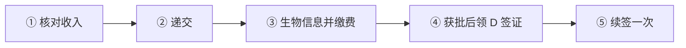
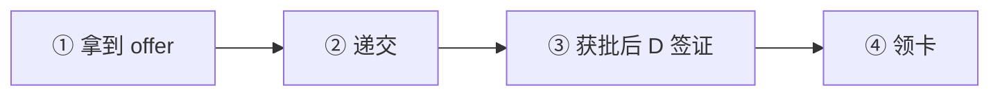
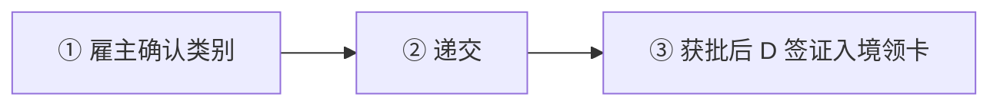
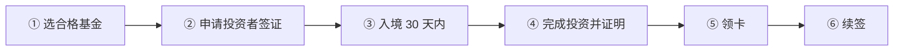

# 🇭🇺 匈牙利 · Hungary

    

**25 万欧基金换 10+10 年居留可工作；白卡不能带家属**

[💻 白卡](#hungary-white-card) · [🧑‍💻 欧盟蓝卡](#hungary-eu-blue-card) · [🧑‍💻 Hungarian Card](#hungary-hungarian-card) · [💰 客座投资者](#hungary-guest-investor) · [📖 深度解读](#deep) · [🔗 延伸阅读](#more)

> [!TIP]
> **一句话判断**：欧盟 + 申根，货币为福林（HUF）。两条特色路线：**Guest Investor 客座投资者**（25 万欧买房地产基金份额，拿最长 10+10 年居留，**可以自由工作**）和**白卡**（远程工作，门槛 EUR 3,000/月，但**不能带家属、只能续一次**）。技术工作看 **Hungarian Card vs 欧盟蓝卡**。普通就业和"客工"路线已大幅收紧。

## 🏙️ 生活与身份档案

<table>
<tr><td width="33%" valign="top">💶 生活成本指数（纽约=100） <b>49.8 ●●●●○</b></td><td width="33%" valign="top">🏠 房租指数（纽约=100） <b>14.2 ●●●●●</b></td><td width="33%" valign="top">🛡️ 安全指数 <b>66.8 ●●●○○</b></td></tr>
<tr><td width="33%" valign="top">💼 平均年薪（总额） <b>EUR 18,461</b></td><td width="33%" valign="top">🧾 最高个税税率 <b>15%</b></td><td width="33%" valign="top">🛂 护照免签目的地 <b>184 个（中国 81）</b></td></tr>
<tr><td width="33%" valign="top">🏠 永居年限 <b>3 年（国民居留卡）</b></td><td width="33%" valign="top">🎖️ 入籍年限 <b>8 年</b></td><td width="33%" valign="top">🔁 双重国籍 <b>✅ 可保留原国籍</b></td></tr>
<tr><td width="33%" valign="top">🗣️ 语言要求 <b>匈牙利语</b></td><td width="33%" valign="top">✈️ 中国护照入境 <b>申根签证</b></td><td width="33%" valign="top"></td></tr>
</table>

● 越多越好（成本/房租越低、安全越高）。数据：Numbeo 2026 年中、Eurostat、Tax Foundation 2026、Henley 2026；永居/入籍为常见规则，以官方为准。中国不承认双重国籍。[数据说明](README.md#profiles)

## 📊 路线速查

| 路线 | 类型 | 门槛信号 | 家属 | 永居 | 状态 |
|---|---|---|:-:|:-:|:-:|
| [匈牙利白卡](#hungary-white-card) | 💻 数字游民 | EUR 3,000/月 | ⚠️ 需核查 | ⏳ 偏临时 | 🟢 开放 |
| [匈牙利欧盟蓝卡](#hungary-eu-blue-card) | 🧑‍💻 技术工作 | HUF 1,001,048/月 | ✅ 可带 | ✅ 可能 | 🟢 开放 |
| [匈牙利 Hungarian Card](#hungary-hungarian-card) | 🧑‍💻 技术工作 | — | ⚠️ 需核查 | ⏳ 偏临时 | 🟢 开放 |
| [匈牙利客座投资者](#hungary-guest-investor) | 💰 投资居留 | 投资 ≥ 250,000 | ✅ 可带 | ✅ 可能 | 🟢 开放 |

门槛为主申请人的最低信号值，多与当地工资挂钩、每年调整，递交前以官方为准。

---

## 💻 匈牙利白卡

   

> **远程工作者的白卡：税后月入 3,000 欧，但不能带家属、只能续一次。**

<table>
<tr><td width="33%" valign="top">收入 <b>入境前 ≥6 个月且持续 税后 ≥ EUR 3,000/月</b></td><td width="33%" valign="top">卡期 <b>1 年，同目的只能续 1 次</b></td><td width="33%" valign="top">家属 <b>❌ 不能团聚（在匈出生的孩子除外）</b></td></tr>
<tr><td width="33%" valign="top">费用 <b>境外 EUR 110；境内现场 HUF 39,000 / 线上 26,000</b></td><td width="33%" valign="top">审理 <b>21 天程序，30 天实质决定</b></td><td width="33%" valign="top">续签条件 <b>前 180 天中住满 90 天</b></td></tr>
<tr><td width="33%" valign="top">限制 <b>不能在匈工作或持有匈牙利公司股份</b></td><td width="33%" valign="top"></td><td width="33%" valign="top"></td></tr>
</table>

<table><tr>
<td width="50%" valign="top">✅ <b>适合</b><ul><li>单身远程工作者，想在布达佩斯住 1–2 年</li></ul></td>
<td width="50%" valign="top">❌ <b>不适合</b><ul><li>带家属</li><li>想长期定居</li></ul></td>
</tr></table>

### 🗺️ 申请流程

1. **核对收入** — 6 个月流水
2. **递交** — 境外使馆，或免签者在匈牙利境内
3. **生物信息并缴费**
4. **获批后领 D 签证** — 单次入境、3 个月内有效
5. **续签一次** — 到期前 90–30 天

### 📋 材料清单

- [ ] 申请表、照片、护照
- [ ] 境外雇主声明或境外公司证明
- [ ] 6 个月收入证明
- [ ] 匈牙利住房证明
- [ ] 医保
- [ ] 离境能力证明（机票或资金）

> [!WARNING]
> **注意**
> - 获批后 3 个月内不入境，批准作废

🔗 官方来源（4）

- [NDGAP White Card residency for digital nomads](https://oif.gov.hu/factsheets/white-card-residency-for-digital-nomads)
- [NDGAP procedural fees](https://www.oif.gov.hu/index.php/factsheets/procedural-fees)
- [NAV general information for foreign citizens](https://nav.gov.hu/en/taxation/taxpayer_registration/general-information-for-foreign-citizens-new)
- [NAV double taxation treaties of Hungary](https://nav.gov.hu/en/taxation/double_taxation_treaties)

数据核查：2026-10-25 · [LetsMigrate 原始记录](https://letsmigrate.org/zh-hans/programmes/hungary-white-card-zh/) · [↑ 回到顶部](#top)

---

## 🧑‍💻 匈牙利欧盟蓝卡

   

> **月薪约 100 万福林（≈ €2,550）以上的高资质岗位，首卡最长 4 年。**

<table>
<tr><td width="33%" valign="top">月薪 <b>HUF 1,001,048（2026）；指定医疗职业 HUF 800,838</b></td><td width="33%" valign="top">合同 <b>≥6 个月</b></td><td width="33%" valign="top">资质 <b>高等学历；高管和 ICT 可凭近 7 年内 3 年经验</b></td></tr>
<tr><td width="33%" valign="top">审理 <b>21 天程序 / 70 天实质；迁入 30 天</b></td><td width="33%" valign="top">卡期 <b>最长 4 年，每次续最长 4 年</b></td><td width="33%" valign="top">欧盟居留卡 <b>在匈 2 年 + 欧盟内蓝卡共 5 年</b></td></tr>
</table>

<table><tr>
<td width="50%" valign="top">✅ <b>适合</b><ul><li>匈牙利外企高薪岗位</li></ul></td>
<td width="50%" valign="top">❌ <b>不适合</b><ul><li>普通岗位（普通雇佣路线有国籍限制）</li></ul></td>
</tr></table>

### 🗺️ 申请流程

1. **拿到 offer**
2. **递交**
3. **获批后 D 签证** — 单次入境领卡
4. **领卡**

### 📋 材料清单

- [ ] 劳动合同
- [ ] 学历证明
- [ ] 护照

> [!WARNING]
> **注意**
> - 客工居留 2026-06-06 起已不受理新申请

🔗 官方来源（3）

- [NDGAP EU Blue Card factsheet](https://www.oif.gov.hu/factsheets/eu-blue-card)
- [NDGAP information for employers and host organizations](https://oif.gov.hu/factsheets/information-for-employers-and-host-organizations)
- [NDGAP EU residence card factsheet](https://oif.gov.hu/factsheets/eu-residence-card)

数据核查：2026-10-25 · [LetsMigrate 原始记录](https://letsmigrate.org/zh-hans/programmes/hungary-eu-blue-card-zh/) · [↑ 回到顶部](#top)

---

## 🧑‍💻 匈牙利 Hungarian Card

   

> **匈牙利国家技术工作路线，与蓝卡二选一。**

<table>
<tr><td width="33%" valign="top">薪资 <b>无统一公示门槛</b></td><td width="33%" valign="top">卡期 <b>最长 3 年，续 3 年</b></td><td width="33%" valign="top">审理 <b>21 天程序 / 70 天实质</b></td></tr>
<tr><td width="33%" valign="top">家属 <b>规则需核查</b></td><td width="33%" valign="top"></td><td width="33%" valign="top"></td></tr>
</table>

<table><tr>
<td width="50%" valign="top">✅ <b>适合</b><ul><li>不符合蓝卡学历或薪资的技术岗位</li></ul></td>
<td width="50%" valign="top">❌ <b>不适合</b><ul><li>需要欧盟流动性</li></ul></td>
</tr></table>

### 🗺️ 申请流程

1. **雇主确认类别**
2. **递交**
3. **获批后 D 签证入境领卡**

### 📋 材料清单

- [ ] 劳动合同或预约
- [ ] 资质证明
- [ ] 护照

> [!WARNING]
> **注意**
> - 国家路线的长期居留资格需单独核查

🔗 官方来源（2）

- [NDGAP Hungarian Card factsheet](https://oif.gov.hu/factsheets/residence-permit-for-hungarian-card)
- [NDGAP information for employers and host organizations](https://oif.gov.hu/factsheets/information-for-employers-and-host-organizations)

数据核查：2026-10-25 · [LetsMigrate 原始记录](https://letsmigrate.org/zh-hans/programmes/hungary-hungarian-card-zh/) · [↑ 回到顶部](#top)

---

## 💰 匈牙利客座投资者

   

> **买 25 万欧匈牙利房地产基金份额，拿 10 年居留（可再续 10 年），还能自由工作。**

<table>
<tr><td width="33%" valign="top">最低投资 <b>房地产基金份额 EUR 250,000（锁定 ≥5 年）</b></td><td width="33%" valign="top">另一方式 <b>向高校捐赠 EUR 1,000,000</b></td><td width="33%" valign="top">签证 <b>客座投资者签证最长 6 个月，费用 EUR 110</b></td></tr>
<tr><td width="33%" valign="top">居留 <b>最长 10 年，可再延 10 年</b></td><td width="33%" valign="top">工作 <b>✅ 可在匈牙利自由工作</b></td><td width="33%" valign="top">审理 <b>21 天（不含补件时间）</b></td></tr>
<tr><td width="33%" valign="top">永久身份 <b>居住 ≥3 年可申请国民居留卡</b></td><td width="33%" valign="top"></td><td width="33%" valign="top"></td></tr>
</table>

<table><tr>
<td width="50%" valign="top">✅ <b>适合</b><ul><li>想要长期欧盟居留且可能在当地工作</li><li>接受基金 5 年锁定</li></ul></td>
<td width="50%" valign="top">❌ <b>不适合</b><ul><li>需要资金灵活</li><li>想快速入籍（一般 8 年 + 匈牙利语）</li></ul></td>
</tr></table>

### 🗺️ 申请流程

1. **选合格基金** — 央行登记、≥40% 投匈牙利住宅
2. **申请投资者签证** — 需签证者先办（6 个月有效）
3. **入境 30 天内** — 通过 Enter Hungary 申请居留
4. **完成投资并证明** — 保守按签发后 3 个月内
5. **领卡** — 邮寄到申请地址
6. **续签** — 到期前 ≥30 天在匈牙利境内

### 📋 材料清单

- [ ] 护照、照片
- [ ] 资金永久可用的银行证明
- [ ] 基金认购和锁定证明（证券账户）
- [ ] 资金来源证明
- [ ] 住址证明
- [ ] 医疗保险

> [!WARNING]
> **注意**
> - 签证 FAQ 和居留须知对投资期限说法不同，按更早的期限准备
> - 基金到期退出要评估流动性

🔗 官方来源（5）

- [NDGAP residence permit for guest investor](https://www.oif.gov.hu/factsheets/residence-permit-for-guest-investor)
- [NDGAP visa for guest investors](https://www.oif.gov.hu/factsheets/visa-for-guest-investors)
- [NDGAP guest investor FAQ](https://www.oif.gov.hu/factsheets/guest-investor-visa-and-permit-frequently-asked-questions-faq)
- [NDGAP family reunification residence permit](https://www.oif.gov.hu/factsheets/residence-permit-for-the-purpose-of-family-reunification)
- [NDGAP national residence card](https://www.oif.gov.hu/factsheets/national-residence-card)

数据核查：2026-10-25 · [LetsMigrate 原始记录](https://letsmigrate.org/zh-hans/programmes/hungary-guest-investor-zh/) · [↑ 回到顶部](#top)

---

## 📖 深度解读

### 路线要点

### Guest Investor 客座投资者居留
| 方式 | 金额 | 要点 |
|---|---|---|
| 房地产基金份额 | ≥ EUR 250,000 | 匈牙利央行登记的房地产基金；净资产 ≥40% 投向匈牙利住宅；份额**锁定 ≥5 年** |
| 高校捐赠 | ≥ EUR 1,000,000 | 捐给公益信托维持的高校，用于教育/科研/艺术，不可退回 |

- **签证**：客座投资者签证最长 6 个月（费用 EUR 110）→ 首次合法入境 30 天内通过 Enter Hungary 申请居留。
- **居留许可最长 10 年，可再延 10 年**（到期前 ≥30 天在匈牙利境内续）。行政审理期 21 天（不含补件时间）。
- **可在匈牙利不受限制地工作**——这是它比白卡强的地方。
- **投资证明时限**：保守按"签证签发后 3 个月内完成投资、入境后 3 个月内证明"准备，具体以移民局（NDGAP）答复为准。
- **家属**：家庭团聚许可最长 10 年 + 可延 10 年（不超过主申请人有效期）。
- **长期身份**：合法连续居留 ≥3 年后可申请"国民居留卡"（national residence card），2025 年起需"社会共处评估"。一般归化需在匈牙利居住 8 年，匈牙利语和融入是核心。

### 白卡（White Card，远程工作）
- 为境外雇主远程工作，或持有盈利境外公司股份并远程管理。
- **收入**：入境前至少 6 个月且居留期间持续 **税后 ≥ EUR 3,000/月**。
- **限制很多**：不能在匈牙利从事营利活动；不能持有匈牙利公司股份；**家属不能团聚**（仅在匈牙利出生的孩子例外）。
- **卡期**：最长 1 年，**同目的只能续一次**（再 1 年）；续签前 180 天中需在匈住满 90 天，到期前 90–30 天之间递交。
- **费用**：境外办理 EUR 110（含领卡用 D 签证）；境内现场 HUF 39,000，Enter Hungary 线上 HUF 26,000；续签 HUF 26,000。
- **审理**：程序期 21 天，30 天内作出实质决定。获批后 D 签证单次入境、3 个月内有效，不入境则批准作废。
- **不通永居**。适合只想在欧洲住 1–2 年的人。

### Hungarian Card vs 欧盟蓝卡
| | Hungarian Card（国家路线） | 欧盟蓝卡 |
|---|---|---|
| 薪资 | 无统一公示门槛 | 2026 年 **HUF 1,001,048/月**（指定医疗职业 HUF 800,838） |
| 合同 | 合格工作的预约或合同 | ≥6 个月 |
| 首次有效期 | 最长 3 年，续 3 年 | 最长 4 年，每次续最长 4 年 |
| 审理 | 21 天程序 / 70 天实质决定 | 同左；蓝卡迁入 30 天 |
| 欧盟长期居留 | 国家路线，资格需核查 | 在匈 2 年 + 欧盟内蓝卡累计 5 年可申请 EU 居留卡 |

- 高管和 ICT 专家可用近 7 年内 3 年相关经验代替学历。
- **普通雇佣**仅限名单国家国民；**客工居留**自 2026-06-06 起已无合格国家，不再受理新申请。

### 税务提醒
- 在匈有应税收入要申请税号（T34 表）；因非居民身份免税的，次年 4 月 30 日前可能需申报非居民声明。
- 匈牙利个税 15% 统一税率，长期居住需做双重征税协定分析。

---

## 🔗 延伸阅读

LetsMigrate 中文指南原文（13 篇）

- [匈牙利 Guest Investor 指南](https://letsmigrate.org/zh-hans/articles/hungary-guest-investor-guide-zh/)
- [匈牙利 Guest Investor 投资路线与尽职调查](https://letsmigrate.org/zh-hans/articles/hungary-guest-investor-investment-routes-due-diligence-zh/)
- [匈牙利 Guest Investor 税务、家庭、工作与入籍](https://letsmigrate.org/zh-hans/articles/hungary-guest-investor-tax-family-work-citizenship-zh/)
- [匈牙利 Guest Investor 时间线与文件](https://letsmigrate.org/zh-hans/articles/hungary-guest-investor-timeline-documents-zh/)
- [匈牙利 Hungarian Card 和欧盟蓝卡家庭、流动性与定居](https://letsmigrate.org/zh-hans/articles/hungary-hungarian-card-eu-blue-card-family-mobility-settlement-zh/)
- [匈牙利 Hungarian Card 和欧盟蓝卡薪资规则](https://letsmigrate.org/zh-hans/articles/hungary-hungarian-card-eu-blue-card-salary-qualification-rules-zh/)
- [匈牙利 Hungarian Card 和欧盟蓝卡时间线与文件](https://letsmigrate.org/zh-hans/articles/hungary-hungarian-card-eu-blue-card-timeline-documents-zh/)
- [匈牙利 Hungarian Card vs 欧盟蓝卡](https://letsmigrate.org/zh-hans/articles/hungary-hungarian-card-vs-eu-blue-card-zh/)
- [匈牙利白卡文件清单](https://letsmigrate.org/zh-hans/articles/hungary-white-card-documents-checklist-zh/)
- [匈牙利白卡家庭和续签规则](https://letsmigrate.org/zh-hans/articles/hungary-white-card-family-extension-zh/)
- [匈牙利白卡指南](https://letsmigrate.org/zh-hans/articles/hungary-white-card-guide-zh/)
- [匈牙利白卡税务、银行、保险和设置](https://letsmigrate.org/zh-hans/articles/hungary-white-card-tax-banking-insurance-zh/)
- [匈牙利白卡时间线和费用](https://letsmigrate.org/zh-hans/articles/hungary-white-card-timeline-costs-zh/)

[← 🇬🇷 希腊](greece.md) ｜ [🇪🇺 全部国家](README.md) ｜ [🏠 首页](../../README.md) ｜ [🇮🇸 冰岛 →](iceland.md)

本页根据 [LetsMigrate.org](https://letsmigrate.org/zh-hans/countries/hungary-zh/) 公开资料及官方来源整理改写，仅供信息参考，不构成移民、法律、税务或投资建议。
