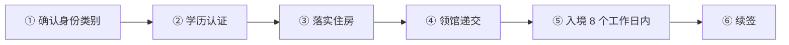
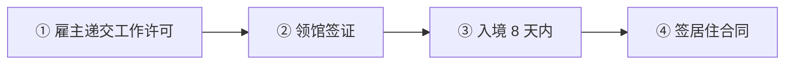
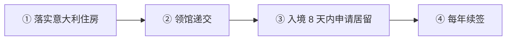
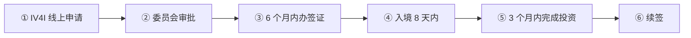

# 🇮🇹 意大利 · Italy

    

**数字游民须高技能；投资者签证 25 万欧起（非房产）**

[💻 数字游民和远程工作者签证](#italy-digital-nomad-remote-worker-visa) · [🧑‍💻 欧盟蓝卡](#italy-eu-blue-card) · [🏖️ 选择性居留（Elective Residence）](#italy-elective-residence) · [💰 投资者签证](#italy-investor-visa) · [📖 深度解读](#deep) · [🔗 延伸阅读](#more)

> [!TIP]
> **一句话判断**：欧盟 + 申根 + 欧元区。三个重点：**数字游民/远程工作者签证**（门槛要"高技能"，不是谁都能办）、**欧盟蓝卡**（不占年度配额 Decreto Flussi）、**投资者签证**（不是买房，最低 25 万欧投初创公司）。入籍一般需 **10 年**居住。

## 🏙️ 生活与身份档案

<table>
<tr><td width="33%" valign="top">💶 生活成本指数（纽约=100） <b>61.3 ●●●●○</b></td><td width="33%" valign="top">🏠 房租指数（纽约=100） <b>18.9 ●●●●○</b></td><td width="33%" valign="top">🛡️ 安全指数 <b>52.6 ●●○○○</b></td></tr>
<tr><td width="33%" valign="top">💼 平均年薪（总额） <b>EUR 33,523</b></td><td width="33%" valign="top">🧾 最高个税税率 <b>47.2%</b></td><td width="33%" valign="top">🛂 护照免签目的地 <b>185 个（中国 81）</b></td></tr>
<tr><td width="33%" valign="top">🏠 永居年限 <b>5 年</b></td><td width="33%" valign="top">🎖️ 入籍年限 <b>10 年</b></td><td width="33%" valign="top">🔁 双重国籍 <b>✅ 可保留原国籍</b></td></tr>
<tr><td width="33%" valign="top">🗣️ 语言要求 <b>意大利语 B1</b></td><td width="33%" valign="top">✈️ 中国护照入境 <b>申根签证</b></td><td width="33%" valign="top"></td></tr>
</table>

● 越多越好（成本/房租越低、安全越高）。数据：Numbeo 2026 年中、Eurostat、Tax Foundation 2026、Henley 2026；永居/入籍为常见规则，以官方为准。中国不承认双重国籍。[数据说明](README.md#profiles)

## 📊 路线速查

| 路线 | 类型 | 门槛信号 | 家属 | 永居 | 状态 |
|---|---|---|:-:|:-:|:-:|
| [意大利数字游民和远程工作者签证](#italy-digital-nomad-remote-worker-visa) | 💻 数字游民 | — | ✅ 可带 | ✅ 可能 | 🟢 开放 |
| [意大利欧盟蓝卡](#italy-eu-blue-card) | 🧑‍💻 技术工作 | — | ✅ 可带 | ✅ 可能 | 🟢 开放 |
| [意大利选择性居留（Elective Residence）](#italy-elective-residence) | 🏖️ 被动收入居留 | EUR 31,160/年 | ✅ 可带 | ✅ 可能 | 🟢 开放 |
| [意大利投资者签证](#italy-investor-visa) | 💰 投资居留 | 投资 ≥ 250,000 | ✅ 可带 | ✅ 可能 | 🟢 开放 |

门槛为主申请人的最低信号值，多与当地工资挂钩、每年调整，递交前以官方为准。

---

## 💻 意大利数字游民和远程工作者签证

   

> **面向'高技能'远程工作者的签证，要求学历或多年经验，不占年度配额。**

<table>
<tr><td width="33%" valign="top">收入 <b>约 EUR 24,789–25,500/年（各领馆口径不同）</b></td><td width="33%" valign="top">雇员额外门槛 <b>华盛顿领馆：税前年薪 ≥ EUR 33,000</b></td><td width="33%" valign="top">技能要求 <b>大学学历，或 5 年专业经验（ICT 3 年）</b></td></tr>
<tr><td width="33%" valign="top">工作经历 <b>相关领域 ≥6 个月</b></td><td width="33%" valign="top">居留许可 <b>最长 1 年，每年续</b></td><td width="33%" valign="top">入境后 <b>8 个工作日内到 Questura 申请居留</b></td></tr>
<tr><td width="33%" valign="top">保险 <b>保额 ≥ EUR 30,000</b></td><td width="33%" valign="top"></td><td width="33%" valign="top"></td></tr>
</table>

<table><tr>
<td width="50%" valign="top">✅ <b>适合</b><ul><li>有学历的 IT、设计、咨询等高技能远程工作者</li><li>已在意大利落实住房</li></ul></td>
<td width="50%" valign="top">❌ <b>不适合</b><ul><li>无学历且经验不足</li><li>需要带成年子女或父母</li><li>雇主不愿出具无犯罪声明</li></ul></td>
</tr></table>

### 🗺️ 申请流程

1. **确认身份类别** — 自雇（数字游民）或雇员/协作者（远程工作者）
2. **学历认证** — CIMEA 或使馆 Declaration of Value
3. **落实住房** — 租约或产权证明须在领馆预约前准备好
4. **领馆递交** — 按所属领区清单
5. **入境 8 个工作日内** — 到住所所在地 Questura 申请 permesso di soggiorno
6. **续签** — 到期前至少 60 天

### 📋 材料清单

- [ ] 国家签证申请表、护照、照片
- [ ] 学历或专业经验证明（认证）
- [ ] ≥6 个月相关工作证明
- [ ] 收入证明
- [ ] 意大利住房证明
- [ ] 医疗保险（≥ EUR 30,000）
- [ ] 雇员：劳动合同 + 雇主无犯罪声明
- [ ] 自雇：客户合同、发票、税表
- [ ] 无犯罪证明

> [!WARNING]
> **注意**
> - 医保不合格是主要拒签原因之一
> - 在意大利工作原则上要缴意大利社保（双边协定除外）
> - 住满 183 天成为税务居民

🔗 官方来源（6）

- [Italian Embassy Tripoli 2026 digital nomad checklist](https://ambtripoli.esteri.it/wp-content/uploads/2026/05/6.-DOC-Nomadi-Digitali-ENG-AR.pdf)
- [Italian Embassy Washington 2026 digital nomad and remote worker checklist](https://ambwashingtondc.esteri.it/wp-content/uploads/2026/02/Digital-nomad-Remote-Worker-Visa-2026.pdf)
- [Integration Migrants FAQ on digital nomads and remote workers](https://www.integrazionemigranti.gov.it/en-gb/Ricerca-news/Dettaglio-news/id/3835/Who-are-the-digital-nomads-How-can-they-enter-Italy-)
- [Italy New York consulate digital nomad and remote worker visa](https://consnewyork.esteri.it/en/servizi-consolari-e-visti/servizi-per-il-cittadino-straniero/visti/visas-to-enter-italy/digital-nomad-remote-worker-visa/)
- [Invest in Italy labour law and immigration](https://www.investinitaly.gov.it/en/doing-business/labour-law-and-immigration)
- [Ministry of the Interior visa and residence permit page](https://www.interno.gov.it/it/temi/immigrazione-e-asilo/modalita-dingresso/visto-e-permesso-soggiorno)

数据核查：2026-10-26 · [LetsMigrate 原始记录](https://letsmigrate.org/zh-hans/programmes/italy-digital-nomad-remote-worker-visa-zh/) · [↑ 回到顶部](#top)

---

## 🧑‍💻 意大利欧盟蓝卡

   

> **不占年度配额的高技能雇佣路线，雇主主导递交，30 天出工作许可。**

<table>
<tr><td width="33%" valign="top">资质 <b>学历/高等职业资格，或 5 年经验；ICT 近 7 年内 3 年</b></td><td width="33%" valign="top">薪资 <b>不低于全国集体合同工资</b></td><td width="33%" valign="top">工作许可 <b>雇主递交，法定 30 天（Law 182/2025）</b></td></tr>
<tr><td width="33%" valign="top">入境后 <b>8 天内申请居留</b></td><td width="33%" valign="top">卡期 <b>无固定期限合同 2 年；固定期限为合同期 + 3 个月</b></td><td width="33%" valign="top">换雇主 <b>前 12 个月需劳动监察部门批准</b></td></tr>
<tr><td width="33%" valign="top">长期居留 <b>欧盟内蓝卡 5 年 + 意大利蓝卡 ≥2 年</b></td><td width="33%" valign="top"></td><td width="33%" valign="top"></td></tr>
</table>

<table><tr>
<td width="50%" valign="top">✅ <b>适合</b><ul><li>有意大利雇主 offer 的工程师、IT、科研人员</li></ul></td>
<td width="50%" valign="top">❌ <b>不适合</b><ul><li>自由职业者（应看数字游民签证）</li></ul></td>
</tr></table>

### 🗺️ 申请流程

1. **雇主递交工作许可** — One-Stop-Shop，30 天决定
2. **领馆签证** — 凭 nulla osta
3. **入境 8 天内** — 申请居留许可
4. **签居住合同** — 2026 年起部分步骤在线完成

### 📋 材料清单

- [ ] 劳动合同
- [ ] 学历或经验证明
- [ ] 护照
- [ ] 住址证明

> [!WARNING]
> **注意**
> - 前 12 个月换工作要先获批

🔗 官方来源（5）

- [Current Italian government EU Blue Card guidance](https://www.integrazionemigranti.gov.it/it-it/Ricerca-news/Dettaglio-news/id/1978/Cose-e-come-si-richiede-la-carta-blue-Ue)
- [Ministry of the Interior EU Blue Card page](https://libertaciviliimmigrazione.dlci.interno.gov.it/la-carta-blu-ue-art-27quater-dlgs-28698-ingresso-lavoratori-altamente-qualificati)
- [Integration Migrants EU Blue Card reform note](https://www.integrazionemigranti.gov.it/it-it/Ricerca-news/Dettaglio-news/id/3851)
- [European Commission highly-qualified worker in Italy](https://home-affairs.ec.europa.eu/policies/migration-and-asylum/eu-immigration-portal/highly-qualified-worker-italy_en)
- [Ministry of Labour work entry in Italy](https://www.lavoro.gov.it/temi-e-priorita/immigrazione/focus-on/ingresso-e-soggiorno-per-lavoro-in-italia/pagine/ingresso-e-soggiorno-per-lavoro-in-italia)

数据核查：2026-10-26 · [LetsMigrate 原始记录](https://letsmigrate.org/zh-hans/programmes/italy-eu-blue-card-zh/) · [↑ 回到顶部](#top)

---

## 🏖️ 意大利选择性居留（Elective Residence）

    

> **靠被动收入在意大利生活的居留，官方最低约 3.1 万欧/年，但各领馆常要求更高。**

<table>
<tr><td width="33%" valign="top">最低收入 <b>约 EUR 31,160/年被动收入</b></td><td width="33%" valign="top">家属 <b>配偶 +20%，每个子女 +5%</b></td><td width="33%" valign="top">实际 <b>不少领馆期望单人 4–6 万欧</b></td></tr>
<tr><td width="33%" valign="top">工作 <b>❌ 不允许（含远程）</b></td><td width="33%" valign="top">住房 <b>须有 ≥12 个月登记租约或产权</b></td><td width="33%" valign="top">期限 <b>1 年可续；5 年永居，10 年入籍</b></td></tr>
</table>

<table><tr>
<td width="50%" valign="top">✅ <b>适合</b><ul><li>有养老金、租金、股息收入的人</li></ul></td>
<td width="50%" valign="top">❌ <b>不适合</b><ul><li>想远程工作的人</li></ul></td>
</tr></table>

### 🗺️ 申请流程

1. **落实意大利住房**
2. **领馆递交**
3. **入境 8 天内申请居留** — Questura
4. **每年续签**

### 📋 材料清单

- [ ] 被动收入证明
- [ ] 住房合同
- [ ] 医保 ≥ EUR 30,000
- [ ] 无犯罪证明

> [!WARNING]
> **注意**
> - 金额各领馆不同，递交前问清所属领馆

🔗 来源（2）

- [Golden Harbors: Italy ERV 2026](https://goldenharbors.com/articles/italy-elective-residence-visa)
- [Harvey Law: Italy retirement visa](https://harveylawcorporation.com/italy-retirement-visa/)

数据核查：2026-10 · 本条为 RUN 补充路线（LetsMigrate 未收录），来源见上 · [↑ 回到顶部](#top)

---

## 💰 意大利投资者签证

   

> **投资初创公司 25 万欧起可获意大利居留；不能买房，不是投资入籍。**

<table>
<tr><td width="33%" valign="top">最低投资 <b>创新型初创公司 EUR 250,000</b></td><td width="33%" valign="top">其他档 <b>有限公司 50 万 / 公益捐赠 100 万 / 国债 200 万</b></td><td width="33%" valign="top">组合 <b>❌ 不能组合凑数</b></td></tr>
<tr><td width="33%" valign="top">审批 <b>IV4I 线上 nulla osta，30 天出结果，免费</b></td><td width="33%" valign="top">卡期 <b>签证 2 年 → 居留 2 年 → 每次续 3 年</b></td><td width="33%" valign="top">投资时限 <b>入境后 3 个月内完成</b></td></tr>
<tr><td width="33%" valign="top">长期居留 <b>投资持续 5 年可申请欧盟长期居留</b></td><td width="33%" valign="top"></td><td width="33%" valign="top"></td></tr>
</table>

<table><tr>
<td width="50%" valign="top">✅ <b>适合</b><ul><li>有意大利创业项目或股权投资计划</li><li>想要不占配额的居留</li></ul></td>
<td width="50%" valign="top">❌ <b>不适合</b><ul><li>想买房拿身份</li><li>想快速入籍（一般需 10 年居住）</li></ul></td>
</tr></table>

### 🗺️ 申请流程

1. **IV4I 线上申请** — 填写投资承诺、拟居住城市
2. **委员会审批** — 30 天内 nulla osta
3. **6 个月内办签证** — 护照有效期 ≥2 年 3 个月
4. **入境 8 天内** — Questura 申请居留
5. **3 个月内完成投资** — 上传证明
6. **续签** — 委员会确认投资持续后续 3 年

### 📋 材料清单

- [ ] 护照
- [ ] 资金证明及来源说明
- [ ] 投资承诺声明（电子签名）
- [ ] 无犯罪证明
- [ ] Questura 费用：EUR 30.46 + 50 + 印花税 16

> [!WARNING]
> **注意**
> - 新居民统一税 2026 年后迁入为每年 EUR 300,000，与签证是两回事
> - 初创投资门槛最低但风险最高

🔗 官方来源（5）

- [Investor Visa for Italy official portal](https://investorvisa.mise.gov.it/index.php/en/home-en/)
- [Investor Visa for Italy policy guidance](https://investorvisa.mise.gov.it/images/documenti/Investor_Visa_for_Italy_Policy_guidance_ENG_19_07_2021.pdf)
- [Ministry of Enterprises and Made in Italy Investor Visa overview](https://www.mimit.gov.it/it/impresa/competitivita-e-nuove-imprese/start-up-innovative/programmi)
- [Ministry of the Interior citizenship overview](https://www.interno.gov.it/it/temi/cittadinanza-e-altri-diritti-civili/cittadinanza)
- [Italian Revenue Agency substitute tax payment note](https://www1.agenziaentrate.gov.it/servizi/scadenzario/main.php?chi=1883&come=526&cosa=10932&entroil=30-06-2025&op=4&vista=1)

数据核查：2026-10-26 · [LetsMigrate 原始记录](https://letsmigrate.org/zh-hans/programmes/italy-investor-visa-zh/) · [↑ 回到顶部](#top)

---

## 📖 深度解读

### 路线要点

### 数字游民和远程工作者签证（Article 27-quater 框架）
- **两类人**：数字游民 = 自雇；远程工作者 = 雇员或协作者。两者都**不占年度配额**。
- **必须是"高技能工作"**：大学学历，或相关领域多年经验（一般 5 年，ICT 行业 3 年），证据标准同欧盟蓝卡（可能要 CIMEA 或 Declaration of Value 学历认证）。
- **收入**：≥ 医疗费用豁免最低收入的 3 倍。常引用 **EUR 24,789/年**（2024 口径）；的黎波里使馆 2026 清单写约 EUR 25,500。**雇员类**另有门槛：华盛顿使馆 2026 清单要求**税前年薪 ≥ EUR 33,000**，并需雇主声明近 5 年无移民/劳工犯罪。
- **其他**：相关领域至少 6 个月工作经历；入境前已落实意大利住房；医保保额不低于 EUR 30,000（不合格保险是常见拒签原因）。
- **流程**：领事馆国家签证 → 入境后 **8 个工作日内**到住所所在地 Questura 申请居留许可（permesso di soggiorno）。
- **卡期**：最长 1 年，满足条件每年续；续签至少提前 60 天。
- **家属**：配偶、18 岁以下子女可随行，家属居留可工作；成年子女和父母一般**不能**通过此路线带。
- **税/社保**：在意大利工作原则上适用意大利社保（有双边协定除外）；自雇者可能要开 partita IVA（增值税号）；>183 天通常成为税务居民。

### 欧盟蓝卡（Carta Blu UE）
- 雇主主导：雇主向 One-Stop-Shop 申请工作许可（Law 182/2025 起法定 30 天决定）→ 签证 → 入境 8 天内申请居留。
- **资质**：学历/高等职业资格，或 5 年相关经验；ICT 经理/专家可凭近 7 年内 3 年经验。
- **薪资**：不得低于适用的全国集体合同工资。
- **卡期**：无固定期限合同 2 年；固定期限 = 合同期 + 3 个月。
- **换工作**：前 12 个月（原为 2 年）换雇主需劳动监察部门事先批准。
- **欧盟流动**：在第一个成员国持蓝卡 12 个月后可免签迁来意大利工作。
- **长期居留**：欧盟内持蓝卡连续 5 年且持意大利蓝卡 ≥2 年，可申请欧盟长期居留。

### 投资者签证（Investor Visa for Italy）
| 投资方式 | 最低金额 |
|---|---|
| 意大利创新型初创公司股权 | EUR 250,000 |
| 意大利有限公司股权（须已运营、已报过至少一份资产负债表） | EUR 500,000 |
| 公益捐赠 | EUR 1,000,000 |
| 意大利国债（剩余期限 ≥2 年） | EUR 2,000,000 |

- **不能组合凑数**，只能选一种。**不含房产。**
- **流程**：IV4I 线上申请 nulla osta（免费，30 天内出结果）→ 6 个月内去领馆签证（护照有效期需 ≥2 年 3 个月）→ 入境 8 天内申请居留 → **入境后 3 个月内完成投资**并上传证明。
- **卡期**：签证 2 年 → 居留 2 年 → 每次续 3 年（需委员会确认投资持续）。
- 投资持续 5 年可申请欧盟长期居留（另需满足条件）。

### 税务提醒
- 新居民"统一税"制度（境外收入每年缴固定税额）：老资料写 EUR 100,000；2024-08-11 后迁入为 EUR 200,000；2026 年预算法后迁入涨到 **EUR 300,000**（每位家属 EUR 50,000）。

### 入籍
- 居住入籍一般 **10 年** + 收入 + 无犯罪 + 意大利语；审理最长 24 个月（可延至 36 个月）。
- 血统入籍（jure sanguinis）在 2025 年已大幅收紧，祖辈血统路线不要按老攻略理解。

---

## 🔗 延伸阅读

LetsMigrate 中文指南原文（14 篇）

- [意大利数字游民签证文件清单](https://letsmigrate.org/zh-hans/articles/italy-digital-nomad-remote-worker-visa-documents-checklist-zh/)
- [意大利数字游民签证家庭和续签规则](https://letsmigrate.org/zh-hans/articles/italy-digital-nomad-remote-worker-visa-family-renewal-zh/)
- [意大利数字游民和远程工作者签证指南](https://letsmigrate.org/zh-hans/articles/italy-digital-nomad-remote-worker-visa-guide-zh/)
- [意大利数字游民签证资质和工作类型](https://letsmigrate.org/zh-hans/articles/italy-digital-nomad-remote-worker-visa-qualifications-worker-types-zh/)
- [意大利数字游民签证税务、社保和医疗](https://letsmigrate.org/zh-hans/articles/italy-digital-nomad-remote-worker-visa-tax-social-security-healthcare-zh/)
- [意大利数字游民签证时间线和费用](https://letsmigrate.org/zh-hans/articles/italy-digital-nomad-remote-worker-visa-timeline-costs-zh/)
- [意大利欧盟蓝卡家庭、流动和换工作](https://letsmigrate.org/zh-hans/articles/italy-eu-blue-card-family-mobility-job-changes-zh/)
- [意大利欧盟蓝卡指南](https://letsmigrate.org/zh-hans/articles/italy-eu-blue-card-guide-zh/)
- [意大利欧盟蓝卡工资和资质规则](https://letsmigrate.org/zh-hans/articles/italy-eu-blue-card-salary-qualification-rules-zh/)
- [意大利欧盟蓝卡时间线和文件](https://letsmigrate.org/zh-hans/articles/italy-eu-blue-card-timeline-documents-zh/)
- [意大利投资者签证指南](https://letsmigrate.org/zh-hans/articles/italy-investor-visa-guide-zh/)
- [意大利投资者签证投资路线和尽调](https://letsmigrate.org/zh-hans/articles/italy-investor-visa-investment-routes-due-diligence-zh/)
- [意大利投资者签证税务、家庭和入籍规划](https://letsmigrate.org/zh-hans/articles/italy-investor-visa-tax-family-citizenship-zh/)
- [意大利投资者签证时间线和文件](https://letsmigrate.org/zh-hans/articles/italy-investor-visa-timeline-documents-zh/)

[← 🇮🇪 爱尔兰](ireland.md) ｜ [🇪🇺 全部国家](README.md) ｜ [🏠 首页](../../README.md) ｜ [🇱🇻 拉脱维亚 →](latvia.md)

本页根据 [LetsMigrate.org](https://letsmigrate.org/zh-hans/countries/italy-zh/) 公开资料及官方来源整理改写，仅供信息参考，不构成移民、法律、税务或投资建议。
