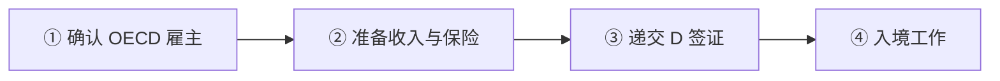
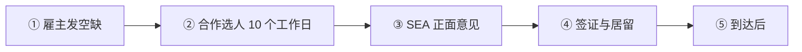
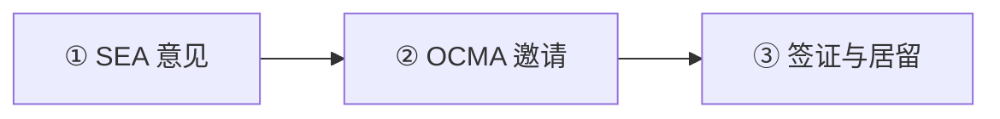
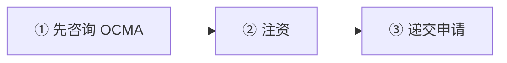

# 🇱🇻 拉脱维亚 · Latvia

    

**2026 新法关闭买房居留；蓝卡门槛 EUR 2,723/月**

[💻 远程工作签证](#latvia-remote-work-visa) · [🧑‍💻 欧盟蓝卡](#latvia-eu-blue-card) · [🧑‍💻 就业居留许可](#latvia-residence-permit-for-employment) · [💰 投资者居留许可](#latvia-investor-residence-permit) · [📖 深度解读](#deep) · [🔗 延伸阅读](#more)

> [!TIP]
> **一句话判断**：欧盟 + 申根 + 欧元区。**2026-09-15 新《移民法》生效，买房居留和银行次级债投资居留都已关闭**，只剩公司注资路线可评估。远程工作签证门槛偏高（EUR 4,538/月）且**必须是 OECD 国家的雇主/注册**，对用中国雇主的人基本不适用。欧盟蓝卡门槛在欧洲属于很低的一档。

## 🏙️ 生活与身份档案

<table>
<tr><td width="33%" valign="top">💶 生活成本指数（纽约=100） <b>51.3 ●●●●○</b></td><td width="33%" valign="top">🏠 房租指数（纽约=100） <b>10.7 ●●●●●</b></td><td width="33%" valign="top">🛡️ 安全指数 <b>64.0 ●●●○○</b></td></tr>
<tr><td width="33%" valign="top">💼 平均年薪（总额） <b>EUR 22,262</b></td><td width="33%" valign="top">🧾 最高个税税率 <b>36%</b></td><td width="33%" valign="top">🛂 护照免签目的地 <b>182 个（中国 81）</b></td></tr>
<tr><td width="33%" valign="top">🏠 永居年限 <b>5 年</b></td><td width="33%" valign="top">🎖️ 入籍年限 <b>10 年</b></td><td width="33%" valign="top">🔁 双重国籍 <b>⚠️ 有条件</b></td></tr>
<tr><td width="33%" valign="top">🗣️ 语言要求 <b>拉脱维亚语</b></td><td width="33%" valign="top">✈️ 中国护照入境 <b>申根签证</b></td><td width="33%" valign="top"></td></tr>
</table>

● 越多越好（成本/房租越低、安全越高）。数据：Numbeo 2026 年中、Eurostat、Tax Foundation 2026、Henley 2026；永居/入籍为常见规则，以官方为准。中国不承认双重国籍。[数据说明](README.md#profiles)

## 📊 路线速查

| 路线 | 类型 | 门槛信号 | 家属 | 永居 | 状态 |
|---|---|---|:-:|:-:|:-:|
| [拉脱维亚远程工作签证](#latvia-remote-work-visa) | 💻 数字游民 | EUR 4,538/月 | ⚠️ 需核查 | ⏳ 偏临时 | 🟢 开放 |
| [拉脱维亚欧盟蓝卡](#latvia-eu-blue-card) | 🧑‍💻 技术工作 | EUR 2,723/月 | ✅ 可带 | ✅ 可能 | 🟢 开放 |
| [拉脱维亚就业居留许可](#latvia-residence-permit-for-employment) | 🧑‍💻 技术工作 | — | ✅ 可带 | ✅ 可能 | 🟢 开放 |
| [拉脱维亚投资者居留许可](#latvia-investor-residence-permit) | 💰 投资居留 | 投资 ≥ 50,000 | ✅ 可带 | ✅ 可能 | 🟢 开放 |

门槛为主申请人的最低信号值，多与当地工资挂钩、每年调整，递交前以官方为准。

---

## 💻 拉脱维亚远程工作签证

   

> **月入 4,538 欧且雇主在 OECD 国家才行，对中国雇主基本不适用。**

<table>
<tr><td width="33%" valign="top">收入 <b>上年平均月薪 × 2.5 = EUR 4,538/月</b></td><td width="33%" valign="top">雇主要求 <b>雇主或自雇注册地须在 OECD 国家</b></td><td width="33%" valign="top">签证费 <b>D 签证 EUR 90（临期递交 EUR 180）</b></td></tr>
<tr><td width="33%" valign="top">期限 <b>1 年 + 同理由再 1 年，之后冷却 6 个月</b></td><td width="33%" valign="top">保险 <b>≥ EUR 42,600</b></td><td width="33%" valign="top">家属 <b>❌ 不能随行</b></td></tr>
</table>

<table><tr>
<td width="50%" valign="top">✅ <b>适合</b><ul><li>为欧美日韩等 OECD 国家公司工作的高收入者</li></ul></td>
<td width="50%" valign="top">❌ <b>不适合</b><ul><li>中国雇主（中国非 OECD 成员）</li><li>带家属</li></ul></td>
</tr></table>

### 🗺️ 申请流程

1. **确认 OECD 雇主**
2. **准备收入与保险**
3. **递交 D 签证**
4. **入境工作** — 最长 1 年

### 📋 材料清单

- [ ] 护照（10 年内签发）
- [ ] 签证表、照片
- [ ] OECD 国家雇佣或自雇证明
- [ ] 收入证明
- [ ] 医保 ≥ EUR 42,600
- [ ] 住宿证明

> [!WARNING]
> **注意**
> - 拉脱维亚个税 25.5%/33%，住满 183 天成税务居民

🔗 官方来源（4）

- [OCMA Receiving a long-term visa for remote work](https://www.pmlp.gov.lv/en/receiving-long-term-visa-remote-work)
- [Immigration Law of Latvia](https://likumi.lv/ta/en/en/id/370622)
- [MFA Latvia visa application fees](https://www.mfa.gov.lv/en/visa-application-fees)
- [State Revenue Service residence status guidance](https://www.vid.gov.lv/lv/rezidences-statusa-noteiksana)

数据核查：2026-10-25 · [LetsMigrate 原始记录](https://letsmigrate.org/zh-hans/programmes/latvia-remote-work-visa-zh/) · [↑ 回到顶部](#top)

---

## 🧑‍💻 拉脱维亚欧盟蓝卡

   

> **欧盟蓝卡门槛最低的一档：月薪 2,723 欧（紧缺职业 2,178）。**

<table>
<tr><td width="33%" valign="top">月薪 <b>EUR 2,723；紧缺职业 EUR 2,178</b></td><td width="33%" valign="top">资质 <b>≥3 年制高等教育或 5 年经验</b></td><td width="33%" valign="top">审理费 <b>EUR 100（10 个工作日）/ 200（5 个工作日）</b></td></tr>
<tr><td width="33%" valign="top">卡期 <b>最长 2 年或合同期 + 3 个月</b></td><td width="33%" valign="top">雇主步骤 <b>2025 起需就业局（SEA）意见</b></td><td width="33%" valign="top"></td></tr>
</table>

<table><tr>
<td width="50%" valign="top">✅ <b>适合</b><ul><li>拉脱维亚技术岗位、薪资中等</li></ul></td>
<td width="50%" valign="top">❌ <b>不适合</b><ul><li>无学历且经验不足 5 年</li></ul></td>
</tr></table>

### 🗺️ 申请流程

1. **雇主发空缺** — SEA 1 个工作日内发布
2. **合作选人 10 个工作日**
3. **SEA 正面意见** — 1 个月内向 OCMA 递交
4. **签证与居留**
5. **到达后** — 申报住址、X 光检查、保险

### 📋 材料清单

- [ ] 劳动合同
- [ ] 学历证明
- [ ] 护照
- [ ] 医保 ≥ EUR 42,600
- [ ] 无犯罪证明（14 岁以上）

> [!WARNING]
> **注意**
> - 续签和邀请方材料须拉脱维亚语

🔗 官方来源（4）

- [OCMA necessary subsistence](https://www.pmlp.gov.lv/en/necessary-subsistence-0)
- [OCMA EU Blue Card](https://www.pmlp.gov.lv/en/eu-blue-card)
- [European Commission highly-qualified worker in Latvia](https://home-affairs.ec.europa.eu/policies/migration-and-asylum/eu-immigration-portal/highly-qualified-worker-latvia_en)
- [Latvian Immigration Law](https://likumi.lv/ta/en/en/id/370622)

数据核查：2026-10-25 · [LetsMigrate 原始记录](https://letsmigrate.org/zh-hans/programmes/latvia-eu-blue-card-zh/) · [↑ 回到顶部](#top)

---

## 🧑‍💻 拉脱维亚就业居留许可

   

> **普通就业居留，工资不低于行业平均。**

<table>
<tr><td width="33%" valign="top">薪资 <b>≥ 上年行业平均工资或行业协议最低</b></td><td width="33%" valign="top">审理费 <b>EUR 100（30 天）/ 200（10 个工作日）/ 400（5 个工作日）</b></td><td width="33%" valign="top">有效期 <b>按 2026 新法向 OCMA 确认</b></td></tr>
</table>

<table><tr>
<td width="50%" valign="top">✅ <b>适合</b><ul><li>普通技术岗位</li></ul></td>
<td width="50%" valign="top">❌ <b>不适合</b><ul><li>想要欧盟流动</li></ul></td>
</tr></table>

### 🗺️ 申请流程

1. **SEA 意见**
2. **OCMA 邀请**
3. **签证与居留**

### 📋 材料清单

- [ ] 劳动合同
- [ ] 护照
- [ ] 无犯罪证明

> [!WARNING]
> **注意**
> - 2026 新法取消了部分类别的年度登记

🔗 官方来源（5）

- [OCMA explains the change](https://www.pmlp.gov.lv/en/article/new-immigration-law-takes-effect-key-changes-and-regulations)
- [OCMA employment of foreigners](https://www.pmlp.gov.lv/en/employment-foreigners)
- [State Employment Agency employment of third-country nationals](https://www.nva.gov.lv/en/employment-third-country-nationals-latvia)
- [OCMA necessary subsistence](https://www.pmlp.gov.lv/en/necessary-subsistence-0)
- [Latvian Immigration Law](https://likumi.lv/ta/en/en/id/370622)

数据核查：2026-10-25 · [LetsMigrate 原始记录](https://letsmigrate.org/zh-hans/programmes/latvia-residence-permit-for-employment-zh/) · [↑ 回到顶部](#top)

---

## 💰 拉脱维亚投资者居留许可

   

> **2026-09-15 新法后买房居留已关闭，只剩公司注资路线可评估。**

<table>
<tr><td width="33%" valign="top">公司注资 <b>按公司规模 EUR 50,000 或 100,000 + 国家缴款 EUR 10,000</b></td><td width="33%" valign="top">买房 <b>⛔ 已关闭</b></td><td width="33%" valign="top">银行次级债 <b>⛔ 已关闭</b></td></tr>
<tr><td width="33%" valign="top">国家基金 15 万欧 <b>法律有规定，但基金未设立，暂不可用</b></td><td width="33%" valign="top">审理 <b>最长 4 个月</b></td><td width="33%" valign="top">永居 <b>欧盟长期居民：持临时居留 5 年 + 拉脱维亚语 A2</b></td></tr>
</table>

<table><tr>
<td width="50%" valign="top">✅ <b>适合</b><ul><li>真实在拉脱维亚经营公司的投资者</li></ul></td>
<td width="50%" valign="top">❌ <b>不适合</b><ul><li>想买房移民</li></ul></td>
</tr></table>

### 🗺️ 申请流程

1. **先咨询 OCMA** — 确认交易符合新法和初始有效期
2. **注资**
3. **递交申请** — 使馆或 OCMA

### 📋 材料清单

- [ ] 公司注册和注资证明
- [ ] 资金来源
- [ ] 护照

> [!WARNING]
> **注意**
> - 旧的'5 年投资者居留'不要再当规划前提
> - OCMA 部分旧页面仍显示已关闭的路线

🔗 官方来源（3）

- [Latvia OCMA share capital investor](https://www.pmlp.gov.lv/en/share-capital-investor)
- [Latvia OCMA: new Immigration Law takes effect](https://www.pmlp.gov.lv/en/article/new-immigration-law-takes-effect-key-changes-and-regulations)
- [Latvia OCMA how long residence permit may be issued](https://www.pmlp.gov.lv/en/how-long-may-residence-permit-be-issued-0)

数据核查：2026-10-25 · [LetsMigrate 原始记录](https://letsmigrate.org/zh-hans/programmes/latvia-investor-residence-permit-zh/) · [↑ 回到顶部](#top)

---

## 📖 深度解读

### 路线要点

### 投资者居留（2026 新法后）
| 方式 | 2026-09-15 后状态 |
|---|---|
| 购买房地产 | **已关闭**新申请 |
| 银行次级债 | **已关闭**新申请 |
| 公司注资 | 仍可评估：按公司规模投资 EUR 50,000 或 100,000 + 国家预算缴款 EUR 10,000 |
| 国家另类投资基金 EUR 150,000 | 法律有规定，但基金尚未设立，**暂不可用** |

- 旧的"5 年投资者居留"不能再作为规划假设；动钱之前先请 OCMA（公民与移民事务局）确认。
- 新法下审理时限最长 4 个月。
- **永久居留**只保留"欧盟长期居民"一种：一般需持临时居留连续 5 年，拉脱维亚语 ≥ A2，出境一般不超过连续 6 个月/累计 10 个月。融合课程 2027-12-31 起实施。

### 远程工作签证（D 类长期签证）
- **雇主或你的自雇注册地必须在 OECD 成员国**。
- **收入**：上一年全国平均月工资 × 2.5，OCMA 当前公示 **EUR 4,538/月**。
- **医保**：覆盖拉脱维亚和申根，保额 ≥ EUR 42,600。
- **费用**：D 签证 EUR 90（停留期满前不足 3 个工作日递交为 EUR 180）。
- **卡期**：最长 1 年，同理由可再签 1 年；之后**同理由 6 个月内不能再签**。
- **不能带家属**（OCMA 未提供该路线下的家庭团聚），不能在拉脱维亚本地工作。不通永居。

### 雇佣路线
| | 国家就业居留 | 欧盟蓝卡 |
|---|---|---|
| 薪资 | 不低于该行业上年平均工资或行业协议最低工资 | **EUR 2,723/月**（紧缺职业 EUR 2,178/月） |
| 资质 | 视岗位 | ≥3 年制高等教育，或 ≥5 年相关经验 |
| 雇主流程 | 2025-01-01 起须先取得国家就业局（SEA）意见：发布空缺 → 合作选人 10 个工作日 → 1 个月内向 OCMA 递交邀请 | 同样需雇主担保 |
| 有效期 | 按 2026 新法向 OCMA 确认 | 最长 2 年，或合同期 + 3 个月 |
| 审理费 | EUR 100（30 天）/ 200（10 个工作日）/ 400（5 个工作日） | EUR 100（10 个工作日）/ 200（5 个工作日） |

- 首次申请材料可用拉脱维亚语或英语，续签和邀请方材料须拉脱维亚语。
- 拿到居留后需申报住址、提交拉脱维亚 X 光检查报告、医保 ≥ EUR 42,600，并在税务局登记。

### 税务提醒
- 申报住所在拉脱维亚，或任意 12 个月内停留 ≥183 天 → 税务居民，全球收入纳税。
- 2026 个税：EUR 105,300 以内 25.5%，以上 33%，年收入 > EUR 200,000 部分再加 3%。

---

## 🔗 延伸阅读

LetsMigrate 中文指南原文（13 篇）

- [拉脱维亚投资者居留许可指南](https://letsmigrate.org/zh-hans/articles/latvia-investor-residence-permit-guide-zh/)
- [拉脱维亚投资者居留路线和尽职调查](https://letsmigrate.org/zh-hans/articles/latvia-investor-residence-permit-routes-due-diligence-zh/)
- [拉脱维亚投资者居留税务、家庭和入籍规划](https://letsmigrate.org/zh-hans/articles/latvia-investor-residence-permit-tax-family-citizenship-zh/)
- [拉脱维亚投资者居留时间线和文件](https://letsmigrate.org/zh-hans/articles/latvia-investor-residence-permit-timeline-documents-zh/)
- [拉脱维亚远程工作签证文件清单](https://letsmigrate.org/zh-hans/articles/latvia-remote-work-visa-documents-checklist-zh/)
- [拉脱维亚远程工作签证家庭和重复签证规则](https://letsmigrate.org/zh-hans/articles/latvia-remote-work-visa-family-repeat-visa-zh/)
- [拉脱维亚远程工作签证指南](https://letsmigrate.org/zh-hans/articles/latvia-remote-work-visa-guide-zh/)
- [拉脱维亚远程工作签证税务、银行、保险和设置](https://letsmigrate.org/zh-hans/articles/latvia-remote-work-visa-tax-banking-insurance-zh/)
- [拉脱维亚远程工作签证时间线和费用](https://letsmigrate.org/zh-hans/articles/latvia-remote-work-visa-timeline-costs-zh/)
- [拉脱维亚工作许可和欧盟蓝卡家庭、流动性与定居](https://letsmigrate.org/zh-hans/articles/latvia-work-permit-eu-blue-card-family-mobility-settlement-zh/)
- [拉脱维亚工作许可和欧盟蓝卡薪资规则](https://letsmigrate.org/zh-hans/articles/latvia-work-permit-eu-blue-card-salary-qualification-rules-zh/)
- [拉脱维亚工作许可和欧盟蓝卡时间线与文件](https://letsmigrate.org/zh-hans/articles/latvia-work-permit-eu-blue-card-timeline-documents-zh/)
- [拉脱维亚工作许可 vs 欧盟蓝卡](https://letsmigrate.org/zh-hans/articles/latvia-work-permit-vs-eu-blue-card-zh/)

[← 🇮🇹 意大利](italy.md) ｜ [🇪🇺 全部国家](README.md) ｜ [🏠 首页](../../README.md) ｜ [🇱🇮 列支敦士登 →](liechtenstein.md)

本页根据 [LetsMigrate.org](https://letsmigrate.org/zh-hans/countries/latvia-zh/) 公开资料及官方来源整理改写，仅供信息参考，不构成移民、法律、税务或投资建议。
