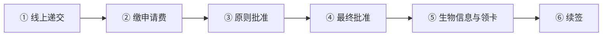
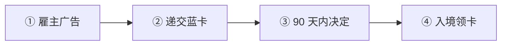
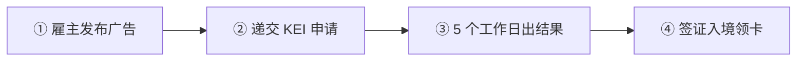
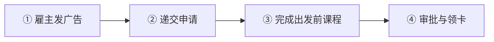
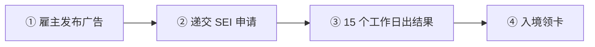
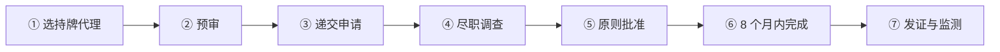
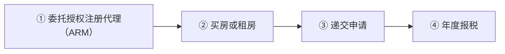
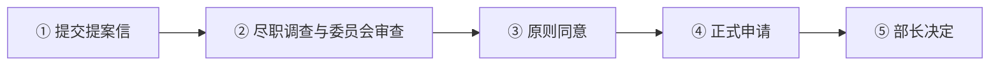

# 🇲🇹 马耳他 · Malta

    

**MPRP 永居约 11–47 万欧；数字游民最长 4 年**

[💻 数字游民居留许可](#malta-nomad-residence-permit) · [🧑‍💻 欧盟蓝卡](#malta-eu-blue-card) · [🧑‍💻 Key Employee Initiative](#malta-key-employee-initiative) · [🧑‍💻 Single Permit](#malta-single-permit) · [🧑‍💻 Specialist Employee Initiative](#malta-specialist-employee-initiative) · [💰 永久居留计划](#malta-permanent-residence-programme) · [💰 全球居留计划（GRP）](#malta-global-residence-programme) · [🛂 基于功绩的归化入籍](#malta-citizenship-by-merit) · [📖 深度解读](#deep) · [🔗 延伸阅读](#more)

> [!TIP]
> **一句话判断**：欧盟 + 申根 + 欧元区，英语官方语言。路线最全的国家之一（本站收录 7 条）：**MPRP 永久居留**（投资型，"一步到位"永居）、**数字游民居留许可**（临时，最长 4 年，不通永居）、**KEI / SEI / Single Permit / 欧盟蓝卡**四种雇佣路线。**原"投资入籍"（护照项目）已于 2025 年被欧盟法院判决后废止**，只剩"基于功绩"的酌情入籍。

## 🏙️ 生活与身份档案

<table>
<tr><td width="33%" valign="top">💶 生活成本指数（纽约=100） <b>56.9 ●●●●○</b></td><td width="33%" valign="top">🏠 房租指数（纽约=100） <b>27.2 ●●●○○</b></td><td width="33%" valign="top">🛡️ 安全指数 <b>57.0 ●●●○○</b></td></tr>
<tr><td width="33%" valign="top">💼 平均年薪（总额） <b>EUR 33,499</b></td><td width="33%" valign="top">🧾 最高个税税率 <b>35%</b></td><td width="33%" valign="top">🛂 护照免签目的地 <b>183 个（中国 81）</b></td></tr>
<tr><td width="33%" valign="top">🏠 永居年限 <b>5 年（MPRP 直接）</b></td><td width="33%" valign="top">🎖️ 入籍年限 <b>约 5 年（酌情）</b></td><td width="33%" valign="top">🔁 双重国籍 <b>✅ 可保留原国籍</b></td></tr>
<tr><td width="33%" valign="top">🗣️ 语言要求 <b>英语可用</b></td><td width="33%" valign="top">✈️ 中国护照入境 <b>申根签证</b></td><td width="33%" valign="top"></td></tr>
</table>

● 越多越好（成本/房租越低、安全越高）。数据：Numbeo 2026 年中、Eurostat、Tax Foundation 2026、Henley 2026；永居/入籍为常见规则，以官方为准。中国不承认双重国籍。[数据说明](README.md#profiles)

## 📊 路线速查

| 路线 | 类型 | 门槛信号 | 家属 | 永居 | 状态 |
|---|---|---|:-:|:-:|:-:|
| [马耳他数字游民居留许可](#malta-nomad-residence-permit) | 💻 数字游民 | EUR 42,000/年 | ✅ 可带 | ⏳ 偏临时 | 🟢 开放 |
| [马耳他欧盟蓝卡](#malta-eu-blue-card) | 🧑‍💻 技术工作 | EUR 34,956/年 | ✅ 可带 | ✅ 可能 | 🟢 开放 |
| [马耳他 Key Employee Initiative](#malta-key-employee-initiative) | 🧑‍💻 技术工作 | EUR 45,000/年 | ✅ 可带 | ✅ 可能 | 🟢 开放 |
| [马耳他 Single Permit](#malta-single-permit) | 🧑‍💻 技术工作 | — | ✅ 可带 | ✅ 可能 | 🟢 开放 |
| [马耳他 Specialist Employee Initiative](#malta-specialist-employee-initiative) | 🧑‍💻 技术工作 | EUR 30,000/年 | ✅ 可带 | ✅ 可能 | 🟢 开放 |
| [马耳他永久居留计划](#malta-permanent-residence-programme) | 💰 投资居留 | 投资 ≥ 99,000 | ✅ 可带 | ✅ 可能 | 🟢 开放 |
| [马耳他全球居留计划（GRP）](#malta-global-residence-programme) | 💰 投资居留 | 投资 ≥ 275,000 | ✅ 可带 | ⏳ 偏临时 | 🟢 开放 |
| [马耳他基于功绩的归化入籍](#malta-citizenship-by-merit) | 🛂 入籍 | — | ✅ 可带 | ⏳ 偏临时 | 🟢 开放 |

门槛为主申请人的最低信号值，多与当地工资挂钩、每年调整，递交前以官方为准。

---

## 💻 马耳他数字游民居留许可

   

> **年入 4.2 万欧的远程工作者可在马耳他住最长 4 年，英语环境，但不通永居。**

<table>
<tr><td width="33%" valign="top">收入 <b>税前 ≥ EUR 42,000/年</b></td><td width="33%" valign="top">费用 <b>申请费 EUR 300/人 + 居留卡 EUR 100/人</b></td><td width="33%" valign="top">审理 <b>收款后 30 个工作日</b></td></tr>
<tr><td width="33%" valign="top">卡期 <b>1 年，最多续 3 次（共 4 年）</b></td><td width="33%" valign="top">续签条件 <b>过去 12 个月在马耳他累计 ≥5 个月</b></td><td width="33%" valign="top">保险 <b>保额 ≥ EUR 100,000，覆盖欧盟 + 英国</b></td></tr>
<tr><td width="33%" valign="top">永居/入籍 <b>❌ 不通向</b></td><td width="33%" valign="top"></td><td width="33%" valign="top"></td></tr>
</table>

<table><tr>
<td width="50%" valign="top">✅ <b>适合</b><ul><li>英语环境优先的远程工作者</li><li>计划在欧洲住 1–4 年</li></ul></td>
<td width="50%" valign="top">❌ <b>不适合</b><ul><li>想拿永居或入籍</li><li>有马耳他本地客户</li><li>首次申请后才想加家属</li></ul></td>
</tr></table>

### 🗺️ 申请流程

1. **线上递交** — Residency Malta 系统，家属一并申请
2. **缴申请费** — 从主申请人账户付 EUR 300/人
3. **原则批准** — 30 个工作日内补交住房和医保
4. **最终批准** — 需要签证的经 Identita 办入境
5. **生物信息与领卡** — 3–4 周出卡
6. **续签** — 到期前 2–3 个月，提交本地银行交易证明

### 📋 材料清单

- [ ] N4 申请表（每人一份）
- [ ] 护照
- [ ] 动机信
- [ ] 近 3 个月银行流水（主申请人名下）
- [ ] 雇佣合同 / 公司股东证明 / 客户服务合同
- [ ] 无犯罪证明（6 个月内）
- [ ] 住房证明（不能用邮箱地址）
- [ ] 医疗保险

> [!WARNING]
> **注意**
> - 被拒无上诉，12 个月后才能重新申请
> - 不能同时持有其他马耳他居留身份

🔗 官方来源（3）

- [Nomad Residence Permit official homepage](https://nomad.residencymalta.gov.mt/)
- [Nomad Residence Permit FAQs version 14.1](https://nomad.residencymalta.gov.mt/new-faqs/)
- [Nomad Residence Permit application checklist](https://nomad.residencymalta.gov.mt/checklist/)

数据核查：2026-10-25 · [LetsMigrate 原始记录](https://letsmigrate.org/zh-hans/programmes/malta-nomad-residence-permit-zh/) · [↑ 回到顶部](#top)

---

## 🧑‍💻 马耳他欧盟蓝卡

   

> **高资质岗位年薪约 3.5 万欧以上，可在欧盟内流动。**

<table>
<tr><td width="33%" valign="top">年薪 <b>≥ 平均工资 1.5 倍，参考 EUR 34,956</b></td><td width="33%" valign="top">合同 <b>≥6 个月</b></td><td width="33%" valign="top">审理 <b>最长 90 天</b></td></tr>
<tr><td width="33%" valign="top">费用 <b>首次 EUR 600，续签 EUR 150/年</b></td><td width="33%" valign="top">卡期 <b>2 年或合同期 + 3 个月</b></td><td width="33%" valign="top">失业 <b>3 个月内找到新工作，否则撤卡</b></td></tr>
</table>

<table><tr>
<td width="50%" valign="top">✅ <b>适合</b><ul><li>需要欧盟流动性的高资质员工</li></ul></td>
<td width="50%" valign="top">❌ <b>不适合</b><ul><li>只看速度（KEI 更快）</li></ul></td>
</tr></table>

### 🗺️ 申请流程

1. **雇主广告** — ≥2 周 + 劳动力市场测试
2. **递交蓝卡** — Identita
3. **90 天内决定**
4. **入境领卡**

### 📋 材料清单

- [ ] 劳动合同
- [ ] 学历证明
- [ ] 招聘广告证明
- [ ] 护照
- [ ] 保险

> [!WARNING]
> **注意**
> - 欧盟委员会页面写的 EUR 300 费用已过时

🔗 官方来源（3）

- [Identita EU Blue Card](https://identita.gov.mt/expatriates-unit-main-page/noneu-nationals/employment-related-permits/highly-qualified-individuals/blue-card/)
- [European Commission EU Blue Card in Malta](https://home-affairs.ec.europa.eu/policies/migration-and-asylum/eu-immigration-portal/eu-blue-card/eu-blue-card-malta_en)
- [Identita non-EU employment FAQ](https://identita.gov.mt/frequently-asked-questions/expatriates/non-eu-employment/)

数据核查：2026-10-25 · [LetsMigrate 原始记录](https://letsmigrate.org/zh-hans/programmes/malta-eu-blue-card-zh/) · [↑ 回到顶部](#top)

---

## 🧑‍💻 马耳他 Key Employee Initiative

   

> **管理或高技术岗位年薪 4.5 万欧以上的快速通道，5 个工作日出结果。**

<table>
<tr><td width="33%" valign="top">年薪 <b>≥ EUR 45,000</b></td><td width="33%" valign="top">岗位 <b>管理岗或高技术岗</b></td><td width="33%" valign="top">审理 <b>5 个工作日</b></td></tr>
<tr><td width="33%" valign="top">费用 <b>首次 EUR 600，续签 EUR 150/年</b></td><td width="33%" valign="top">卡期 <b>首年 1 年，可续至 3 年</b></td><td width="33%" valign="top">招聘广告 <b>≥2 周（申请前 2 个月内）</b></td></tr>
</table>

<table><tr>
<td width="50%" valign="top">✅ <b>适合</b><ul><li>年薪达标、急着入职</li></ul></td>
<td width="50%" valign="top">❌ <b>不适合</b><ul><li>薪资低于 4.5 万欧</li></ul></td>
</tr></table>

### 🗺️ 申请流程

1. **雇主发布广告** — 本地平台 ≥2 周
2. **递交 KEI 申请** — Identita
3. **5 个工作日出结果**
4. **签证入境领卡**

### 📋 材料清单

- [ ] 劳动合同
- [ ] 学历或资质/经验证明
- [ ] 招聘广告证明
- [ ] 护照
- [ ] 医保

> [!WARNING]
> **注意**
> - 换雇主需走变更流程

🔗 官方来源（2）

- [Identita Key Employee Initiative](https://identita.gov.mt/expatriates-unit-main-page/noneu-nationals/employment-related-permits/highly-qualified-individuals/key-employee-initiative/)
- [Identita KEI who is eligible](https://identita.gov.mt/expatriates-unit-main-page/noneu-nationals/employment-related-permits/highly-qualified-individuals/key-employee-initiative/who-is-eligible/)

数据核查：2026-10-25 · [LetsMigrate 原始记录](https://letsmigrate.org/zh-hans/programmes/malta-key-employee-initiative-zh/) · [↑ 回到顶部](#top)

---

## 🧑‍💻 马耳他 Single Permit

   

> **马耳他普通雇佣居留，适用于不符合 KEI/SEI/蓝卡的本地工作。**

<table>
<tr><td width="33%" valign="top">薪资 <b>无统一公示门槛</b></td><td width="33%" valign="top">招聘广告 <b>Jobsplus + EURES ≥3 周</b></td><td width="33%" valign="top">审理 <b>法定最长 4 个月，完整材料平均约 2 个月</b></td></tr>
<tr><td width="33%" valign="top">费用 <b>EUR 600，续签 EUR 150</b></td><td width="33%" valign="top">出发前课程 <b>2026-03 起首次申请一般需完成（EUR 250）</b></td><td width="33%" valign="top"></td></tr>
</table>

<table><tr>
<td width="50%" valign="top">✅ <b>适合</b><ul><li>普通岗位</li></ul></td>
<td width="50%" valign="top">❌ <b>不适合</b><ul><li>合同不足 6 个月</li></ul></td>
</tr></table>

### 🗺️ 申请流程

1. **雇主发广告** — ≥3 周
2. **递交申请**
3. **完成出发前课程**
4. **审批与领卡**

### 📋 材料清单

- [ ] 劳动合同
- [ ] 广告证明
- [ ] 出发前课程证书
- [ ] 护照

> [!WARNING]
> **注意**
> - 续签提前 90 天（需体检的提前 30 天）

🔗 官方来源（4）

- [Identita Single Permit](https://identita.gov.mt/expatriates-unit-main-page/noneu-nationals/employment-related-permits/single-permit/)
- [Identita Single Permit who is eligible](https://identita.gov.mt/expatriates-unit-main-page/noneu-nationals/employment-related-permits/single-permit/who-is-eligible/)
- [Jobsplus employing non-EU nationals](https://jobsplus.gov.mt/find-candidates/non-eu-nationals-tcns)
- [Identita pre-departure course for first-time Single Permit applicants](https://identita.gov.mt/expatriates-unit-main-page/noneu-nationals/employment-related-permits/single-permit/expatriates-unit-single-permit-pre-departure-course/)

数据核查：2026-10-25 · [LetsMigrate 原始记录](https://letsmigrate.org/zh-hans/programmes/malta-single-permit-zh/) · [↑ 回到顶部](#top)

---

## 🧑‍💻 马耳他 Specialist Employee Initiative

   

> **年薪 3 万欧以上、有对口学历或经验的专业员工路线，15 个工作日出结果。**

<table>
<tr><td width="33%" valign="top">年薪 <b>≥ EUR 30,000</b></td><td width="33%" valign="top">资质 <b>MQF 6 级对口学历，或较低学历 + 3 年经验</b></td><td width="33%" valign="top">审理 <b>15 个工作日</b></td></tr>
<tr><td width="33%" valign="top">费用 <b>EUR 600</b></td><td width="33%" valign="top">招聘广告 <b>≥2 周</b></td><td width="33%" valign="top"></td></tr>
</table>

<table><tr>
<td width="50%" valign="top">✅ <b>适合</b><ul><li>薪资在 3–4.5 万欧之间的专业岗位</li></ul></td>
<td width="50%" valign="top">❌ <b>不适合</b><ul><li>无对口学历也无经验</li></ul></td>
</tr></table>

### 🗺️ 申请流程

1. **雇主发布广告** — ≥2 周
2. **递交 SEI 申请**
3. **15 个工作日出结果**
4. **入境领卡**

### 📋 材料清单

- [ ] 劳动合同
- [ ] 对口学历或 3 年经验证明
- [ ] 招聘广告证明
- [ ] 护照

> [!WARNING]
> **注意**
> - 达到 4.5 万欧且岗位符合的，优先走 KEI 更快

🔗 官方来源（2）

- [Identita Specialist Employee Initiative](https://identita.gov.mt/expatriates-unit-main-page/noneu-nationals/employment-related-permits/highly-qualified-individuals/specialist-employee-initiative/)
- [Identita SEI who is eligible](https://identita.gov.mt/expatriates-unit-main-page/noneu-nationals/employment-related-permits/highly-qualified-individuals/specialist-employee-initiative/who-is-eligible/)

数据核查：2026-10-25 · [LetsMigrate 原始记录](https://letsmigrate.org/zh-hans/programmes/malta-specialist-employee-initiative-zh/) · [↑ 回到顶部](#top)

---

## 💰 马耳他永久居留计划

   

> **欧盟内少数'一步到位'直接给永居的投资项目，租房方案总成本约 11 万欧起。**

<table>
<tr><td width="33%" valign="top">房产 <b>购买 ≥ EUR 375,000 或租赁 ≥ EUR 14,000/年</b></td><td width="33%" valign="top">行政费 <b>EUR 60,000（递交时 15,000 + 原则批准后 45,000）</b></td><td width="33%" valign="top">政府捐款 <b>EUR 37,000（买/租相同）</b></td></tr>
<tr><td width="33%" valign="top">慈善捐赠 <b>EUR 2,000</b></td><td width="33%" valign="top">资产证明 <b>总资产 ≥ 50 万（金融资产 ≥ 15 万），或 ≥ 65 万（金融资产 ≥ 7.5 万）</b></td><td width="33%" valign="top">家属附加费 <b>成年子女/父母/祖父母每人 EUR 7,500</b></td></tr>
<tr><td width="33%" valign="top">结果 <b>永久居留证书（条件持续即有效）</b></td><td width="33%" valign="top">居住要求 <b>无硬性天数</b></td><td width="33%" valign="top"></td></tr>
</table>

<table><tr>
<td width="50%" valign="top">✅ <b>适合</b><ul><li>想给全家（含父母）一次性拿欧盟永居</li><li>不打算在马耳他工作或常住</li><li>资产规模在 50 万欧以上且来源清晰</li></ul></td>
<td width="50%" valign="top">❌ <b>不适合</b><ul><li>想以此入籍（需真实居住且酌情审批）</li><li>需要在马耳他工作的人（永居不等于工作许可）</li></ul></td>
</tr></table>

### 🗺️ 申请流程

1. **选持牌代理** — MPRP 必须通过持牌代理递交
2. **预审** — 国籍、制裁名单、资金来源、家属
3. **递交申请** — 缴行政费首期 EUR 15,000（1 个月内）
4. **尽职调查** — 多层背调，14 岁以上家属都要查
5. **原则批准** — 2 个月内付行政费余款 45,000 + 家属附加费
6. **8 个月内完成** — 买房或签租约、捐款 37,000、捐赠 2,000、医保
7. **发证与监测** — 前 5 年每年合规检查

### 📋 材料清单

- [ ] 护照、出生/结婚证明
- [ ] 无犯罪证明（原籍国 + 近 10 年居住超 6 个月的国家）
- [ ] 资产证明（银行、证券、房产）
- [ ] 资金来源说明
- [ ] 购房合同或租约
- [ ] 覆盖欧盟的医疗保险
- [ ] 英文翻译件

> [!WARNING]
> **注意**
> - 递交后可先申请 1 年期临时居留
> - MPRP 不等于税务居民，马耳他有汇入制税务规则
> - 原'投资入籍'已废止，别和 MPRP 混淆

🔗 官方来源（4）

- [Residency Malta Agency MPRP page](https://residencymalta.gov.mt/legal-framework-mprp-2/)
- [Malta Permanent Residence Programme Regulations S.L. 217.26](https://residencymalta.gov.mt/wp-content/uploads/2025/08/S.L.217.26-Amended-by-LN-310-of-2024_-LN-146-of-2025.pdf)
- [Malta Commissioner for Revenue tax residence](https://cfr.gov.mt/en/individuals/Pages/Tax-Residence.aspx)
- [Community Malta Agency citizenship by naturalisation](https://komunita.gov.mt/services/acquisition-of-citizenship/)

数据核查：2026-10-25 · [LetsMigrate 原始记录](https://letsmigrate.org/zh-hans/programmes/malta-permanent-residence-programme-zh/) · [↑ 回到顶部](#top)

---

## 💰 马耳他全球居留计划（GRP）

    

> **买房 27.5 万或租房 9,600 欧/年即可获特殊税务居留，汇入马耳他的境外收入按 15% 征税。**

<table>
<tr><td width="33%" valign="top">购房 <b>EUR 275,000（南部/戈佐 220,000）</b></td><td width="33%" valign="top">或租房 <b>EUR 9,600/年（南部/戈佐 8,750）</b></td><td width="33%" valign="top">税 <b>汇入境外收入 15%，每年最低 EUR 15,000</b></td></tr>
<tr><td width="33%" valign="top">行政费 <b>EUR 6,000（南部/戈佐 5,500）</b></td><td width="33%" valign="top">条件 <b>不得在其他单一国家住 >183 天</b></td><td width="33%" valign="top"></td></tr>
</table>

<table><tr>
<td width="50%" valign="top">✅ <b>适合</b><ul><li>有境外收入、想以马耳他为税务居所的人</li></ul></td>
<td width="50%" valign="top">❌ <b>不适合</b><ul><li>想要永居（GRP 是特殊税务居留，不是永居）</li></ul></td>
</tr></table>

### 🗺️ 申请流程

1. **委托授权注册代理（ARM）**
2. **买房或租房**
3. **递交申请**
4. **年度报税** — 6 月 30 日前；最低税 4 月 30 日前

### 📋 材料清单

- [ ] 购房/租房合同
- [ ] 医疗保险
- [ ] 背景调查材料

> [!WARNING]
> **注意**
> - 与 MPRP 永居是两个不同项目

🔗 来源（2）

- [CC Malta: GRP 2026](https://www.ccmalta.com/publications/malta-global-residence-programme)
- [GVZH: Global Residence Programme](https://gvzh.mt/services/practice-areas/immigration-citizenship-residence/global-residence-programme/)

数据核查：2026-10 · 本条为 RUN 补充路线（LetsMigrate 未收录），来源见上 · [↑ 回到顶部](#top)

---

## 🛂 马耳他基于功绩的归化入籍

   

> **仅面向对马耳他或人类有'杰出贡献'的人的酌情入籍，没有明码标价。**

<table>
<tr><td width="33%" valign="top">法律依据 <b>公民法第 10(9) 条 + S.L. 188.06</b></td><td width="33%" valign="top">门槛 <b>杰出服务、杰出贡献或对马耳他有特别利益</b></td><td width="33%" valign="top">居住 <b>正式申请前在马耳他居住 ≥8 个月</b></td></tr>
<tr><td width="33%" valign="top">决定 <b>部长酌情决定</b></td><td width="33%" valign="top">原投资入籍 <b>⛔ 2025 年废止</b></td><td width="33%" valign="top"></td></tr>
</table>

<table><tr>
<td width="50%" valign="top">✅ <b>适合</b><ul><li>科学、艺术、体育、慈善等领域有国际级成就者</li></ul></td>
<td width="50%" valign="top">❌ <b>不适合</b><ul><li>想花钱买护照的人</li></ul></td>
</tr></table>

### 🗺️ 申请流程

1. **提交提案信** — 通过机构递交给委员会
2. **尽职调查与委员会审查**
3. **原则同意**
4. **正式申请** — 居住 ≥8 个月 + 房产 + 语言 + 背书
5. **部长决定**

### 📋 材料清单

- [ ] 详细提案信
- [ ] 成就证明
- [ ] 资金来源
- [ ] 无犯罪证明

> [!WARNING]
> **注意**
> - 官方禁止就此流程做营销，宣传'马耳他护照套餐'的都要警惕
> - 中国不承认双重国籍

🔗 官方来源（5）

- [Community Malta Agency Citizenship by Naturalisation on the Basis of Merit](https://komunita.gov.mt/wp-content/uploads/2026/02/Citizenship-by-Naturalisation-on-the-Basis-of-Merit.pdf)
- [Laws of Malta S.L. 188.06 merit regulations](https://legislation.mt/getpdf/68ac0c67d91e441100f8c680)
- [Government press release on Maltese Citizenship Act amendments](https://www.gov.mt/en/Government/DOI/Press%20Releases/Pages/2025/07/16/PR251293en.aspx)
- [Court of Justice judgment C-181/23 Commission v Malta](https://eur-lex.europa.eu/legal-content/EN/TXT/?uri=CELEX:62023CJ0181)
- [Identita passport FAQ](https://identita.gov.mt/frequently-asked-questions/passport/)

数据核查：2026-10-25 · [LetsMigrate 原始记录](https://letsmigrate.org/zh-hans/programmes/malta-citizenship-by-merit-zh/) · [↑ 回到顶部](#top)

---

## 📖 深度解读

### 路线要点

### MPRP 永久居留计划
| 项目 | 金额 |
|---|---|
| 房产 | 购买 ≥ EUR 375,000 **或** 租赁 ≥ EUR 14,000/年 |
| 行政费（主申请人） | EUR 60,000（递交时 15,000 + 原则批准后 2 个月内 45,000） |
| 政府捐款（买/租相同，2025 新规） | EUR 37,000（原则批准后 8 个月内） |
| 慈善捐赠 | EUR 2,000（给认可的本地 NGO） |
| 受抚养人附加费 | 每位成年未婚子女（<29 岁）/父母/祖父母 EUR 7,500 |
| 资产证明（二选一） | 总资产 ≥ EUR 500,000 且金融资产 ≥ 150,000；或总资产 ≥ 650,000 且金融资产 ≥ 75,000 |

- **最低总成本**：租房方案约 **EUR 113,000+**；买房方案约 **EUR 474,000+**（不含中介、税费、保险等）。
- 必须通过持牌代理递交；多层尽职调查（14 岁以上家属都要背景审查）。
- 递交后可先申请 1 年期临时居留。证书签发后前 5 年每年合规监测。
- **家属范围宽**：配偶、未成年子女、<29 岁未婚受抚养子女、受抚养父母和祖父母、残障成年子女。
- MPRP 是永居，**不等于**工作许可、税务居民或入籍。普通居住入籍：申请前 12 个月连续居住 + 前 6 年中累计 ≥4 年，且属酌情审批。

### 数字游民居留许可（Nomad Residence Permit）
- **收入**：税前 ≥ **EUR 42,000/年**（2024-04-01 前递交的为 EUR 32,400）。
- **身份**：为马耳他境外雇主工作的雇员、在境外注册公司的合伙人/股东、或客户都在境外的自由职业者。不能为马耳他本地雇主/客户工作。
- **费用**：申请费 EUR 300/人（不退）+ 居留卡 EUR 100/人。
- **审理**：收款后 30 个工作日；原则批准后 30 个工作日内补交住房和医保（保额 ≥ EUR 100,000，覆盖欧盟+英国）。
- **卡期**：1 年，最多续 3 次，**总共最长 4 年**。续签需证明过去 12 个月在马耳他累计住满 5 个月（用本地银行交易证明）。
- **不通向**长期居留、永居、MPRP 或入籍。被拒无上诉，12 个月后才能重新申请。家属要在首次申请时一起报（新生儿除外）。

### 雇佣路线四选一
| | Single Permit | SEI 专业员工 | KEI 关键员工 | 欧盟蓝卡 |
|---|---|---|---|---|
| 年薪 | 无统一门槛 | ≥ EUR 30,000 | ≥ EUR 45,000 | ≥ 平均工资 1.5 倍（参考 **EUR 34,956**） |
| 资质 | 视岗位 | MQF 6 级相关学历，或较低学历 + 3 年经验 | 管理/高技术岗 | 高等资质 |
| 招聘广告 | Jobsplus + EURES ≥3 周 | ≥2 周 | ≥2 周 | ≥2 周 + 劳动力市场测试 |
| 审理 | 法定 4 个月，完整材料平均约 2 个月 | 15 个工作日 | **5 个工作日** | 最长 90 天 |
| 费用 | EUR 600（续签 150） | EUR 600 | EUR 600（续 150/年） | EUR 600（续 150/年） |

- 2026 年 3 月起，首次 Single Permit 申请人一般需完成出发前课程（EUR 250）。
- 蓝卡持有人失业后有 3 个月找新工作，否则撤卡。

### 基于功绩入籍（Citizenship by Merit）
- 法律依据：《马耳他公民法》第 10(9) 条 + S.L. 188.06。面向对马耳他或人类有"杰出服务/贡献/利益"的人，**没有明码标价**，官方禁止营销。
- 先提交提案信 → 委员会审查 → 原则同意后正式申请（需在马耳他居住至少 8 个月）。
- 原直接投资入籍（MEIN / 护照项目）因 2025-04-29 欧盟法院 C-181/23 判决被认定为"交易性"，已由 L.N. 159/2025 删除。

### 税务提醒
- 一年在马耳他 >183 天即为税务居民；马耳他对非 domicile 居民有汇入制（remittance basis），但需专业税务规划。数字游民另有 S.L. 123.210 专门税则。

---

## 🔗 延伸阅读

LetsMigrate 中文指南原文（17 篇）

- [马耳他基于功绩入籍的文件、证据和决策流程](https://letsmigrate.org/zh-hans/articles/malta-citizenship-by-merit-documents-evidence-decision-process-zh/)
- [马耳他基于功绩的入籍指南](https://letsmigrate.org/zh-hans/articles/malta-citizenship-by-merit-guide-zh/)
- [马耳他基于功绩入籍的税务、家庭、护照和实际影响](https://letsmigrate.org/zh-hans/articles/malta-citizenship-by-merit-tax-family-passport-practical-implications-zh/)
- [马耳他基于功绩入籍、投资入籍和 MPRP 对比](https://letsmigrate.org/zh-hans/articles/malta-citizenship-by-merit-vs-investment-citizenship-permanent-residence-zh/)
- [马耳他数字游民居留许可文件清单](https://letsmigrate.org/zh-hans/articles/malta-nomad-residence-permit-documents-checklist-zh/)
- [马耳他数字游民居留许可家庭和续签规则](https://letsmigrate.org/zh-hans/articles/malta-nomad-residence-permit-family-renewal-zh/)
- [马耳他数字游民居留许可指南](https://letsmigrate.org/zh-hans/articles/malta-nomad-residence-permit-guide-zh/)
- [马耳他数字游民居留许可税务、银行和医疗保险](https://letsmigrate.org/zh-hans/articles/malta-nomad-residence-permit-tax-banking-health-insurance-zh/)
- [马耳他数字游民居留许可时间线和费用](https://letsmigrate.org/zh-hans/articles/malta-nomad-residence-permit-timeline-costs-zh/)
- [马耳他 MPRP 费用、房产和尽职调查](https://letsmigrate.org/zh-hans/articles/malta-permanent-residence-programme-costs-property-due-diligence-zh/)
- [马耳他永久居留计划 MPRP 指南](https://letsmigrate.org/zh-hans/articles/malta-permanent-residence-programme-guide-zh/)
- [马耳他 MPRP 税务、家庭和公民身份](https://letsmigrate.org/zh-hans/articles/malta-permanent-residence-programme-tax-family-citizenship-zh/)
- [马耳他 MPRP 时间线和文件](https://letsmigrate.org/zh-hans/articles/malta-permanent-residence-programme-timeline-documents-zh/)
- [马耳他 Single Permit 和欧盟蓝卡的家庭、流动和定居](https://letsmigrate.org/zh-hans/articles/malta-single-permit-eu-blue-card-family-mobility-settlement-zh/)
- [马耳他 Single Permit 和欧盟蓝卡薪资规则](https://letsmigrate.org/zh-hans/articles/malta-single-permit-eu-blue-card-salary-qualification-rules-zh/)
- [马耳他 Single Permit 和欧盟蓝卡时间线与文件](https://letsmigrate.org/zh-hans/articles/malta-single-permit-eu-blue-card-timeline-documents-zh/)
- [马耳他 Single Permit、KEI、SEI 和欧盟蓝卡](https://letsmigrate.org/zh-hans/articles/malta-single-permit-vs-eu-blue-card-zh/)

[← 🇱🇺 卢森堡](luxembourg.md) ｜ [🇪🇺 全部国家](README.md) ｜ [🏠 首页](../../README.md) ｜ [🇲🇪 黑山 →](montenegro.md)

本页根据 [LetsMigrate.org](https://letsmigrate.org/zh-hans/countries/malta-zh/) 公开资料及官方来源整理改写，仅供信息参考，不构成移民、法律、税务或投资建议。
