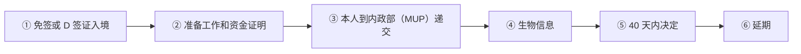

# 🇲🇪 黑山 · Montenegro

    

**非申根；数字游民 2+2 年最友好；投资入籍已关闭**

[💻 数字游民居留许可](#montenegro-digital-nomad-residence-permit) · [💰 欧盟公民投资居留与工作许可](#montenegro-eu-citizen-investment-residence-work-permit) · [🛂 投资入籍](#montenegro-citizenship-by-investment) · [📖 深度解读](#deep) · [🔗 延伸阅读](#more)

> [!TIP]
> **一句话判断**：**非欧盟、非申根**，但用欧元，生活成本低，正在入盟谈判中。**数字游民居留许可首期最长 2 年、可再延 2 年**，在欧洲同类路线中期限最友好；在黑山的时间**不占用申根 90/180 天**。房产居留门槛 2026 年起提高到评估价值 ≥ EUR 150,000。**投资入籍项目已于 2022-12-31 终止**；新的 25 万欧投资居留**只限欧盟公民**。

## 🏙️ 生活与身份档案

<table>
<tr><td width="33%" valign="top">💶 生活成本指数（纽约=100） <b>42.8 ●●●●●</b></td><td width="33%" valign="top">🏠 房租指数（纽约=100） <b>15.7 ●●●●○</b></td><td width="33%" valign="top">🛡️ 安全指数 <b>66.4 ●●●○○</b></td></tr>
<tr><td width="33%" valign="top">💼 平均年薪（总额） <b>—</b></td><td width="33%" valign="top">🧾 最高个税税率 <b>15%</b></td><td width="33%" valign="top">🛂 护照免签目的地 <b>128 个（中国 81）</b></td></tr>
<tr><td width="33%" valign="top">🏠 永居年限 <b>5 年</b></td><td width="33%" valign="top">🎖️ 入籍年限 <b>10 年</b></td><td width="33%" valign="top">🔁 双重国籍 <b>❌ 一般须放弃</b></td></tr>
<tr><td width="33%" valign="top">🗣️ 语言要求 <b>黑山语</b></td><td width="33%" valign="top">✈️ 中国护照入境 <b>一般需签证；持有效申根/美/英等签证可入境</b></td><td width="33%" valign="top"></td></tr>
</table>

● 越多越好（成本/房租越低、安全越高）。数据：Numbeo 2026 年中、Eurostat、Tax Foundation 2026、Henley 2026；永居/入籍为常见规则，以官方为准。中国不承认双重国籍。[数据说明](README.md#profiles)

## 📊 路线速查

| 路线 | 类型 | 门槛信号 | 家属 | 永居 | 状态 |
|---|---|---|:-:|:-:|:-:|
| [黑山数字游民居留许可](#montenegro-digital-nomad-residence-permit) | 💻 数字游民 | — | ✅ 可带 | ✅ 可能 | 🟢 开放 |
| [黑山欧盟公民投资居留与工作许可](#montenegro-eu-citizen-investment-residence-work-permit) | 💰 投资居留 | 投资 ≥ 250,000 | ✅ 可带 | ⏳ 偏临时 | 🟢 开放 |
| [黑山投资入籍](#montenegro-citizenship-by-investment) | 🛂 入籍 | — | — | — | ⛔ 已关闭 |

门槛为主申请人的最低信号值，多与当地工资挂钩、每年调整，递交前以官方为准。

---

## 💻 黑山数字游民居留许可

   

> **非申根、用欧元：首期最长 2 年再延 2 年，期限在欧洲同类路线里最友好。**

<table>
<tr><td width="33%" valign="top">适用 <b>为外国雇主或自己在黑山以外的公司电子化工作</b></td><td width="33%" valign="top">首期 <b>最长 2 年</b></td><td width="33%" valign="top">延期 <b>再延最长 2 年（到期前 ≥30 天）</b></td></tr>
<tr><td width="33%" valign="top">冷却期 <b>到期后 6 个月才能再申请</b></td><td width="33%" valign="top">审理 <b>40 天</b></td><td width="33%" valign="top">申根 <b>不占申根 90/180 天</b></td></tr>
<tr><td width="33%" valign="top">税 <b>境外雇主收入可能免个税（需确认）</b></td><td width="33%" valign="top"></td><td width="33%" valign="top"></td></tr>
</table>

<table><tr>
<td width="50%" valign="top">✅ <b>适合</b><ul><li>想离欧盟近、生活成本低的远程工作者</li><li>想保留申根天数</li></ul></td>
<td width="50%" valign="top">❌ <b>不适合</b><ul><li>想在黑山本地工作</li><li>需要申根居留卡</li></ul></td>
</tr></table>

### 🗺️ 申请流程

1. **免签或 D 签证入境** — D 签证一般 10 天决定
2. **准备工作和资金证明** — 雇佣/服务合同、境外公司认证注册
3. **本人到内政部（MUP）递交** — 90 天短停期满前
4. **生物信息** — 照片、指纹、电子签名
5. **40 天内决定**
6. **延期** — 到期前 ≥30 天

### 📋 材料清单

- [ ] 护照（比居留期长 3 个月）
- [ ] 雇佣合同或服务合同
- [ ] 境外公司认证注册证明
- [ ] 生活资金证明
- [ ] 住宿证明（租约/产权）
- [ ] 医疗保险
- [ ] 无犯罪证明

> [!WARNING]
> **注意**
> - 数字游民年限是否计入 5 年永居，官方未明确
> - 投资入籍已于 2022 年关闭

🔗 官方来源（6）

- [Digital Nomads Montenegro legal status for nomads](https://digitalnomads.gov.me/article/legal-status-for-nomads)
- [Ministry of Foreign Affairs visas](https://www.gov.me/en/article/visas)
- [Government of Montenegro temporary residence](https://www.gov.me/en/article/temporary-residence)
- [Government of Montenegro permanent residence](https://www.gov.me/en/article/permanent-residence)
- [Tax Administration tax residence procedure](https://www.gov.me/clanak/utvrdivanje-rezidentnosti-u-poreske-svrhe)
- [Official Gazette Law on Foreigners amendment 154/2026](https://www.sluzbenilist.me/propisi/399225)

数据核查：2026-10-27 · [LetsMigrate 原始记录](https://letsmigrate.org/zh-hans/programmes/montenegro-digital-nomad-residence-permit-zh/) · [↑ 回到顶部](#top)

---

## 💰 黑山欧盟公民投资居留与工作许可

   

> **2026-10-27 新设的 25 万欧投资居留，只限欧盟公民，中国护照不适用。**

<table>
<tr><td width="33%" valign="top">适用 <b>仅欧盟公民企业家/公司所有人</b></td><td width="33%" valign="top">投资 <b>≥ EUR 250,000 投入黑山公司</b></td><td width="33%" valign="top">期限 <b>最长 3 年 + 3 年</b></td></tr>
<tr><td width="33%" valign="top">居住 <b>每年 ≥15 天</b></td><td width="33%" valign="top"></td><td width="33%" valign="top"></td></tr>
</table>

<table><tr>
<td width="50%" valign="top">✅ <b>适合</b><ul></ul></td>
<td width="50%" valign="top">❌ <b>不适合</b><ul><li>非欧盟公民（包括中国护照）</li></ul></td>
</tr></table>

> [!WARNING]
> **注意**
> - 不是投资入籍的重启

🔗 官方来源（1）

- [Montenegro Official Gazette 154/2026, amendment Article 10 inserting Article 70g](https://www.sluzbenilist.me/propisi/399225?page=5)

数据核查：2026-10-27 · [LetsMigrate 原始记录](https://letsmigrate.org/zh-hans/programmes/montenegro-eu-citizen-investment-residence-work-permit-zh/) · [↑ 回到顶部](#top)

---

## 🛂 黑山投资入籍

   

> **黑山投资入籍项目已于 2022-12-31 正式终止。**

<table>
<tr><td width="33%" valign="top">终止 <b>2022-12-31</b></td><td width="33%" valign="top">原条件 <b>捐款 EUR 100,000 + 项目投资 25 万/45 万</b></td><td width="33%" valign="top">遗留案件 <b>截至 2026-07-31：1,113 份中 869 份获批、239 份被拒、5 份待决</b></td></tr>
</table>

> [!WARNING]
> **注意**
> - 推销'黑山护照'的需警惕；买房只给一年期临时居留，2026 起评估价值需 ≥ EUR 150,000

🔗 官方来源（6）

- [Montenegro Official Gazette 154/2026, Law on Foreigners amendment, Article 70g](https://www.sluzbenilist.me/propisi/399225?page=5)
- [Montenegro Government special investment programme financial status at July 31, 2026](https://www.gov.me/en/documents/f0fd1706-7c5d-4e0c-9910-756f7833d7ed)
- [Government launch of Montenegro investment citizenship programme](https://www.gov.me/en/article/195254--development-programme-for-acquisition-of-montenegrin-citizenship-by-admission-for-investment-purposes-launched)
- [Government decision press release on economic citizenship](https://www.gov.me/en/article/193956--cabinet-passes-decision-on-economic-citizenship)
- [European Commission 2023 visa suspension mechanism report](https://eur-lex.europa.eu/legal-content/EN/TXT/?uri=celex%3A52023DC0730)
- [European Commission 2025 visa suspension mechanism report](https://eur-lex.europa.eu/legal-content/EN/TXT/?uri=COM%3A2025%3A792%3AFIN)

数据核查：2026-10-27 · [LetsMigrate 原始记录](https://letsmigrate.org/zh-hans/programmes/montenegro-citizenship-by-investment-zh/) · [↑ 回到顶部](#top)

---

## 📖 深度解读

### 路线要点

### 数字游民居留许可
- **适用**：以电子方式为外国雇主工作，或为自己在黑山以外的公司工作。**不能在黑山本地就业**。
- **工作证明**：雇佣合同、服务合同，或本人境外公司的认证注册证明。
- **其他材料**：生活资金证明、住宿（租约/产权/确认函）、医保、无犯罪记录（未因公诉罪被判 >6 个月实刑）、护照比居留期长 3 个月。
- **流程**：免签或 D 签证入境（D 签证一般 10 天决定）→ 在 90 天短停到期前到居住地内政部（MUP）本人递交 → **40 天**内决定。
- **期限**：首期**最长 2 年** → 到期前 ≥30 天申请延期，**再延最长 2 年**（共 4 年）→ 之后须**冷却 6 个月**才能再申请。
- **家属**：配偶、未成年子女（含继子女、18 岁以下养子女）可家庭团聚。
- **税务**：投资署资料称获批数字游民的境外雇主收入可免个税（ICT 指南提到收入需超过平均工资 3 倍），该资料早于 2026 修法，需向税务机关确认。
- **永居**：一般连续合法居留 5 年可申请（允许累计缺席 10 个月或连续 6 个月）；数字游民期间是否计入，官方未明确，规划定居前要确认。

### 房产居留
- 以"处分境内自有不动产"为目的的临时居留，一年一签。
- **2026 年新法**：房产税务评估价值 ≥ **EUR 150,000**，且至少拥有一半产权。欧盟/EEA/瑞士公民及其家属不受此价值要求；2026 年 1 月修法前已获批的续签也不受影响。
- 房产居留**不计入**永居连续年限。

### 公司居留
- 2027 年 1 月起，外国企业家或持股 >51% 的执行董事续签时，须证明**每年缴纳税款和社保合计 ≥ EUR 5,000**（部分国籍豁免）。空壳公司不再好用。

### 欧盟公民投资居留与工作许可（第 70g 条，2026-10-27 生效）
- **仅限欧盟公民**企业家/公司所有人，在黑山投资 ≥ EUR 250,000，可获最长 3 年 + 3 年的居留和工作许可，每年至少居住 15 天。**中国护照不适用**。

### 投资入籍（已关闭）
- 2019-01-01 启动，2022-12-31 正式终止（原为 10 万欧捐款 + 25/45 万欧项目投资）。截至 2026-07-31，关闭前 1,113 份申请中 869 份获批、239 份被拒、5 份待决。

### 常见坑
- 中介宣传"黑山买房移民/护照"——护照项目已关闭，买房只给一年期临时居留且门槛已提高。

---

## 🔗 延伸阅读

LetsMigrate 中文指南原文（6 篇）

- [黑山投资入籍终止说明](https://letsmigrate.org/zh-hans/articles/montenegro-citizenship-by-investment-ended-explainer-zh/)
- [黑山投资入籍遗留案件和尽职调查](https://letsmigrate.org/zh-hans/articles/montenegro-citizenship-by-investment-legacy-due-diligence-zh/)
- [黑山数字游民居留许可指南](https://letsmigrate.org/zh-hans/articles/montenegro-digital-nomad-residence-permit-guide-zh/)
- [黑山数字游民税务、家庭和实务设置](https://letsmigrate.org/zh-hans/articles/montenegro-digital-nomad-residence-permit-tax-family-setup-zh/)
- [黑山数字游民许可时间线和文件](https://letsmigrate.org/zh-hans/articles/montenegro-digital-nomad-residence-permit-timeline-documents-zh/)
- [黑山房产和公司居留替代路径](https://letsmigrate.org/zh-hans/articles/montenegro-property-company-residence-alternatives-zh/)

[← 🇲🇹 马耳他](malta.md) ｜ [🇪🇺 全部国家](README.md) ｜ [🏠 首页](../../README.md) ｜ [🇳🇱 荷兰 →](netherlands.md)

本页根据 [LetsMigrate.org](https://letsmigrate.org/zh-hans/countries/montenegro-zh/) 公开资料及官方来源整理改写，仅供信息参考，不构成移民、法律、税务或投资建议。
