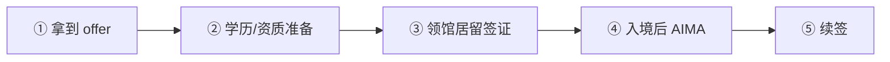
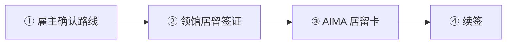
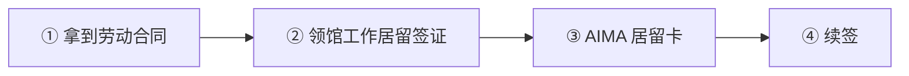
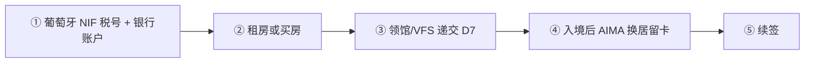
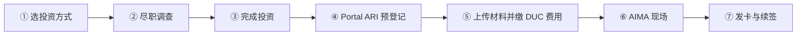

# 🇵🇹 葡萄牙 · Portugal

    

**数字游民 EUR 3,680/月；黄金签证不能买房；入籍改为 10 年**

[💻 数字游民签证](#portugal-digital-nomad-visa) · [🧑‍💻 欧盟蓝卡](#portugal-eu-blue-card) · [🧑‍💻 高度合格活动居留许可](#portugal-highly-qualified-activity-residence-permit) · [🧑‍💻 受雇工作居留许可](#portugal-subordinate-work-residence-permit) · [🏖️ D7 被动收入签证](#portugal-d7-visa) · [💰 ARI 黄金签证](#portugal-ari-golden-visa) · [📖 深度解读](#deep) · [🔗 延伸阅读](#more)

> [!TIP]
> **一句话判断**：欧盟 + 申根 + 欧元区。远程工作者看**数字游民签证**，有钱想"挂身份"看 **ARI 黄金签证（已不能买房）**，有雇主看**普通工作 / 高度合格 / Tech Visa / 欧盟蓝卡**四选一。**2026 年国籍法改革后，"5 年入籍"已经不成立**，新申请一般要 10 年（葡语国家/欧盟公民 7 年）。

## 🏙️ 生活与身份档案

<table>
<tr><td width="33%" valign="top">💶 生活成本指数（纽约=100） <b>48.7 ●●●●○</b></td><td width="33%" valign="top">🏠 房租指数（纽约=100） <b>23.5 ●●●●○</b></td><td width="33%" valign="top">🛡️ 安全指数 <b>66.7 ●●●○○</b></td></tr>
<tr><td width="33%" valign="top">💼 平均年薪（总额） <b>EUR 24,818</b></td><td width="33%" valign="top">🧾 最高个税税率 <b>53%</b></td><td width="33%" valign="top">🛂 护照免签目的地 <b>184 个（中国 81）</b></td></tr>
<tr><td width="33%" valign="top">🏠 永居年限 <b>5 年</b></td><td width="33%" valign="top">🎖️ 入籍年限 <b>10 年（2026 新规）</b></td><td width="33%" valign="top">🔁 双重国籍 <b>✅ 可保留原国籍</b></td></tr>
<tr><td width="33%" valign="top">🗣️ 语言要求 <b>葡萄牙语 A2</b></td><td width="33%" valign="top">✈️ 中国护照入境 <b>申根签证</b></td><td width="33%" valign="top"></td></tr>
</table>

● 越多越好（成本/房租越低、安全越高）。数据：Numbeo 2026 年中、Eurostat、Tax Foundation 2026、Henley 2026；永居/入籍为常见规则，以官方为准。中国不承认双重国籍。[数据说明](README.md#profiles)

## 📊 路线速查

| 路线 | 类型 | 门槛信号 | 家属 | 永居 | 状态 |
|---|---|---|:-:|:-:|:-:|
| [葡萄牙数字游民签证](#portugal-digital-nomad-visa) | 💻 数字游民 | EUR 3,680/月 | ✅ 可带 | ✅ 可能 | 🟢 开放 |
| [葡萄牙欧盟蓝卡](#portugal-eu-blue-card) | 🧑‍💻 技术工作 | EUR 30,492/年 | ✅ 可带 | ✅ 可能 | 🟢 开放 |
| [葡萄牙高度合格活动居留许可](#portugal-highly-qualified-activity-residence-permit) | 🧑‍💻 技术工作 | — | ✅ 可带 | ✅ 可能 | 🟢 开放 |
| [葡萄牙受雇工作居留许可](#portugal-subordinate-work-residence-permit) | 🧑‍💻 技术工作 | EUR 920/月 | ✅ 可带 | ✅ 可能 | 🟢 开放 |
| [葡萄牙 D7 被动收入签证](#portugal-d7-visa) | 🏖️ 被动收入居留 | EUR 920/月 | ✅ 可带 | ✅ 可能 | 🟢 开放 |
| [葡萄牙 ARI 黄金签证](#portugal-ari-golden-visa) | 💰 投资居留 | 投资 ≥ 250,000 | ✅ 可带 | ✅ 可能 | 🟢 开放 |

门槛为主申请人的最低信号值，多与当地工资挂钩、每年调整，递交前以官方为准。

---

## 💻 葡萄牙数字游民签证

   

> **为葡萄牙境外雇主或客户远程工作的人，凭收入申请居留；续签后可累积永居年限。**

<table>
<tr><td width="33%" valign="top">收入门槛 <b>最近 3 个月平均 ≥ EUR 3,680/月（最低工资 920 × 4）</b></td><td width="33%" valign="top">家属加算 <b>配偶 +50%，每个子女 +30%（常见口径）</b></td><td width="33%" valign="top">签证 <b>短期停留 ≤1 年；或居留签证 120 天、2 次入境</b></td></tr>
<tr><td width="33%" valign="top">居留卡 <b>首次 2 年，之后每次续 3 年</b></td><td width="33%" valign="top">费用 <b>国家签证 EUR 110 + 服务费；AIMA 居留另计</b></td><td width="33%" valign="top">家属 <b>可团聚，但需核对两年等待规则</b></td></tr>
<tr><td width="33%" valign="top">永居/入籍 <b>5 年可申请永居；入籍新规一般 10 年</b></td><td width="33%" valign="top"></td><td width="33%" valign="top"></td></tr>
</table>

<table><tr>
<td width="50%" valign="top">✅ <b>适合</b><ul><li>远程雇员或自由职业者，收入稳定且来自葡萄牙以外</li><li>想长期住下、带家人、走永居的人</li><li>能提供 3 个月以上连续收入流水</li></ul></td>
<td width="50%" valign="top">❌ <b>不适合</b><ul><li>靠存款或被动收入生活（应看 D7）</li><li>主要客户在葡萄牙</li><li>想 5 年拿护照（规则已变）</li></ul></td>
</tr></table>

### 🗺️ 申请流程

1. **确认路线** — 住 1 年以内选短期停留签证；打算长住选居留签证
2. **准备收入证据** — 最近 3 个月工资单/发票 + 银行流水，雇佣或服务合同
3. **领馆/VFS 递交** — 预约所属领区，缴签证费 EUR 110
4. **入境葡萄牙** — 居留签证 120 天内有效，最多 2 次入境
5. **AIMA 预约** — 办理居留卡、采集生物信息
6. **落地手续** — NIF 税号、NISS 社保号、银行账户、医保
7. **续签** — 居留卡 2 年到期前续签 3 年；2025-10-15 后不再自动延期

### 📋 材料清单

- [ ] 护照及复印件
- [ ] 签证申请表、照片
- [ ] 雇佣合同或服务合同（证明为境外雇主/客户工作）
- [ ] 最近 3 个月收入证明 + 银行流水
- [ ] 住宿证明（租约或预订）
- [ ] 无犯罪记录证明（公证 + 附加证明书 + 翻译）
- [ ] 覆盖葡萄牙的医疗保险
- [ ] 税务居民证明
- [ ] 家属的结婚证/出生证明（如随行）

> [!WARNING]
> **注意**
> - 门槛跟随最低工资每年调整，2027 年会更高
> - 数字游民卡不在'家属免两年等待'名单内，家属分开申请要算好时间
> - 居住超过 183 天会成为葡萄牙税务居民，NHR 已于 2024 年废止

🔗 官方来源（4）

- [AIMA remote work residence permit page](https://aima.gov.pt/pt/trabalhar/autorizacao-de-residencia-para-o-exercicio-de-atividade-profissional-prestada-de-forma-remota-com-visto-de-residencia-para-o-exe)
- [gov.pt Foreigners Act digital nomad visa summary](https://www2.gov.pt/en/noticias/lei-dos-estrangeiros-pedidos-de-vistos-e-autorizacao-de-residencia-vao-ser-mais-simples)
- [Portugal Government minimum wage 2026 announcement](https://portugal.gov.pt/en/gc25/communication/news/government-increases-minimum-wage-to-920-euros-in-2026)
- [VFS Portugal UK national visa information](https://visa.vfsglobal.com/one-pager/portugal/uk/english/index.html)

数据核查：2026-10-26 · [LetsMigrate 原始记录](https://letsmigrate.org/zh-hans/programmes/portugal-digital-nomad-visa-zh/) · [↑ 回到顶部](#top)

---

## 🧑‍💻 葡萄牙欧盟蓝卡

   

> **有葡萄牙高资质工作 offer 的人走蓝卡，家属免等待、可在欧盟内流动。**

<table>
<tr><td width="33%" valign="top">薪资 <b>≥ 平均工资 1.5 倍，按 2025 数据约 EUR 30,492/年（部分职业 1.2 倍约 24,394）</b></td><td width="33%" valign="top">资质 <b>高等学历或受监管职业认证</b></td><td width="33%" valign="top">合同 <b>高资质岗位</b></td></tr>
<tr><td width="33%" valign="top">家属 <b>免两年等待，可同时申请</b></td><td width="33%" valign="top">欧盟流动 <b>在他国持蓝卡 18 个月可迁来，入境 30 天内递交</b></td><td width="33%" valign="top">永居 <b>满 5 年临时居留可申请</b></td></tr>
</table>

<table><tr>
<td width="50%" valign="top">✅ <b>适合</b><ul><li>葡萄牙雇主的高薪技术岗位</li><li>需要日后在欧盟内换国家工作</li></ul></td>
<td width="50%" valign="top">❌ <b>不适合</b><ul><li>没有学历证明</li><li>薪资低于门槛（可看普通工作或高度合格路线）</li></ul></td>
</tr></table>

### 🗺️ 申请流程

1. **拿到 offer** — 确认薪资达到当年门槛
2. **学历/资质准备** — 学位公证 + 附加证明书 + 翻译
3. **领馆居留签证** — 以蓝卡/高资质工作为目的
4. **入境后 AIMA** — 申请蓝卡居留卡
5. **续签** — 按蓝卡规则续

### 📋 材料清单

- [ ] 劳动合同
- [ ] 学历证明（公证认证）
- [ ] 护照、照片
- [ ] 无犯罪记录
- [ ] 医疗保险或社保

> [!WARNING]
> **注意**
> - AIMA 页面上的薪资参考值仍是 2023/2024 口径，以递交时当局实际采用为准

🔗 官方来源（4）

- [AIMA EU Blue Card residence permit](https://aima.gov.pt/pt/viver/concessao-de-cartao-azul-ue-e-autorizacao-de-residencia-para-titulares-de-cartao-azul-ue-noutro-estado-membro-art-121-o-a-e-segu)
- [European Commission EU Blue Card in Portugal](https://home-affairs.ec.europa.eu/policies/migration-and-asylum/eu-immigration-portal/eu-blue-card/eu-blue-card-portugal_en)
- [Portugal Government 2025 average monthly gross wages](https://portugal.gov.pt/en/gc25/communication/news/real-wages-rose-32-in-2025)
- [Diario da Republica Article 121-A](https://diariodarepublica.pt/dr/legislacao-consolidada/lei/2007-67564445-221053318)

数据核查：2026-10-26 · [LetsMigrate 原始记录](https://letsmigrate.org/zh-hans/programmes/portugal-eu-blue-card-zh/) · [↑ 回到顶部](#top)

---

## 🧑‍💻 葡萄牙高度合格活动居留许可

   

> **第 90 条高度合格活动居留（含认证企业的 Tech Visa），薪资和学历要求介于普通工作和蓝卡之间。**

<table>
<tr><td width="33%" valign="top">薪资 <b>平均工资 1.5 倍（列名职业 1.2 倍）；Tech Visa ≥ 2.5 倍 IAS</b></td><td width="33%" valign="top">资质 <b>学历或专业资质；Tech Visa 需 ISCED 6 级，或 5 级 + 5 年经验</b></td><td width="33%" valign="top">卡期 <b>首次 2 年，续签每次 3 年</b></td></tr>
<tr><td width="33%" valign="top">家属 <b>免两年等待</b></td><td width="33%" valign="top">永居 <b>满 5 年可申请</b></td><td width="33%" valign="top"></td></tr>
</table>

<table><tr>
<td width="50%" valign="top">✅ <b>适合</b><ul><li>受雇于葡萄牙认证科技企业（Tech Visa）</li><li>学历清晰的专家岗位</li></ul></td>
<td width="50%" valign="top">❌ <b>不适合</b><ul><li>普通岗位、无学历证明</li></ul></td>
</tr></table>

### 🗺️ 申请流程

1. **雇主确认路线** — 普通/高度合格/Tech Visa/蓝卡四选一
2. **领馆居留签证** — 提交合同与资质
3. **AIMA 居留卡** — 入境后办理
4. **续签** — 2 年后续 3 年

### 📋 材料清单

- [ ] 劳动合同或工作承诺
- [ ] 学历/资质证明
- [ ] Tech Visa 企业认证（如适用）
- [ ] 护照、无犯罪记录

> [!WARNING]
> **注意**
> - 四条雇佣路线证据逻辑不同，申请前让雇主确认走哪条

🔗 官方来源（2）

- [AIMA highly qualified activity residence permit](https://aima.gov.pt/pt/trabalhar/autorizacao-de-residencia-para-atividade-altamente-qualificada-art-90-o)
- [AIMA Tech Visa residence permit](https://aima.gov.pt/pt/trabalhar/autorizacao-de-residencia-para-atividade-altamente-qualificada-exercida-para-empresa-certificada-art-90-o-tech-visa)

数据核查：2026-10-26 · [LetsMigrate 原始记录](https://letsmigrate.org/zh-hans/programmes/portugal-highly-qualified-activity-residence-permit-zh/) · [↑ 回到顶部](#top)

---

## 🧑‍💻 葡萄牙受雇工作居留许可

   

> **最普通的雇佣居留（第 88 条），只要求劳动合同合法合规。**

<table>
<tr><td width="33%" valign="top">薪资 <b>符合劳动法即可（2026 最低工资 EUR 920/月）</b></td><td width="33%" valign="top">学历 <b>不是核心门槛</b></td><td width="33%" valign="top">卡期 <b>首次 2 年，续签每次 3 年</b></td></tr>
<tr><td width="33%" valign="top">家属 <b>一般需担保人持卡满 2 年（有例外）</b></td><td width="33%" valign="top">永居 <b>满 5 年可申请</b></td><td width="33%" valign="top"></td></tr>
</table>

<table><tr>
<td width="50%" valign="top">✅ <b>适合</b><ul><li>普通岗位、薪资不高</li><li>没有高等学历</li></ul></td>
<td width="50%" valign="top">❌ <b>不适合</b><ul><li>想要家属立即团聚</li></ul></td>
</tr></table>

### 🗺️ 申请流程

1. **拿到劳动合同** — 葡萄牙雇主
2. **领馆工作居留签证** — 或符合条件的境内途径
3. **AIMA 居留卡** — 入境后办理
4. **续签** — 2 年后续 3 年

### 📋 材料清单

- [ ] 劳动合同
- [ ] 护照、照片
- [ ] 无犯罪记录
- [ ] 住宿证明
- [ ] 医疗保险

> [!WARNING]
> **注意**
> - 家属团聚等待期比高度合格/蓝卡路线长

🔗 官方来源（2）

- [AIMA subordinate work residence permit with residence visa](https://aima.gov.pt/pt/trabalhar/autorizacao-de-residencia-para-exercicio-de-atividade-profissional-subordinada-com-visto-de-residencia-art-88-o-n-o-1)
- [DGERT 2026 minimum wage](https://www.dgert.gov.pt/retribuicao-minima-mensal-garantida-para-2026)

数据核查：2026-10-26 · [LetsMigrate 原始记录](https://letsmigrate.org/zh-hans/programmes/portugal-subordinate-work-residence-permit-zh/) · [↑ 回到顶部](#top)

---

## 🏖️ 葡萄牙 D7 被动收入签证

    

> **被动收入达到最低工资（EUR 920/月）即可申请，是欧洲门槛最低的长期居留之一。**

<table>
<tr><td width="33%" valign="top">主申请人 <b>被动收入 ≥ EUR 920/月（2026 最低工资）</b></td><td width="33%" valign="top">家属 <b>第二位成人 +50%（EUR 460），每个孩子 +30%（EUR 276）</b></td><td width="33%" valign="top">存款 <b>常见要求 1 年最低工资 EUR 11,040</b></td></tr>
<tr><td width="33%" valign="top">收入来源 <b>养老金、租金、股息、利息、知识产权等</b></td><td width="33%" valign="top">居留 <b>2 年，续 3 年</b></td><td width="33%" valign="top">续签居住 <b>连续 6 个月或累计 8 个月（每期）</b></td></tr>
<tr><td width="33%" valign="top">永居/入籍 <b>5 年永居；入籍 2026 新规一般 10 年</b></td><td width="33%" valign="top"></td><td width="33%" valign="top"></td></tr>
</table>

<table><tr>
<td width="50%" valign="top">✅ <b>适合</b><ul><li>有稳定被动收入的退休或半退休人士</li><li>预算有限但想长居葡萄牙</li></ul></td>
<td width="50%" valign="top">❌ <b>不适合</b><ul><li>收入主要是工资（应走 D8 数字游民）</li></ul></td>
</tr></table>

### 🗺️ 申请流程

1. **葡萄牙 NIF 税号 + 银行账户**
2. **租房或买房** — 需葡萄牙地址
3. **领馆/VFS 递交 D7**
4. **入境后 AIMA 换居留卡**
5. **续签** — 2 年后续 3 年

### 📋 材料清单

- [ ] 被动收入证明（12 个月）
- [ ] 葡萄牙银行存款证明
- [ ] 葡萄牙住址（租约/产权）
- [ ] 医疗保险
- [ ] 无犯罪证明

> [!WARNING]
> **注意**
> - 刚好达标容易被拒，建议收入和存款留余量
> - 门槛随最低工资每年上调

🔗 来源（2）

- [Global Citizen Solutions: Portugal D7 (Oct 2026)](https://www.globalcitizensolutions.com/portugal-d7-visa/)
- [Immigrant Invest: D7 income requirements](https://immigrantinvest.com/blog/portugal-d7-visa-income-requirements/)

数据核查：2026-10 · 本条为 RUN 补充路线（LetsMigrate 未收录），来源见上 · [↑ 回到顶部](#top)

---

## 💰 葡萄牙 ARI 黄金签证

   

> **投资换居留，住得极少也能保持身份；但 2023 年起不能再买房，入籍时间也变长了。**

<table>
<tr><td width="33%" valign="top">最低投资 <b>文化艺术 EUR 250,000；基金/科研/公司 EUR 500,000；或创造 10 个岗位</b></td><td width="33%" valign="top">买房 <b>❌ 已关闭（2023 住房改革）</b></td><td width="33%" valign="top">居住要求 <b>首年 ≥7 天，之后每 2 年 ≥14 天</b></td></tr>
<tr><td width="33%" valign="top">卡期 <b>首次 2 年，每次续 2 年</b></td><td width="33%" valign="top">家属 <b>免两年等待，可同时团聚</b></td><td width="33%" valign="top">永居 <b>满 5 年可申请</b></td></tr>
<tr><td width="33%" valign="top">入籍 <b>新规非葡语国家一般 10 年合法居留</b></td><td width="33%" valign="top"></td><td width="33%" valign="top"></td></tr>
</table>

<table><tr>
<td width="50%" valign="top">✅ <b>适合</b><ul><li>想要欧盟居留身份备份、不打算常住的家庭</li><li>能接受基金 5 年锁定和投资风险</li><li>资金来源清晰、经得起尽调</li></ul></td>
<td width="50%" valign="top">❌ <b>不适合</b><ul><li>想买房移民</li><li>想快速拿护照</li><li>资金需要随时取出</li></ul></td>
</tr></table>

### 🗺️ 申请流程

1. **选投资方式** — 基金最常见：非房地产基金，≥5 年期限，≥60% 投向葡萄牙公司
2. **尽职调查** — 基金管理人、费用、退出条款、资金来源
3. **完成投资** — 开葡萄牙银行账户、取 NIF、转账认购
4. **Portal ARI 预登记** — 线上填写申请人、护照、投资类型
5. **上传材料并缴 DUC 费用** — AIMA 先审材料再给预约
6. **AIMA 现场** — 核验原件、采集生物信息
7. **发卡与续签** — 2 年卡；2026-02 起续签走线上门户

### 📋 材料清单

- [ ] 护照、申根有效入境证明
- [ ] 投资证明（基金认购确认、托管证明等）
- [ ] 资金来源证明（工资、经营、房产出售等）
- [ ] 无犯罪记录（原籍国及居住国）
- [ ] 葡萄牙及中国的税务/社保无欠款证明
- [ ] 医疗保险
- [ ] 家属关系证明

> [!WARNING]
> **注意**
> - 任何'保证 5 年拿护照'的宣传都已过时
> - 低居住不等于不是税务居民：超 183 天或有惯常住所即构成
> - 基金到期前退出可能影响续签

🔗 官方来源（5）

- [AIMA residence permit for investment activity](https://aima.gov.pt/pt/viver/autorizacao-de-residencia-para-investimento-art-90-o-a)
- [AIMA Portal ARI](https://aima.gov.pt/pt/viver/autorizacao-de-residencia-para-investimento-art-90-o-a/portal-ari)
- [AIMA ARI renewals in the Renewal Portal](https://aima.gov.pt/pt/noticias/portal-de-renovacoes-aima-disponibiliza-renovacao-de-ari)
- [gov.pt Portuguese nationality request](https://www.gov.pt/servicos/pedir-a-nacionalidade-portuguesa)
- [Portuguese Tax Authority tax residency rules](https://info.portaldasfinancas.gov.pt/en/tax-information/getting-started-in-portugal/tax-residency/tax-residency-rules/Pages/default.aspx)

数据核查：2026-10-26 · [LetsMigrate 原始记录](https://letsmigrate.org/zh-hans/programmes/portugal-ari-golden-visa-zh/) · [↑ 回到顶部](#top)

---

## 📖 深度解读

### 路线要点

### 数字游民签证（远程工作居留）
- **收入门槛**：最近 3 个月平均月收入 ≥ 4 倍葡萄牙最低工资。2026 年最低工资 EUR 920 → **EUR 3,680/月**（每年随最低工资调整）。
- **两种签法**：短期停留签证（90 天–1 年，不转居留）；居留签证（>1 年，入境后 120 天内、最多 2 次入境，去 AIMA 换居留卡）。
- **居留卡**：首次 2 年，之后每次续 3 年。
- **费用**：国家签证费 EUR 110（英国 VFS 示例，另有服务费）。
- **家庭**：配偶、未成年子女、在葡读书的受抚养成年子女、受抚养父母等。注意：数字游民卡**不在**"免两年等待"的类别里，家属分开申请要核对时间。
- **别搞混**：D7 是被动收入签证，不是数字游民签证。

### ARI 黄金签证（投资居留）
- **2023 年住房改革后，买房和单纯转账两条路都已关闭**。现行选项：

| 投资方式 | 金额 |
|---|---|
| 文化/艺术/遗产支持 | EUR 250,000 |
| 科研投资 | EUR 500,000 |
| 非房地产基金（≥5 年期限，≥60% 投向葡萄牙公司） | EUR 500,000 |
| 设立公司或增资 + 创造就业 | EUR 500,000 + 5 个岗位 |
| 直接创造就业 | 10 个岗位 |

- **居住要求极低**：第一年 ≥7 天，之后每两年 ≥14 天。
- **卡期**：首次 2 年，每次续 2 年；2026-02-16 起续签走 AIMA 线上续签门户。
- **流程**：Portal ARI 线上预登记 → 上传材料 → DUC 缴费 → AIMA 现场生物识别 → 发卡。
- **家属**：ARI 家属免除一般的两年等待期。
- **入籍**：新规下非葡语国家公民需 10 年合法居留。任何"保证拿护照"的营销都要警惕。

### 雇主担保工作（四条路）

| 路线 | 法律依据 | 薪资信号 | 学历要求 |
|---|---|---|---|
| 普通受雇工作 | 第 88 条 | 合法即可（2026 最低工资 EUR 920/月） | 非核心 |
| 高度合格活动 | 第 90 条 | 平均工资 1.5 倍（特定职业 1.2 倍） | 学历/专业证明 |
| Tech Visa | 第 90 条（认证企业） | ≥ 2.5 倍 IAS | ISCED 6 级，或 5 级 + 5 年经验 |
| 欧盟蓝卡 | 第 121-A 条起 | 平均工资 1.5 倍，按 2025 年数据推算约 **EUR 30,492/年** | 高等资质 |

- 居留卡一般首次 2 年，续签每次 3 年；满 5 年临时居留可申请永居。
- 高度合格和蓝卡的家属免除两年等待期。
- 已在其他欧盟国家持蓝卡满 18 个月可迁移到葡萄牙，入境后 30 天内递交。

### 税务提醒
- 一年在葡停留 >183 天，或有"惯常居所"性质的住房 → 通常成为葡萄牙税务居民。
- **NHR（非惯常居民）制度已于 2024-01-01 废止**（只有过渡案例），网上老文章不能照搬；新制度叫 IFICI，范围窄得多。
- 落地要办 NIF（税号）、视情况办 NISS（社保号）、银行账户、医保。

### 常见坑
- 拿着老攻略找"买房移民"——已关闭。
- 以为 5 年能入籍——2026 年改革后普遍变成 10 年。
- AIMA 已在 2025-10-15 后取消居留卡自动延期，续签要提前；递交续签并缴费后会给 180 天有效回执。

---

## 🔗 延伸阅读

LetsMigrate 中文指南原文（13 篇）

- [葡萄牙 ARI 黄金签证指南](https://letsmigrate.org/zh-hans/articles/portugal-ari-golden-visa-guide-zh/)
- [葡萄牙 ARI 投资路线和尽职调查](https://letsmigrate.org/zh-hans/articles/portugal-ari-golden-visa-investment-routes-due-diligence-zh/)
- [葡萄牙 ARI 税务、家庭、永居和公民身份](https://letsmigrate.org/zh-hans/articles/portugal-ari-golden-visa-tax-family-citizenship-zh/)
- [葡萄牙 ARI 黄金签证时间线和文件](https://letsmigrate.org/zh-hans/articles/portugal-ari-golden-visa-timeline-documents-zh/)
- [葡萄牙数字游民签证文件清单](https://letsmigrate.org/zh-hans/articles/portugal-digital-nomad-visa-documents-checklist-zh/)
- [葡萄牙数字游民签证家庭和续签规则](https://letsmigrate.org/zh-hans/articles/portugal-digital-nomad-visa-family-renewal-zh/)
- [葡萄牙数字游民签证指南](https://letsmigrate.org/zh-hans/articles/portugal-digital-nomad-visa-guide-zh/)
- [葡萄牙数字游民签证税务、银行和医疗](https://letsmigrate.org/zh-hans/articles/portugal-digital-nomad-visa-tax-banking-healthcare-zh/)
- [葡萄牙数字游民签证时间线和费用](https://letsmigrate.org/zh-hans/articles/portugal-digital-nomad-visa-timeline-costs-zh/)
- [葡萄牙高技能和欧盟蓝卡家庭、流动和定居](https://letsmigrate.org/zh-hans/articles/portugal-highly-qualified-eu-blue-card-family-mobility-settlement-zh/)
- [葡萄牙高技能和欧盟蓝卡薪资与资格规则](https://letsmigrate.org/zh-hans/articles/portugal-highly-qualified-eu-blue-card-salary-qualification-rules-zh/)
- [葡萄牙高技能和欧盟蓝卡时间线与文件](https://letsmigrate.org/zh-hans/articles/portugal-highly-qualified-eu-blue-card-timeline-documents-zh/)
- [葡萄牙高技能工作许可与欧盟蓝卡](https://letsmigrate.org/zh-hans/articles/portugal-highly-qualified-work-vs-eu-blue-card-zh/)

[← 🇵🇱 波兰](poland.md) ｜ [🇪🇺 全部国家](README.md) ｜ [🏠 首页](../../README.md) ｜ [🇷🇴 罗马尼亚 →](romania.md)

本页根据 [LetsMigrate.org](https://letsmigrate.org/zh-hans/countries/portugal-zh/) 公开资料及官方来源整理改写，仅供信息参考，不构成移民、法律、税务或投资建议。
