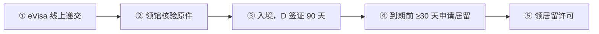
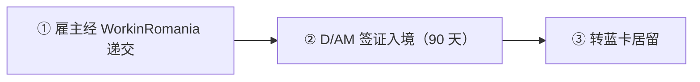

# 🇷🇴 罗马尼亚 · Romania

    

**数字游民门槛最高之一（约 EUR 5,500/月）；蓝卡门槛低**

[💻 数字游民签证](#romania-digital-nomad-visa) · [🧑‍💻 欧盟蓝卡](#romania-eu-blue-card) · [🧑‍💻 工作签证和居留许可](#romania-work-visa-residence-permit) · [📖 深度解读](#deep) · [🔗 延伸阅读](#more)

> [!TIP]
> **一句话判断**：欧盟成员，2025 年起完整加入申根，货币列伊（RON）。**数字游民签证收入门槛是欧洲最高的一档**（平均工资 3 倍，约 RON 27,576/月 ≈ EUR 5,500）；**2026 年起工作移民改用 WorkinRomania 平台和 D/AM 工作签证**（紧急法令 GEO 32/2026），老攻略里的"工作许可"流程已过时。蓝卡门槛相对低（RON 9,192/月）。

## 🏙️ 生活与身份档案

<table>
<tr><td width="33%" valign="top">💶 生活成本指数（纽约=100） <b>39.5 ●●●●●</b></td><td width="33%" valign="top">🏠 房租指数（纽约=100） <b>11.0 ●●●●●</b></td><td width="33%" valign="top">🛡️ 安全指数 <b>66.9 ●●●○○</b></td></tr>
<tr><td width="33%" valign="top">💼 平均年薪（总额） <b>EUR 21,108</b></td><td width="33%" valign="top">🧾 最高个税税率 <b>10%</b></td><td width="33%" valign="top">🛂 护照免签目的地 <b>178 个（中国 81）</b></td></tr>
<tr><td width="33%" valign="top">🏠 永居年限 <b>5 年</b></td><td width="33%" valign="top">🎖️ 入籍年限 <b>8 年</b></td><td width="33%" valign="top">🔁 双重国籍 <b>✅ 可保留原国籍</b></td></tr>
<tr><td width="33%" valign="top">🗣️ 语言要求 <b>罗马尼亚语</b></td><td width="33%" valign="top">✈️ 中国护照入境 <b>申根签证</b></td><td width="33%" valign="top"></td></tr>
</table>

● 越多越好（成本/房租越低、安全越高）。数据：Numbeo 2026 年中、Eurostat、Tax Foundation 2026、Henley 2026；永居/入籍为常见规则，以官方为准。中国不承认双重国籍。[数据说明](README.md#profiles)

## 📊 路线速查

| 路线 | 类型 | 门槛信号 | 家属 | 永居 | 状态 |
|---|---|---|:-:|:-:|:-:|
| [罗马尼亚数字游民签证](#romania-digital-nomad-visa) | 💻 数字游民 | — | ✅ 可带 | ⏳ 偏临时 | 🟢 开放 |
| [罗马尼亚欧盟蓝卡](#romania-eu-blue-card) | 🧑‍💻 技术工作 | RON 9,192/月 | ✅ 可带 | ✅ 可能 | 🟢 开放 |
| [罗马尼亚工作签证和居留许可](#romania-work-visa-residence-permit) | 🧑‍💻 技术工作 | RON 4,325/月 | ✅ 可带 | ✅ 可能 | 🟢 开放 |

门槛为主申请人的最低信号值，多与当地工资挂钩、每年调整，递交前以官方为准。

---

## 💻 罗马尼亚数字游民签证

   

> **收入门槛很高（平均工资 3 倍 ≈ €5,500/月），签证 90 天后在境内转居留。**

<table>
<tr><td width="33%" valign="top">收入 <b>近 6 个月 ≥ 平均月薪 3 倍（≈ RON 27,576 ≈ €5,500）</b></td><td width="33%" valign="top">签证 <b>D/AS，入境停留 90 天</b></td><td width="33%" valign="top">签证费 <b>EUR 300（2026-04-27 起）</b></td></tr>
<tr><td width="33%" valign="top">审理 <b>领馆 30 天内</b></td><td width="33%" valign="top">转居留 <b>到期前 ≥30 天本人到移民局申请</b></td><td width="33%" valign="top">保险 <b>≥ EUR 30,000</b></td></tr>
</table>

<table><tr>
<td width="50%" valign="top">✅ <b>适合</b><ul><li>高收入远程工作者，想住在申根东欧</li></ul></td>
<td width="50%" valign="top">❌ <b>不适合</b><ul><li>收入达不到门槛</li></ul></td>
</tr></table>

### 🗺️ 申请流程

1. **eVisa 线上递交**
2. **领馆核验原件**
3. **入境，D 签证 90 天**
4. **到期前 ≥30 天申请居留** — 地方移民局
5. **领居留许可**

### 📋 材料清单

- [ ] 境外雇佣或公司证明
- [ ] 意向书
- [ ] 税务居民证明
- [ ] 收入证明（6 个月）
- [ ] 医保 ≥ EUR 30,000
- [ ] 住所证明
- [ ] 无犯罪证明
- [ ] 护照（10 年内签发）
- [ ] 罗马尼亚语认证翻译

> [!WARNING]
> **注意**
> - 门槛按最新平均工资重算
> - 罗马尼亚个税 10%，但超过 183 天成为税务居民

🔗 官方来源（4）

- [Romanian Ministry of Foreign Affairs eVisa visa types](https://eviza.mae.ro/home/TypeOfVisa)
- [Romanian Ministry of Foreign Affairs eVisa supporting documents](https://eviza.mae.ro/home/SupportingDocuments)
- [Romanian Ministry of Foreign Affairs visa fees](https://eviza.mae.ro/VisaFees)
- [Romanian Law 22/2022 digital nomad amendments](https://legislatie.just.ro/Public/DetaliiDocumentAfis/250498)

数据核查：2026-10-26 · [LetsMigrate 原始记录](https://letsmigrate.org/zh-hans/programmes/romania-digital-nomad-visa-zh/) · [↑ 回到顶部](#top)

---

## 🧑‍💻 罗马尼亚欧盟蓝卡

   

> **月薪 RON 9,192（≈ €1,850）以上即可，是欧盟门槛最低的蓝卡之一。**

<table>
<tr><td width="33%" valign="top">月薪 <b>≥ 平均工资 RON 9,192</b></td><td width="33%" valign="top">资质 <b>高等教育或 5 年经验；IT 近 7 年内 3 年</b></td><td width="33%" valign="top">合同 <b>全职、无固定期限或 ≥6 个月</b></td></tr>
<tr><td width="33%" valign="top">有效期 <b>合同期 + 3 个月，最长 3 年</b></td><td width="33%" valign="top"></td><td width="33%" valign="top"></td></tr>
</table>

<table><tr>
<td width="50%" valign="top">✅ <b>适合</b><ul><li>罗马尼亚技术岗位</li></ul></td>
<td width="50%" valign="top">❌ <b>不适合</b><ul><li>无学历且经验不足</li></ul></td>
</tr></table>

### 🗺️ 申请流程

1. **雇主经 WorkinRomania 递交** — D/AM1 高技能
2. **D/AM 签证入境（90 天）**
3. **转蓝卡居留**

### 📋 材料清单

- [ ] 劳动合同
- [ ] 学历或经验证明
- [ ] 无犯罪证明
- [ ] 医保 ≥ EUR 30,000

> [!WARNING]
> **注意**
> - WorkinRomania 平台仍在试运行，旧流程说明已过时

🔗 官方来源（4）

- [GEO 32/2026 on access of foreigners to the Romanian labour market](https://legislatie.just.ro/Public/DetaliiDocument/309832)
- [WorkinRomania visas and residence](https://workinromania.gov.ro/workinro/default/vize-si-sedere)
- [Law 44/2026 social insurance budget average gross salary](https://legislatie.just.ro/Public/DetaliiDocumentAfis/308863)
- [European Commission EU Blue Card in Romania](https://home-affairs.ec.europa.eu/policies/migration-and-asylum/eu-immigration-portal/eu-blue-card/eu-blue-card-romania_en)

数据核查：2026-10-26 · [LetsMigrate 原始记录](https://letsmigrate.org/zh-hans/programmes/romania-eu-blue-card-zh/) · [↑ 回到顶部](#top)

---

## 🧑‍💻 罗马尼亚工作签证和居留许可

   

> **2026 新框架下的 D/AM 工作签证；普通岗位多需在紧缺职业清单上。**

<table>
<tr><td width="33%" valign="top">薪资 <b>≥ 最低工资 RON 4,325/月</b></td><td width="33%" valign="top">类别 <b>D/AM1 高技能；D/AM2 长期/季节/跨境（需紧缺清单）</b></td><td width="33%" valign="top">签证 <b>90 天</b></td></tr>
<tr><td width="33%" valign="top">居留 <b>合同期，最长 2 年</b></td><td width="33%" valign="top"></td><td width="33%" valign="top"></td></tr>
</table>

<table><tr>
<td width="50%" valign="top">✅ <b>适合</b><ul><li>紧缺职业的普通岗位</li></ul></td>
<td width="50%" valign="top">❌ <b>不适合</b><ul><li>不在清单上的职业</li></ul></td>
</tr></table>

### 🗺️ 申请流程

1. **雇主或授权中介递交** — WorkinRomania
2. **D/AM 签证**
3. **入境转居留**

### 📋 材料清单

- [ ] 劳动合同
- [ ] 无犯罪证明
- [ ] 医保

> [!WARNING]
> **注意**
> - GEO 32/2026 新规，核对最新法规

🔗 官方来源（4）

- [WorkinRomania visas and residence](https://workinromania.gov.ro/workinro/default/vize-si-sedere)
- [GEO 32/2026 on access of foreigners to the Romanian labour market](https://legislatie.just.ro/Public/DetaliiDocument/309832)
- [Government decision 146/2026 minimum gross salary](https://legislatie.just.ro/Public/FormaPrintabila/00000G0UWAJQDLM8S3J00SPP9LDAJLOY)
- [IGI worker categories for work approvals](https://igi.mai.gov.ro/categorii-de-lucratorii-pentru-care-se-obtin-avizele-de-munca/)

数据核查：2026-10-26 · [LetsMigrate 原始记录](https://letsmigrate.org/zh-hans/programmes/romania-work-visa-residence-permit-zh/) · [↑ 回到顶部](#top)

---

## 📖 深度解读

### 路线要点

### 数字游民签证（D/AS）
- **适用**：受雇于境外公司，或拥有/管理境外公司。罗马尼亚本地工作属于其他类别。
- **收入**：最近 6 个月及签证期间收入 ≥ 罗马尼亚平均月工资总额 **3 倍**。按 2026 年 RON 9,192 计算约 **RON 27,576/月**，申请前按最新 INS（统计局）或领馆数据重算。
- **材料**：境外雇佣或公司证明、意向书、税务居民证明、医保 ≥ EUR 30,000、住所证明、无犯罪证明、护照（比签证有效期多 3 个月、10 年内签发）、罗马尼亚语认证翻译。
- **流程**：eVisa 线上递交 → 领馆核验原件（递交后 30 天内决定）→ 入境，D 签证停留 **90 天** → **到期前至少 30 天**本人到地方移民局申请延长，换发居留许可。
- **费用**：2026-04-27 起长期签证 **EUR 300**。
- **家属**：配偶和未婚未成年子女可走家庭团聚，具体视主申请人获得的居留身份向移民总局（IGI）确认。
- 官方标注"通常偏临时"。

### D/AM 工作签证 vs 欧盟蓝卡（2026 新框架）
| | D/AM1 / D/AM2 普通工作 | 欧盟蓝卡 |
|---|---|---|
| 适用 | D/AM1：高技能及特定类别；D/AM2：长期、季节性、跨境工人（多数需在紧缺职业清单上） | 高技能岗位，全职无固定期限或 ≥6 个月 |
| 薪资 | ≥ 全国最低工资 **RON 4,325/月**（2026-07-01 起），另看岗位要求 | ≥ 平均工资 **RON 9,192/月** |
| 资质 | 视岗位 | 高等教育，或 5 年可比经验；IT 经理/ICT 专家可凭近 7 年内 3 年经验 |
| 递交 | 雇主或授权中介通过 WorkinRomania 递交统一申请 | 先走 D/AM1 高技能渠道入境，再转蓝卡居留 |
| 入境签证 | D/AM 签证首次 90 天 | 同左 |
| 居留有效期 | 合同期，普通工作最长 2 年 | 合同期 + 3 个月，最长 3 年 |

- 签证材料需无犯罪证明（翻译/认证）和 ≥ EUR 30,000 旅行医保。
- 蓝卡欧盟流动：其他成员国蓝卡持有人可在罗短期工作 90/180 天；满 12 个月（或第二国 6 个月）可迁来，入境 1 个月内申请罗马尼亚蓝卡。
- WorkinRomania 平台仍在测试运行阶段，务必核对最新法规。

### 税务提醒
- 在罗有住所、生活重心，或任意连续 12 个月内停留 >183 天 → 税务居民，全球收入纳税；超过 183 天可能需向税务局（ANAF）填写到达税务居民问卷。
- 罗马尼亚个税 10% 统一税率，但税务居民身份认定需谨慎。

---

## 🔗 延伸阅读

LetsMigrate 中文指南原文（9 篇）

- [罗马尼亚数字游民签证文件清单](https://letsmigrate.org/zh-hans/articles/romania-digital-nomad-visa-documents-checklist-zh/)
- [罗马尼亚数字游民签证家庭和居留延长](https://letsmigrate.org/zh-hans/articles/romania-digital-nomad-visa-family-extension-zh/)
- [罗马尼亚数字游民签证指南](https://letsmigrate.org/zh-hans/articles/romania-digital-nomad-visa-guide-zh/)
- [罗马尼亚数字游民税务、银行、保险和设置](https://letsmigrate.org/zh-hans/articles/romania-digital-nomad-visa-tax-banking-insurance-zh/)
- [罗马尼亚数字游民签证时间线和费用](https://letsmigrate.org/zh-hans/articles/romania-digital-nomad-visa-timeline-costs-zh/)
- [罗马尼亚工作签证和欧盟蓝卡家庭、流动和长期居留](https://letsmigrate.org/zh-hans/articles/romania-work-visa-eu-blue-card-family-mobility-settlement-zh/)
- [罗马尼亚工作签证和欧盟蓝卡薪资规则](https://letsmigrate.org/zh-hans/articles/romania-work-visa-eu-blue-card-salary-qualification-rules-zh/)
- [罗马尼亚工作签证和欧盟蓝卡时间线及文件](https://letsmigrate.org/zh-hans/articles/romania-work-visa-eu-blue-card-timeline-documents-zh/)
- [罗马尼亚工作签证 vs 欧盟蓝卡](https://letsmigrate.org/zh-hans/articles/romania-work-visa-vs-eu-blue-card-zh/)

[← 🇵🇹 葡萄牙](portugal.md) ｜ [🇪🇺 全部国家](README.md) ｜ [🏠 首页](../../README.md) ｜ [🇸🇰 斯洛伐克 →](slovakia.md)

本页根据 [LetsMigrate.org](https://letsmigrate.org/zh-hans/countries/romania-zh/) 公开资料及官方来源整理改写，仅供信息参考，不构成移民、法律、税务或投资建议。
