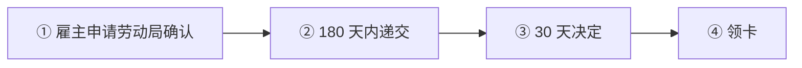
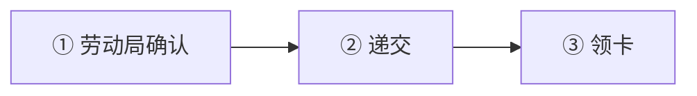

# 🇸🇰 斯洛伐克 · Slovakia

    

**蓝卡门槛全欧最低之一 EUR 1,944/月，首卡 5 年**

[🧑‍💻 欧盟蓝卡](#slovakia-eu-blue-card) · [🧑‍💻 就业临时居留](#slovakia-temporary-residence-for-employment) · [🧾 商业居留许可替代方案](#slovakia-business-residence-permit) · [📖 深度解读](#deep) · [🔗 延伸阅读](#more)

> [!TIP]
> **一句话判断**：欧盟 + 申根 + 欧元区。**没有数字游民签证**。**欧盟蓝卡门槛在全欧洲最低之一**（1.2 倍平均工资 ≈ **EUR 1,944/月**，近 3 年毕业生甚至 EUR 1,620/月），首次就给 5 年。自雇走**商业居留**，2025-07-01 起首次申请必须在境外使馆递交并附商业计划。

## 🏙️ 生活与身份档案

<table>
<tr><td width="33%" valign="top">💶 生活成本指数（纽约=100） <b>48.5 ●●●●○</b></td><td width="33%" valign="top">🏠 房租指数（纽约=100） <b>15.6 ●●●●○</b></td><td width="33%" valign="top">🛡️ 安全指数 <b>69.1 ●●●●○</b></td></tr>
<tr><td width="33%" valign="top">💼 平均年薪（总额） <b>EUR 20,287</b></td><td width="33%" valign="top">🧾 最高个税税率 <b>35%</b></td><td width="33%" valign="top">🛂 护照免签目的地 <b>184 个（中国 81）</b></td></tr>
<tr><td width="33%" valign="top">🏠 永居年限 <b>5 年</b></td><td width="33%" valign="top">🎖️ 入籍年限 <b>8 年</b></td><td width="33%" valign="top">🔁 双重国籍 <b>❌ 一般须放弃</b></td></tr>
<tr><td width="33%" valign="top">🗣️ 语言要求 <b>斯洛伐克语</b></td><td width="33%" valign="top">✈️ 中国护照入境 <b>申根签证</b></td><td width="33%" valign="top"></td></tr>
</table>

● 越多越好（成本/房租越低、安全越高）。数据：Numbeo 2026 年中、Eurostat、Tax Foundation 2026、Henley 2026；永居/入籍为常见规则，以官方为准。中国不承认双重国籍。[数据说明](README.md#profiles)

## 📊 路线速查

| 路线 | 类型 | 门槛信号 | 家属 | 永居 | 状态 |
|---|---|---|:-:|:-:|:-:|
| [斯洛伐克欧盟蓝卡](#slovakia-eu-blue-card) | 🧑‍💻 技术工作 | EUR 1,944/月 | ✅ 可带 | ✅ 可能 | 🟢 开放 |
| [斯洛伐克就业临时居留](#slovakia-temporary-residence-for-employment) | 🧑‍💻 技术工作 | — | ✅ 可带 | ✅ 可能 | 🟢 开放 |
| [斯洛伐克商业居留许可替代方案](#slovakia-business-residence-permit) | 🧾 自雇 | — | ✅ 可带 | ✅ 可能 | 🟢 开放 |

门槛为主申请人的最低信号值，多与当地工资挂钩、每年调整，递交前以官方为准。

---

## 🧑‍💻 斯洛伐克欧盟蓝卡

   

> **欧盟门槛最低的蓝卡之一：月薪 1,944 欧（近 3 年毕业生 1,620），首卡 5 年，30 天审理。**

<table>
<tr><td width="33%" valign="top">月薪 <b>≥ EUR 1,944（1.2 倍平均工资）</b></td><td width="33%" valign="top">应届 <b>≥ EUR 1,620</b></td><td width="33%" valign="top">前置 <b>劳动局高资质确认（15 个工作日）</b></td></tr>
<tr><td width="33%" valign="top">审理 <b>30 天</b></td><td width="33%" valign="top">首期 <b>5 年</b></td><td width="33%" valign="top">费用 <b>EUR 250</b></td></tr>
</table>

<table><tr>
<td width="50%" valign="top">✅ <b>适合</b><ul><li>中低薪资的技术岗位</li><li>刚毕业的大学生</li></ul></td>
<td width="50%" valign="top">❌ <b>不适合</b><ul><li>无学历</li></ul></td>
</tr></table>

### 🗺️ 申请流程

1. **雇主申请劳动局确认**
2. **180 天内递交** — 使领馆或外警
3. **30 天决定**
4. **领卡**

### 📋 材料清单

- [ ] 劳动合同
- [ ] 学历证明
- [ ] 无犯罪证明（≤90 天）
- [ ] 住宿证明（≥6 个月）

> [!WARNING]
> **注意**
> - 材料一般不能超过 90 天

🔗 官方来源（4）

- [IOM Slovakia EU Blue Card](https://mic.iom.sk/en/residence/temporary-residence/236-modra-karta-eu-2.html)
- [European Commission EU Blue Card in Slovakia](https://home-affairs.ec.europa.eu/policies/migration-and-asylum/eu-immigration-portal/eu-blue-card/eu-blue-card-slovakia_en)
- [Statistical Office of the SR average monthly wage in 2025](https://slovak.statistics.sk/wps/portal/ext/products/informationmessages/inf_sprava_detail/e85f8bdc-faf2-4aed-8684-44ed4a839ad2/!ut/p/z1/tVNNc4IwFPwtPXjM5AEB4jE4Clh0RAUll04UUIqCHwyt_76h9eJ0FHtoLklmdvdl39tgjpeYF6LONqLKykLs5D3ixptvutSyFAZgeRq4ZRb_m_5EHPM10V1qLY4KldnsUXnHGVFikRedUAeytNeuqmLBJ0PJ1FfOlCfkyqXe0L1lK7iNUpFqiIikhhRgxJESBITQbWuiNVG_rDOYhw9hV609auxA3cWgyu_ZzOHmB4A9WwdXOYE066vacC059r5oEArn39DHr2gzcMPgPm-P_PCEOxQHYCrKTaMgwBgYLYALKMFMDdwJG2ad30oJl7UWfKBg6IZ_g7P_jhFB_CwrVPyZ6inUW-0kcqi2jaRK_HyKXlJzd6PR85kcsuiSj4rvPyP6B72QbCn2iXLUD7tp6O-Rvjq8vHyBcY0U-4!/dz/d5/L0lDUmlTUSEhL3dHa0FKRnNBLzROV3FpQSEhL2Vu/)
- [IOM Slovakia permanent residence](https://mic.iom.sk/en/residence/permanent-residence.html)

数据核查：2026-10-25 · [LetsMigrate 原始记录](https://letsmigrate.org/zh-hans/programmes/slovakia-eu-blue-card-zh/) · [↑ 回到顶部](#top)

---

## 🧑‍💻 斯洛伐克就业临时居留

   

> **斯洛伐克最常见的就业居留（单一许可），60 天审理。**

<table>
<tr><td width="33%" valign="top">前置 <b>劳动局确认</b></td><td width="33%" valign="top">审理 <b>60 天（特定类别 30 天）</b></td><td width="33%" valign="top">首期 <b>一般最长 2 年</b></td></tr>
<tr><td width="33%" valign="top">费用 <b>EUR 250</b></td><td width="33%" valign="top">失业 <b>7 个工作日内通知外警</b></td><td width="33%" valign="top"></td></tr>
</table>

<table><tr>
<td width="50%" valign="top">✅ <b>适合</b><ul><li>普通岗位</li></ul></td>
<td width="50%" valign="top">❌ <b>不适合</b><ul></ul></td>
</tr></table>

### 🗺️ 申请流程

1. **劳动局确认**
2. **递交**
3. **领卡**

### 📋 材料清单

- [ ] 劳动合同
- [ ] 无犯罪证明
- [ ] 住宿证明

🔗 官方来源（4）

- [IOM Slovakia temporary residence for employment](https://mic.iom.sk/en/residence/temporary-residence/983-temporary-residence-employment.html)
- [IOM Slovakia employment of foreign nationals](https://mic.iom.sk/en/work/employment-of-foreign-nationals-in-slovakia.html)
- [IOM Slovakia work permit](https://mic.iom.sk/en/work/work-permit.html)
- [IOM Slovakia permanent residence](https://mic.iom.sk/en/residence/permanent-residence.html)

数据核查：2026-10-25 · [LetsMigrate 原始记录](https://letsmigrate.org/zh-hans/programmes/slovakia-temporary-residence-for-employment-zh/) · [↑ 回到顶部](#top)

---

## 🧾 斯洛伐克商业居留许可替代方案

   

> **2025-07 起须附商业计划、首次只能在境外使馆递交的商业居留。**

<table>
<tr><td width="33%" valign="top">商业计划 <b>必须（评估可行性和经济贡献）</b></td><td width="33%" valign="top">递交 <b>首次仅限境外使领馆</b></td><td width="33%" valign="top">审理 <b>外警 90 天 + 经济部意见 60 天</b></td></tr>
<tr><td width="33%" valign="top">期限 <b>最长 3 年</b></td><td width="33%" valign="top">账户余额 <b>个体户 ≥ 最低生活标准 20 倍；公司代表 100 倍</b></td><td width="33%" valign="top"></td></tr>
</table>

<table><tr>
<td width="50%" valign="top">✅ <b>适合</b><ul><li>真实经营者</li></ul></td>
<td width="50%" valign="top">❌ <b>不适合</b><ul><li>空壳公司</li></ul></td>
</tr></table>

### 🗺️ 申请流程

1. **营业执照/公司**
2. **商业计划**
3. **使领馆递交**
4. **审批**

### 📋 材料清单

- [ ] 商业计划
- [ ] 营业执照
- [ ] 商业登记
- [ ] 资金证明

> [!WARNING]
> **注意**
> - 企业税：≤10 万欧利润 10%

🔗 官方来源（5）

- [Slovak Ministry of Economy foreigners running a business in Slovakia](https://www.economy.gov.sk/podnikatelske-prostredie/cudzinci-foreigners/foreigners-running-a-business-in-the-slovak-republic)
- [Slovensko.sk entrepreneurship for foreigners](https://www.slovensko.sk/en/life-situation/life-situation/_entrepreneurship)
- [Slovensko.sk notifying a trade](https://www.slovensko.sk/en/life-situation/life-situation/_notifying-a-trade)
- [EU Immigration Portal self-employed worker in Slovakia](https://home-affairs.ec.europa.eu/policies/migration-and-asylum/eu-immigration-portal/self-employed-worker-slovakia_en)
- [Financial Administration general tax information for businesses](https://www.financnasprava.sk/en/businesses/taxes-businesses)

数据核查：2026-10-25 · [LetsMigrate 原始记录](https://letsmigrate.org/zh-hans/programmes/slovakia-business-residence-permit-zh/) · [↑ 回到顶部](#top)

---

## 📖 深度解读

### 路线要点

### 单一许可 vs 欧盟蓝卡
| | 就业临时居留（单一许可） | 欧盟蓝卡 |
|---|---|---|
| 薪资 | 视岗位 | ≥ 平均工资 1.2 倍 **EUR 1,944/月**；近 3 年大学毕业生 ≥ **EUR 1,620/月** |
| 前置 | 劳动局确认（15 个工作日），180 天内须递交居留 | 劳动局高资质就业确认，180 天内递交 |
| 审理 | 60 天；特定类别 30 天；斯洛伐克毕业生 90 天 | **30 天** |
| 首次有效期 | 一般最长 2 年 | **5 年**（或确认有效期 + 90 天） |
| 费用 | EUR 250 + 居留卡寄送 | 同左 |

- 递交：一般在国籍国或居住国的斯洛伐克使领馆；合法停留在斯洛伐克（含申根免签）时可在外警递交。
- 材料一般不得超过 90 天；住宿证明通常需覆盖 ≥6 个月。
- 失业须 7 个工作日内通知外警；基于劳动局确认的居留，持有 <2 年有 3 个月保护期，>2 年 6 个月。
- **长期居留**：合法不间断居住 5 年；蓝卡持有人可累计欧盟内 5 年（最后 2 年在斯洛伐克）。

### 商业居留（自雇 / 公司）
- 2025-07-01 起：首次申请**只能在境外使领馆递交**，必须附**商业计划**（评估质量、可行性、可持续性、对经济的贡献，如创造就业或紧缺行业）。
- 外警 90 天内决定，经济部在收到后 60 天内出具意见；最长 3 年。
- 无欧盟/OECD 永居的非欧盟人以营业执照自雇，还需登记商业登记簿。
- **资金要求**（IOM 资料）：个人生活费 ≥ 每月最低生活标准（停留 >1 年需 12 倍）；企业账户余额个体户 ≥ 最低生活标准 20 倍，公司法定代表人 ≥ 100 倍。
- 企业所得税：应税所得 ≤ EUR 100,000 为 10%，其他 21%，> EUR 5,000,000 为 24%。

---

## 🔗 延伸阅读

LetsMigrate 中文指南原文（7 篇）

- [斯洛伐克商业居留许可替代方案指南](https://letsmigrate.org/zh-hans/articles/slovakia-business-residence-permit-guide-zh/)
- [斯洛伐克商业居留税务和商业设置](https://letsmigrate.org/zh-hans/articles/slovakia-business-residence-permit-tax-business-setup-zh/)
- [斯洛伐克商业居留时间线和文件](https://letsmigrate.org/zh-hans/articles/slovakia-business-residence-permit-timeline-documents-zh/)
- [斯洛伐克 Single Permit 和欧盟蓝卡家庭、流动性与定居](https://letsmigrate.org/zh-hans/articles/slovakia-single-permit-eu-blue-card-family-mobility-settlement-zh/)
- [斯洛伐克 Single Permit 和欧盟蓝卡薪资规则](https://letsmigrate.org/zh-hans/articles/slovakia-single-permit-eu-blue-card-salary-qualification-rules-zh/)
- [斯洛伐克 Single Permit 和欧盟蓝卡时间线和文件](https://letsmigrate.org/zh-hans/articles/slovakia-single-permit-eu-blue-card-timeline-documents-zh/)
- [斯洛伐克 Single Permit vs 欧盟蓝卡](https://letsmigrate.org/zh-hans/articles/slovakia-single-permit-vs-eu-blue-card-zh/)

[← 🇷🇴 罗马尼亚](romania.md) ｜ [🇪🇺 全部国家](README.md) ｜ [🏠 首页](../../README.md) ｜ [🇸🇮 斯洛文尼亚 →](slovenia.md)

本页根据 [LetsMigrate.org](https://letsmigrate.org/zh-hans/countries/slovakia-zh/) 公开资料及官方来源整理改写，仅供信息参考，不构成移民、法律、税务或投资建议。
