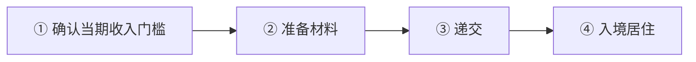
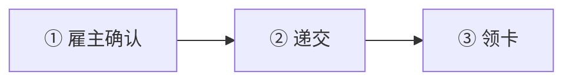
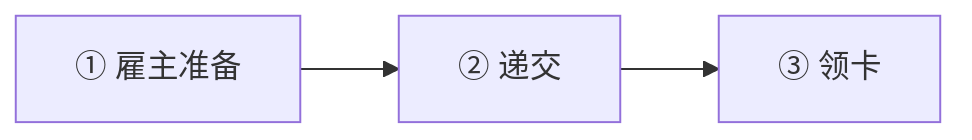

# 🇸🇮 斯洛文尼亚 · Slovenia

    

**数字游民 2025 新开、家属可立即团聚；蓝卡 1 倍平均工资**

[💻 数字游民许可](#slovenia-digital-nomad-permit) · [🧑‍💻 欧盟蓝卡](#slovenia-eu-blue-card) · [🧑‍💻 单一居留和工作许可](#slovenia-single-residence-and-work-permit) · [📖 深度解读](#deep) · [🔗 延伸阅读](#more)

> [!TIP]
> **一句话判断**：欧盟 + 申根 + 欧元区。**数字游民许可 2025-11-21 才开放**，最长 1 年、**不能续**，但**家属可以立即团聚**（无等待期）。雇佣路线看**单一居留和工作许可 vs 欧盟蓝卡**：2025 年改革后蓝卡门槛降到"平均工资 1 倍"（EUR 2,536.03/月）、合同只需 6 个月，在欧洲属于很友好的一档。

## 🏙️ 生活与身份档案

<table>
<tr><td width="33%" valign="top">💶 生活成本指数（纽约=100） <b>53.2 ●●●●○</b></td><td width="33%" valign="top">🏠 房租指数（纽约=100） <b>18.2 ●●●●○</b></td><td width="33%" valign="top">🛡️ 安全指数 <b>75.5 ●●●●○</b></td></tr>
<tr><td width="33%" valign="top">💼 平均年薪（总额） <b>EUR 35,133</b></td><td width="33%" valign="top">🧾 最高个税税率 <b>50%</b></td><td width="33%" valign="top">🛂 护照免签目的地 <b>184 个（中国 81）</b></td></tr>
<tr><td width="33%" valign="top">🏠 永居年限 <b>5 年</b></td><td width="33%" valign="top">🎖️ 入籍年限 <b>10 年</b></td><td width="33%" valign="top">🔁 双重国籍 <b>⚠️ 有条件</b></td></tr>
<tr><td width="33%" valign="top">🗣️ 语言要求 <b>斯洛文尼亚语 B1</b></td><td width="33%" valign="top">✈️ 中国护照入境 <b>申根签证</b></td><td width="33%" valign="top"></td></tr>
</table>

● 越多越好（成本/房租越低、安全越高）。数据：Numbeo 2026 年中、Eurostat、Tax Foundation 2026、Henley 2026；永居/入籍为常见规则，以官方为准。中国不承认双重国籍。[数据说明](README.md#profiles)

## 📊 路线速查

| 路线 | 类型 | 门槛信号 | 家属 | 永居 | 状态 |
|---|---|---|:-:|:-:|:-:|
| [斯洛文尼亚数字游民许可](#slovenia-digital-nomad-permit) | 💻 数字游民 | — | ✅ 可带 | ⏳ 偏临时 | 🟢 开放 |
| [斯洛文尼亚欧盟蓝卡](#slovenia-eu-blue-card) | 🧑‍💻 技术工作 | EUR 2,536.03/月 | ✅ 可带 | ✅ 可能 | 🟢 开放 |
| [斯洛文尼亚单一居留和工作许可](#slovenia-single-residence-and-work-permit) | 🧑‍💻 技术工作 | — | ✅ 可带 | ✅ 可能 | 🟢 开放 |

门槛为主申请人的最低信号值，多与当地工资挂钩、每年调整，递交前以官方为准。

---

## 💻 斯洛文尼亚数字游民许可

   

> **2025-11 新开的数字游民许可：1 年不可续，但家属可以立即团聚。**

<table>
<tr><td width="33%" valign="top">收入 <b>≥ 平均月净工资 2 倍</b></td><td width="33%" valign="top">期限 <b>最长 1 年，不可延期</b></td><td width="33%" valign="top">冷却期 <b>到期 6 个月后才能再申请</b></td></tr>
<tr><td width="33%" valign="top">家属 <b>✅ 立即团聚，无等待期</b></td><td width="33%" valign="top">递交 <b>境外使领馆，或在斯洛文尼亚的行政单位</b></td><td width="33%" valign="top"></td></tr>
</table>

<table><tr>
<td width="50%" valign="top">✅ <b>适合</b><ul><li>带家属的远程工作者，想在欧洲试住一年</li></ul></td>
<td width="50%" valign="top">❌ <b>不适合</b><ul><li>想长期居留</li></ul></td>
</tr></table>

### 🗺️ 申请流程

1. **确认当期收入门槛** — 向主管部门核实
2. **准备材料** — 工作证明、收入、保险、无犯罪
3. **递交**
4. **入境居住** — 有效期内可转其他居留目的

### 📋 材料清单

- [ ] 护照
- [ ] 境外雇主/客户/自雇证明
- [ ] 收入证明
- [ ] 医疗保险
- [ ] 无犯罪证明

> [!WARNING]
> **注意**
> - 住满一年很容易超过 183 天成为税务居民

🔗 官方来源（4）

- [GOV.SI Temporary residence permit for digital nomads](https://www.gov.si/en/news/2025-11-21-temporary-residence-permit-for-digital-nomads/)
- [GOV.SI Entry and residence](https://www.gov.si/en/topics/entry-and-residence/)
- [Statistical Office of Slovenia earnings release](https://www.stat.si/StatWeb/en/News/Index/14332)
- [Financial Administration of Slovenia international taxation](https://www.fu.gov.si/en/taxes_and_other_duties/areas_of_work/international_taxation)

数据核查：2026-10-25 · [LetsMigrate 原始记录](https://letsmigrate.org/zh-hans/programmes/slovenia-digital-nomad-permit-zh/) · [↑ 回到顶部](#top)

---

## 🧑‍💻 斯洛文尼亚欧盟蓝卡

   

> **2025 改革后门槛降到平均工资 1 倍（EUR 2,536/月），合同只需 6 个月。**

<table>
<tr><td width="33%" valign="top">月薪 <b>≥ EUR 2,536.03</b></td><td width="33%" valign="top">合同 <b>≥6 个月</b></td><td width="33%" valign="top">资质 <b>高等资质；ICT 近 7 年内 3 年经验</b></td></tr>
<tr><td width="33%" valign="top">有效期 <b>2 年或合同期 + 3 个月，续最长 3 年</b></td><td width="33%" valign="top">费用 <b>境外 EUR 102 / 境内 EUR 70</b></td><td width="33%" valign="top">家属 <b>不受居住时长限制</b></td></tr>
</table>

<table><tr>
<td width="50%" valign="top">✅ <b>适合</b><ul><li>中等薪资的技术岗位</li></ul></td>
<td width="50%" valign="top">❌ <b>不适合</b><ul><li>无学历且非 ICT</li></ul></td>
</tr></table>

### 🗺️ 申请流程

1. **雇主确认**
2. **递交** — 通常 30 天决定
3. **领卡**

### 📋 材料清单

- [ ] 劳动合同
- [ ] 学历证明
- [ ] 护照

> [!WARNING]
> **注意**
> - 旧资料的 1.5 倍、1 年合同已过时

🔗 官方来源（4）

- [Employment Service of Slovenia EU Blue Card](https://www.ess.gov.si/delodajalci/zaposlovanje-tujcev-iz-tretjih-drzav/enotno-dovoljenje/modra-karta-eu/)
- [GOV.SI amendment to the Employment, Self-employment and Work of Foreigners Act](https://www.gov.si/novice/2025-04-29-spremembe-in-dopolnitve-zakona-o-zaposlovanju-samozaposlovanju-in-delu-tujcev/)
- [Slovenian Official Gazette: 2025 average earnings](https://www.uradni-list.si/glasilo-uradni-list-rs/vsebina/2026-01-0572)
- [European Commission highly-qualified worker in Slovenia](https://home-affairs.ec.europa.eu/policies/migration-and-asylum/eu-immigration-portal/highly-qualified-worker-slovenia_en)

数据核查：2026-10-25 · [LetsMigrate 原始记录](https://letsmigrate.org/zh-hans/programmes/slovenia-eu-blue-card-zh/) · [↑ 回到顶部](#top)

---

## 🧑‍💻 斯洛文尼亚单一居留和工作许可

   

> **普通单一居留和工作许可，换工作须事先书面批准。**

<table>
<tr><td width="33%" valign="top">薪资 <b>视岗位</b></td><td width="33%" valign="top">有效期 <b>合同期，最长 2 年</b></td><td width="33%" valign="top">续签 <b>最长 3 年</b></td></tr>
<tr><td width="33%" valign="top">家属 <b>一般需担保人已居住 1 年</b></td><td width="33%" valign="top"></td><td width="33%" valign="top"></td></tr>
</table>

<table><tr>
<td width="50%" valign="top">✅ <b>适合</b><ul><li>普通岗位</li></ul></td>
<td width="50%" valign="top">❌ <b>不适合</b><ul><li>家属需要立即团聚</li></ul></td>
</tr></table>

### 🗺️ 申请流程

1. **雇主准备**
2. **递交**
3. **领卡**

### 📋 材料清单

- [ ] 劳动合同
- [ ] 护照

> [!WARNING]
> **注意**
> - 换雇主、换岗位都要行政单位书面批准

🔗 官方来源（4）

- [Employment Service of Slovenia single permit](https://www.ess.gov.si/en/jobseekers/employment-of-non-eu-migrant-workers/work-in-slovenia/single-permit)
- [GOV.SI employment and work of foreign nationals](https://www.gov.si/en/topics/employment-and-work-of-foreign-nationals/)
- [Employment Service of Slovenia work in Slovenia](https://www.ess.gov.si/en/jobseekers/employment-of-non-eu-migrant-workers/work-in-slovenia)
- [European Commission employed worker in Slovenia](https://home-affairs.ec.europa.eu/policies/migration-and-asylum/eu-immigration-portal/employed-worker-slovenia_en)

数据核查：2026-10-25 · [LetsMigrate 原始记录](https://letsmigrate.org/zh-hans/programmes/slovenia-single-residence-and-work-permit-zh/) · [↑ 回到顶部](#top)

---

## 📖 深度解读

### 路线要点

### 数字游民许可（临时居留）
- **适用**：非欧盟/EEA 公民，通过信息通信技术远程为斯洛文尼亚以外的企业工作、签境外民事合同，或在境外自雇。
- **收入**：每月 ≥ 斯洛文尼亚**平均月净工资的 2 倍**（以官方公报最近公布的平均月总工资推算），递交前请主管部门确认当期金额。
- **递交**：在境外向斯洛文尼亚使领馆递交；已合法居住在斯洛文尼亚的可向行政单位递交。
- **期限**：最长 1 年，**不能延期**；到期后 6 个月才能再申请。有效期内如符合条件，可转其他居留目的。
- **家属**：可**立即团聚**，不受主申请人居住时长和许可有效期限制。
- 官方未单列具体费用，需按行政/领事费用、翻译、无犯罪证明、保险预留预算。

### 单一居留和工作许可 vs 欧盟蓝卡（2025 改革后）
| | 单一许可 | 欧盟蓝卡 |
|---|---|---|
| 薪资 | 视岗位 | ≥ 最新公布的平均月总工资 **EUR 2,536.03**（2025 年均值，2026-02 公报） |
| 合同 | 视岗位 | ≥6 个月 |
| 资质 | 视岗位，受监管职业需认证 | 高等专业资质；ICT 岗位可凭近 7 年内 3 年经验 |
| 首次有效期 | 合同期，最长 2 年 | 2 年，或合同期 + 3 个月 |
| 续签 | 最长 3 年 | 最长 3 年 |
| 换工作 | 须行政单位书面批准 | 第 1 年需同意；合法就业满 2 年后提前书面通知即可 |
| 家庭团聚 | 一般需担保人已居住 1 年且持 ≥1 年期许可 | **不受**上述时长限制 |

- **审理**：通常 30 天，需特别调查的 60 天。
- **费用**：境外递交 EUR 102，在斯洛文尼亚行政单位递交 EUR 70，另有居留卡费。
- 部分旧资料仍写"1.5 倍工资、1 年合同"，已过时。
- 蓝卡长期居留：欧盟内持蓝卡连续 5 年，最后 2 年在斯洛文尼亚。

### 税务提醒
- 建立居住联系（永居、家人在斯、一个日历年内 >183 天等）即可能成为税务居民，全球收入纳税。数字游民住满一年很容易超过 183 天。

---

## 🔗 延伸阅读

LetsMigrate 中文指南原文（9 篇）

- [斯洛文尼亚数字游民许可文件清单](https://letsmigrate.org/zh-hans/articles/slovenia-digital-nomad-permit-documents-checklist-zh/)
- [斯洛文尼亚数字游民许可家庭和一年后规则](https://letsmigrate.org/zh-hans/articles/slovenia-digital-nomad-permit-family-after-year-one-zh/)
- [斯洛文尼亚数字游民许可指南](https://letsmigrate.org/zh-hans/articles/slovenia-digital-nomad-permit-guide-zh/)
- [斯洛文尼亚数字游民许可税务、银行、保险和居住设置](https://letsmigrate.org/zh-hans/articles/slovenia-digital-nomad-permit-tax-banking-insurance-zh/)
- [斯洛文尼亚数字游民许可时间线和费用](https://letsmigrate.org/zh-hans/articles/slovenia-digital-nomad-permit-timeline-costs-zh/)
- [斯洛文尼亚 Single Permit 和欧盟蓝卡家庭、流动性与定居](https://letsmigrate.org/zh-hans/articles/slovenia-single-permit-eu-blue-card-family-mobility-settlement-zh/)
- [斯洛文尼亚 Single Permit 和欧盟蓝卡薪资规则](https://letsmigrate.org/zh-hans/articles/slovenia-single-permit-eu-blue-card-salary-qualification-rules-zh/)
- [斯洛文尼亚 Single Permit 和欧盟蓝卡时间线和文件](https://letsmigrate.org/zh-hans/articles/slovenia-single-permit-eu-blue-card-timeline-documents-zh/)
- [斯洛文尼亚 Single Permit vs 欧盟蓝卡](https://letsmigrate.org/zh-hans/articles/slovenia-single-permit-vs-eu-blue-card-zh/)

[← 🇸🇰 斯洛伐克](slovakia.md) ｜ [🇪🇺 全部国家](README.md) ｜ [🏠 首页](../../README.md) ｜ [🇪🇸 西班牙 →](spain.md)

本页根据 [LetsMigrate.org](https://letsmigrate.org/zh-hans/countries/slovenia-zh/) 公开资料及官方来源整理改写，仅供信息参考，不构成移民、法律、税务或投资建议。
