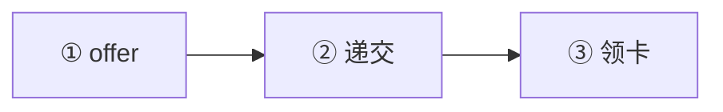

# 🇸🇪 瑞典 · Sweden

    

**2026 起工作许可须达中位工资 90%（SEK 34,470/月）**

[🧑‍💻 欧盟蓝卡](#sweden-eu-blue-card) · [🧑‍💻 工作许可](#sweden-work-permit) · [🧾 自雇居留许可替代路线](#sweden-self-employed-residence-permit) · [📖 深度解读](#deep) · [🔗 延伸阅读](#more)

> [!TIP]
> **一句话判断**：欧盟 + 申根，货币克朗（SEK）。**没有数字游民签证**。**2026 年工作许可薪资门槛大幅提高**：普通工作许可须达到中位工资 90%（**SEK 34,470/月**），蓝卡 **SEK 53,625/月**（2026-07-15 起）。自雇许可要求持股 ≥51% + 个人资金 SEK 200,000。

## 🏙️ 生活与身份档案

<table>
<tr><td width="33%" valign="top">💶 生活成本指数（纽约=100） <b>65.5 ●●●○○</b></td><td width="33%" valign="top">🏠 房租指数（纽约=100） <b>20.1 ●●●●○</b></td><td width="33%" valign="top">🛡️ 安全指数 <b>52.2 ●●○○○</b></td></tr>
<tr><td width="33%" valign="top">💼 平均年薪（总额） <b>EUR 46,525</b></td><td width="33%" valign="top">🧾 最高个税税率 <b>52.3%</b></td><td width="33%" valign="top">🛂 护照免签目的地 <b>186 个（中国 81）</b></td></tr>
<tr><td width="33%" valign="top">🏠 永居年限 <b>约 4 年</b></td><td width="33%" valign="top">🎖️ 入籍年限 <b>8 年（2026-06-06 起）</b></td><td width="33%" valign="top">🔁 双重国籍 <b>✅ 可保留原国籍</b></td></tr>
<tr><td width="33%" valign="top">🗣️ 语言要求 <b>瑞典语 + 公民考试（新）</b></td><td width="33%" valign="top">✈️ 中国护照入境 <b>申根签证</b></td><td width="33%" valign="top"></td></tr>
</table>

● 越多越好（成本/房租越低、安全越高）。数据：Numbeo 2026 年中、Eurostat、Tax Foundation 2026、Henley 2026；永居/入籍为常见规则，以官方为准。中国不承认双重国籍。[数据说明](README.md#profiles)

## 📊 路线速查

| 路线 | 类型 | 门槛信号 | 家属 | 永居 | 状态 |
|---|---|---|:-:|:-:|:-:|
| [瑞典欧盟蓝卡](#sweden-eu-blue-card) | 🧑‍💻 技术工作 | SEK 53,625/月 | ✅ 可带 | ✅ 可能 | 🟢 开放 |
| [瑞典工作许可](#sweden-work-permit) | 🧑‍💻 技术工作 | SEK 34,470/月 | ✅ 可带 | ✅ 可能 | 🟢 开放 |
| [瑞典自雇居留许可替代路线](#sweden-self-employed-residence-permit) | 🧾 自雇 | — | ✅ 可带 | ✅ 可能 | 🟢 开放 |

门槛为主申请人的最低信号值，多与当地工资挂钩、每年调整，递交前以官方为准。

---

## 🧑‍💻 瑞典欧盟蓝卡

   

> **瑞典蓝卡月薪 SEK 53,625，有效期 9 个月至 4 年。**

<table>
<tr><td width="33%" valign="top">月薪 <b>≥ SEK 53,625</b></td><td width="33%" valign="top">学历 <b>180 学分或 5 年经验</b></td><td width="33%" valign="top">有效期 <b>9 个月–4 年</b></td></tr>
<tr><td width="33%" valign="top">永居 <b>36 个月起可考虑</b></td><td width="33%" valign="top"></td><td width="33%" valign="top"></td></tr>
</table>

<table><tr>
<td width="50%" valign="top">✅ <b>适合</b><ul><li>高薪岗位</li></ul></td>
<td width="50%" valign="top">❌ <b>不适合</b><ul></ul></td>
</tr></table>

### 🗺️ 申请流程

1. **offer**
2. **递交**
3. **领卡**

### 📋 材料清单

- [ ] 劳动合同
- [ ] 学历证明

🔗 官方来源（3）

- [Swedish Migration Agency EU Blue Card page](https://www.migrationsverket.se/en/you-want-to-apply/work/employee-or-self-employed/eu-blue-cards.html)
- [Swedish Migration Agency March 2026 labour migration rule changes](https://www.migrationsverket.se/nyhetsarkiv/nyhetsarkiv/2026-03-19-beslut-om-nya-regler-for-arbetskraftsinvandring.html)
- [European Commission EU Blue Card overview](https://home-affairs.ec.europa.eu/policies/migration-and-asylum/eu-immigration-portal/eu-blue-card_en)

数据核查：2026-10-25 · [LetsMigrate 原始记录](https://letsmigrate.org/zh-hans/programmes/sweden-eu-blue-card-zh/) · [↑ 回到顶部](#top)

---

## 🧑‍💻 瑞典工作许可

   

> **2026 起普通工作许可须达中位工资 90%（SEK 34,470/月），不卡学历。**

<table>
<tr><td width="33%" valign="top">月薪 <b>≥ SEK 34,470；豁免职业 SEK 28,725</b></td><td width="33%" valign="top">招聘广告 <b>≥10 天</b></td><td width="33%" valign="top">首期 <b>最长 2 年</b></td></tr>
<tr><td width="33%" valign="top">家属 <b>配偶 + 21 岁以下子女，可工作</b></td><td width="33%" valign="top">永居 <b>一般 4 年</b></td><td width="33%" valign="top"></td></tr>
</table>

<table><tr>
<td width="50%" valign="top">✅ <b>适合</b><ul><li>普通技术岗位</li></ul></td>
<td width="50%" valign="top">❌ <b>不适合</b><ul><li>薪资低于门槛</li></ul></td>
</tr></table>

### 🗺️ 申请流程

1. **雇主发布广告**
2. **雇主发起申请**
3. **申请人补充**
4. **审批领卡**

### 📋 材料清单

- [ ] 劳动合同
- [ ] 保险
- [ ] 护照

> [!WARNING]
> **注意**
> - 2026-06 起部分岗位禁止申请

🔗 官方来源（3）

- [Swedish Migration Agency work permit page](https://www.migrationsverket.se/en/you-want-to-apply/work/employee-or-self-employed/employees.html)
- [Swedish Migration Agency salary requirements for work permits](https://www.migrationsverket.se/en/word-explanations/salary-requirements-for-a-work-permit.html)
- [Swedish Migration Agency employer work permit page](https://www.migrationsverket.se/en/employers/you-want-to-employ/employing-someone-from-outside-the-eu-eea/employment/employment.html)

数据核查：2026-10-25 · [LetsMigrate 原始记录](https://letsmigrate.org/zh-hans/programmes/sweden-work-permit-zh/) · [↑ 回到顶部](#top)

---

## 🧾 瑞典自雇居留许可替代路线

   

> **持股 ≥51% 亲自经营，个人资金 SEK 20 万，2 年后可申请永居。**

<table>
<tr><td width="33%" valign="top">持股 <b>≥51%</b></td><td width="33%" valign="top">个人资金 <b>SEK 200,000（配偶 10 万，每孩 5 万）</b></td><td width="33%" valign="top">费用 <b>SEK 2,000</b></td></tr>
<tr><td width="33%" valign="top">首期 <b>最长 2 年</b></td><td width="33%" valign="top">永居 <b>满 2 年续签时可申请</b></td><td width="33%" valign="top"></td></tr>
</table>

<table><tr>
<td width="50%" valign="top">✅ <b>适合</b><ul><li>有行业经验和客户的经营者</li></ul></td>
<td width="50%" valign="top">❌ <b>不适合</b><ul><li>资金靠贷款</li></ul></td>
</tr></table>

### 🗺️ 申请流程

1. **商业计划与预算**
2. **境外递交**
3. **审批**
4. **F-tax 登记**

### 📋 材料清单

- [ ] 持股证明
- [ ] 资金证明
- [ ] 商业计划
- [ ] 客户联系证明

🔗 官方来源（4）

- [Swedish Migration Agency self-employed people](https://www.migrationsverket.se/en/you-want-to-apply/work/employee-or-self-employed/self-employed-people.html)
- [Swedish Migration Agency extension for self-employed people](https://www.migrationsverket.se/en/you-want-to-extend/work/employee-or-self-employed/self-employed-people.html)
- [Swedish Tax Agency starting a business in Sweden](https://www.skatteverket.se/servicelankar/otherlanguages/englishengelska/businessesandemployers/startingandrunningaswedishbusiness/registeringabusiness/startingabusinessinsweden.4.12815e4f14a62bc048f51be.html)
- [Swedish Tax Agency approval for F-tax](https://www.skatteverket.se/servicelankar/otherlanguages/englishengelska/businessesandemployers/startingandrunningaswedishbusiness/registeringabusiness/approvalforftax.4.676f4884175c97df4192308.html)

数据核查：2026-10-25 · [LetsMigrate 原始记录](https://letsmigrate.org/zh-hans/programmes/sweden-self-employed-residence-permit-zh/) · [↑ 回到顶部](#top)

---

## 📖 深度解读

### 路线要点

### 普通工作许可 vs 欧盟蓝卡
| | 工作许可 | 欧盟蓝卡 |
|---|---|---|
| 薪资 | **≥ SEK 34,470/月**（中位工资 90%）；豁免职业 SEK 28,725（75%） | **≥ SEK 53,625/月**（平均工资 1.25 倍） |
| 资质 | 无学历门槛，但须符合集体协议或行业惯例 | 180 学分高等教育或 5 年相关经验 |
| 招聘广告 | 新招聘一般需在瑞典/欧盟/EEA/瑞士发布 ≥10 天 | 视案件类型 |
| 合同 | 已签雇佣合同 | ≥6 个月高资质雇佣合同 |
| 首次期限 | 最长 2 年 | 9 个月–4 年 |
| 家属 | 配偶/同居伴侣 + 21 岁以下子女 | 配偶/同居伴侣 + 18 岁以下子女 |

- 2026-06-01 起部分岗位（如采浆果工、个人助理）不能再申请普通工作许可。
- 家属可同时申请，获批后成年家属及当年满 16 岁的子女可工作；主申请人收入须覆盖家庭住房和生活费。
- 蓝卡：在其他欧盟国持蓝卡 ≥12 个月可迁来，入境 1 个月内申请；满 36 个月（符合蓝卡期间条件）可考虑永居。
- 瑞典普通工作许可一般 4 年后可申请永居（以移民局当前要求为准）。

### 自雇居留许可
- 本人经营、持股 **≥51%**、对运营负主要责任；有行业和经营经验；瑞典语或英语能力；可信预算和客户网络。
- **个人资金**：申请人 **SEK 200,000**，配偶 SEK 100,000，每个孩子 SEK 50,000；业务资金一般不接受贷款。
- **费用**：SEK 2,000（成年家属 1,500，儿童 750）；首次一般须在瑞典境外递交。
- **首次最长 2 年**；满 2 年续签时可同时申请永居（需证明业务可持续养活自己）。
- 年营业额超过 SEK 120,000 一般须登记增值税；需申请 F-tax（自雇税登记）。
- 不是给境外雇主远程员工的许可。

---

## 🔗 延伸阅读

LetsMigrate 中文指南原文（7 篇）

- [瑞典自雇居留许可替代路线指南](https://letsmigrate.org/zh-hans/articles/sweden-self-employed-residence-permit-guide-zh/)
- [瑞典自雇许可税务、F-tax 和设立](https://letsmigrate.org/zh-hans/articles/sweden-self-employed-residence-permit-tax-ftax-setup-zh/)
- [瑞典自雇居留许可时间线和文件](https://letsmigrate.org/zh-hans/articles/sweden-self-employed-residence-permit-timeline-documents-zh/)
- [瑞典工作许可和欧盟蓝卡家庭、换工作和定居](https://letsmigrate.org/zh-hans/articles/sweden-work-permit-eu-blue-card-family-job-changes-settlement-zh/)
- [瑞典工作许可和欧盟蓝卡薪资、条件和职业规则](https://letsmigrate.org/zh-hans/articles/sweden-work-permit-eu-blue-card-salary-terms-rules-zh/)
- [瑞典工作许可和欧盟蓝卡时间线与文件](https://letsmigrate.org/zh-hans/articles/sweden-work-permit-eu-blue-card-timeline-documents-zh/)
- [瑞典工作许可 vs 欧盟蓝卡](https://letsmigrate.org/zh-hans/articles/sweden-work-permit-vs-eu-blue-card-zh/)

[← 🇪🇸 西班牙](spain.md) ｜ [🇪🇺 全部国家](README.md) ｜ [🏠 首页](../../README.md) ｜ [🇨🇭 瑞士 →](switzerland.md)

本页根据 [LetsMigrate.org](https://letsmigrate.org/zh-hans/countries/sweden-zh/) 公开资料及官方来源整理改写，仅供信息参考，不构成移民、法律、税务或投资建议。
