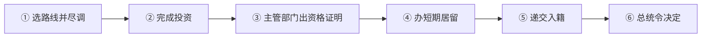

# 🇹🇷 土耳其 · Türkiye

    

**USD 40 万买房可申请入籍（非欧盟护照）**

[🛂 投资入籍](#turkiye-citizenship-by-investment) · [📖 深度解读](#deep) · [🔗 延伸阅读](#more)

> [!TIP]
> **一句话判断**：横跨欧亚、**非欧盟、非申根**。本站收录的是**土耳其投资入籍**——欧洲周边仍在运行的少数"投资直接换护照"项目之一，最低 **USD 40 万买房**（3 年内不能卖）。土耳其护照**不是欧盟护照**，不带来申根居住权。

## 🏙️ 生活与身份档案

<table>
<tr><td width="33%" valign="top">💶 生活成本指数（纽约=100） <b>40.2 ●●●●●</b></td><td width="33%" valign="top">🏠 房租指数（纽约=100） <b>12.3 ●●●●●</b></td><td width="33%" valign="top">🛡️ 安全指数 <b>58.5 ●●●○○</b></td></tr>
<tr><td width="33%" valign="top">💼 平均年薪（总额） <b>—</b></td><td width="33%" valign="top">🧾 最高个税税率 <b>40.8%</b></td><td width="33%" valign="top">🛂 护照免签目的地 <b>113 个（中国 81）</b></td></tr>
<tr><td width="33%" valign="top">🏠 永居年限 <b>8 年（长期居留）</b></td><td width="33%" valign="top">🎖️ 入籍年限 <b>5 年（投资可直接）</b></td><td width="33%" valign="top">🔁 双重国籍 <b>✅ 可保留原国籍</b></td></tr>
<tr><td width="33%" valign="top">🗣️ 语言要求 <b>土耳其语</b></td><td width="33%" valign="top">✈️ 中国护照入境 <b>电子签证（e-Visa）</b></td><td width="33%" valign="top"></td></tr>
</table>

● 越多越好（成本/房租越低、安全越高）。数据：Numbeo 2026 年中、Eurostat、Tax Foundation 2026、Henley 2026；永居/入籍为常见规则，以官方为准。中国不承认双重国籍。[数据说明](README.md#profiles)

## 📊 路线速查

| 路线 | 类型 | 门槛信号 | 家属 | 永居 | 状态 |
|---|---|---|:-:|:-:|:-:|
| [土耳其投资入籍](#turkiye-citizenship-by-investment) | 🛂 入籍 | 投资 ≥ 400,000 | ✅ 可带 | ⏳ 偏临时 | 🟢 开放 |

门槛为主申请人的最低信号值，多与当地工资挂钩、每年调整，递交前以官方为准。

---

## 🛂 土耳其投资入籍

   

> **USD 40 万买房（3 年不卖）可申请土耳其国籍，审批为总统令酌情决定。**

<table>
<tr><td width="33%" valign="top">房产 <b>≥ USD 400,000，3 年内不得转售</b></td><td width="33%" valign="top">其他方式 <b>资本/存款/国债/基金/养老金 USD 500,000，或创造 50 个岗位</b></td><td width="33%" valign="top">前置 <b>先办投资类短期居留</b></td></tr>
<tr><td width="33%" valign="top">决定 <b>总统令</b></td><td width="33%" valign="top">结果 <b>土耳其国籍（非欧盟）</b></td><td width="33%" valign="top"></td></tr>
</table>

<table><tr>
<td width="50%" valign="top">✅ <b>适合</b><ul><li>想要第二本护照、能接受土耳其政治经济风险</li></ul></td>
<td width="50%" valign="top">❌ <b>不适合</b><ul><li>想保留中国国籍（中国不承认双重国籍）</li></ul></td>
</tr></table>

### 🗺️ 申请流程

1. **选路线并尽调** — 房产查抵押、估值达标
2. **完成投资**
3. **主管部门出资格证明**
4. **办短期居留**
5. **递交入籍**
6. **总统令决定**

### 📋 材料清单

- [ ] 地契（注明入籍目的和 3 年不卖）
- [ ] 估值报告
- [ ] 护照、出生/结婚证明
- [ ] 无犯罪证明

> [!WARNING]
> **注意**
> - 子女在审批结束前成年就不能随父母入籍
> - 男性可能涉及兵役问题

🔗 官方来源（2）

- [Invest in Turkiye acquiring property and citizenship](https://www.invest.gov.tr/en/investmentguide/pages/acquiring-property-and-citizenship.aspx)
- [Turkish civil registry citizenship services FAQ](https://www.nvi.gov.tr/sss-vatandaslik-hizmetleri)

数据核查：2026-10-26 · [LetsMigrate 原始记录](https://letsmigrate.org/zh-hans/programmes/turkiye-citizenship-by-investment-zh/) · [↑ 回到顶部](#top)

---

## 📖 深度解读

### 路线要点

### 投资入籍（例外入籍）
| 方式 | 最低金额（等值） | 持有要求 | 认证机构 |
|---|---|---|---|
| 房地产 | **USD 400,000** | 3 年内不得转售（地契注明） | 土地登记 |
| 固定资本投资 | USD 500,000 | — | 工业和技术部 |
| 创造就业 | 50 个岗位 | — | 劳动部门 |
| 银行存款 | USD 500,000 | 3 年 | 银行监管局（BDDK） |
| 政府债券 | USD 500,000 | 3 年 | 财政部 |
| 房地产/风投基金份额 | USD 500,000 | 3 年 | 资本市场委员会 |
| 私人养老金 | USD 500,000 | 3 年 | 保险与养老金监管局 |

- **流程**：资格评估 → 选择路线并尽调 → 完成投资 → 主管部门出具资格证明 → **先办投资类短期居留许可** → 递交入籍申请（个人、家属、户籍、背景材料）→ **总统令**决定。
- **家属**：配偶和未成年子女可一并申请；未成年子女若在审批结束前成年，就不能再随父母入籍，需单独符合条件。
- **注意**：
  - 房产估值必须达到官方门槛，查清抵押、留置和限制。
  - 入籍是酌情决定，不是"买了就有"。
  - 土耳其承认双重国籍，但**中国法律不承认双重国籍**，取得外国国籍会自动丧失中国国籍。
  - 男性可能涉及兵役问题；入籍不等于税务居民。

---

## 🔗 延伸阅读

LetsMigrate 中文指南原文（4 篇）

- [土耳其投资入籍指南](https://letsmigrate.org/zh-hans/articles/turkiye-citizenship-by-investment-guide-zh/)
- [土耳其投资入籍路线和尽职调查](https://letsmigrate.org/zh-hans/articles/turkiye-citizenship-by-investment-routes-due-diligence-zh/)
- [土耳其投资入籍税务、家庭和护照规划](https://letsmigrate.org/zh-hans/articles/turkiye-citizenship-by-investment-tax-family-passport-zh/)
- [土耳其投资入籍时间线和文件](https://letsmigrate.org/zh-hans/articles/turkiye-citizenship-by-investment-timeline-documents-zh/)

[← 🇨🇭 瑞士](switzerland.md) ｜ [🇪🇺 全部国家](README.md) ｜ [🏠 首页](../../README.md) ｜ [🇬🇧 英国 →](united-kingdom.md)

本页根据 [LetsMigrate.org](https://letsmigrate.org/zh-hans/countries/turkiye-zh/) 公开资料及官方来源整理改写，仅供信息参考，不构成移民、法律、税务或投资建议。
