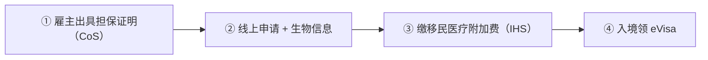
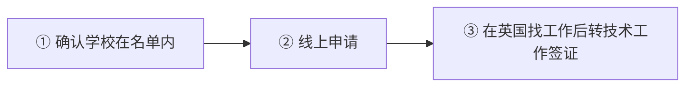

# 🇬🇧 英国 · United Kingdom

    

**投资移民已关闭；永居拟从 5 年改为 10 年**

[🧑‍💻 技术工作签证（Skilled Worker）](#uk-skilled-worker) · [🧑‍💻 全球人才签证（Global Talent）](#uk-global-talent) · [🧑‍💻 高潜力人才签证（HPI）](#uk-hpi) · [💰 UK Tier 1 Investor Visa](#uk-tier-1-investor-visa) · [📖 深度解读](#deep) · [🔗 延伸阅读](#more)

> [!TIP]
> **一句话判断**：**非欧盟、非申根**，英语国家。**Tier 1 投资移民已于 2022-02-17 关闭**，投资移民这条路没了；现在主要靠**技术工作签证（Skilled Worker）**、**全球人才（Global Talent）**、**创新创业（Innovator Founder）**、**高潜力人才（HPI）**、**扩张签证（Scale-up）** 等。**永居政策正在收紧**：政府提议将标准永居年限从 5 年延长到 10 年（"earned settlement"，截至 2026-10 尚未立法）。

## 🏙️ 生活与身份档案

<table>
<tr><td width="33%" valign="top">💶 生活成本指数（纽约=100） <b>68.2 ●●●○○</b></td><td width="33%" valign="top">🏠 房租指数（纽约=100） <b>30.1 ●●●○○</b></td><td width="33%" valign="top">🛡️ 安全指数 <b>51.8 ●●○○○</b></td></tr>
<tr><td width="33%" valign="top">💼 平均年薪（总额） <b>—</b></td><td width="33%" valign="top">🧾 最高个税税率 <b>45%</b></td><td width="33%" valign="top">🛂 护照免签目的地 <b>182 个（中国 81）</b></td></tr>
<tr><td width="33%" valign="top">🏠 永居年限 <b>5 年（拟改 10 年）</b></td><td width="33%" valign="top">🎖️ 入籍年限 <b>永居后 1 年</b></td><td width="33%" valign="top">🔁 双重国籍 <b>✅ 可保留原国籍</b></td></tr>
<tr><td width="33%" valign="top">🗣️ 语言要求 <b>英语 B1 + Life in UK</b></td><td width="33%" valign="top">✈️ 中国护照入境 <b>英国签证</b></td><td width="33%" valign="top"></td></tr>
</table>

● 越多越好（成本/房租越低、安全越高）。数据：Numbeo 2026 年中、Eurostat、Tax Foundation 2026、Henley 2026；永居/入籍为常见规则，以官方为准。中国不承认双重国籍。[数据说明](README.md#profiles)

## 📊 路线速查

| 路线 | 类型 | 门槛信号 | 家属 | 永居 | 状态 |
|---|---|---|:-:|:-:|:-:|
| [英国技术工作签证（Skilled Worker）](#uk-skilled-worker) | 🧑‍💻 技术工作 | GBP 41,700/年 | ✅ 可带 | ✅ 可能 | 🟢 开放 |
| [英国全球人才签证（Global Talent）](#uk-global-talent) | 🧑‍💻 技术工作 | — | ✅ 可带 | ✅ 可能 | 🟢 开放 |
| [英国高潜力人才签证（HPI）](#uk-hpi) | 🧑‍💻 技术工作 | — | ✅ 可带 | ⏳ 偏临时 | 🟢 开放 |
| [UK Tier 1 Investor Visa](#uk-tier-1-investor-visa) | 💰 投资居留 | — | — | — | ⛔ 已关闭 |

门槛为主申请人的最低信号值，多与当地工资挂钩、每年调整，递交前以官方为准。

---

## 🧑‍💻 英国技术工作签证（Skilled Worker）

    

> **英国最主流的工作移民路线：持牌雇主担保、学士级岗位、年薪 41,700 英镑起。**

<table>
<tr><td width="33%" valign="top">薪资 <b>≥ GBP 41,700/年或职业标准工资（取高者），时薪 ≥ GBP 17.13</b></td><td width="33%" valign="top">岗位 <b>RQF 6（学士级）以上；中等技能岗位需在紧缺清单</b></td><td width="33%" valign="top">英语 <b>B2（2026-01-08 起）</b></td></tr>
<tr><td width="33%" valign="top">雇主 <b>持牌担保雇主</b></td><td width="33%" valign="top">永居 <b>现行 5 年；拟改为 10 年（earned settlement）</b></td><td width="33%" valign="top"></td></tr>
</table>

<table><tr>
<td width="50%" valign="top">✅ <b>适合</b><ul><li>拿到英国 offer 的本科以上专业人士</li></ul></td>
<td width="50%" valign="top">❌ <b>不适合</b><ul><li>中低技能岗位</li></ul></td>
</tr></table>

### 🗺️ 申请流程

1. **雇主出具担保证明（CoS）**
2. **线上申请 + 生物信息**
3. **缴移民医疗附加费（IHS）**
4. **入境领 eVisa**

### 📋 材料清单

- [ ] CoS 担保证明
- [ ] 英语 B2 证明
- [ ] 护照
- [ ] 肺结核检测（中国申请人需要）

> [!WARNING]
> **注意**
> - 2026-04 起按每个发薪期核查工资合规

🔗 来源（2）

- [GOV.UK Skilled Worker visa](https://www.gov.uk/skilled-worker-visa)
- [Kenton Solicitors: 2026 thresholds](https://kentonsolicitors.co.uk/skilled-worker-visa-2026-salary-changes/)

数据核查：2026-10 · 本条为 RUN 补充路线（LetsMigrate 未收录），来源见上 · [↑ 回到顶部](#top)

---

## 🧑‍💻 英国全球人才签证（Global Talent）

    

> **科研、数字技术、艺术、设计等领域顶尖或潜力人才，无需雇主，最长 5 年，可快速永居。**

<table>
<tr><td width="33%" valign="top">背书 <b>认可机构背书（2026-08 起 100 多家企业可为研究人员背书）</b></td><td width="33%" valign="top">雇主 <b>不需要</b></td><td width="33%" valign="top">期限 <b>最长 5 年</b></td></tr>
<tr><td width="33%" valign="top">费用 <b>GBP 766 + IHS</b></td><td width="33%" valign="top">新增 <b>2026-07 起设计领域</b></td><td width="33%" valign="top"></td></tr>
</table>

<table><tr>
<td width="50%" valign="top">✅ <b>适合</b><ul><li>有国际认可成果的科研人员、技术专家</li></ul></td>
<td width="50%" valign="top">❌ <b>不适合</b><ul><li>没有可证明的杰出成就</li></ul></td>
</tr></table>

### 🗺️ 申请流程

1. **申请背书**
2. **获背书后申请签证**

🔗 来源（1）

- [GOV.UK Global Talent visa](https://www.gov.uk/global-talent)

数据核查：2026-10 · 本条为 RUN 补充路线（LetsMigrate 未收录），来源见上 · [↑ 回到顶部](#top)

---

## 🧑‍💻 英国高潜力人才签证（HPI）

    

> **全球前约 100 名大学近 5 年毕业生可直接申请 2 年开放工作签证，无需 offer。**

<table>
<tr><td width="33%" valign="top">学历 <b>名单内大学近 5 年毕业</b></td><td width="33%" valign="top">期限 <b>2 年（博士 3 年），不可续</b></td><td width="33%" valign="top">名额 <b>每年 8,000（2025-11 起）</b></td></tr>
<tr><td width="33%" valign="top">英语 <b>B2</b></td><td width="33%" valign="top">永居 <b>不直接通向，可转其他签证</b></td><td width="33%" valign="top"></td></tr>
</table>

<table><tr>
<td width="50%" valign="top">✅ <b>适合</b><ul><li>北大、清华等名单内大学的毕业生（以 GOV.UK 当年名单为准）</li></ul></td>
<td width="50%" valign="top">❌ <b>不适合</b><ul><li>想直接拿永居</li></ul></td>
</tr></table>

### 🗺️ 申请流程

1. **确认学校在名单内**
2. **线上申请**
3. **在英国找工作后转技术工作签证**

🔗 来源（2）

- [GOV.UK High Potential Individual visa](https://www.gov.uk/high-potential-individual-visa)
- [Fragomen: UK widens HPI](https://www.fragomen.com/insights/uk-widens-access-to-the-high-potential-individual-visa-to-attract-the-worlds-top-graduate-talent-or-mobilityminute.html)

数据核查：2026-10 · 本条为 RUN 补充路线（LetsMigrate 未收录），来源见上 · [↑ 回到顶部](#top)

---

## 💰 UK Tier 1 Investor Visa

   

> **英国投资移民已于 2022-02-17 关闭，只剩历史案件的永居截止日。**

<table>
<tr><td width="33%" valign="top">关闭 <b>2022-02-17 16:00 GMT</b></td><td width="33%" valign="top">续签截止 <b>2026-02-17（已过）</b></td><td width="33%" valign="top">永居截止 <b>2028-02-17</b></td></tr>
<tr><td width="33%" valign="top">原门槛 <b>GBP 200 万</b></td><td width="33%" valign="top"></td><td width="33%" valign="top"></td></tr>
</table>

> [!WARNING]
> **注意**
> - 现在可走 Skilled Worker、Global Talent、Innovator Founder、HPI

🔗 官方来源（1）

- [GOV.UK Tier 1 Investor guidance](https://www.gov.uk/government/publications/guidance-on-application-for-uk-visa-as-tier-1-investor/tier-1-investor-guidance-accessible-version)

数据核查：2026-10-25 · [LetsMigrate 原始记录](https://letsmigrate.org/zh-hans/programmes/uk-tier-1-investor-visa-zh/) · [↑ 回到顶部](#top)

---

## 📖 深度解读

### 路线要点

### Tier 1 投资者签证（已关闭，仅剩历史案件）
| 时间 | 事件 |
|---|---|
| 2022-02-17 16:00 GMT | 停止受理新申请 |
| 2026-02-17 | 剩余续签类申请截止（已过） |
| 2028-02-17 | 永居（ILR）申请截止 |

- 2014 年后获批者最低投资 GBP 200 万。

### 现行主要路线（本站未单列，摘自 GOV.UK 及公开资料，需以官方为准）
| 路线 | 要点 |
|---|---|
| Skilled Worker 技术工作签证 | 需持牌担保雇主；2025-07-22 起一般门槛提高，申请永居时年薪须 ≥ **GBP 41,700** 或职业标准工资（取高者）；2026-01-08 起新申请英语要求提高到 B2 |
| Global Talent 全球人才 | 科研、数字技术、艺术等领域经认可机构背书，无需雇主担保 |
| High Potential Individual（HPI） | 全球排名前列大学近 5 年毕业生，2 年（博士 3 年）开放工作签证 |
| Innovator Founder 创新创业 | 创新、可行、可扩展的商业计划，需背书机构认可 |
| Scale-up | 为高速成长企业工作 |

### 永居（ILR）规则变化
- **现行**：Skilled Worker 连续合法居住 5 年 + 薪资达标即可申请 ILR。
- **提议中（earned settlement）**：标准年限 10 年；年收入 > GBP 50,270 可能 5 年；> GBP 125,140 可能 3 年；低于 RQF 6 级岗位可能长达 15 年。咨询期 2025-11 至 2026-02，预计 2027 年 2 月前定案。正在走 5 年路线的人要关注过渡安排。
- 2027-03-26 起 ILR 英语要求将提高到 B2。

---

## 🔗 延伸阅读

LetsMigrate 中文指南原文（3 篇）

- [Tier 1 Investor 关闭后的英国投资者签证替代方案](https://letsmigrate.org/zh-hans/articles/uk-investment-residence-alternatives-zh/)
- [UK Tier 1 Investor Visa 已结束说明](https://letsmigrate.org/zh-hans/articles/uk-tier-1-investor-visa-ended-explainer-zh/)
- [UK Tier 1 Investor 历史延期与定居](https://letsmigrate.org/zh-hans/articles/uk-tier-1-investor-visa-legacy-extension-settlement-zh/)

[← 🇹🇷 土耳其](turkiye.md) ｜ [🇪🇺 全部国家](README.md) ｜ [🏠 首页](../../README.md) ｜ [🇦🇱 阿尔巴尼亚 →](albania.md)

本页根据 [LetsMigrate.org](https://letsmigrate.org/zh-hans/countries/united-kingdom-zh/) 公开资料及官方来源整理改写，仅供信息参考，不构成移民、法律、税务或投资建议。
