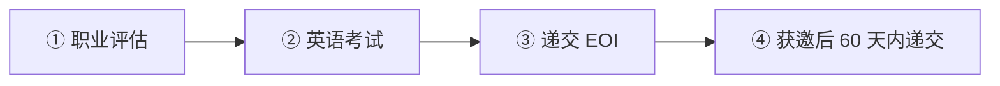
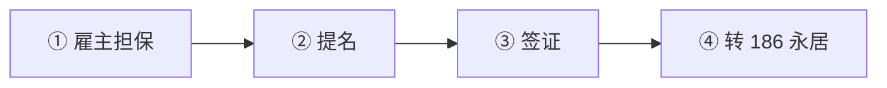

# 🇦🇺 澳大利亚 · Australia

   

**189 独立技术移民 + 482 雇主担保 + 858 杰出人才**

[🧑‍💻 189 独立技术移民](#au-189) · [🧑‍💻 482 紧缺技能签证（Skills in Demand）](#au-482) · [🧑‍💻 858 国家创新签证](#au-858) · [📖 深度解读](#deep)

> [!NOTE]
> 本篇依据 2026-10 对政府页面和公开资料的检索整理，核查深度低于欧洲篇，递交前请回到官方入口核对。

## 🏙️ 生活档案

<table>
<tr><td width="25%" valign="top">💶 生活成本指数（纽约=100） <b>71.4 ●●●○○（中国 30.7）</b></td><td width="25%" valign="top">🏠 房租指数（纽约=100） <b>33.1 ●●●○○（中国 9.5）</b></td><td width="25%" valign="top">🛡️ 安全指数 <b>52.6 ●●○○○（中国 77.0）</b></td><td width="25%" valign="top">🛂 护照免签目的地 <b>182 个（中国 81）</b></td></tr>
<tr><td width="25%" valign="top">入籍 <b>居住 4 年（永居 1 年）</b></td><td width="25%" valign="top">双重国籍 <b>允许（中国不认）</b></td><td width="25%" valign="top">482 门槛 <b>AUD 79,423</b></td><td width="25%" valign="top">投资移民 <b>⛔ 已关闭</b></td></tr>
</table>

数据：Numbeo 2026 年中、Henley Passport Index 2026。● 越多越好。

## 📊 路线速查

| 路线 | 类型 | 一句话 | 状态 |
|---|---|---|:-:|
| [189 独立技术移民](#au-189) | 🧑‍💻 技术工作 | 积分制直接永居，不需要雇主，但实际获邀分数很高。 | 🟢 开放 |
| [482 紧缺技能签证（Skills in Demand）](#au-482) | 🧑‍💻 技术工作 | 雇主担保工签，可转 186 永居。 | 🟢 开放 |
| [858 国家创新签证](#au-858) | 🧑‍💻 技术工作 | 邀请制，需国际认可的杰出成就和澳洲提名人，直接永居。 | 🟢 开放 |

---

## 🧑‍💻 189 独立技术移民

 

> **积分制直接永居，不需要雇主，但实际获邀分数很高。**

<table>
<tr><td width="33%" valign="top">门槛 <b>≥65 分，实际常 75–85+</b></td><td width="33%" valign="top">年龄 <b>45 岁以下</b></td><td width="33%" valign="top">职业 <b>MLTSSL 清单</b></td></tr>
<tr><td width="33%" valign="top">名额 <b>2026–27 年度 21,090</b></td><td width="33%" valign="top">费用 <b>主申请人 AUD 6,135</b></td><td width="33%" valign="top"></td></tr>
</table>

### 🗺️ 申请流程

1. **职业评估**
2. **英语考试**
3. **递交 EOI**
4. **获邀后 60 天内递交**

[↑ 回到顶部](#top)

---

## 🧑‍💻 482 紧缺技能签证（Skills in Demand）

 

> **雇主担保工签，可转 186 永居。**

<table>
<tr><td width="33%" valign="top">核心技能门槛 <b>AUD 79,423（2026-07-01 起）</b></td><td width="33%" valign="top">专家技能门槛 <b>约 AUD 146,576</b></td><td width="33%" valign="top">经验 <b>≥1 年</b></td></tr>
<tr><td width="33%" valign="top">工资 <b>取门槛与市场工资较高者</b></td><td width="33%" valign="top"></td><td width="33%" valign="top"></td></tr>
</table>

### 🗺️ 申请流程

1. **雇主担保**
2. **提名**
3. **签证**
4. **转 186 永居**

[↑ 回到顶部](#top)

---

## 🧑‍💻 858 国家创新签证

 

> **邀请制，需国际认可的杰出成就和澳洲提名人，直接永居。**

<table>
<tr><td width="33%" valign="top">收入 <b>一般需能达高收入门槛（约 AUD 175,000）</b></td><td width="33%" valign="top">提名人 <b>澳洲公民/永居/机构</b></td><td width="33%" valign="top">费用 <b>约 AUD 6,235</b></td></tr>
</table>

[↑ 回到顶部](#top)

---

## 📖 深度解读

### 一句话判断

积分制独立技术移民（189）+ 雇主担保（482/186）+ 杰出人才（858）三条主线。**2024-12 起 482 改名"紧缺技能签证 Skills in Demand"**，2026-07-01 起核心技能收入门槛 **AUD 79,423**。

### 主要路线

| 路线 | 要点 | 2026 关键数字 |
|---|---|---|
| **189 独立技术移民** | 职业在 MLTSSL 清单 + ≥65 分 + 获邀；45 岁以下；直接永居 | 2026–27 年度 21,090 个名额；实际获邀分数常在 75–85+；主申请费 AUD 6,135 |
| 190 / 491 州担保 | 州政府提名，491 为偏远地区临时签 | 各州规则不同 |
| **482 Skills in Demand** | 雇主担保临时工签，可转 186 永居 | 核心技能门槛 **AUD 79,423**；专家技能门槛约 AUD 146,576；≥1 年相关经验 |
| 186 雇主提名永居 | 482 持有人常见的转永居路径 | 同上收入门槛 |
| **858 国家创新签证** | 取代原全球人才签证；邀请制，需国际认可的杰出成就 + 澳洲提名人 | 一般需能达到高收入门槛（约 AUD 175,000）；直接永居 |

- 雇主须支付"CSIT 与市场工资中的较高者"。
- 2025 年起投资移民（188/888 商业创新与投资类）已关闭新申请。

### 入籍

- 一般需在澳居住 4 年（其中永居身份 1 年），允许双重国籍。

### 官方入口

- [Home Affairs 签证总览](https://immi.homeaffairs.gov.au/visas/getting-a-visa/visa-listing) · [SkillSelect](https://immi.homeaffairs.gov.au/visas/working-in-australia/skillselect)

## 🔗 官方入口

- [Home Affairs](https://immi.homeaffairs.gov.au/visas/getting-a-visa/visa-listing)

[← 🇨🇦 加拿大](canada.md) ｜ [🌏 主要移民地区](README.md) ｜ [🏠 首页](../../README.md) ｜ [🇳🇿 新西兰 →](new-zealand.md)

