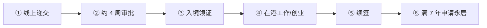

# 🇭🇰 香港 · Hong Kong

   

**无需 offer 的人才计划多，7 年永居；不涉及放弃国籍**

[🧑‍💻 高端人才通行证（高才通）](#hk-ttps) · [🧑‍💻 优秀人才入境计划](#hk-qmas) · [🧑‍💻 非本地毕业生 IANG](#hk-iang) · [📖 深度解读](#deep)

> [!NOTE]
> 本篇依据 2026-10 对政府页面和公开资料的检索整理，核查深度低于欧洲篇，递交前请回到官方入口核对。

## 🏙️ 生活档案

<table>
<tr><td width="25%" valign="top">💶 生活成本指数（纽约=100） <b>76.4 ●●●○○（中国 30.7）</b></td><td width="25%" valign="top">🏠 房租指数（纽约=100） <b>59.1 ●●○○○（中国 9.5）</b></td><td width="25%" valign="top">🛡️ 安全指数 <b>78.2 ●●●●○（中国 77.0）</b></td><td width="25%" valign="top">🛂 护照免签目的地 <b>171 个（中国 81）</b></td></tr>
<tr><td width="25%" valign="top">永居 <b>连续通常居住 7 年</b></td><td width="25%" valign="top">高才通 A <b>年收入 HKD 250 万</b></td><td width="25%" valign="top">高才通 B/C <b>百强大学学历</b></td><td width="25%" valign="top">审批 <b>约 4 周</b></td></tr>
</table>

数据：Numbeo 2026 年中、Henley Passport Index 2026。● 越多越好。

## 📊 路线速查

| 路线 | 类型 | 一句话 | 状态 |
|---|---|---|:-:|
| [高端人才通行证（高才通）](#hk-ttps) | 🧑‍💻 技术工作 | 高收入或名校毕业即可申请，无需工作 offer。 | 🟢 开放 |
| [优秀人才入境计划](#hk-qmas) | 🧑‍💻 技术工作 | 积分制，无需 offer。 | 🟢 开放 |
| [非本地毕业生 IANG](#hk-iang) | 🧑‍💻 技术工作 | 香港高校毕业生首签 24 个月，可自由就业。 | 🟢 开放 |

---

## 🧑‍💻 高端人才通行证（高才通）

 

> **高收入或名校毕业即可申请，无需工作 offer。**

<table>
<tr><td width="33%" valign="top">A 类 <b>上年收入 ≥ HKD 250 万，首签 3 年</b></td><td width="33%" valign="top">B 类 <b>指定大学本科 + 近 5 年 3 年经验，2 年</b></td><td width="33%" valign="top">C 类 <b>指定大学近 5 年毕业，每年 1 万名额</b></td></tr>
<tr><td width="33%" valign="top">费用 <b>HKD 600 + 1,300/人</b></td><td width="33%" valign="top">续签 <b>需有工作或业务</b></td><td width="33%" valign="top"></td></tr>
</table>

<table><tr>
<td width="50%" valign="top">✅ <b>适合</b><ul><li>名校毕业的内地人才</li></ul></td>
<td width="50%" valign="top">❌ <b>不适合</b><ul><li>续签时没有在港工作</li></ul></td>
</tr></table>

### 🗺️ 申请流程

1. **线上递交**
2. **约 4 周审批**
3. **入境领证**
4. **在港工作/创业**
5. **续签**
6. **满 7 年申请永居**

> [!WARNING]
> **注意**
> - 2026 起续签核查社保和税表

[↑ 回到顶部](#top)

---

## 🧑‍💻 优秀人才入境计划

 

> **积分制，无需 offer。**

<table>
<tr><td width="33%" valign="top">方式 <b>综合计分</b></td><td width="33%" valign="top"></td><td width="33%" valign="top"></td></tr>
</table>

[↑ 回到顶部](#top)

---

## 🧑‍💻 非本地毕业生 IANG

 

> **香港高校毕业生首签 24 个月，可自由就业。**

<table>
<tr><td width="33%" valign="top">首签 <b>24 个月</b></td><td width="33%" valign="top">配额 <b>无</b></td><td width="33%" valign="top"></td></tr>
</table>

[↑ 回到顶部](#top)

---

## 📖 深度解读

### 一句话判断

对中国大陆居民来说**门槛最低、最近的"出境"选项**之一：多条人才计划不需要雇主 offer，**连续通常居住 7 年可申请永久居民**。注意：香港属于中国，取得香港永居不涉及放弃国籍。

| 计划 | 要点 |
|---|---|
| **高端人才通行证（TTPS）** | A 类：上一年应税收入 ≥ HKD 250 万；B 类：全球指定约 200 所大学本科 + 近 5 年内 3 年工作经验；C 类：上述大学近 5 年毕业、经验不足 3 年（**每年 1 万名额**）；A 类首签 3 年，B/C 类 2 年；**无需工作 offer**，续签时需有工作或业务；约 4 周审批；费用 HKD 600 + 每人 1,300 |
| 优秀人才入境计划（QMAS） | 积分制，无需 offer；配额政策近年调整，以入境处为准 |
| 内地人才计划（ASMTP） | 内地居民，需香港雇主 offer，首签 3 年或合同期 |
| 非本地毕业生（IANG） | 香港全日制本科及以上毕业，首签 24 个月，可自由就业，无配额；已扩展到港校大湾区校区毕业生 |
| 投资：新资本投资者入境计划 | 投资获许金融资产及房产，金额以入境处为准 |

- **永久居民**：以上身份连续通常居住满 7 年可申请。
- 2026 年起 TTPS 续签审核趋严（第三方学历认证、工作经历核查社保和税表）。

### 官方入口

- [香港入境事务处 人才入境计划](https://www.immd.gov.hk/hks/useful_information/admission-schemes-talents-professionals-entrepreneurs.html) · [香港人才服务办公室](https://www.hkengage.gov.hk/)

## 🔗 官方入口

- [入境事务处](https://www.immd.gov.hk/hks/useful_information/admission-schemes-talents-professionals-entrepreneurs.html)

[← 🇸🇬 新加坡](singapore.md) ｜ [🌏 主要移民地区](README.md) ｜ [🏠 首页](../../README.md) ｜ [🇵🇭 菲律宾 →](philippines.md)

