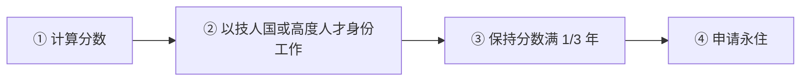

# 🇯🇵 日本 · Japan

   

**高度人才 80 分 1 年永住；经营管理签证涨到 3,000 万日元**

[🧑‍💻 高度专门职（高度人才）](#jp-hsp) · [🚀 经营管理签证](#jp-bm) · [🧑‍💻 技术·人文知识·国际业务](#jp-gjk) · [📖 深度解读](#deep)

> [!NOTE]
> 本篇依据 2026-10 对政府页面和公开资料的检索整理，核查深度低于欧洲篇，递交前请回到官方入口核对。

## 🏙️ 生活档案

<table>
<tr><td width="25%" valign="top">💶 生活成本指数（纽约=100） <b>47.6 ●●●●○（中国 30.7）</b></td><td width="25%" valign="top">🏠 房租指数（纽约=100） <b>13.6 ●●●●●（中国 9.5）</b></td><td width="25%" valign="top">🛡️ 安全指数 <b>77.8 ●●●●○（中国 77.0）</b></td><td width="25%" valign="top">🛂 护照免签目的地 <b>188 个（中国 81）</b></td></tr>
<tr><td width="25%" valign="top">最快永住 <b>1 年（80 分）</b></td><td width="25%" valign="top">双重国籍 <b>❌ 不允许</b></td><td width="25%" valign="top">经管签资本 <b>¥30,000,000</b></td><td width="25%" valign="top">数字游民 <b>中国护照不适用</b></td></tr>
</table>

数据：Numbeo 2026 年中、Henley Passport Index 2026。● 越多越好。

## 📊 路线速查

| 路线 | 类型 | 一句话 | 状态 |
|---|---|---|:-:|
| [高度专门职（高度人才）](#jp-hsp) | 🧑‍💻 技术工作 | 按学历、年收入、年龄、日语打分，70 分 3 年、80 分 1 年可申请永住。 | 🟢 开放 |
| [经营管理签证](#jp-bm) | 🚀 创业 | 2025-10-16 新规后门槛提高约 6 倍。 | 🟢 开放 |
| [技术·人文知识·国际业务](#jp-gjk) | 🧑‍💻 技术工作 | 最常见的工作签证，大学学历或 10 年经验 + 日本雇主。 | 🟢 开放 |

---

## 🧑‍💻 高度专门职（高度人才）

 

> **按学历、年收入、年龄、日语打分，70 分 3 年、80 分 1 年可申请永住。**

<table>
<tr><td width="33%" valign="top">70 分 <b>3 年申请永住</b></td><td width="33%" valign="top">80 分 <b>1 年申请永住</b></td><td width="33%" valign="top">J-Skip <b>高收入/高学历直接认定</b></td></tr>
<tr><td width="33%" valign="top">审查重点 <b>纳税、年金、健康保险</b></td><td width="33%" valign="top"></td><td width="33%" valign="top"></td></tr>
</table>

<table><tr>
<td width="50%" valign="top">✅ <b>适合</b><ul><li>硕博学历、年收入较高的技术人员</li></ul></td>
<td width="50%" valign="top">❌ <b>不适合</b><ul><li>社保年金缴纳不全</li></ul></td>
</tr></table>

### 🗺️ 申请流程

1. **计算分数** — 入管厅积分表
2. **以技人国或高度人才身份工作**
3. **保持分数满 1/3 年**
4. **申请永住**

> [!WARNING]
> **注意**
> - 2026-10-01 起永住要求和手续费有调整

[↑ 回到顶部](#top)

---

## 🚀 经营管理签证

 

> **2025-10-16 新规后门槛提高约 6 倍。**

<table>
<tr><td width="33%" valign="top">资本金 <b>¥30,000,000（原 500 万）</b></td><td width="33%" valign="top">员工 <b>至少 1 名全职</b></td><td width="33%" valign="top">经验 <b>3 年管理经验或相关学历</b></td></tr>
<tr><td width="33%" valign="top">日语 <b>本人或员工 N2/B2</b></td><td width="33%" valign="top">办公 <b>原则上不可住宅办公</b></td><td width="33%" valign="top">过渡 <b>既有持有人至 2028-10</b></td></tr>
</table>

[↑ 回到顶部](#top)

---

## 🧑‍💻 技术·人文知识·国际业务

 

> **最常见的工作签证，大学学历或 10 年经验 + 日本雇主。**

<table>
<tr><td width="33%" valign="top">学历 <b>大学或 10 年经验</b></td><td width="33%" valign="top">雇主 <b>日本公司</b></td><td width="33%" valign="top"></td></tr>
</table>

[↑ 回到顶部](#top)

---

## 📖 深度解读

### 一句话判断

离中国近、文化接受度高、**高度人才积分 80 分 1 年就能申请永住**，是程序员"润日"的热门目的地。但**经营管理签证 2025-10-16 起资本金涨到 3,000 万日元**，"开公司拿签证"的低门槛时代结束；数字游民签证**不适用中国护照**。

### 主要路线

| 路线 | 要点 |
|---|---|
| **技术·人文知识·国际业务（技人国）** | 最常见的工作签证，大学学历或 10 年经验 + 日本雇主 |
| **高度专门职（高度人才）** | 学历、年收入、年龄、日语等打分；**70 分 3 年、80 分 1 年**可申请永住（需证明打分在整个期间都维持）；无需先转高度人才身份也可按分数申请永住 |
| J-Skip 特别高度人才 | 高收入/高学历直接认定，享受 1 年永住快速通道 |
| **经营管理签证** | 2025-10-16 新规：资本金 **¥30,000,000**（原 500 万）+ 雇 1 名全职员工 + 3 年管理经验或相关学历 + 日语 N2/B2（本人或员工）+ 专家审核商业计划 + 原则上不可住宅办公；既有持有人有 3 年过渡期至 2028-10 |
| 数字游民（特定活动） | 年收入 ¥10,000,000，6 个月不可续；**仅限对日免签且有税收协定的 51 个国家/地区，中国大陆护照不在内** |
| 留学 → 就职 | 日本语言学校/大学毕业后转工作签证 |

- 2026-10-01 起永住审查要求和手续费有调整；纳税、年金、健康保险缴纳记录是永住审查重点。
- 日本**不允许双重国籍**，归化需放弃原国籍。

### 官方入口

- [出入国在留管理厅](https://www.moj.go.jp/isa/) · [高度人才积分表](https://www.moj.go.jp/isa/applications/resources/newimmiact_3_index.html)

## 🔗 官方入口

- [出入国在留管理厅](https://www.moj.go.jp/isa/)

[← 🇳🇿 新西兰](new-zealand.md) ｜ [🌏 主要移民地区](README.md) ｜ [🏠 首页](../../README.md) ｜ [🇰🇷 韩国 →](south-korea.md)

