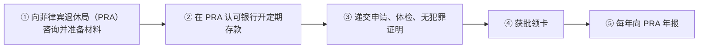

# 🇵🇭 菲律宾 · Philippines

   

**退休签证 SRRV 2025 年降到 40 岁起；投资签证 SIRV 7.5 万美元**

[🏖️ SRRV 特别退休居留签证](#ph-srrv) · [💰 SIRV 特别投资者居留签证](#ph-sirv) · [📖 深度解读](#deep)

> [!NOTE]
> 本篇依据 2026-10 对政府页面和公开资料的检索整理，核查深度低于欧洲篇，递交前请回到官方入口核对。

## 🏙️ 生活档案

<table>
<tr><td width="25%" valign="top">💶 生活成本指数（纽约=100） <b>29.1 ●●●●●（中国 30.7）</b></td><td width="25%" valign="top">🏠 房租指数（纽约=100） <b>7.2 ●●●●●（中国 9.5）</b></td><td width="25%" valign="top">🛡️ 安全指数 <b>56.6 ●●○○○（中国 77.0）</b></td><td width="25%" valign="top">🛂 护照免签目的地 <b>64 个（中国 81）</b></td></tr>
<tr><td width="25%" valign="top">SRRV 年龄 <b>40 岁起（2025-09 新规）</b></td><td width="25%" valign="top">SRRV 存款 <b>USD 15,000 起</b></td><td width="25%" valign="top">SIRV 投资 <b>USD 75,000</b></td><td width="25%" valign="top">英语 <b>官方语言之一</b></td></tr>
</table>

数据：Numbeo 2026 年中、Henley Passport Index 2026。● 越多越好。

## 📊 路线速查

| 路线 | 类型 | 一句话 | 状态 |
|---|---|---|:-:|
| [SRRV 特别退休居留签证](#ph-srrv) | 🏖️ 被动收入居留 | 在菲律宾指定银行存一笔定期存款即可获得可无限期居留的退休签证，2025 年起 40 岁就能申请。 | 🟢 开放 |
| [SIRV 特别投资者居留签证](#ph-sirv) | 💰 投资居留 | 投资 7.5 万美元于菲律宾合格企业或证券，获得可无限期居留的投资者签证。 | 🟢 开放 |

---

## 🏖️ SRRV 特别退休居留签证

 

> **在菲律宾指定银行存一笔定期存款即可获得可无限期居留的退休签证，2025 年起 40 岁就能申请。**

<table>
<tr><td width="33%" valign="top">年龄 <b>≥40 岁（2025-09 起，原为 50 岁）</b></td><td width="33%" valign="top">50 岁以上存款 <b>有养老金 USD 15,000 / 无养老金 USD 30,000</b></td><td width="33%" valign="top">40–49 岁存款 <b>有养老金 USD 25,000 / 无养老金 USD 50,000</b></td></tr>
<tr><td width="33%" valign="top">养老金标准 <b>单人终身养老金 ≥ USD 800/月</b></td><td width="33%" valign="top">存款性质 <b>本人名下定期存款，不是费用</b></td><td width="33%" valign="top">类别 <b>仅剩 Classic 和 Courtesy</b></td></tr>
</table>

<table><tr>
<td width="50%" valign="top">✅ <b>适合</b><ul><li>想在东南亚养老、预算有限的人</li><li>有稳定养老金的退休人士</li></ul></td>
<td width="50%" valign="top">❌ <b>不适合</b><ul><li>需要在菲律宾工作（需另办工作许可）</li></ul></td>
</tr></table>

### 🗺️ 申请流程

1. **向菲律宾退休局（PRA）咨询并准备材料**
2. **在 PRA 认可银行开定期存款**
3. **递交申请、体检、无犯罪证明**
4. **获批领卡**
5. **每年向 PRA 年报**

### 📋 材料清单

- [ ] 护照
- [ ] 无犯罪证明
- [ ] 体检报告
- [ ] 养老金证明（如适用）
- [ ] 存款证明

> [!WARNING]
> **注意**
> - 网上很多页面仍写'50 岁、USD 20,000'的旧规则
> - 以 PRA 官网公布的金额为准

[↑ 回到顶部](#top)

---

## 💰 SIRV 特别投资者居留签证

 

> **投资 7.5 万美元于菲律宾合格企业或证券，获得可无限期居留的投资者签证。**

<table>
<tr><td width="33%" valign="top">投资额 <b>≥ USD 75,000</b></td><td width="33%" valign="top">年龄 <b>21 岁起</b></td><td width="33%" valign="top">流程 <b>先 6 个月试用签证，资金先存入 DBP 或 Land Bank 比索定存，再转为合格投资</b></td></tr>
<tr><td width="33%" valign="top">不可投资 <b>公寓、批发贸易、零售（含餐馆）</b></td><td width="33%" valign="top">维持 <b>每年向投资署（BOI）年报，投资不得低于 7.5 万美元</b></td><td width="33%" valign="top"></td></tr>
</table>

<table><tr>
<td width="50%" valign="top">✅ <b>适合</b><ul><li>想在菲律宾长期居住的投资者</li></ul></td>
<td width="50%" valign="top">❌ <b>不适合</b><ul><li>想买公寓拿签证</li></ul></td>
</tr></table>

### 🗺️ 申请流程

1. **汇入 7.5 万美元至指定银行**
2. **申请 6 个月试用签证**
3. **180 天内转为合格投资并报 BOI**
4. **获正式 SIRV**
5. **每年年报**

> [!WARNING]
> **注意**
> - 不报年报或投资低于门槛会被自动取消签证

[↑ 回到顶部](#top)

---

## 📖 深度解读

### 一句话判断

离中国近、英语通用、生活成本低（Numbeo 生活成本指数 29.1，略低于中国的 30.7），**退休签证 SRRV 在 2025 年 9 月改革后降到 40 岁起**，是东南亚门槛最低的长期居留之一。

### 主要路线

| 路线 | 要点 |
|---|---|
| **SRRV 特别退休居留** | 40 岁起；50 岁以上存 USD 15,000（有养老金）或 30,000；40–49 岁 25,000 / 50,000；可无限期居留 |
| **SIRV 特别投资者居留** | 投资 USD 75,000 于合格企业或证券，不能是公寓或零售；可无限期居留 |
| 9(g) 工作签证 | 菲律宾雇主担保，需外国人就业许可（AEP） |
| 13(a) 婚姻签证 | 与菲律宾公民结婚 |

### 注意
- 菲律宾不允许外国人拥有土地，外国人可购买公寓（外资比例上限 40%）。
- 安全状况因地区差异大（Numbeo 安全指数 56.6）。
- 护照免签目的地 64 个，不如中国护照，但菲律宾长期居留身份不涉及入籍。

## 🔗 官方入口

- [菲律宾退休局 PRA](https://pra.gov.ph/)
- [菲律宾投资署 BOI](https://boi.gov.ph/)

[← 🇭🇰 香港](hong-kong.md) ｜ [🌏 主要移民地区](README.md) ｜ [🏠 首页](../../README.md) ｜ [🇹🇭 泰国 →](thailand.md)

