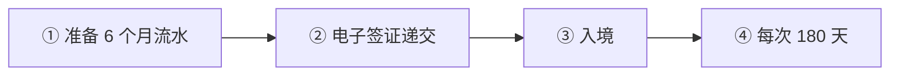

# 🇹🇭 泰国 · Thailand

  

**DTV 5 年多次入境，存款 50 万泰铢即可**

[💻 DTV 目的地泰国签证](#th-dtv) · [🧑‍💻 LTR 长期居留签证](#th-ltr) · [📖 深度解读](#deep)

> [!NOTE]
> 本篇依据 2026-10 对政府页面和公开资料的检索整理，核查深度低于欧洲篇，递交前请回到官方入口核对。

## 🏙️ 生活档案

<table>
<tr><td width="25%" valign="top">💶 生活成本指数（纽约=100） <b>36.8 ●●●●●（中国 30.7）</b></td><td width="25%" valign="top">🏠 房租指数（纽约=100） <b>12.8 ●●●●●（中国 9.5）</b></td><td width="25%" valign="top">🛡️ 安全指数 <b>63.6 ●●●○○（中国 77.0）</b></td><td width="25%" valign="top">🛂 护照免签目的地 <b>79 个（中国 81）</b></td></tr>
<tr><td width="25%" valign="top">DTV 存款 <b>THB 500,000</b></td><td width="25%" valign="top">每次停留 <b>180 天 + 延 180</b></td><td width="25%" valign="top">签证费 <b>THB 10,000</b></td><td width="25%" valign="top"></td></tr>
</table>

数据：Numbeo 2026 年中、Henley Passport Index 2026。● 越多越好。

## 📊 路线速查

| 路线 | 类型 | 一句话 | 状态 |
|---|---|---|:-:|
| [DTV 目的地泰国签证](#th-dtv) | 💻 数字游民 | 远程工作者和软实力活动参与者的 5 年多次入境签证。 | 🟢 开放 |
| [LTR 长期居留签证](#th-ltr) | 🧑‍💻 技术工作 | 10 年签，面向富裕人士、退休、远程专业人士、高技能人才。 | 🟢 开放 |

---

## 💻 DTV 目的地泰国签证

 

> **远程工作者和软实力活动参与者的 5 年多次入境签证。**

<table>
<tr><td width="33%" valign="top">存款 <b>THB 500,000，持有约 3 个月</b></td><td width="33%" valign="top">期限 <b>5 年多次入境</b></td><td width="33%" valign="top">每次停留 <b>180 天，可境内延 180 天</b></td></tr>
<tr><td width="33%" valign="top">费用 <b>THB 10,000</b></td><td width="33%" valign="top">年龄 <b>20 岁以上</b></td><td width="33%" valign="top"></td></tr>
</table>

<table><tr>
<td width="50%" valign="top">✅ <b>适合</b><ul><li>想在东南亚长住的远程工作者</li></ul></td>
<td width="50%" valign="top">❌ <b>不适合</b><ul><li>想为泰国公司工作</li></ul></td>
</tr></table>

### 🗺️ 申请流程

1. **准备 6 个月流水**
2. **电子签证递交** — 境外
3. **入境**
4. **每次 180 天**

### 📋 材料清单

- [ ] 护照
- [ ] 照片
- [ ] 银行流水
- [ ] 雇佣合同或作品集
- [ ] 无犯罪证明

> [!WARNING]
> **注意**
> - 加密货币不算存款
> - 汇入泰国的境外收入可能要纳税

[↑ 回到顶部](#top)

---

## 🧑‍💻 LTR 长期居留签证

 

> **10 年签，面向富裕人士、退休、远程专业人士、高技能人才。**

<table>
<tr><td width="33%" valign="top">期限 <b>10 年</b></td><td width="33%" valign="top"></td><td width="33%" valign="top"></td></tr>
</table>

[↑ 回到顶部](#top)

---

## 📖 深度解读

| 路线 | 要点 |
|---|---|
| **DTV 目的地泰国签证** | 面向远程工作者（境外雇主/客户）和"软实力"活动（泰拳、烹饪课等，语言学校已不算）；**5 年多次入境，每次停留 180 天，可在境内延期 180 天一次**；须有 **THB 500,000** 存款（多数使馆要求约 3 个月持续持有，6 个月流水），加密货币不算；签证费 THB 10,000（各使馆按当地币种收）；20 岁以上；**不能为泰国公司工作**；2025 起只接受电子签证申请，须在境外递交 |
| LTR 长期居留签证 | 面向富裕人士、退休人员、远程工作专业人士、高技能人才，10 年，有收入/资产门槛 |
| 退休签证（O-A/O-X） | 50 岁以上，有存款/收入要求 |
| 泰国精英签证（Thailand Privilege） | 付费会员制长期签证，5–20 年 |

- 泰国税务居民（一年 >180 天）汇入泰国的境外收入可能需要纳税，2024 年起规则收紧，需专业意见。

### 官方入口

- [泰国电子签证官网](https://www.thaievisa.go.th/) · [LTR 签证](https://ltr.boi.go.th/)

## 🔗 官方入口

- [泰国电子签证](https://www.thaievisa.go.th/)

[← 🇵🇭 菲律宾](philippines.md) ｜ [🌏 主要移民地区](README.md) ｜ [🏠 首页](../../README.md) ｜ [🇲🇾 马来西亚 →](malaysia.md)

