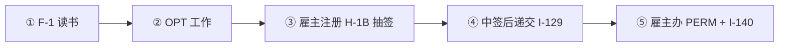
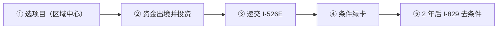

# 🇺🇸 美国 · United States

   

**机会最大，但中国大陆出生的职业移民排期最长**

[🧑‍💻 F-1 留学 → OPT → H-1B](#us-h1b) · [🧑‍💻 EB-1A 杰出人才 / EB-2 NIW 国家利益豁免](#us-eb1a-niw) · [💰 EB-5 投资移民](#us-eb5) · [📖 深度解读](#deep)

> [!NOTE]
> 本篇依据 2026-10 对政府页面和公开资料的检索整理，核查深度低于欧洲篇，递交前请回到官方入口核对。

## 🏙️ 生活档案

<table>
<tr><td width="25%" valign="top">💶 生活成本指数（纽约=100） <b>69.7 ●●●○○（中国 30.7）</b></td><td width="25%" valign="top">🏠 房租指数（纽约=100） <b>37.1 ●●●○○（中国 9.5）</b></td><td width="25%" valign="top">🛡️ 安全指数 <b>50.8 ●●○○○（中国 77.0）</b></td><td width="25%" valign="top">🛂 护照免签目的地 <b>179 个（中国 81）</b></td></tr>
<tr><td width="25%" valign="top">绿卡排队 <b>EB-2 中国排到 2021-10</b></td><td width="25%" valign="top">入籍 <b>绿卡 5 年</b></td><td width="25%" valign="top">双重国籍 <b>允许（中国不认）</b></td><td width="25%" valign="top">税务 <b>公民/绿卡全球征税</b></td></tr>
</table>

数据：Numbeo 2026 年中、Henley Passport Index 2026。● 越多越好。

## 📊 路线速查

| 路线 | 类型 | 一句话 | 状态 |
|---|---|---|:-:|
| [F-1 留学 → OPT → H-1B](#us-h1b) | 🧑‍💻 技术工作 | 最常见的路径：读书 → 实习工作 → 抽签拿工作签证 → 雇主办绿卡。 | 🟢 开放 |
| [EB-1A 杰出人才 / EB-2 NIW 国家利益豁免](#us-eb1a-niw) | 🧑‍💻 技术工作 | 不需要雇主，自己申请绿卡；科研人员和高成就专业人士的主要途径。 | 🟢 开放 |
| [EB-5 投资移民](#us-eb5) | 💰 投资居留 | 投资 80 万美元（TEA 区域）直接申请绿卡，乡村预留名额可绕开中国排期。 | 🟢 开放 |

---

## 🧑‍💻 F-1 留学 → OPT → H-1B

 

> **最常见的路径：读书 → 实习工作 → 抽签拿工作签证 → 雇主办绿卡。**

<table>
<tr><td width="33%" valign="top">OPT <b>毕业后 1 年，STEM 专业共 3 年</b></td><td width="33%" valign="top">H-1B 抽签 <b>2026-02 起按工资等级加权（Level IV 4 次机会）</b></td><td width="33%" valign="top">FY2027 名额 <b>已满</b></td></tr>
<tr><td width="33%" valign="top">10 万美元附加费 <b>2026-09-30 被法院禁止执行，政府上诉中</b></td><td width="33%" valign="top">期限 <b>3 年 + 3 年</b></td><td width="33%" valign="top"></td></tr>
</table>

<table><tr>
<td width="50%" valign="top">✅ <b>适合</b><ul><li>在美读 STEM 硕博</li><li>能拿到较高工资等级 offer</li></ul></td>
<td width="50%" valign="top">❌ <b>不适合</b><ul><li>工资处于 Level I</li><li>人在境外首次申请（附加费风险）</li></ul></td>
</tr></table>

### 🗺️ 申请流程

1. **F-1 读书**
2. **OPT 工作** — STEM 可延至 3 年
3. **雇主注册 H-1B 抽签** — 每年 3 月
4. **中签后递交 I-129**
5. **雇主办 PERM + I-140** — 转绿卡

> [!WARNING]
> **注意**
> - F-1 境内转 H-1B 不适用 10 万美元附加费

[↑ 回到顶部](#top)

---

## 🧑‍💻 EB-1A 杰出人才 / EB-2 NIW 国家利益豁免

 

> **不需要雇主，自己申请绿卡；科研人员和高成就专业人士的主要途径。**

<table>
<tr><td width="33%" valign="top">EB-1A 中国排期 <b>FAD 2023-08-01（2026-11）</b></td><td width="33%" valign="top">EB-2 中国排期 <b>FAD 2021-10-01；递交日期 2023-01-01</b></td><td width="33%" valign="top">雇主 <b>不需要</b></td></tr>
<tr><td width="33%" valign="top">证明 <b>EB-1A 领域顶尖；NIW 对美国有国家利益</b></td><td width="33%" valign="top"></td><td width="33%" valign="top"></td></tr>
</table>

<table><tr>
<td width="50%" valign="top">✅ <b>适合</b><ul><li>论文、专利、奖项、媒体报道丰富的人</li></ul></td>
<td width="50%" valign="top">❌ <b>不适合</b><ul><li>指望很快拿绿卡的中国出生申请人</li></ul></td>
</tr></table>

### 🗺️ 申请流程

1. **整理成就证据** — 论文引用、推荐信、奖项
2. **递交 I-140** — 可加急
3. **等待排期** — 看 Visa Bulletin
4. **I-485 或领馆办理**

> [!WARNING]
> **注意**
> - NIW 不能降级到 EB-3（需 PERM）
> - '金卡'本质也是 EB-1/NIW，同样受中国排期约束

[↑ 回到顶部](#top)

---

## 💰 EB-5 投资移民

 

> **投资 80 万美元（TEA 区域）直接申请绿卡，乡村预留名额可绕开中国排期。**

<table>
<tr><td width="33%" valign="top">TEA 区域 <b>USD 800,000</b></td><td width="33%" valign="top">非 TEA <b>USD 1,050,000</b></td><td width="33%" valign="top">额外费用 <b>区域中心费约 USD 80,000 + 律师费 2.5–3.5 万</b></td></tr>
<tr><td width="33%" valign="top">2027-01-01 <b>按通胀上调（预计 TEA 约 90 万以上）</b></td><td width="33%" valign="top">结果 <b>条件绿卡 → 正式绿卡</b></td><td width="33%" valign="top"></td></tr>
</table>

<table><tr>
<td width="50%" valign="top">✅ <b>适合</b><ul><li>资金充足、来源清晰</li></ul></td>
<td width="50%" valign="top">❌ <b>不适合</b><ul><li>资金无法合规出境</li></ul></td>
</tr></table>

### 🗺️ 申请流程

1. **选项目（区域中心）** — 尽调
2. **资金出境并投资**
3. **递交 I-526E**
4. **条件绿卡**
5. **2 年后 I-829 去条件**

> [!WARNING]
> **注意**
> - 递交日锁定投资额，2026 年底前递交仍按 80 万

[↑ 回到顶部](#top)

---

## 📖 深度解读

### 一句话判断

最大的科技和学术市场，但**排期是中国大陆出生申请人的最大障碍**：职业移民绿卡按出生地排队，EB-2/NIW 中国 Final Action Date 仍停在 2021 年。H-1B 已改为**按工资加权抽签**，"10 万美元附加费"目前被法院阻止执行。

### 主要路线

| 路线 | 要点 | 现状（2026-10） |
|---|---|---|
| **F-1 留学 → OPT → H-1B** | 最常见路径；STEM 专业 OPT 共 3 年 | H-1B 2026-02-27 起按工资等级加权抽签（Level IV 4 次机会 … Level I 1 次）；FY2027 名额已满 |
| H-1B "10 万美元费" | 2025-09-19 总统公告，针对境外受益人 | 2026-09-30 加州联邦法院禁止执行，政府已上诉；另有 DHS 提议的新费用尚未生效 |
| **EB-1A 杰出人才** | 自行申请，无需雇主；证明在领域内顶尖 | 中国 FAD 2023-08-01（2026-11 排期表） |
| **EB-2 NIW 国家利益豁免** | 硕士/杰出能力 + 对美国有国家利益，无需雇主 | 中国 FAD 2021-10-01，Dates for Filing 2023-01-01 |
| **O-1 杰出人才工作签证** | 非移民，可续，常与 EB-1A 配合 | 无排期 |
| **EB-5 投资移民** | TEA 地区 USD 800,000 / 非 TEA 1,050,000，另有区域中心费、律师费 | 2027-01-01 按通胀调整（预计 TEA 约 90 万+）；乡村预留名额可绕开中国排期 |
| "金卡"（Gold Card） | 个人 USD 100 万 / 企业 200 万 + USD 15,000 手续费，本质上是 EB-1/EB-2 NIW 的加速证据 | 截至 2026 年中仅 1 例获批，**仍受中国排期约束**，有诉讼待决 |
| E-2 条约投资者 | — | **中国公民不适用** |

### 入籍与税务

- 绿卡满 5 年（与美国公民结婚 3 年）可申请入籍。
- **绿卡持有人和公民都需就全球收入向美国报税**，这是很多人忽略的长期成本。

### 官方入口

- [USCIS](https://www.uscis.gov/) · [国务院排期表 Visa Bulletin](https://travel.state.gov/content/travel/en/legal/visa-law0/visa-bulletin.html) · [EB-5](https://www.uscis.gov/working-in-the-united-states/permanent-workers/eb-5-immigrant-investor-program)

## 🔗 官方入口

- [USCIS](https://www.uscis.gov/)
- [Visa Bulletin 排期表](https://travel.state.gov/content/travel/en/legal/visa-law0/visa-bulletin.html)

[← 🌎 拉丁美洲](latin-america.md) ｜ [🌏 主要移民地区](README.md) ｜ [🏠 首页](../../README.md) ｜ [🇨🇦 加拿大 →](canada.md)

