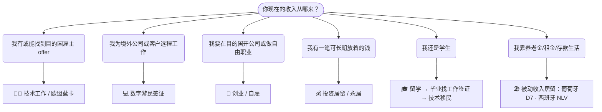

# 🧭 我该走哪条路？

四步判断：收入来源 → 目标 → 护照限制 → 自检

[🏠 首页](../../README.md) ｜ [🇪🇺 欧洲 36 国](../europe/README.md) ｜ [🌏 主要移民地区](../global/README.md)

## 第一步：你属于哪种人？

直达：[技术工作](skilled-work.md) · [数字游民](digital-nomad.md) · [留学转移民](study-to-work.md) · [创业自雇](startup-self-employed.md) · [被动收入](passive-income.md) · [投资居留](investment.md)

## 第二步：你的目标是什么？

| 目标 | 关键指标 | 推荐优先看 |
|---|---|---|
| 先出去住 1–2 年试试 | 门槛低、手续快 | 西班牙 / 阿尔巴尼亚 / 黑山 / 泰国 DTV / 马来西亚 DE Rantau |
| 尽快拿永居 | 永居年限 | 德国蓝卡（21 个月）、奥地利（21 个月转 Plus 卡）、日本高度人才 80 分（1 年）、塞浦路斯/马耳他投资永居（直接） |
| 最终拿护照 | 入籍年限 + 是否允许双重国籍 | 加拿大（3 年/5 年）、澳大利亚（4 年）、德国（5 年）、美国（5 年）；葡萄牙已改为 10 年 |
| 全家一起走 | 家属能否同时申请、配偶能否工作 | 蓝卡类、法国人才护照、荷兰 HSM、斯洛文尼亚数字游民 |
| 尽量少住也保身份 | 最低居住要求 | 葡萄牙 ARI（每 2 年 14 天）、希腊黄金签证（无）、马耳他 MPRP（无） |
| 低税 | 个税/特殊税制 | 阿联酋、塞浦路斯、马耳他、保加利亚（10%）、意大利统一税（富裕人士） |
| 英语环境 | 官方/工作语言 | 爱尔兰、马耳他、英国、荷兰（英语普及）、新加坡、澳新加 |

## 第三步：排除不适用中国大陆护照的路线

| 路线 | 原因 |
|---|---|
| 🇨🇿 捷克 Digital Nomad Program | 国籍名单不含中国大陆 |
| 🇯🇵 日本数字游民签证 | 需对日免签 + 税收协定国 |
| 🇱🇻 拉脱维亚远程工作签证 | 雇主须在 OECD 国家（中国公司不行） |
| 🇲🇪 黑山 70g 投资居留 | 仅限欧盟公民 |
| 🇵🇦 巴拿马友好国家签证 | 中国不在名单 |
| 🇺🇸 E-2 条约投资者 | 中美无相关条约 |
| 🇳🇱 荷美友好条约路线 | 仅限美国（及日本条约路线） |

## 第四步：做个可行性自检

- [ ] 我的收入/资金是否**稳定超过门槛 20% 以上**？（汇率和年度调整会吃掉余量）
- [ ] 收入证明能否覆盖要求的 3–6 个月？
- [ ] 学历、无犯罪、婚姻、出生文件能否在 1–2 个月内办好公证和附加证明书？
- [ ] 我是否理解了**税务居民**和**社保**后果？（见 [税务居民入门](../practical/tax-residency.md)）
- [ ] 这条路线的**下一步**是什么？到期后能续、能转、还是必须离开？
- [ ] 我是否核对了**官方页面**而不是只看中介或本手册？
