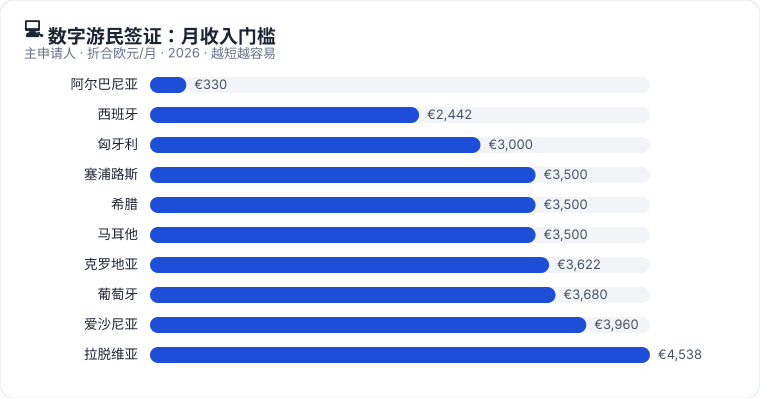

# 💻 数字游民 / 远程工作签证

**收入来自境外雇主或客户的远程员工和自由职业者**：换个国家生活，不是"移民捷径"

[🏠 首页](../../README.md) ｜ [🇪🇺 欧洲 36 国](../europe/README.md) ｜ [🧭 选路线](choose-route.md)

## 先搞懂三件事

1. **数字游民签证 ≠ 移民**。多数是 1–2 年的临时居留，部分国家有封顶（克罗地亚 18 个月、马耳他 4 年、爱沙尼亚 548/730 天），封顶后要离开或换别的身份。只有少数（葡萄牙、西班牙、希腊、意大利、黑山等）在续签后可能累积到永居年限。
2. **雇主所在地很关键**。几乎所有国家都要求雇主/客户在**目的国以外**；拉脱维亚要求必须在 **OECD 国家**；捷克的计划**不接受中国大陆护照**。用中国公司发工资的，先确认目标国家接受。
3. **签证不是税务裁定**。在一个国家住满 183 天左右通常就成为当地税务居民，全球收入可能要在当地纳税。克罗地亚、黑山对境外工作收入有免税规定，其他国家大多没有。

## 欧洲数字游民路线一览（自动生成自 [data/programmes.csv](../../data/programmes.csv)）

<!-- AUTO:table -->
| 国家 | 路线 | 一句话 | 门槛信号 | 家属 | 永居 | 状态 |
|---|---|---|---|:-:|:-:|:-:|
| 🇦🇱 阿尔巴尼亚 | [阿尔巴尼亚数字移动工作者统一许可](../europe/albania.md#albania-digital-mobile-worker-unique-permit) | 欧洲门槛最低的数字游民许可：月入约 €330 或存款约 €3,100 即可。 | ALL 32,000/月 | ✅ 可带 | ✅ 可能 | 🟢 开放 |
| 🇪🇸 西班牙 | [西班牙数字游民签证](../europe/spain.md#spain-digital-nomad-visa) | 欧洲门槛最低的主流数字游民签证之一：月入约 EUR 2,442 即可，境内申请可直接拿 3 年居留。 | EUR 2,442/月 | ✅ 可带 | ✅ 可能 | 🟢 开放 |
| 🇭🇺 匈牙利 | [匈牙利白卡](../europe/hungary.md#hungary-white-card) | 远程工作者的白卡：税后月入 3,000 欧，但不能带家属、只能续一次。 | EUR 3,000/月 | ⚠️ 需核查 | ⏳ 偏临时 | 🟢 开放 |
| 🇨🇾 塞浦路斯 | [塞浦路斯数字游民签证](../europe/cyprus.md#cyprus-digital-nomad-visa) | 税后月入 3,500 欧可申请，最长 3 年；全国只有 500 个名额。 | EUR 3,500/月 | ✅ 可带 | ⏳ 偏临时 | 🟢 开放 |
| 🇬🇷 希腊 | [希腊数字游民签证](../europe/greece.md#greece-digital-nomad-visa) | 税后月入 3,500 欧的远程工作者可申请，签证 1 年后转 2 年居留，可长期续。 | EUR 3,500/月 | ✅ 可带 | ✅ 可能 | 🟢 开放 |
| 🇲🇹 马耳他 | [马耳他数字游民居留许可](../europe/malta.md#malta-nomad-residence-permit) | 年入 4.2 万欧的远程工作者可在马耳他住最长 4 年，英语环境，但不通永居。 | EUR 42,000/年 | ✅ 可带 | ⏳ 偏临时 | 🟢 开放 |
| 🇭🇷 克罗地亚 | [克罗地亚数字游民临时居留](../europe/croatia.md#croatia-digital-nomad-temporary-stay) | 月入 3,622 欧的远程工作者可在克罗地亚住最长 18 个月，境外工作收入免所得税。 | EUR 3,622.5/月 | ✅ 可带 | ⏳ 偏临时 | 🟢 开放 |
| 🇵🇹 葡萄牙 | [葡萄牙数字游民签证](../europe/portugal.md#portugal-digital-nomad-visa) | 为葡萄牙境外雇主或客户远程工作的人，凭收入申请居留；续签后可累积永居年限。 | EUR 3,680/月 | ✅ 可带 | ✅ 可能 | 🟢 开放 |
| 🇪🇪 爱沙尼亚 | [爱沙尼亚数字游民签证](../europe/estonia.md#estonia-digital-nomad-visa) | 月入约 3,960 欧的远程工作者可拿 D 签证住最长 1 年；这是签证，不是居留许可。 | EUR 3,960/月 | ✅ 可带 | ⏳ 偏临时 | 🟢 开放 |
| 🇱🇻 拉脱维亚 | [拉脱维亚远程工作签证](../europe/latvia.md#latvia-remote-work-visa) | 月入 4,538 欧且雇主在 OECD 国家才行，对中国雇主基本不适用。 | EUR 4,538/月 | ⚠️ 需核查 | ⏳ 偏临时 | 🟢 开放 |
| 🇨🇿 捷克 | [捷克 Digital Nomad Program](../europe/czechia.md#czechia-digital-nomad-program) | 只对指定国家的 IT 和营销专家开放，中国大陆护照不在名单内。 | — | ✅ 可带 | ⏳ 偏临时 | 🟢 开放 |
| 🇮🇹 意大利 | [意大利数字游民和远程工作者签证](../europe/italy.md#italy-digital-nomad-remote-worker-visa) | 面向'高技能'远程工作者的签证，要求学历或多年经验，不占年度配额。 | — | ✅ 可带 | ✅ 可能 | 🟢 开放 |
| 🇲🇪 黑山 | [黑山数字游民居留许可](../europe/montenegro.md#montenegro-digital-nomad-residence-permit) | 非申根、用欧元：首期最长 2 年再延 2 年，期限在欧洲同类路线里最友好。 | — | ✅ 可带 | ✅ 可能 | 🟢 开放 |
| 🇷🇴 罗马尼亚 | [罗马尼亚数字游民签证](../europe/romania.md#romania-digital-nomad-visa) | 收入门槛很高（平均工资 3 倍 ≈ €5,500/月），签证 90 天后在境内转居留。 | — | ✅ 可带 | ⏳ 偏临时 | 🟢 开放 |
| 🇸🇮 斯洛文尼亚 | [斯洛文尼亚数字游民许可](../europe/slovenia.md#slovenia-digital-nomad-permit) | 2025-11 新开的数字游民许可：1 年不可续，但家属可以立即团聚。 | — | ✅ 可带 | ⏳ 偏临时 | 🟢 开放 |
<!-- /AUTO -->

## 按门槛从低到高（主申请人月收入，2026）

| 国家 | 月收入门槛（约） | 期限 | 备注 |
|---|---|---|---|
| 🇦🇱 阿尔巴尼亚 | ALL 32,000（≈ EUR 330）或存款 ALL 300,000 | 1 年可续 | 非申根 |
| 🇪🇸 西班牙 | EUR 2,442（税前） | 签证 1 年 / 境内许可 3 年 | 可有 ≤20% 西班牙客户 |
| 🇭🇺 匈牙利 白卡 | EUR 3,000（税后） | 1 年 + 续 1 次 | **不能带家属** |
| 🇬🇷 希腊 | EUR 3,500（税后） | 签证 1 年 + 居留 2 年可续 | 本人和家属都不能为希腊客户工作 |
| 🇨🇾 塞浦路斯 | EUR 3,500（税后） | 1 年 + 2 年 | 名额 500 |
| 🇭🇷 克罗地亚 | EUR 3,622.50 | 最长 18 个月 | 境外收入免所得税 |
| 🇵🇹 葡萄牙 | EUR 3,680 | 2 年 + 每次 3 年 | 可通向永居 |
| 🇪🇪 爱沙尼亚 | EUR 3,960（EUR 132/天） | D 签证 ≤365 天 | 签证不是居留 |
| 🇲🇹 马耳他 | EUR 3,500（年 EUR 42,000 税前） | 1 年，最长 4 年 | 不通永居 |
| 🇱🇻 拉脱维亚 | EUR 4,538 | 1 年 + 1 年 | 雇主须在 OECD；不能带家属 |
| 🇷🇴 罗马尼亚 | 平均工资 3 倍（≈ EUR 5,500） | 90 天签证转居留 | |
| 🇸🇮 斯洛文尼亚 | 平均净工资 2 倍 | 1 年，不可续 | 家属可立即团聚 |
| 🇮🇹 意大利 | 约 EUR 24,789–25,500/年；雇员 ≥ EUR 33,000/年 | 1 年可续 | 必须"高技能" |
| 🇲🇪 黑山 | 需证明足够生活资金 | 2 年 + 2 年 | 非申根，境外收入可免税 |
| 🇨🇿 捷克 | 公式计算 | 签证 ≤1 年 | 限国籍 + IT/营销 |

## 欧洲以外的数字游民签证（摘要，详见[全球篇](../global/README.md)）

| 国家/地区 | 门槛（约） | 期限 | 备注 |
|---|---|---|---|
| 🇹🇭 泰国 DTV | 存款 THB 500,000（需持有约 3 个月） | 5 年多次入境，每次 180 天 | 不能为泰国公司工作 |
| 🇲🇾 马来西亚 DE Rantau | 科技类年入约 USD 24,000 | 1 年 + 1 年 | 仅限马来半岛 |
| 🇯🇵 日本 | 年入 ¥10,000,000 | 6 个月，不可续 | **中国护照不符合**（需免签 + 税收协定国） |
| 🇰🇷 韩国 F-1-D | 上年人均 GNI 2 倍（部分地区青年 1 倍） | 最长 3 年 | 2026-06 转为正式签证 |
| 🇦🇷 阿根廷 | 实务上约 USD 2,000–2,500/月 | 180 天 + 180 天 | 需对阿免签护照 |

## 怎么选

| 你的情况 | 先看 |
|---|---|
| 收入稳定、有家庭、想长期住下去 | 西班牙、葡萄牙 |
| 自由职业、多个国际客户 | 葡萄牙、爱沙尼亚、克罗地亚 |
| 预算有限、先试住一年 | 阿尔巴尼亚、黑山、西班牙 |
| 想留在申根区外、不占 90/180 天 | 黑山、阿尔巴尼亚 |
| 在亚洲生活 | 泰国 DTV、马来西亚 DE Rantau、韩国 F-1-D |
