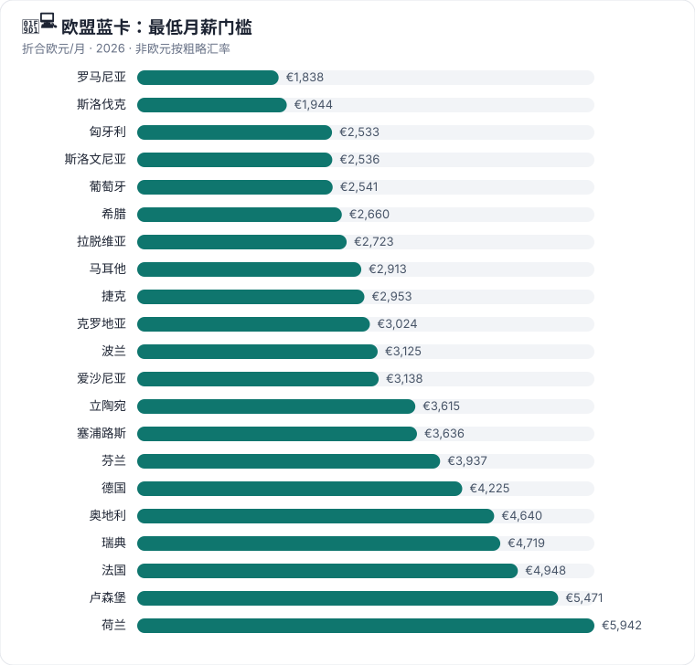

# 🧑‍💻 技术工作与欧盟蓝卡

**对普通中国人最稳的路径**：工作 → 居留 → 永居 → 入籍

[🏠 首页](../../README.md) ｜ [🇪🇺 欧洲 36 国](../europe/README.md) ｜ [🧭 选路线](choose-route.md)

## 欧盟蓝卡是什么

- 欧盟统一框架下的**高技能工作居留许可**，25 个欧盟国家参与；**丹麦和爱尔兰不参与**（它们有各自的国家路线）。
- 基本条件：≥6 个月的工作合同或 offer + 高等学历（或 5 年同等经验，ICT 岗位通常 3 年）+ 薪资达到该国门槛（欧盟规定门槛设计不得高于平均工资 1.6 倍）+ 医保。
- 优势：**欧盟内流动**（在第一国持卡 12 个月后可迁往其他成员国）、**家属团聚更快**、**欧盟长期居民年限可跨国累计**。
- 每个国家还有自己的"国家路线"（如德国技术工人签证、荷兰高技术移民、法国人才护照、奥地利红白红卡），**很多时候国家路线门槛更低、更好办**，不要只盯着蓝卡。

## 各国路线（自动生成）

<!-- AUTO:table -->
| 国家 | 路线 | 一句话 | 门槛信号 | 家属 | 永居 | 状态 |
|---|---|---|---|:-:|:-:|:-:|
| 🇷🇴 罗马尼亚 | [罗马尼亚工作签证和居留许可](../europe/romania.md#romania-work-visa-residence-permit) | 2026 新框架下的 D/AM 工作签证；普通岗位多需在紧缺职业清单上。 | RON 4,325/月 | ✅ 可带 | ✅ 可能 | 🟢 开放 |
| 🇨🇿 捷克 | [捷克 Employee Card](../europe/czechia.md#czechia-employee-card) | 门槛最低的欧盟工作居留之一：只要最低工资、每周 15 小时，不卡学历。 | CZK 22,400/月 | ✅ 可带 | ✅ 可能 | 🟢 开放 |
| 🇬🇷 希腊 | [希腊受雇工作居留许可](../europe/greece.md#greece-dependent-employment-residence-permit) | E.4 普通受雇工作居留：雇主先获批'邀请'，员工再办国家签证。 | EUR 920/月 | ✅ 可带 | ✅ 可能 | 🟢 开放 |
| 🇵🇹 葡萄牙 | [葡萄牙受雇工作居留许可](../europe/portugal.md#portugal-subordinate-work-residence-permit) | 最普通的雇佣居留（第 88 条），只要求劳动合同合法合规。 | EUR 920/月 | ✅ 可带 | ✅ 可能 | 🟢 开放 |
| 🇵🇱 波兰 | [波兰临时居留和工作许可](../europe/poland.md#poland-temporary-residence-work-permit) | 波兰普通临时居留和工作许可，最低工资即可，最长 3 年。 | PLN 4,806/月 | ✅ 可带 | ✅ 可能 | 🟢 开放 |
| 🇷🇴 罗马尼亚 | [罗马尼亚欧盟蓝卡](../europe/romania.md#romania-eu-blue-card) | 月薪 RON 9,192（≈ €1,850）以上即可，是欧盟门槛最低的蓝卡之一。 | RON 9,192/月 | ✅ 可带 | ✅ 可能 | 🟢 开放 |
| 🇸🇰 斯洛伐克 | [斯洛伐克欧盟蓝卡](../europe/slovakia.md#slovakia-eu-blue-card) | 欧盟门槛最低的蓝卡之一：月薪 1,944 欧（近 3 年毕业生 1,620），首卡 5 年，30 天审理。 | EUR 1,944/月 | ✅ 可带 | ✅ 可能 | 🟢 开放 |
| 🇪🇪 爱沙尼亚 | [爱沙尼亚就业居留许可](../europe/estonia.md#estonia-residence-permit-for-employment) | 爱沙尼亚普通就业居留，工资达平均水平即可，首次最长 5 年。 | EUR 2,092/月 | ✅ 可带 | ✅ 可能 | 🟢 开放 |
| 🇲🇹 马耳他 | [马耳他 Specialist Employee Initiative](../europe/malta.md#malta-specialist-employee-initiative) | 年薪 3 万欧以上、有对口学历或经验的专业员工路线，15 个工作日出结果。 | EUR 30,000/年 | ✅ 可带 | ✅ 可能 | 🟢 开放 |
| 🇭🇺 匈牙利 | [匈牙利欧盟蓝卡](../europe/hungary.md#hungary-eu-blue-card) | 月薪约 100 万福林（≈ €2,550）以上的高资质岗位，首卡最长 4 年。 | HUF 1,001,048/月 | ✅ 可带 | ✅ 可能 | 🟢 开放 |
| 🇸🇮 斯洛文尼亚 | [斯洛文尼亚欧盟蓝卡](../europe/slovenia.md#slovenia-eu-blue-card) | 2025 改革后门槛降到平均工资 1 倍（EUR 2,536/月），合同只需 6 个月。 | EUR 2,536.03/月 | ✅ 可带 | ✅ 可能 | 🟢 开放 |
| 🇵🇹 葡萄牙 | [葡萄牙欧盟蓝卡](../europe/portugal.md#portugal-eu-blue-card) | 有葡萄牙高资质工作 offer 的人走蓝卡，家属免等待、可在欧盟内流动。 | EUR 30,492/年 | ✅ 可带 | ✅ 可能 | 🟢 开放 |
| 🇬🇷 希腊 | [希腊欧盟蓝卡](../europe/greece.md#greece-eu-blue-card) | E.1 高资质员工居留：年薪约 3.2 万欧以上、合同 6 个月，审理最快 30 天。 | EUR 31,918.83/年 | ✅ 可带 | ✅ 可能 | 🟢 开放 |
| 🇱🇻 拉脱维亚 | [拉脱维亚欧盟蓝卡](../europe/latvia.md#latvia-eu-blue-card) | 欧盟蓝卡门槛最低的一档：月薪 2,723 欧（紧缺职业 2,178）。 | EUR 2,723/月 | ✅ 可带 | ✅ 可能 | 🟢 开放 |
| 🇲🇹 马耳他 | [马耳他欧盟蓝卡](../europe/malta.md#malta-eu-blue-card) | 高资质岗位年薪约 3.5 万欧以上，可在欧盟内流动。 | EUR 34,956/年 | ✅ 可带 | ✅ 可能 | 🟢 开放 |
| 🇨🇿 捷克 | [捷克欧盟蓝卡](../europe/czechia.md#czechia-eu-blue-card) | 月薪约 7.4 万克朗（≈ €2,950）以上的高资质岗位，最长 3 年。 | CZK 73,823/月 | ✅ 可带 | ✅ 可能 | 🟢 开放 |
| 🇭🇷 克罗地亚 | [克罗地亚欧盟蓝卡](../europe/croatia.md#croatia-eu-blue-card) | 月薪约 3,024 欧以上的高资质岗位，2025 年修法后蓝卡最长 48 个月。 | EUR 3,024/月 | ✅ 可带 | ✅ 可能 | 🟢 开放 |
| 🇸🇪 瑞典 | [瑞典工作许可](../europe/sweden.md#sweden-work-permit) | 2026 起普通工作许可须达中位工资 90%（SEK 34,470/月），不卡学历。 | SEK 34,470/月 | ✅ 可带 | ✅ 可能 | 🟢 开放 |
| 🇵🇱 波兰 | [波兰欧盟蓝卡](../europe/poland.md#poland-eu-blue-card) | 波兰蓝卡年薪约 16 万兹罗提（月 13,355），门槛明显高于普通许可。 | PLN 160,264.08/年 | ✅ 可带 | ✅ 可能 | 🟢 开放 |
| 🇪🇪 爱沙尼亚 | [爱沙尼亚欧盟蓝卡](../europe/estonia.md#estonia-eu-blue-card) | 月薪约 3,138 欧（特定职业 2,594）以上的高资质岗位。 | EUR 3,138/月 | ✅ 可带 | ✅ 可能 | 🟢 开放 |
| 🇫🇷 法国 | [法国 Talent Qualified Employee](../europe/france.md#france-talent-qualified-employee) | 法国人才护照员工类：年薪 39,582 欧即可，首卡最长 4 年，家属专门有人才家庭卡。 | EUR 39,582/年 | ✅ 可带 | ✅ 可能 | 🟢 开放 |
| 🇮🇪 爱尔兰 | [爱尔兰 Critical Skills Employment Permit](../europe/ireland.md#ireland-critical-skills-employment-permit) | 英语国家里最好走的技术移民之一：列名职业年薪 4.09 万欧，2 年后转可自由工作的 Stamp 4。 | EUR 40,904/年 | ✅ 可带 | ✅ 可能 | 🟢 开放 |
| 🇱🇹 立陶宛 | [立陶宛欧盟蓝卡](../europe/lithuania.md#lithuania-eu-blue-card) | 月薪约 3,615 欧（紧缺职业 2,894），1 个月审理，有效期 3 年。 | EUR 3,615/月 | ✅ 可带 | ✅ 可能 | 🟢 开放 |
| 🇨🇾 塞浦路斯 | [塞浦路斯欧盟蓝卡](../europe/cyprus.md#cyprus-eu-blue-card) | 年薪 43,632 欧以上，且仅限 ICT、药企研发、海事三个行业。 | EUR 43,632/年 | ✅ 可带 | ✅ 可能 | 🟢 开放 |
| 🇲🇹 马耳他 | [马耳他 Key Employee Initiative](../europe/malta.md#malta-key-employee-initiative) | 管理或高技术岗位年薪 4.5 万欧以上的快速通道，5 个工作日出结果。 | EUR 45,000/年 | ✅ 可带 | ✅ 可能 | 🟢 开放 |
| 🇫🇮 芬兰 | [芬兰欧盟蓝卡](../europe/finland.md#finland-eu-blue-card) | 与专家许可同门槛（3,937 欧），多一个欧盟流动和 P-EU 累计优势。 | EUR 3,937/月 | ✅ 可带 | ✅ 可能 | 🟢 开放 |
| 🇫🇮 芬兰 | [芬兰专家居留许可](../europe/finland.md#finland-specialist-residence-permit) | 芬兰专家许可：月薪 3,937 欧，学历要求灵活，快速通道 2 周。 | EUR 3,937/月 | ✅ 可带 | ✅ 可能 | 🟢 开放 |
| 🇬🇧 英国 | [英国技术工作签证（Skilled Worker）](../europe/united-kingdom.md#uk-skilled-worker) | 英国最主流的工作移民路线：持牌雇主担保、学士级岗位、年薪 41,700 英镑起。 | GBP 41,700/年 | ✅ 可带 | ✅ 可能 | 🟢 开放 |
| 🇩🇪 德国 | [德国欧盟蓝卡](../europe/germany.md#germany-eu-blue-card) | 欧洲最主流的技术移民路线：年薪 5.07 万欧（紧缺职业 4.59 万），IT 无学历也能办，最快 21 个月永居。 | EUR 50,700/年 | ✅ 可带 | ✅ 可能 | 🟢 开放 |
| 🇦🇹 奥地利 | [奥地利欧盟蓝卡](../europe/austria.md#austria-eu-blue-card) | 奥地利蓝卡：年薪 55,678 欧、无积分，21 个月后也可转 Plus 卡。 | EUR 55,678/年 | ✅ 可带 | ✅ 可能 | 🟢 开放 |
| 🇸🇪 瑞典 | [瑞典欧盟蓝卡](../europe/sweden.md#sweden-eu-blue-card) | 瑞典蓝卡月薪 SEK 53,625，有效期 9 个月至 4 年。 | SEK 53,625/月 | ✅ 可带 | ✅ 可能 | 🟢 开放 |
| 🇫🇷 法国 | [法国 EU Blue Card](../europe/france.md#france-eu-blue-card) | 人才护照-欧盟蓝卡：年薪 59,373 欧，高资质岗位，可欧盟流动。 | EUR 59,373/年 | ✅ 可带 | ✅ 可能 | 🟢 开放 |
| 🇱🇺 卢森堡 | [卢森堡欧盟蓝卡](../europe/luxembourg.md#luxembourg-eu-blue-card) | 门槛高（年薪 65,652 欧）但首卡就给 4 年，金融业机会多。 | EUR 65,652/年 | ✅ 可带 | ✅ 可能 | 🟢 开放 |
| 🇳🇱 荷兰 | [荷兰欧盟蓝卡](../europe/netherlands.md#netherlands-eu-blue-card) | 雇主不是认可担保人、或需要欧盟流动时选蓝卡；门槛 5,942 欧/月。 | EUR 5,942/月 | ✅ 可带 | ✅ 可能 | 🟢 开放 |
| 🇳🇱 荷兰 | [荷兰高技术移民](../europe/netherlands.md#netherlands-highly-skilled-migrant) | 雇主是 IND 认可担保人时最省事的路线，30 岁以下月薪 4,357 欧即可。 | EUR 5,942/月 | ✅ 可带 | ✅ 可能 | 🟢 开放 |
| 🇩🇰 丹麦 | [丹麦 Pay Limit Scheme](../europe/denmark.md#denmark-pay-limit-scheme) | 丹麦不签蓝卡，高薪走 Pay Limit：年薪 DKK 55.2 万，不限学历和行业。 | DKK 552,000/年 | ✅ 可带 | ✅ 可能 | 🟢 开放 |
| 🇦🇹 奥地利 | [奥地利红白红卡](../europe/austria.md#austria-red-white-red-card) | 奥地利积分制工作居留：按学历、经验、语言、年龄打分，21 个月后转可自由就业的 Plus 卡。 | — | ✅ 可带 | ✅ 可能 | 🟢 开放 |
| 🇧🇪 比利时 | [比利时欧盟蓝卡](../europe/belgium.md#belgium-eu-blue-card) | 比利时蓝卡同样按大区：布鲁塞尔 4,748 欧/月，弗拉芒 63,586、瓦隆 68,815 欧/年。 | — | ✅ 可带 | ✅ 可能 | 🟢 开放 |
| 🇧🇪 比利时 | [比利时单一许可 / 工作许可](../europe/belgium.md#belgium-single-permit-work-permit) | 工作许可按大区审批：布鲁塞尔月薪 3,703 欧、弗拉芒 4.9 万/年、瓦隆 5.3 万/年起。 | — | ✅ 可带 | ✅ 可能 | 🟢 开放 |
| 🇧🇬 保加利亚 | [保加利亚欧盟蓝卡](../europe/bulgaria.md#bulgaria-eu-blue-card) | 平均工资 1.5 倍的高资质岗位，标准有效期 5 年，雇主无外籍员工比例限制。 | — | ✅ 可带 | ✅ 可能 | 🟢 开放 |
| 🇧🇬 保加利亚 | [保加利亚单一居留和工作许可](../europe/bulgaria.md#bulgaria-single-residence-work-permit) | 保加利亚普通单一居留和工作许可，雇主外籍员工有比例上限。 | — | ✅ 可带 | ✅ 可能 | 🟢 开放 |
| 🇭🇷 克罗地亚 | [克罗地亚居留和工作许可](../europe/croatia.md#croatia-stay-and-work-permit) | 受雇于克罗地亚雇主的普通居留和工作许可，可能需劳动力市场测试。 | — | ✅ 可带 | ✅ 可能 | 🟢 开放 |
| 🇨🇾 塞浦路斯 | [塞浦路斯受雇工作 Single Permit](../europe/cyprus.md#cyprus-remunerated-employment-single-permit) | 普通雇佣单一许可（GEN）；外资公司另有月薪 2,500 欧的便利政策。 | — | ✅ 可带 | ✅ 可能 | 🟢 开放 |
| 🇭🇺 匈牙利 | [匈牙利 Hungarian Card](../europe/hungary.md#hungary-hungarian-card) | 匈牙利国家技术工作路线，与蓝卡二选一。 | — | ⚠️ 需核查 | ⏳ 偏临时 | 🟢 开放 |
| 🇮🇹 意大利 | [意大利欧盟蓝卡](../europe/italy.md#italy-eu-blue-card) | 不占年度配额的高技能雇佣路线，雇主主导递交，30 天出工作许可。 | — | ✅ 可带 | ✅ 可能 | 🟢 开放 |
| 🇱🇻 拉脱维亚 | [拉脱维亚就业居留许可](../europe/latvia.md#latvia-residence-permit-for-employment) | 普通就业居留，工资不低于行业平均。 | — | ✅ 可带 | ✅ 可能 | 🟢 开放 |
| 🇱🇹 立陶宛 | [立陶宛就业居留许可](../europe/lithuania.md#lithuania-residence-permit-for-employment) | 立陶宛普通就业居留，2024 年起在立陶宛工作必须持本国居留。 | — | ⚠️ 需核查 | ✅ 可能 | 🟢 开放 |
| 🇲🇹 马耳他 | [马耳他 Single Permit](../europe/malta.md#malta-single-permit) | 马耳他普通雇佣居留，适用于不符合 KEI/SEI/蓝卡的本地工作。 | — | ✅ 可带 | ✅ 可能 | 🟢 开放 |
| 🇵🇹 葡萄牙 | [葡萄牙高度合格活动居留许可](../europe/portugal.md#portugal-highly-qualified-activity-residence-permit) | 第 90 条高度合格活动居留（含认证企业的 Tech Visa），薪资和学历要求介于普通工作和蓝卡之间。 | — | ✅ 可带 | ✅ 可能 | 🟢 开放 |
| 🇸🇰 斯洛伐克 | [斯洛伐克就业临时居留](../europe/slovakia.md#slovakia-temporary-residence-for-employment) | 斯洛伐克最常见的就业居留（单一许可），60 天审理。 | — | ✅ 可带 | ✅ 可能 | 🟢 开放 |
| 🇸🇮 斯洛文尼亚 | [斯洛文尼亚单一居留和工作许可](../europe/slovenia.md#slovenia-single-residence-and-work-permit) | 普通单一居留和工作许可，换工作须事先书面批准。 | — | ✅ 可带 | ✅ 可能 | 🟢 开放 |
| 🇩🇪 德国 | [德国机会卡（Chancenkarte）](../europe/germany.md#germany-opportunity-card) | 没有 offer 也能先去德国找工作：积分 ≥6 分，最长 1 年，期间可兼职每周 20 小时。 | — | ⚠️ 需核查 | ⏳ 偏临时 | 🟢 开放 |
| 🇩🇪 德国 | [德国技术工人签证（§18a / §18b）](../europe/germany.md#germany-skilled-worker-18a-18b) | 有德国 offer 但达不到蓝卡薪资时的主要选择；45 岁以下没有固定薪资门槛，3 年可永居。 | — | ✅ 可带 | ✅ 可能 | 🟢 开放 |
| 🇬🇧 英国 | [英国全球人才签证（Global Talent）](../europe/united-kingdom.md#uk-global-talent) | 科研、数字技术、艺术、设计等领域顶尖或潜力人才，无需雇主，最长 5 年，可快速永居。 | — | ✅ 可带 | ✅ 可能 | 🟢 开放 |
| 🇬🇧 英国 | [英国高潜力人才签证（HPI）](../europe/united-kingdom.md#uk-hpi) | 全球前约 100 名大学近 5 年毕业生可直接申请 2 年开放工作签证，无需 offer。 | — | ✅ 可带 | ⏳ 偏临时 | 🟢 开放 |
<!-- /AUTO -->

## 欧盟蓝卡薪资门槛排行（2026，按折合欧元月薪从低到高）

| 国家 | 官方门槛 | 折合 ≈ EUR/月 | 备注 |
|---|---|---|---|
| 🇷🇴 罗马尼亚 | RON 9,192/月 | 1,850 | 2026 新 D/AM 框架 |
| 🇸🇰 斯洛伐克 | EUR 1,944/月 | 1,944 | 近 3 年毕业生 EUR 1,620；首卡 5 年 |
| 🇸🇮 斯洛文尼亚 | EUR 2,536/月 | 2,536 | 2025 改革后 = 平均工资 1 倍 |
| 🇵🇹 葡萄牙 | EUR 30,492/年 | 2,541 | |
| 🇭🇺 匈牙利 | HUF 1,001,048/月 | 2,550 | 首卡最长 4 年 |
| 🇬🇷 希腊 | EUR 31,918.83/年 | 2,660 | 1.6 倍公式 |
| 🇱🇻 拉脱维亚 | EUR 2,723/月 | 2,723 | 紧缺职业 EUR 2,178 |
| 🇲🇹 马耳他 | EUR 34,956/年 | 2,913 | KEI EUR 45,000/年，审理 5 个工作日 |
| 🇨🇿 捷克 | CZK 73,823/月 | 2,950 | 员工卡只要最低工资 |
| 🇭🇷 克罗地亚 | EUR 3,024/月 | 3,024 | 最长 48 个月 |
| 🇵🇱 波兰 | PLN 160,264/年 | 3,100 | 普通许可 PLN 4,806/月 |
| 🇪🇪 爱沙尼亚 | EUR 3,138/月 | 3,138 | 特定职业 1.24 倍 |
| 🇱🇹 立陶宛 | 约 EUR 3,615/月 | 3,615 | 紧缺职业 EUR 2,894 |
| 🇨🇾 塞浦路斯 | EUR 43,632/年 | 3,636 | 仅限 ICT、药企研发、海事 |
| 🇫🇮 芬兰 | EUR 3,937/月 | 3,937 | 与专家许可相同，快速通道 2 周 |
| 🇩🇪 德国 | EUR 50,700/年 | 4,225 | 紧缺/应届/IT 无学历 EUR 45,934.20 |
| 🇦🇹 奥地利 | EUR 55,678/年 | 4,640 | 红白红卡积分制可替代 |
| 🇸🇪 瑞典 | SEK 53,625/月 | 4,700 | 普通许可 SEK 34,470/月 |
| 🇧🇪 比利时 | 布鲁塞尔 EUR 4,748/月；弗拉芒 63,586/年；瓦隆 68,815/年 | 4,748–5,735 | 按大区 |
| 🇫🇷 法国 | EUR 59,373/年 | 4,948 | 人才护照员工类 EUR 39,582/年 |
| 🇱🇺 卢森堡 | EUR 65,652/年 | 5,471 | 首卡 4 年 |
| 🇳🇱 荷兰 | EUR 5,942/月 | 5,942 | HSM 30 岁以下 EUR 4,357 |

> 汇率为 2026 年粗略值，仅用于横向比较；年薪按 12 个月折算（奥地利等 14 薪国家实际月薪更低）。

## 不参与蓝卡的国家

| 国家 | 替代路线 | 门槛 |
|---|---|---|
| 🇮🇪 爱尔兰 | Critical Skills Employment Permit | EUR 40,904/年（列名职业），2 年后转 Stamp 4 |
| 🇩🇰 丹麦 | Pay Limit Scheme / 正面清单 / Fast-track | DKK 552,000/年 |
| 🇬🇧 英国 | Skilled Worker | 永居时年薪 ≥ GBP 41,700 |
| 🇨🇭 瑞士 | 配额制工作许可 | 雇主主导，第三国国民门槛高 |
| 🇳🇴 挪威 | Skilled worker 许可 | 需挪威雇主 offer |

## 实操建议

1. **先找工作，再谈签证**。蓝卡/工作许可都以雇主 offer 为前提，LinkedIn、各国官方求职门户（如德国 Make it in Germany、EURES）是起点。
2. **学历认证尽早做**：德国查 anabin / ZAB，意大利 CIMEA，荷兰 Nuffic 等。
3. **永居最快的几个**：德国蓝卡（B1 德语 21 个月）、奥地利（21 个月转 Plus 卡）、日本高度人才 80 分（1 年，见全球篇）。
4. **想入籍**先看各国入籍年限和双重国籍政策（中国不承认双重国籍，入外籍即自动丧失中国国籍）。
